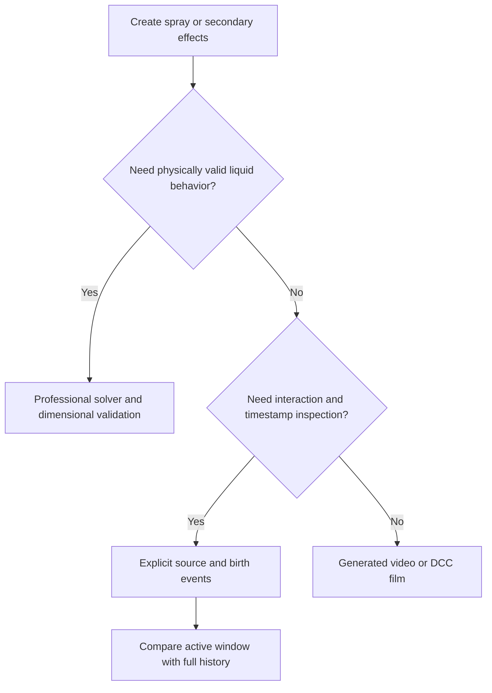
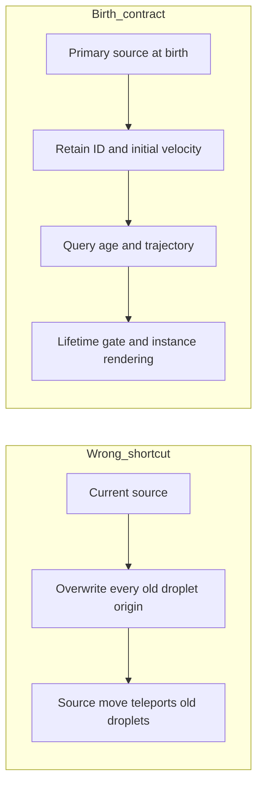
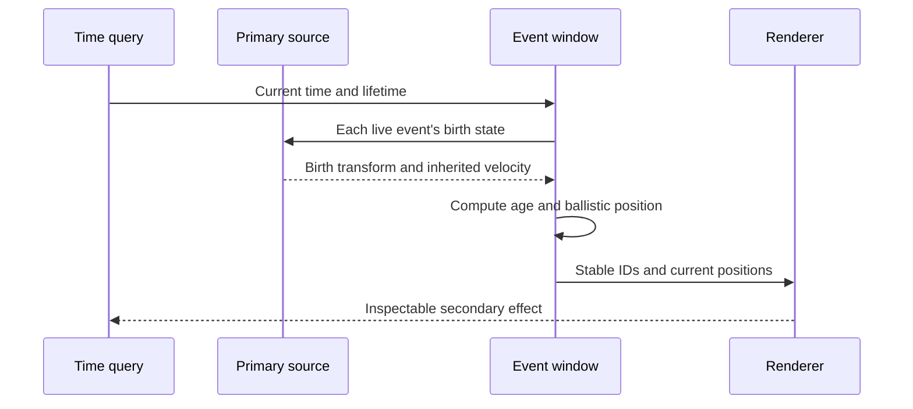

# Secondary effects should not teleport with the current source: a birth-aware FX FAQ

**Three minutes for selection; ten minutes to reproduce seekable spray.**

[中文](birth-aware-secondary-fx-faq.md) · [Interactive demo](https://turbo998.github.io/animation/demos/secondary-spray-rig/) · [Measured cards](../demos/secondary-spray-rig/test-report-cards.html)

## ① 📌 Executive Summary

- **Primary motion and secondary detail are separate layers.** A water body's shape and foam/spray detail are not the same state. Each secondary event needs its own birth time and transform. This demo simulates a nozzle and simple ballistic droplets, not a real liquid body.
- **Birth transforms must not become current-source transforms.** Moving a nozzle cannot teleport droplets already in flight. At the tested 4.5-second query, the deliberately wrong baseline produces approximately 0.530330 mean horizontal scene-unit discrepancy.
- **Query events that are still alive.** Avoid scanning from the first historic droplet, while requiring optimized IDs, birth times and positions to equal the complete-history reference.
- **A new original 59-solid bench with twelve local checks.** Scene: `synthetic`; local code and Node CPU query: `measured`; Maxon software, full fluids, generated video and GPU time: `not_measured`.

**Verified daily direction:** Maxon's October 14, 2026 Cinema 4D 2027.0 release added Liquid FX foam, spray and bubbles driven by the underlying liquid behavior. The direction is **coupled secondary detail**, not merely more particles. Retrieved November 9, 2026; no verified same-day popularity ranking and no claim of today's launch or vendor implementation reproduction.

## ② 🎯 Customer and architect Q&A

### Q1 When should I choose AI video versus code-driven interactive animation?

Photographic surf, beer foam, performances and atmosphere can favor generated video or professional DCC fluid rendering. Customers who need to inspect 4.5 seconds, edit source motion and examine each droplet's identity favor explicit editable state.

Combine layers when useful: a solver or model handles appearance; preserve source/events and the acceptance contract separately. **Attractive pixels do not certify internal particle state.** No model quality is measured here.

### Q2 Under which explicit constraints is code strictly better?

Exact timestamp revisits, stable birth timing under reseeding, lifetime-bounded resources and inspectable local changes can be directly exposed and compared. That is an acceptance-specific advantage, not a blanket claim over artistic video.

Useful SA applications include equipment explainers, secondary-FX authoring prototypes and reproducible interactive demonstrations. **Not for real spray safety, firefighting hydraulics or aerosol spread:** the prototype lacks drag, droplet collisions, airflow and real-dimensional calibration.

### Q3 How does the pipeline make secondary motion smooth and controllable?

Think of a nozzle as a moving post office and each droplet as a posted parcel. Parcels retain the departure time, address and initial velocity. Relocating the post office does not rewrite parcels already dispatched.

Assign events at fixed birth intervals, then query the source transform and inherited velocity **at birth**. A later query computes age and a simple initial-velocity/downward-acceleration trajectory. This is a ballistic illustration, not a complete fluid algorithm.

Naive frame-by-frame accumulation mixes display cadence, random draws and inherited state. Absolute-time queries allow reverse inspection but still cost computation and rendering. The active window enumerates events born after “now minus lifetime”; the independent full-history scan is the correctness reference. Birth/death boundaries must not be skipped for speed.

Lifetime is a delivery contract. Here events leave within at most one second while above the tray. Disappearance is not a solved impact, rebound, splash or foam simulation.

### Q4 How can I reproduce it in ten minutes?

1. Run `npm run dev`, open `/demos/secondary-spray-rig/`, and inspect 4.5 seconds.
2. Toggle birth-source versus deliberately wrong current-source mode. Compare the same IDs, not newly randomized points.
3. Seek forward and backward to 4.5 seconds; birth-mode positions must be identical.
4. Change the seed for trajectory detail. Fixed rate/lifetime preserve IDs and birth timestamps.
5. Apply a fractional rate of 1.5, expect explicit rejection, and export actual state as `SECONDARY_EVENTS.json`.
6. Run `npx vitest run tests\secondary-spray.test.ts`; after building and previewing at 4335, run `node scripts\benchmark-secondary-spray.mjs`.

## ③ 🧭 Visual explanations

## ④ 📊 Architect Decision Matrix

| Acceptance requirement | Generated video | Complete DCC fluids | Local ballistic events | Current-source shortcut |
| --- | --- | --- | --- | --- |
| Real foam and bubbles | Appearance review | Professional direction; tuning needed | Not implemented | Not implemented |
| Exact birth identity and seeking | Usually opaque film state | Keep project and cache | Explicit queries/tests | Old events teleport |
| Frame-cadence independence | Evaluate separately | Solver steps/cache matter | Absolute-time state | Current source is not history |
| Long-history query cost | Model/editing costs | Implementation-dependent | Bounded active window | Fast wrongness is not acceptable |
| Safety simulation | Pixels cannot certify | Professional validation needed | Explicitly unsuitable | Explicitly unsuitable |

**Count example:** 16 births per second and one-second lifetime yield 16 observed live events at 4.5 seconds. A 3600-second source history contains approximately 57,600 earlier birth instants, but display needs only live events. Logical work is not GPU bytes, nor can allocated buffer capacity be inferred from active count.

## ⑤ 🧪 New demo and measured findings, including seven cards

The [sealed report](../demos/secondary-spray-rig/report.json) separates history equality, birth-reference error, reverse visits, seeded timing invariance, invalid-input rejection and cached geometry counts. Approximately 0.530330 mean discrepancy is a scene-coordinate measurement, not video pixels or physical meters.

Three history tiers retain seven CPU repeats each, 500 queries per run, alternating algorithm order after warmup. Both return identical events. All samples remain available; missing values are never coerced to zero.

| History length | Active-window median | Full-history scan median |
| --- | --- | --- |
| 60 seconds | 2.916 ms | 3.408 ms |
| 600 seconds | 1.262 ms | 6.141 ms |
| 3600 seconds | 0.593 ms | 30.015 ms |

These are Node CPU queries, not individual rendered frames, inference, display latency or Maxon performance. The short tier includes JIT/system variation; a smaller later median does not mean longer history intrinsically makes the window faster.

[English cards](../demos/secondary-spray-rig/test-report-cards.html) · [中文七卡](../demos/secondary-spray-rig/test-report-cards.zh.html). Synthetic illustration and measured local code remain distinct; commercial software and real fluids are unexecuted.

## ⑥ 🛠️ Architect Checklist

- [ ] Separate primary liquid shape and secondary foam/spray detail.
- [ ] Retain birth transforms and inherited velocity rather than replacing them with current source.
- [ ] Define stable event IDs, seed, units, rate and lifetime.
- [ ] Test exact births, deaths and fractional timestamps.
- [ ] Compare every optimized event with the complete-history reference.
- [ ] Revisit identical states forward, backward and with different access cadence.
- [ ] Do not equate lifetime expiry with solved collision.
- [ ] Check invalid inputs, resource bounds, reduced motion and offscreen freezing.
- [ ] Accept CPU, GPU, video quality and physical safety separately.
- [ ] Mark unexecuted software/models as unmeasured and retain source dates.

**Primary source:** [Maxon Fall 2026 release](https://www.maxon.net/en/article/maxon-fall-2026-release-faster-workflows-more-creative-control), October 14, 2026; retrieved November 9, 2026. Liquid FX adds secondary foam, spray and bubbles coupled to underlying liquids. This prototype illustrates layering, not the commercial implementation or its performance.
