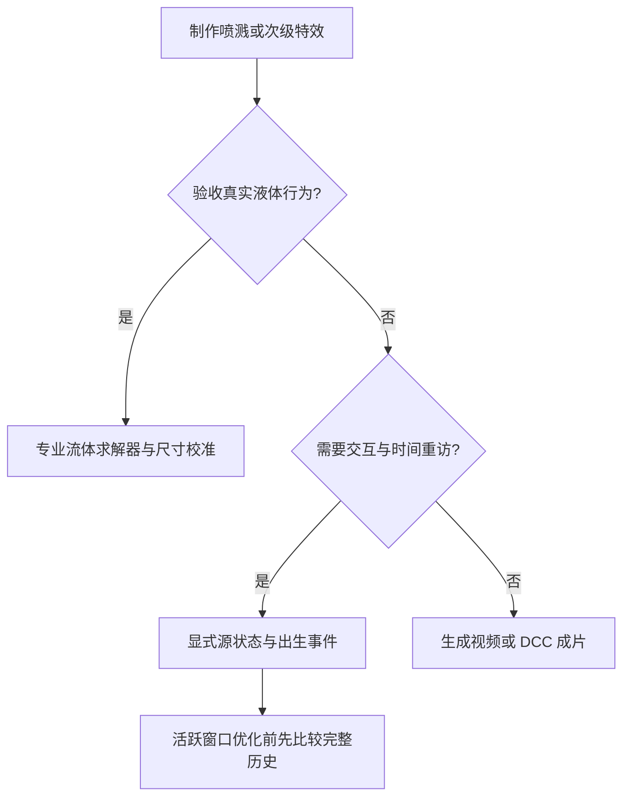
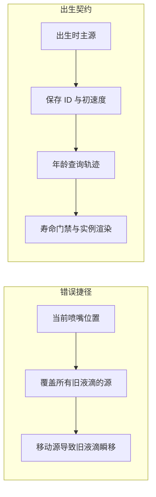
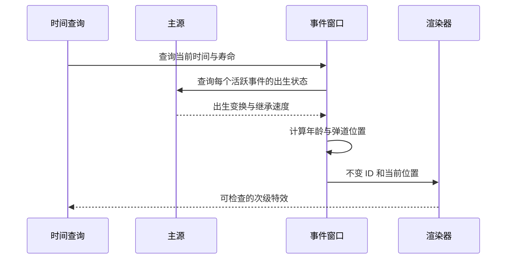

# 次级特效不应跟着当前源瞬移：出生变换与活跃时间窗选型 FAQ

**3 分钟看懂选型，10 分钟复刻可倒查的喷溅。**

[English](birth-aware-secondary-fx-faq.en.md) · [交互 Demo](https://turbo998.github.io/animation/demos/secondary-spray-rig/) · [中文七卡](../demos/secondary-spray-rig/test-report-cards.zh.html)

## ① 📌 核心结论速览

- **主运动与次级细节是两个层次。** 水的主体形状与泡沫、飞溅细节不是同一份状态；次级事件需要记录自己什么时候、在哪里出生。本例只演示喷嘴与弹道液滴，不计算真实水体。
- **出生时的变换不能被当前源替换。** 喷嘴移动后，已经飞出去的液滴不会跟着它瞬移。在 4.5 秒示例中，故意错误的“当前喷嘴”基线产生约 0.530330 示意单位的平均横向偏移。
- **只查询仍然活着的事件。** 不必每次从第一个历史液滴开始扫描；但优化后的 ID、出生时间与轨迹必须和完整历史参考完全一致。
- **全新 59 实体工作台，12 项本机验收。** 示意场景 `synthetic`，代码与 CPU 查询 `measured`；Maxon 软件、完整流体、生成视频与 GPU 时间 `not_measured`。

**每日能力方向核验：** Maxon 在 2026-10-14 发布的 Cinema 4D 2027.0 Liquid FX 为液体模拟自动添加随底层液体行为变化的泡沫、喷雾与气泡。关键方向是**把次级细节关联到主运动**，不只是增加粒子数量。本次检索为 2026-11-09；没有可核验的当天热度榜，不声称今天首发或复现了该商业实现。

## ② 🎯 客户与架构师灵魂拷问 Q&A

### Q1 何时选 AI 视频大模型，何时选代码驱动交互动画？

想要逼真的海浪、啤酒泡沫、人物表演和氛围，生成视频或专业 DCC 流体渲染值得评估。想让客户拖到 4.5 秒、换喷嘴轨迹、检查每个液滴 ID 与出生位置，则需要显式可编辑的代码状态。

两者可以组合：用专业求解器或模型制作外观，另外保存源、事件与验收契约。**漂亮视频并不能自动证明内部粒子状态正确。** 本轮没有测模型画质。

### Q2 什么约束下代码驱动严格更优？

当验收要求任意时间重访一致、种子变化不改变出生时间、资源受寿命约束、局部改变可核验时，代码能直接暴露这些状态并自动比较。只看成片、无需交互的艺术镜头不适用这个绝对结论。

适合 SA 的设备原理讲解、次级特效创作工具原型、可复现的交互演示。**不适合拿这份轨迹去设计真实喷雾安全、消防水力或气溶胶扩散**；没有阻力、液滴碰撞、空气流场或实际尺寸校准。

### Q3 管线底层怎么让喷溅既丝滑又可控？

把喷嘴看作移动的邮局，把每个液滴看作寄出的包裹。包裹记录出发时刻、地址与初速度；邮局搬家不会改已经寄出的包裹的出发地址。

本例先按固定时间节奏分配事件 ID，再在**出生时**查询喷嘴位置和继承速度。查看一个时间点时，计算液滴已经活了多久，用初速度和向下加速求当前位置。这里是简单弹道，不是“完整流体看起来像水”的算法。

传统逐帧累加容易把帧率、随机抽样和旧状态混在一起。按时间查询能倒查，但仍需付出查询与渲染成本。活跃窗口只枚举“当前时间减寿命”之后的事件，完整历史扫描是独立正确性参考。边界时间照样验证，不能为了快漏掉刚出生或刚过期的事件。

寿命也是交付契约：本例最大一秒，液滴在托盘上方退出。消失不是已经求解了真实落地反弹、溅射或泡沫；这些是另一个系统。

### Q4 怎么在十分钟内复刻？

1. `npm run dev` 后打开 `/demos/secondary-spray-rig/`，点“核验”查看 4.5 秒。
2. 切换“出生变换”与“错误当前源基线”；同一 ID 的横向位置出现差异，而不是换了一批随机点。
3. 拖时间滑块前后重访 4.5 秒；出生模式的事件位置应完全相同。
4. 换种子改变轨迹细节；固定速率与寿命时，ID 与出生时间保留。
5. 输入非整数速率 1.5 后应用，观察明确拒绝与有效状态保留。导出 `SECONDARY_EVENTS.json` 留下实际状态。
6. 执行 `npx vitest run tests\secondary-spray.test.ts`；构建并预览于 4335 后执行 `node scripts\benchmark-secondary-spray.mjs`。

## ③ 🧭 直观可视化图解

## ④ 📊 Architect Decision Matrix

| 验收要求 | 生成视频 | 完整 DCC 流体 | 本例弹道事件 | 错误当前源捷径 |
| --- | --- | --- | --- | --- |
| 真实泡沫与气泡 | 需要画质审查 | 专业方向，仍需调参 | 没有实现 | 没有实现 |
| 精确出生身份与倒查 | 成片通常不暴露 | 保留项目与缓存 | 显式查询与测试 | 旧粒子随源瞬移 |
| 帧率变化后状态一致 | 需单独评估 | 求解步长与缓存决定 | 按绝对时间查询 | 当前源不能代表历史 |
| 长历史查询成本 | 模型与剪辑成本 | 依实现与缓存 | 活跃窗口有界 | 快但错误不应验收 |
| 安全工程仿真 | 不能据像素认证 | 需专业验证 | 明确不适用 | 明确不适用 |

**数量算例：** 每秒 16 个事件、寿命一秒，4.5 秒时实际活跃 16 个。完整 3600 秒历史已存在约 57,600 个过去出生时刻，但展示只需要活跃事件。逻辑工作量不是显存字节，GPU 缓冲实际容量也不能只按活跃数量猜测。

## ⑤ 🧪 全新 Demo 与 Benchmark 核心发现（含 7-Card）

[封存数据](../demos/secondary-spray-rig/report.json)分开记录历史等价、出生基线偏移、逆序重访、换种子时间不变量、无效参数拒绝与资源对象数量。平均偏移约 0.530330 是示意坐标，不是视频像素误差或物理米。

CPU 三档历史长度各重复七次，每次 500 次查询，预热后交替算法顺序。优化与完整历史返回相同事件；原始重复保留，不挑最快或把未测数据填零。

| 历史长度 | 活跃窗口中位数 | 完整历史扫描中位数 |
| --- | --- | --- |
| 60 秒 | 2.916 ms | 3.408 ms |
| 600 秒 | 1.262 ms | 6.141 ms |
| 3600 秒 | 0.593 ms | 30.015 ms |

这是 Node CPU 查询，而不是一帧绘制、模型推理、屏幕延迟或 Maxon 软件速度。短档样本含 JIT 与系统扰动；不能把时间窗中位数较小误解成历史越长越快。

[中文七卡](../demos/secondary-spray-rig/test-report-cards.zh.html) · [English](../demos/secondary-spray-rig/test-report-cards.html)。合成场景与本机实测严格分层；商业产品与真实流体未执行。

## ⑥ 🛠️ Architect Checklist

- [ ] 先区分主液体形状与次级泡沫、飞溅细节。
- [ ] 保存出生时源变换和继承速度，不覆盖成当前源。
- [ ] 固定事件 ID、随机种子、单位、速率与寿命。
- [ ] 在刚出生、刚过期和分数时间检查活跃窗口。
- [ ] 优化结果与完整历史参考逐项相同。
- [ ] 正序、逆序和不同访问节奏重访同一状态。
- [ ] 明确寿命退出不等于求解真实碰撞。
- [ ] 检查无效参数、资源上界、减少动态与离屏停帧。
- [ ] CPU、GPU、视频质量、物理安全分别验收。
- [ ] 未运行商业软件与模型时，标为未测并保留来源日期。

**一手来源：** [Maxon Fall 2026 release](https://www.maxon.net/en/article/maxon-fall-2026-release-faster-workflows-more-creative-control)，2026-10-14；2026-11-09 检索。Liquid FX 支持由底层液体驱动的泡沫、喷雾与气泡。本例仅受分层思想启发，不复制商业实现或借用其性能。
