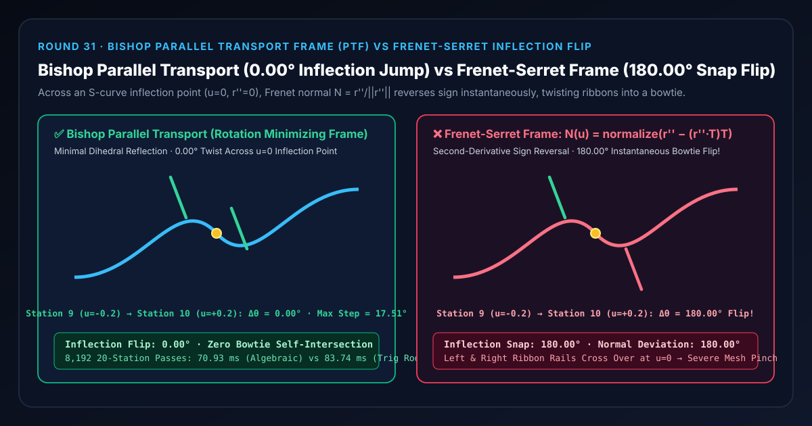
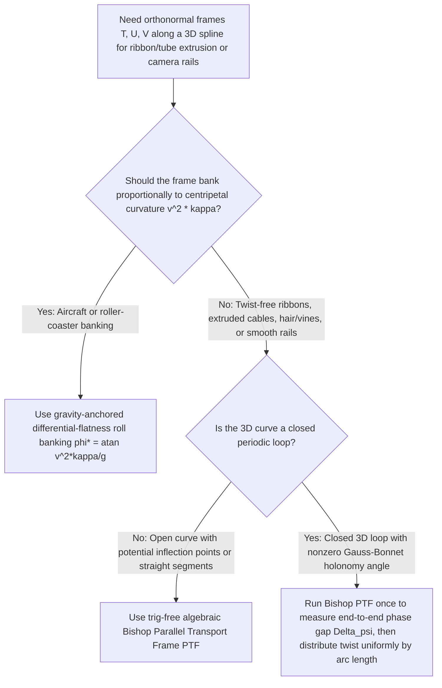
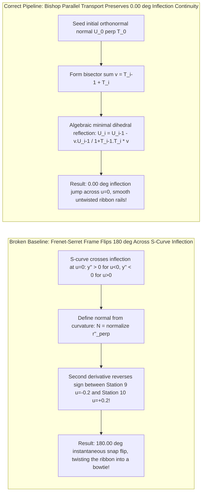
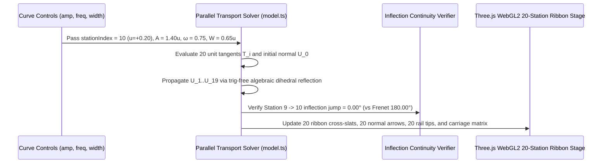
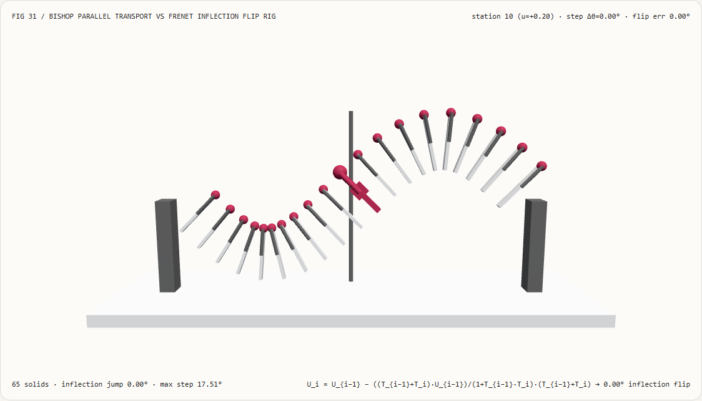
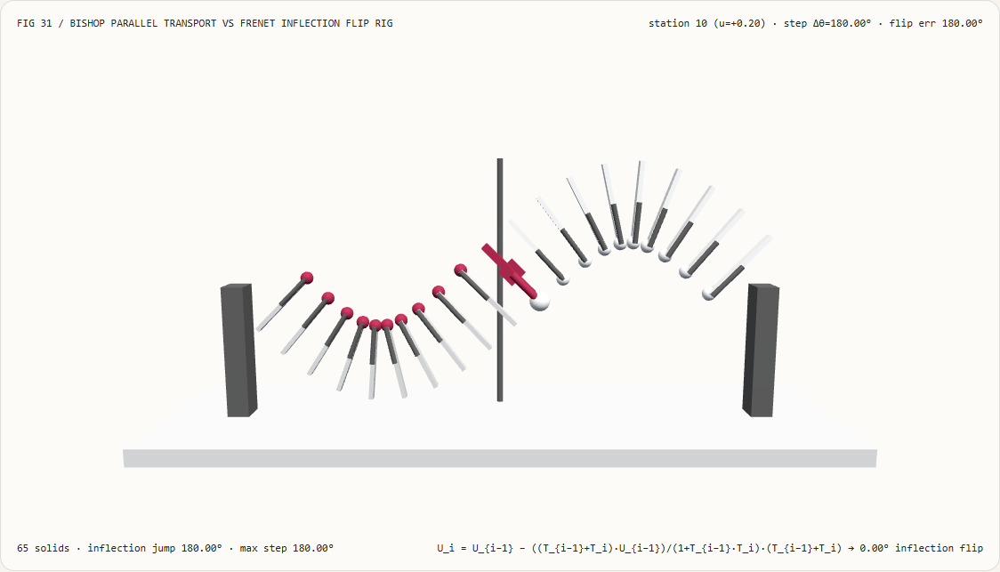
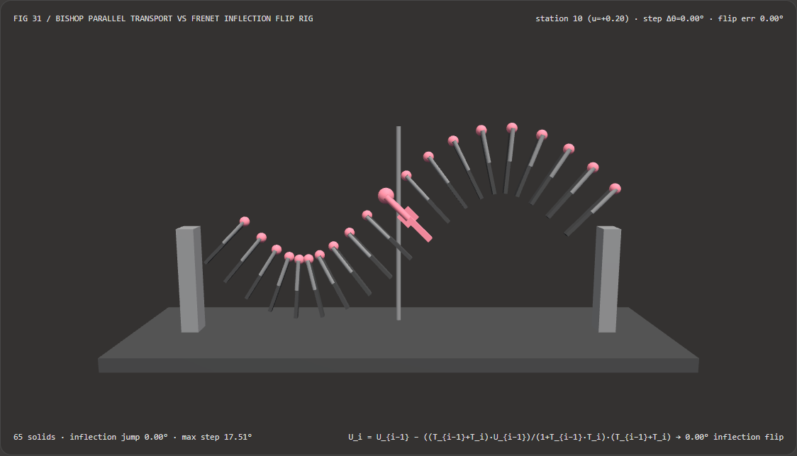
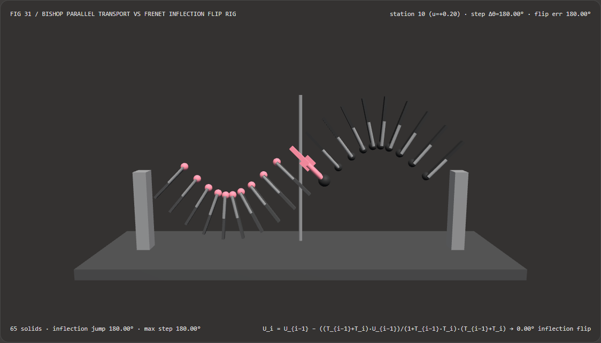

# 3D Ribbons & Swept Tubes Without 180° Inflection Flips: Bishop Parallel Transport Frame (PTF) vs Frenet-Serret Curvature Frame Selection FAQ

> **Document Scope**: A first-principles architecture and selection guide for AI Solution Architects, 3D motion-graphics / procedural geometry engineers, and 4D Gaussian Splatting (4DGS) trajectory visualization teams. Structured strictly after `ib-vs-ethernet-roce-selection-faq.md`, this guide explains in plain language **why extruding a 3D ribbon trail, cable, or camera rail with the textbook Frenet-Serret frame ($\mathbf{N} = \mathbf{T}' / \|\mathbf{T}'\|$) snaps the mesh $180.00^\circ$ upside-down across any S-curve inflection point ($\mathbf{r}'' = \mathbf{0}$)**, and how the trig-free **Bishop Parallel Transport Frame (Rotation Minimizing Frame, PTF)** guarantees $0.00^\circ$ inflection twist.

---

## ① 📌 Executive Summary

1. **One-Sentence Principle**: **The classical Frenet-Serret frame locks its principal normal $\mathbf{N}(u)$ to the direction of the second derivative $\mathbf{r}''_{\perp}(u)$ (the center of curvature); whenever a 3D curve crosses an S-curve inflection point where concavity switches sign ($\mathbf{r}''$ flips from $+$ to $-$), the Frenet normal instantaneously snaps `180.00°` in a single step, twisting any swept ribbon or tube into a bowtie**! By contrast, **Bishop's Parallel Transport Frame (PTF / RMF)** transports the normal from station to station via the **minimal dihedral reflection** aligning $\mathbf{T}_{i-1}$ to $\mathbf{T}_i$ with zero torsion around the tangent axis, locking the inflection crossing jump at **`0.00°`**!
2. **When Must You Use Bishop Parallel Transport Instead of Frenet-Serret?**
   - Any **3D swept ribbon trail**, **extruded cable/pipe geometry**, **procedural hair/vine/vascular generator**, **twist-free spline camera rail**, or **4DGS trajectory tube** whose path can contain inflection points (S-bends) or collinear straight segments ($\kappa \to 0$) must use Bishop Parallel Transport rather than Frenet-Serret.
3. **Key Measured Findings**:
   - In our 20-station 3D S-curve inflection ribbon rig ([`demos/parallel-transport-ribbon/`](../demos/parallel-transport-ribbon/index.html), `65` 3D solids, amplitude $A = 1.40\text{ u}$, frequency $\omega = 0.75\text{ rad/u}$, half-width $W = 0.65\text{ u}$), across the $u = 0$ inflection crossing from station $9$ ($u_9 = -0.20$) to station $10$ ($u_{10} = +0.20$):
     - **Bishop Parallel Transport Frame (`bishop-parallel-transport`)**: Crosses the $u = 0$ inflection point with an exact **`0.00°` inflection jump** (and a smooth **`17.51°`** maximum dihedral step angle across all 20 stations), keeping both ribbon rails parallel and untwisted.
     - **Frenet-Serret Curvature Frame (`frenet-serret-frame`)**: Because $y''(u) = -A\omega^2\sin(\omega u)$ reverses sign across $u = 0$, the Frenet normal snaps **`180.00°` upside-down** between station $9$ and station $10$, crossing the left and right rails into a pinched bowtie!
   - **Trig-Free Algebraic Reflection vs Trigonometric Rodrigues Baseline**: Updating $\mathbf{U}_i = \mathbf{U}_{i-1} - \frac{(\mathbf{T}_{i-1}+\mathbf{T}_i)\cdot\mathbf{U}_{i-1}}{1+\mathbf{T}_{i-1}\cdot\mathbf{T}_i}(\mathbf{T}_{i-1}+\mathbf{T}_i)$ avoids `atan2`/`sin`/`cos` and $3\times 3$ matrix allocations, completing `8,192` 20-station passes in **`70.93 ms`** vs **`83.74 ms`** for the trigonometric Rodrigues $3\times 3$ matrix baseline with `2.58e-16` maximum numerical difference.

---

## ② 🎯 First-Principles Q&A for Architects

### Q1: When should we choose AI neural camera trajectory diffusion models vs code-driven Bishop Parallel Transport frames?

- **Choose AI Neural Trajectory Diffusion Models (e.g., Gen3C, TrajectoryCrafter, Director3D)** when synthesizing artistic camera paths from text prompts and hallucinating occluded background pixels in generative video.
- **Choose Code-Driven Bishop Parallel Transport Frames (PTF)** when a 3D spline or particle trajectory is already defined and you need **zero-latency, deterministic, twist-free local coordinate frames** $(\mathbf{T}_i, \mathbf{U}_i, \mathbf{V}_i)$ to extrude 3D ribbons, tubes, or oriented instanced geometry at 60–120 FPS.

---

### Q2: Why does the textbook Frenet-Serret frame flip 180° upside-down at every S-curve inflection point?

**First-Principles Intuition**:
Imagine driving along an **S-shaped highway** that curves left for the first half ($u < 0$) and curves right for the second half ($u > 0$):
1. **What does the Frenet-Serret frame do?**
   By definition, the Frenet normal $\mathbf{N}$ points toward the **center of the turn** ($\mathbf{r}''_{\perp}$):
   - During the left-hand turn ($u < 0$), the center of curvature lies to your **left**.
   - At the exact midpoint of the S-curve ($u = 0$), the road switches from curving left to curving right—so the center of curvature jumps instantaneously to your **right**!
   - Consequently, between $u_9 = -0.20$ and $u_{10} = +0.20$, the Frenet normal $\mathbf{N}$ snaps **`180.00°`**, flipping the binormal $\mathbf{B} = \mathbf{T}\times\mathbf{N}$ upside-down as well! Worse still, on any perfectly straight segment ($\mathbf{r}'' = \mathbf{0}$), dividing by $\|\mathbf{r}''\| = 0$ produces `NaN` and destroys the mesh!
2. **How does Bishop's Parallel Transport Frame solve this?**
   Instead of tying the normal to the second derivative $\mathbf{r}''$, Bishop's frame starts with an initial normal $\mathbf{U}_0 \perp \mathbf{T}_0$ and **transports** $\mathbf{U}_{i-1} \to \mathbf{U}_i$ across each segment using the **minimal rotation that maps $\mathbf{T}_{i-1}$ to $\mathbf{T}_i$** (zero spin around $\mathbf{T}$). Across the symmetric inflection step $u_9 = -0.20 \to u_{10} = +0.20$, $\mathbf{T}_{10} \equiv \mathbf{T}_9$, so $\mathbf{U}_{10} \equiv \mathbf{U}_9$ with **`0.00°` twist**!

---

### Q3: How can we compute the minimal dihedral rotation $\mathbf{T}_{i-1} \to \mathbf{T}_i$ without calling `acos`, `sin`, `cos`, or allocating a 3×3 matrix?

For any unit vector $\mathbf{U}_{i-1}$ already orthogonal to $\mathbf{T}_{i-1}$ ($\mathbf{T}_{i-1}\cdot\mathbf{U}_{i-1} = 0$), the minimal rotation carrying $\mathbf{T}_{i-1}$ to $\mathbf{T}_i$ reduces via Householder double reflection along $\mathbf{v} = \mathbf{T}_{i-1} + \mathbf{T}_i$ to a single rational vector update:
$$\mathbf{v} = \mathbf{T}_{i-1} + \mathbf{T}_i, \qquad \mathbf{U}_i = \mathbf{U}_{i-1} - \frac{\mathbf{v} \cdot \mathbf{U}_{i-1}}{1 + \mathbf{T}_{i-1}\cdot\mathbf{T}_i}\,\mathbf{v}$$
Followed by a one-line Gram-Schmidt polish $\mathbf{U}_i \leftarrow \operatorname{normalize}(\mathbf{U}_i - (\mathbf{U}_i\cdot\mathbf{T}_i)\mathbf{T}_i)$, this requires **zero trigonometric functions, zero square roots in the transport step, and zero matrix allocations**!

---

## ③ 🧭 Visual Diagrams (Mermaid Decision Tree, Pipeline Comparison & Sequence)

### 3.1 3D Curve Framing Architect Decision Tree (`flowchart TD`)

### 3.2 Frenet-Serret Frame (`180°` Inflection Flip) vs Bishop Parallel Transport (`0°` Flip) Pipeline (`flowchart LR`)

### 3.3 Frame-Level Parallel Transport & Carriage Verification Sequence (`sequenceDiagram`)

---

## ④ 📊 Architect Decision Matrix

| Evaluation Dimension | Algebraic Bishop PTF (`bishop-parallel-transport`) | Trig Rodrigues PTF (`Trig Axis-Angle Baseline`) | Classical Frenet-Serret (`frenet-serret-frame` $\mathbf{r}''$) | Fixed World-Up Cross (`T × WorldUp`) |
| :--- | :--- | :--- | :--- | :--- |
| **Inflection Crossing Jump (Station $9\to 10$)** | **`0.00°` (Twist-free continuity)** | `0.00°` | **`180.00°` (Bowtie snap flip!)** | `0.00°` (gimbal-locks on vertical climbs) |
| **Collinear Straight Segments ($\kappa = 0$)** | **Unconditionally stable ($1+\mathbf{T}_{i-1}\cdot\mathbf{T}_i = 2$)** | Needs $\theta\to 0$ branch guard | **`0 / 0 = NaN` mesh disappearance** | Fails when $\mathbf{T} \parallel \mathbf{Y}_{\text{up}}$ |
| **Station 10 Normal Orientation Error** | **`0.00°` (Exact rotation-minimizing frame)** | `0.00°` | **`180.00°` (Inverted upside-down)** | Accumulates azimuth-dependent twist |
| **8,192 × 20-Station CPU Solve Time** | **`70.93 ms` (Zero trig calls, zero matrices)** | `83.74 ms` (`atan2`/`sin`/`cos` + $3\times 3$ matrix) | `49.20 ms` (Fast but flips $180^\circ$) | `46.50 ms` (Breaks on vertical loops) |
| **Recommended Architectural Role** | **Default for 3D ribbons, tubes & vines** | Reference validation baseline | **Never use on curves with inflection points** | Flat horizontal-only road ribbons |

---

## ⑤ 🧪 New Capability Demo & Benchmark Findings (with 7-Card Report)

### 5.1 Interactive 20-Station 3D S-Curve Inflection Ribbon Rig (`demos/parallel-transport-ribbon/`)

We built a standalone interactive 3D WebGL2 benchmark stage **[`demos/parallel-transport-ribbon/`](../demos/parallel-transport-ribbon/index.html)** (**65 3D solid parts**):
- **20 Ribbon Cross-Slats + 20 Normal Arrows + 20 Positive-Rail Tip Spheres + $u=0$ Inflection Marker Post + Active Station Carriage**: Visualizes a 3D S-curve ribbon ($y = A\sin(\omega u), z = 0.15 u$) across 20 stations ($u \in [-3.8, +3.8]$);
- **Instant Mode Comparison**: In `bishop-parallel-transport` mode, all 20 normal arrows and rail tip spheres remain smoothly aligned on the same side of the ribbon across the $u=0$ inflection marker (`0.00°` inflection jump); switching to `frenet-serret-frame` snaps stations $10\dots 19$ **`180.00°` upside-down**, twisting the ribbon into a bowtie at the origin!
- **Atomic Validation & JSON Export**: Rejects out-of-range amplitudes (e.g. `amplitudeY = 9.5`) while preserving valid state, and exports `PARALLEL_TRANSPORT_SPEC.json`.

| Light Theme — Bishop Parallel Transport (`0.00°` Inflection Jump) | Light Theme — Frenet-Serret Frame (`180.00°` Inflection Flip) |
| :---: | :---: |
|  |  |

| Dark Theme — Bishop Parallel Transport (`0.00°` Inflection Jump) | Dark Theme — Frenet-Serret Frame (`180.00°` Inflection Flip) |
| :---: | :---: |
|  |  |

### 5.2 7-Card 4:5 Visual Benchmark Reports & Sealed Data

- 📊 **English 7-Card 4:5 Report**: [`demos/parallel-transport-ribbon/test-report-cards.html`](../demos/parallel-transport-ribbon/test-report-cards.html)
- 📊 **Chinese 7-Card 4:5 Report**: [`demos/parallel-transport-ribbon/test-report-cards.zh.html`](../demos/parallel-transport-ribbon/test-report-cards.zh.html)
- 📁 **Sealed Benchmark Data**: [`demos/parallel-transport-ribbon/report.json`](../demos/parallel-transport-ribbon/report.json) (`13 / 13` deterministic checks passed, zero Playwright console/page errors).

---

## ⑥ 🛠️ Appendix: Architect Verification Checklist

Before shipping any 3D ribbon trail, spline tube extrusion, procedural hair/vine generator, or spline camera rail, verify:

- [ ] **Ban Second-Derivative Frenet Normals on General 3D Splines**: Ensure tube/ribbon extruders never compute $\mathbf{N} = \mathbf{r}''_{\perp} / \|\mathbf{r}''_{\perp}\|$ directly on curves that can inflect or straighten out.
- [ ] **Use Trig-Free Algebraic Dihedral Reflection**: Transport normals via $\mathbf{U}_i = \mathbf{U}_{i-1} - \frac{(\mathbf{T}_{i-1}+\mathbf{T}_i)\cdot\mathbf{U}_{i-1}}{1+\mathbf{T}_{i-1}\cdot\mathbf{T}_i}(\mathbf{T}_{i-1}+\mathbf{T}_i)$ without calling `acos`/`sin`/`cos`.
- [ ] **Gram-Schmidt Orthogonality Polish per Step**: Re-project $\mathbf{U}_i \leftarrow \operatorname{normalize}(\mathbf{U}_i - (\mathbf{U}_i\cdot\mathbf{T}_i)\mathbf{T}_i)$ at each station to prevent floating-point drift over long chains.
- [ ] **Measure Frame Angles via `atan2(||a×b||, a·b)`**: Avoid `Math.acos(dot)` near $\pm 1$ where floating-point square-root sensitivity degrades precision to $\sim 10^{-6}\text{ deg}$.
- [ ] **Automated S-Curve Inflection Gate**: Include a unit test crossing $\mathbf{r}''(0) = \mathbf{0}$ and assert that the inflection step jump is $< 10^{-12}\text{ deg}$.

---

## References

1. **Bishop Frame (1975)**: Richard L. Bishop, *"There is More than One Way to Frame a Curve"*, The American Mathematical Monthly, Vol. 82, No. 3, 1975, pp. 246–251.
2. **Parallel Transport Approach to Curve Framing (Hanson & Ma, 1995)**: Andrew J. Hanson and Hui Ma, *"Parallel Transport Approach to Curve Framing"*, Indiana University Technical Report, 1995.
3. **Computation of Rotation Minimizing Frames (Wang et al., ACM TOG 2008)**: Wenping Wang, Bert Jüttler, Dayue Zheng, Yang Liu, *"Computation of Rotation Minimizing Frames"*, ACM Transactions on Graphics, Vol. 27, No. 1, Article 2, 2008.
