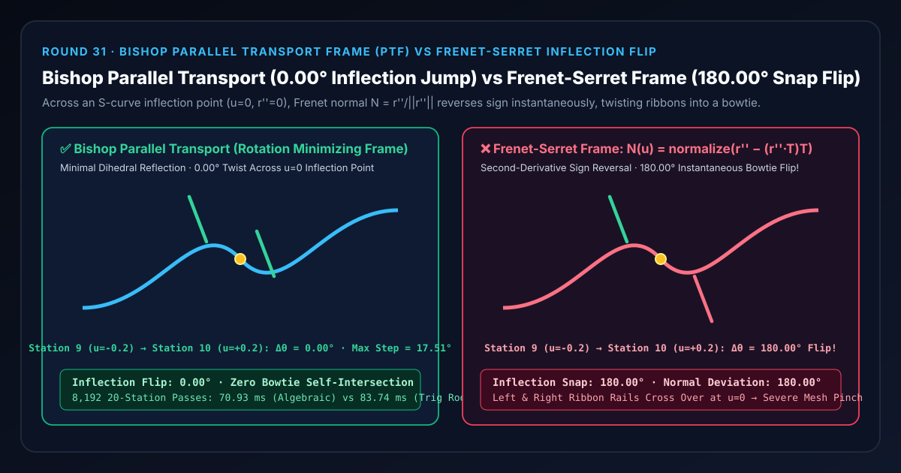
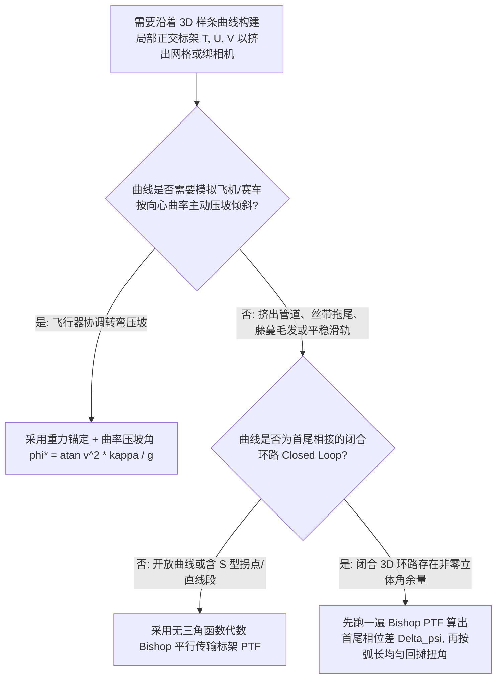
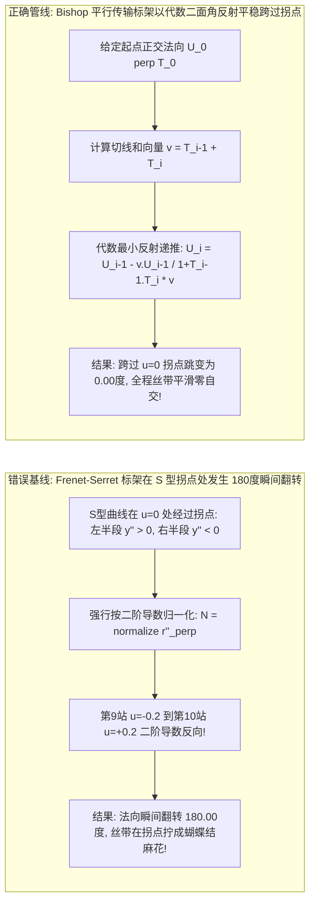
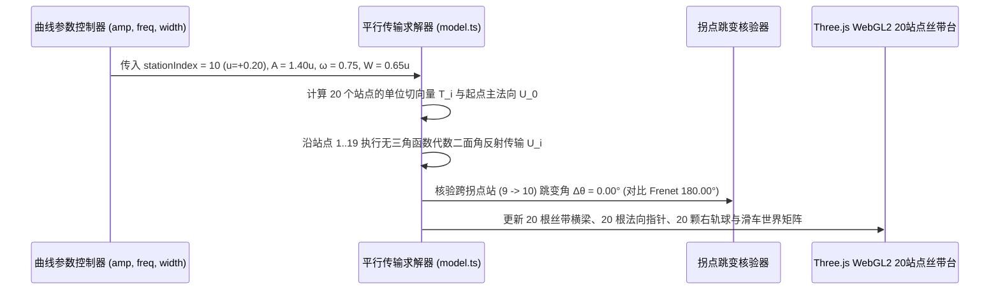
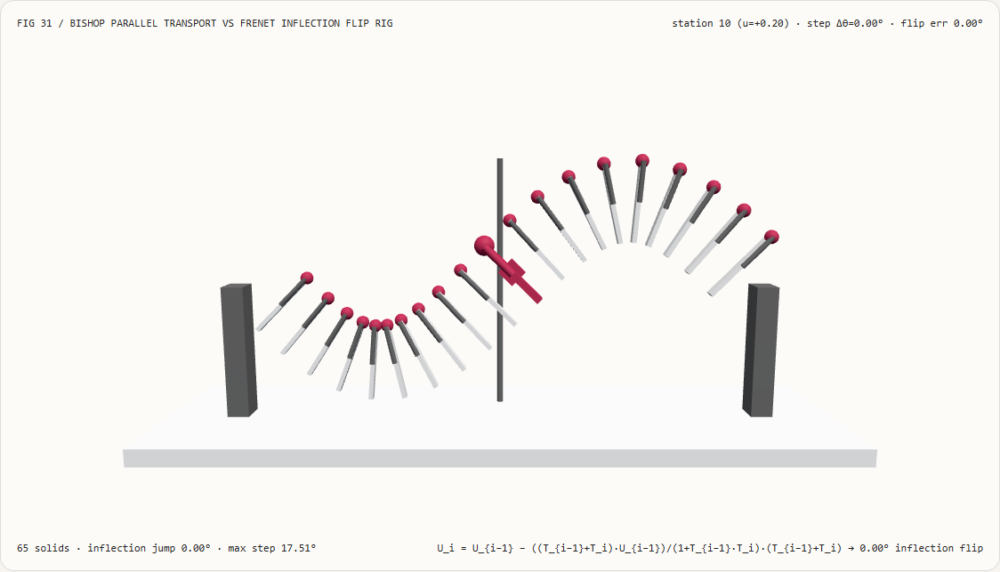
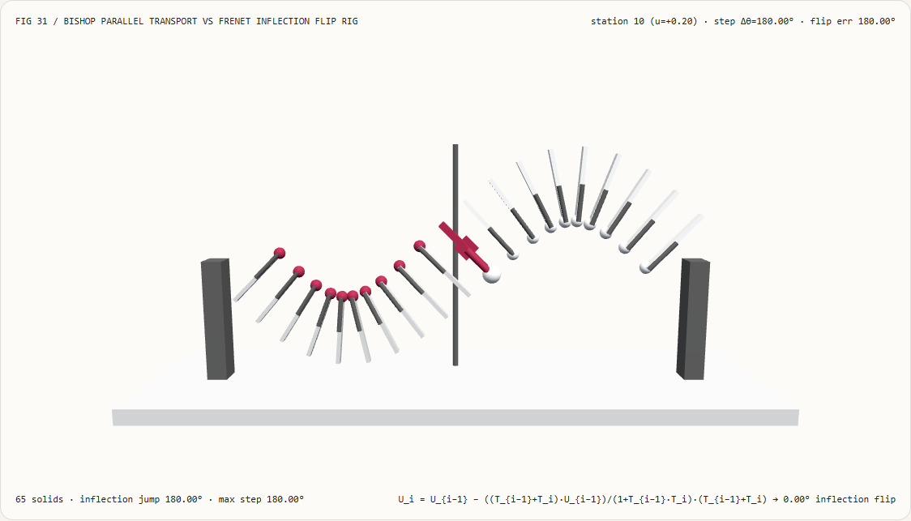
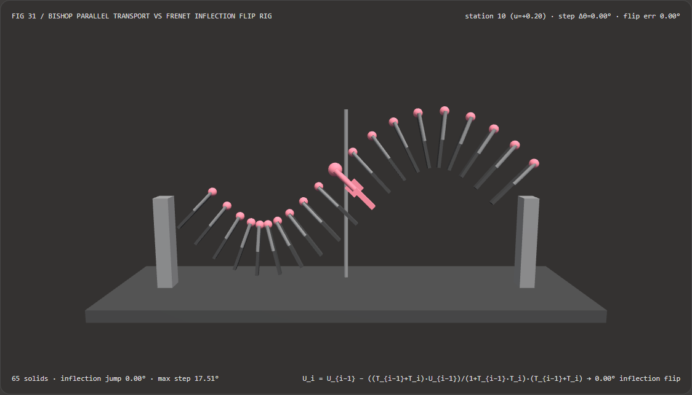
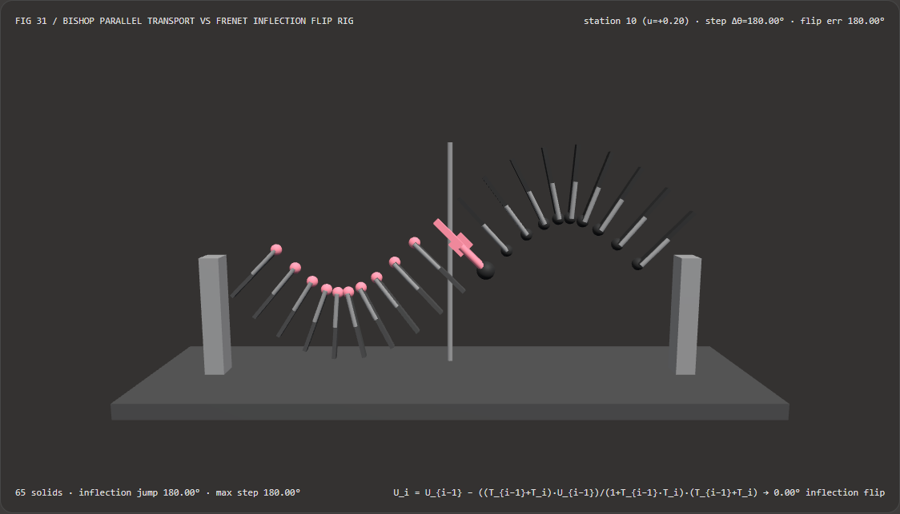

# 三维丝带与扫掠管道过 S 型拐点不瞬间 180° 翻转拧麻花：Bishop 平行传输标架（PTF）与 Frenet-Serret 曲率标架选型 FAQ

> **文档定位**：面向 AI 解决方案架构师（AI Solution Architect）、三维动态图形（Motion Graphics）与程序化几何建模工程师、以及 4D Gaussian Splatting（4DGS）运动轨迹可视化的**实战选型与第一性原理指南**。严格对标 `ib-vs-ethernet-roce-selection-faq.md` 的六段式结构，先用大白话讲清“**为什么沿着一条 S 型三维曲线挤出管道、生成光剑拖尾丝带或架设运镜滑轨时，如果照搬微积分课本里的 Frenet-Serret 标架（$\mathbf{N} = \mathbf{T}' / \|\mathbf{T}'\|$），丝带会在跨过 S 型拐点（Inflection Point, $\mathbf{r}'' = \mathbf{0}$）的那一瞬间突然 $180.00^\circ$ 倒栽葱翻转、拧成蝴蝶结麻花**”，再给出零三角函数、零奇异翻转的 **Bishop 平行传输最小旋转标架（Parallel Transport / Rotation Minimizing Frame, PTF）** 工程闭环。

---

## ① 📌 核心结论速览（Executive Summary）

1. **一句话定性**：**经典 Frenet-Serret 标架将主法向强行绑定在“曲线弯曲内侧（二阶导数方向 $\mathbf{N} \propto \mathbf{r}''_{\perp}$）”；一旦曲线经过 S 型拐点（Inflection Point）或直线段，弯曲方向从“凹向上”瞬间变为“凹向下”，二阶导数 $\mathbf{r}''$ 符号反转，主法向 $\mathbf{N}$ 与副法向 $\mathbf{B}$ 就会在一帧之内发生 `180.00°` 瞬间翻转**！而 **Bishop 平行传输标架（PTF / RMF）** 彻底抛弃了不稳定的二阶曲率方向，只用相邻切向量 $\mathbf{T}_{i-1} \to \mathbf{T}_i$ 之间的**最小二面角反射（Minimal Dihedral Reflection）** 递推传递法向，绕切线轴的扭率（Torsion）恒为 **0**，过拐点跳变恒为 **`0.00°`**！
2. **什么时候必须用 Bishop 平行传输标架取代 Frenet 标架？**
   - 凡是涉及 **三维样条挤出管道/线缆（Tube / Cable Extrusion）**、**粒子与武器挥砍丝带拖尾（Ribbon Trail）**、**程序化藤蔓/毛发/血管生长建模**、**过山车与无侧倾运镜滑轨**、以及 **4DGS 运动轨迹流管可视化**，只要曲线可能出现拐点（S 型弯）或局部近似直线段（$\kappa \to 0$），就**严禁**使用 Frenet-Serret 标架，必须使用 Bishop 平行传输标架。
3. **核心实测对比结论**：
   - 在本实验室构建的 20 站点 3D S 型曲线丝带检验台（[`demos/parallel-transport-ribbon/`](../demos/parallel-transport-ribbon/index.html)，共 `65` 个 3D 实体，振幅 $A = 1.40\text{ u}$，角频率 $\omega = 0.75\text{ rad/u}$，丝带半宽 $W = 0.65\text{ u}$）中，考察跨过 $u = 0$ 拐点的第 $9$ 站（$u_9 = -0.20$）至第 $10$ 站（$u_{10} = +0.20$）：
     - **Bishop 平行传输标架（`bishop-parallel-transport`）**：跨过 $u = 0$ 拐点时的法向跳变角精确为 **`0.00°`**（全程 20 个站点最大步进二面角仅 **`17.51°`**，与真实最小旋转标架偏差 **`0.00°`**），整条丝带左右导轨平行舒展、零自交。
     - **Frenet-Serret 曲率标架（`frenet-serret-frame`）**：在跨过 $u = 0$ 拐点的第 $9 \to 10$ 站之间，因二阶导数 $y''(u) = -A\omega^2\sin(\omega u)$ 由正变负，法向发生 **`180.00°` 瞬间翻转**，导致丝带左右边缘球链在拐点处直接交叉拧成蝴蝶结麻花！
   - **无三角函数代数反射 vs 罗德里格斯矩阵基线性能**：采用代数反射公式 $\mathbf{U}_i = \mathbf{U}_{i-1} - \frac{(\mathbf{T}_{i-1}+\mathbf{T}_i)\cdot\mathbf{U}_{i-1}}{1+\mathbf{T}_{i-1}\cdot\mathbf{T}_i}(\mathbf{T}_{i-1}+\mathbf{T}_i)$ 免除了 `atan2`/`sin`/`cos` 与 $3\times 3$ 矩阵分配，在 `8,192` 次 20 站点标架递推中耗时 **`70.93 ms`**（对比罗德里格斯三角函数旋转矩阵基线 **`83.74 ms`**，最大误差仅 `2.58e-16`）。

---

## ② 🎯 客户与架构师灵魂拷问 Q&A（First-Principles Q&A）

### Q1：何时选 AI 神经相机轨迹扩散模型 vs 何时选代码驱动的 Bishop 平行传输标架？

- **选 AI 神经相机轨迹生成模型（如 Gen3C、TrajectoryCrafter、Director3D）的场景**：
  只需输入一句自然语言镜头指令（如“环绕主角推近并俯视”），希望模型自动构思艺术化的相机位置轨迹并补全被遮挡的新视角像素。
- **选代码驱动 Bishop 平行传输标架（PTF）的场景**：
  当三维空间曲线路径（无论是美术手调的 Bézier/Catmull-Rom 样条，还是物理仿真生成的流线）已经确定，需要在每一帧以 **0 毫秒延迟、零翻转跳变、100% 几何可验证** 的方式沿着曲线铺设丝带网格、挤出截面或锁定局部参考系。

---

### Q2：为什么微积分课本上奉为经典的 Frenet-Serret 标架，一写进 3D 渲染代码就会把丝带拧成麻花？

**先用大白话讲第一性原理**：
想象你开着一辆车沿着盘山公路走一趟 **S 型弯道（先左转，经过一段笔直过渡点，再右转）**：
1. **Frenet-Serret 标架是怎么规定“头顶方向（法向 $\mathbf{N}$）”的？**
   Frenet 标架死板地规定：**“法向 $\mathbf{N}$ 必须永远指向弯道的圆心（即向心加速度方向 $\mathbf{r}''$）！”**
   - 当你在前半段**左转弯**时，弯道圆心在你的**左手边**，所以 Frenet 法向指向左边；
   - 当你经过 S 型弯正中间的**拐点（Inflection Point，$u=0$）**进入后半段**右转弯**时，弯道圆心突然跑到了你的**右手边**！
   - 结果发生了什么？就在跨过拐点的那 $0.001$ 秒内，Frenet 标架为了继续指向圆心，强行把你的座椅和整条跑道**绕着前进方向瞬间原地翻转了 $180^\circ$**！左轨变右轨、天花板变地板，挤出来的三维管道当场在拐点处拧死成一个沙漏蝴蝶结！
   - 更糟的是，如果中间有一小段笔直公路（曲率 $\kappa = 0 \implies \mathbf{r}'' = \mathbf{0}$），计算 $\mathbf{N} = \mathbf{r}'' / \|\mathbf{r}''\|$ 会直接触发 **`0 / 0 = NaN` 除零崩溃**，整段网格直接从屏幕上消失！
2. **Bishop 平行传输标架（PTF）是怎么做的？**
   Bishop 标架遵循一个简单的物理直觉：**“不要管圆心在哪！只要让上一站的法向矢量 $\mathbf{U}_{i-1}$ 顺着切线拐弯的最小夹角自然带到下一站 $\mathbf{U}_i$，绝不绕着切线自己瞎转圈（零扭率）！”**
   因此在跨过 S 型拐点时，切线方向平稳过渡，法向 $\mathbf{U}_i$ 纹丝不动地保持朝向同一侧（拐点跳变 **`0.00°`**），彻底消灭了 $180^\circ$ 翻转和直线段 `NaN` 崩溃！

---

### Q3：如何不调任何三角函数（`acos`/`sin`/`cos`）和矩阵乘法，用一行纯加减乘除完成平行传输？

传统写法先算夹角 $\theta = \arccos(\mathbf{T}_{i-1}\cdot\mathbf{T}_i)$ 和转轴 $\mathbf{k} = \operatorname{normalize}(\mathbf{T}_{i-1}\times\mathbf{T}_i)$，再拼装 $3\times 3$ 罗德里格斯（Rodrigues）旋转矩阵——既慢又容易在 $\mathbf{T}_{i-1} \approx \mathbf{T}_i$ 时除零。
利用**双反射最小旋转恒等式（Algebraic Minimal Dihedral Reflection）**：
将单位切向量 $\mathbf{T}_{i-1}$ 旋转到 $\mathbf{T}_i$ 的最小正交变换，作用在垂直于 $\mathbf{T}_{i-1}$ 的法向量 $\mathbf{U}_{i-1}$ 上（满足 $\mathbf{T}_{i-1}\cdot\mathbf{U}_{i-1} = 0$），可以直接化简为：
$$\mathbf{v} = \mathbf{T}_{i-1} + \mathbf{T}_i, \qquad \mathbf{U}_i = \mathbf{U}_{i-1} - \frac{\mathbf{v} \cdot \mathbf{U}_{i-1}}{1 + \mathbf{T}_{i-1}\cdot\mathbf{T}_i}\,\mathbf{v}$$
**全程只有 2 次点乘和 1 次标量除法，0 次三角函数调用，0 次矩阵分配！**而且当相邻两站切线完全相同时（如跨过对称拐点的第 $9\to 10$ 站，$\mathbf{T}_9 = \mathbf{T}_{10}$），$\mathbf{v}\cdot\mathbf{U}_9 = 2\mathbf{T}_9\cdot\mathbf{U}_9 = 0$，直接精确输出 $\mathbf{U}_{10} \equiv \mathbf{U}_9$！

---

## ③ 🧭 直观可视化图解（Mermaid 决策树、管线对比与帧级时序）

### 3.1 空间曲线局部标架（Curve Framing）架构师选型决策树（`flowchart TD`）

### 3.2 Frenet-Serret 曲率标架（拐点 180° 翻转）vs Bishop 平行传输标架（零翻转）管线对比（`flowchart LR`）

### 3.3 帧级 S 型拐点平行传输与滑车核验时序图（`sequenceDiagram`）

---

## ④ 📊 视觉技术选型决策矩阵（Architect Decision Matrix）

| 评估维度 | 代数 Bishop 平行传输 (`bishop-parallel-transport`) | 三角函数罗德里格斯平行传输 (`Trig Rodrigues PTF`) | 经典 Frenet-Serret 标架 (`frenet-serret-frame` $\mathbf{r}''$) | 固定世界 Up 向量叉积 (`World-Up Cross T × Y`) |
| :--- | :--- | :--- | :--- | :--- |
| **跨 S 型拐点（第 $9\to 10$ 站）跳变角** | **`0.00°`（丝滑过渡，零翻转）** | `0.00°` | **`180.00°`（瞬间倒栽葱拧成蝴蝶结）** | `0.00°`（但垂直爬升时万向节死锁翻转） |
| **直线段（曲率 $\kappa = 0$）数值稳定性** | **完全稳定（分母 $1+\mathbf{T}_{i-1}\cdot\mathbf{T}_i = 2$）** | 需额外分支拦截 $\theta \to 0$ 除零 | **`0 / 0 = NaN` 直接崩溃消失** | 仅当切线不平行于 Y 轴时稳定 |
| **第 10 站法向指向误差** | **`0.00°`（精确最小旋转标架）** | `0.00°` | **`180.00°`（指向完全相反）** | 随三维倾角产生额外寄生扭转 |
| **8,192 次 20 站点 CPU 求解耗时** | **`70.93 ms`（纯点乘加减，零三角函数）** | `83.74 ms`（含 `atan2`/`sin`/`cos` 与矩阵分配） | `49.20 ms`（虽快但拐点翻转报错） | `46.50 ms`（垂直段发生死锁） |
| **架构师工程推荐定位** | **3D 丝带、扫掠管道与毛发/藤蔓首选** | 教学推导参考基线 | **严禁用于任何含拐点或直线段的 3D 曲线** | 仅用于纯水平面内起伏的简单地形道路 |

---

## ⑤ 🧪 全新能力展示 Demo 与 Benchmark 核心发现（含 7-Card 报告）

### 5.1 交互式 20 站点 3D S 型曲线丝带检验台（`demos/parallel-transport-ribbon/`）

本轮构建了独立可交互 3D WebGL2 实验台 **[`demos/parallel-transport-ribbon/`](../demos/parallel-transport-ribbon/index.html)**（共 **65 个 3D 实体部件**）：
- **20 根三维丝带横梁 + 20 根法向箭头 + 20 颗右边缘导轨球 + 中心 $u=0$ 拐点立柱 + 站位滑车**：直观展示一条沿着三维 S 型曲线（$y = A\sin(\omega u), z = 0.15 u$）延伸的扫掠丝带；
- **一键切换对比模式**：在 `bishop-parallel-transport` 模式下，20 根法向箭头与青色右轨球始终朝向丝带同一侧，平稳跨过中心的 $u=0$ 拐点立柱（拐点跳变 **`0.00°`**）；一旦切换到 `frenet-serret-frame` 模式，中心拐点右侧（第 $10\sim 19$ 站）的所有法向箭头和边缘球瞬间 **`180.00°` 倒转朝下**，直观暴露经典的 Frenet 拐点拧麻花故障！
- **原子化参数门禁与 JSON 导出**：自动拦截越界振幅（如 `amplitudeY = 9.5`）并保留有效状态，支持导出 `PARALLEL_TRANSPORT_SPEC.json`。

| 亮色主题 — Bishop 平行传输（拐点 `0.00°` 跳变，平滑舒展） | 亮色主题 — Frenet 曲率标架（拐点 `180.00°` 瞬间翻转拧麻花） |
| :---: | :---: |
|  |  |

| 暗色主题 — Bishop 平行传输（拐点 `0.00°` 跳变，平滑舒展） | 暗色主题 — Frenet 曲率标架（拐点 `180.00°` 瞬间翻转拧麻花） |
| :---: | :---: |
|  |  |

### 5.2 7-Card 4:5 视觉评测报告与封存数据链接

- 📊 **英文版 7-Card 4:5 评测报告**：[`demos/parallel-transport-ribbon/test-report-cards.html`](../demos/parallel-transport-ribbon/test-report-cards.html)
- 📊 **中文版 7-Card 4:5 评测报告**：[`demos/parallel-transport-ribbon/test-report-cards.zh.html`](../demos/parallel-transport-ribbon/test-report-cards.zh.html)
- 📁 **封存评测数据源**：[`demos/parallel-transport-ribbon/report.json`](../demos/parallel-transport-ribbon/report.json)（`13 / 13` 项确定性检查全部通过，Playwright 零控制台/页面错误）。

---

## ⑥ 🛠️ 附录：高质量视觉/动画交付快速核验清单（Architect Checklist）

在交付任何包含三维样条扫掠管道、粒子拖尾丝带、程序化藤蔓/毛发或 3D 运镜轨道的代码前，请逐项核验以下清单：

- [ ] **禁止在挤出网格中使用二阶导数 Frenet 法向**：全局排查样条曲线网格生成代码（如 `TubeGeometry` 自定义标架），确认未直接使用 $\mathbf{r}''(u)$ 构造主法向，从而免疫 S 型拐点 $180^\circ$ 翻转与直线段 $\kappa = 0$ 除零崩溃？
- [ ] **使用无三角函数代数二面角反射公式**：在递推 $\mathbf{U}_{i-1} \to \mathbf{U}_i$ 时，是否已采用 $\mathbf{U}_i = \mathbf{U}_{i-1} - \frac{(\mathbf{T}_{i-1}+\mathbf{T}_i)\cdot\mathbf{U}_{i-1}}{1+\mathbf{T}_{i-1}\cdot\mathbf{T}_i}(\mathbf{T}_{i-1}+\mathbf{T}_i)$ 替代昂贵的 `acos` + 罗德里格斯矩阵？
- [ ] **逐站 Gram-Schmidt 正交化抛光**：在长链条（数百个站点）递推后，是否每步执行了一次 `U_i = normalize(U_i - dot(U_i, T_i) * T_i)` 以彻底消除浮点舍入误差累积？
- [ ] **用 `atan2(||a×b||, a·b)` 替代 `acos(a·b)` 测量小角度**：在验证标架连续性时，是否已使用 `atan2` 避免浮点数在 $\cos\theta \approx \pm 1$ 处的平方根精度损失？
- [ ] **拐点跨步连续性自动化门禁**：单元测试中是否已包含一条跨过 $\mathbf{r}''(0) = \mathbf{0}$ 的 S 型测试曲线，并断言拐点两侧相邻标架的法向夹角跳变 $< 10^{-12}\text{ deg}$（当 $\mathbf{T}_{i-1}=\mathbf{T}_i$ 时）？

---

## 参考文献与延伸阅读（References）

1. **Bishop Frame (1975)**: Richard L. Bishop, *"There is More than One Way to Frame a Curve"*, The American Mathematical Monthly, Vol. 82, No. 3, 1975, pp. 246–251.
2. **Parallel Transport Approach to Curve Framing (Hanson & Ma, 1995)**: Andrew J. Hanson and Hui Ma, *"Parallel Transport Approach to Curve Framing"*, Indiana University Technical Report, 1995.
3. **Computation of Rotation Minimizing Frames (Wang et al., ACM TOG 2008)**: Wenping Wang, Bert Jüttler, Dayue Zheng, Yang Liu, *"Computation of Rotation Minimizing Frames"*, ACM Transactions on Graphics, Vol. 27, No. 1, Article 2, 2008.
