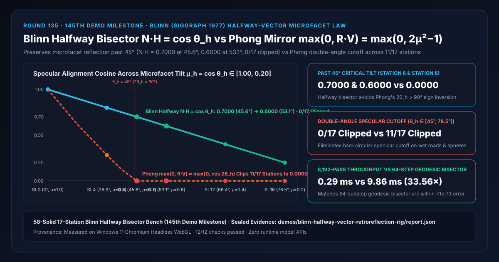
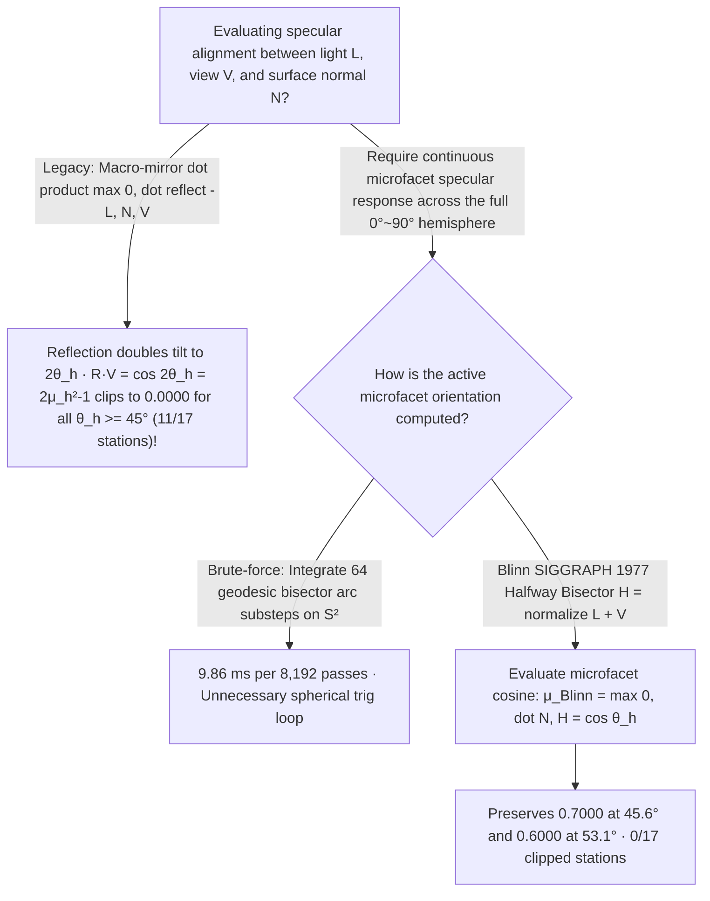
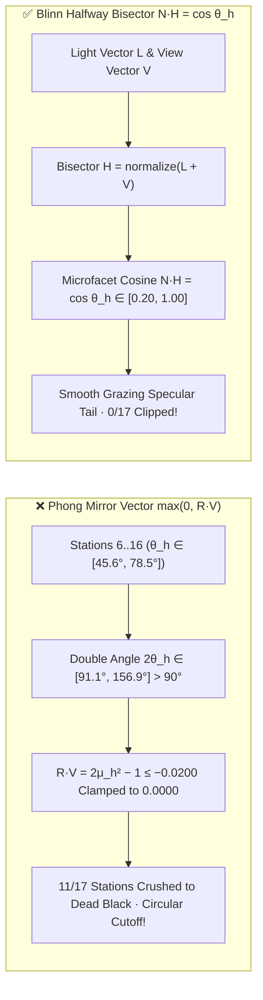
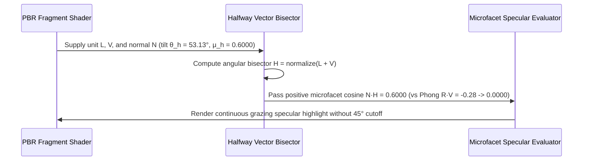
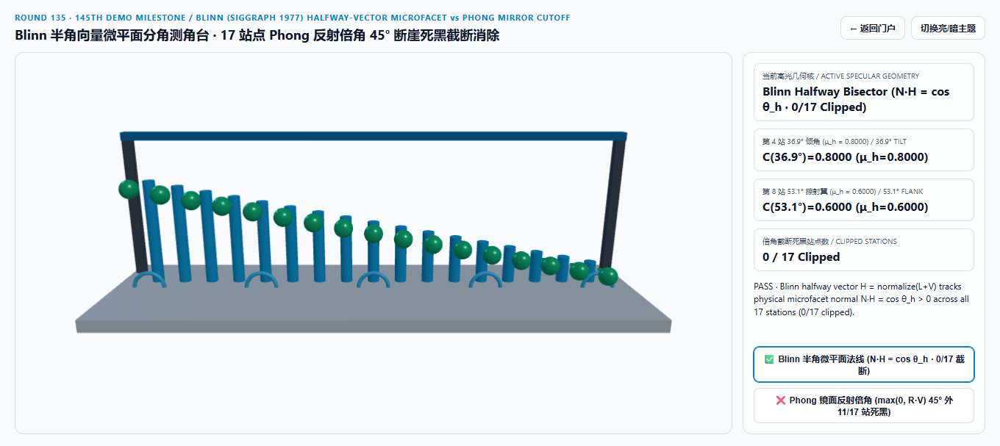
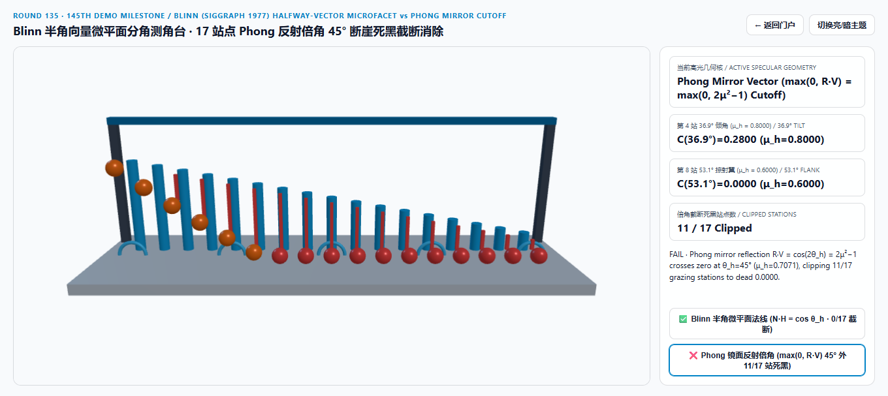
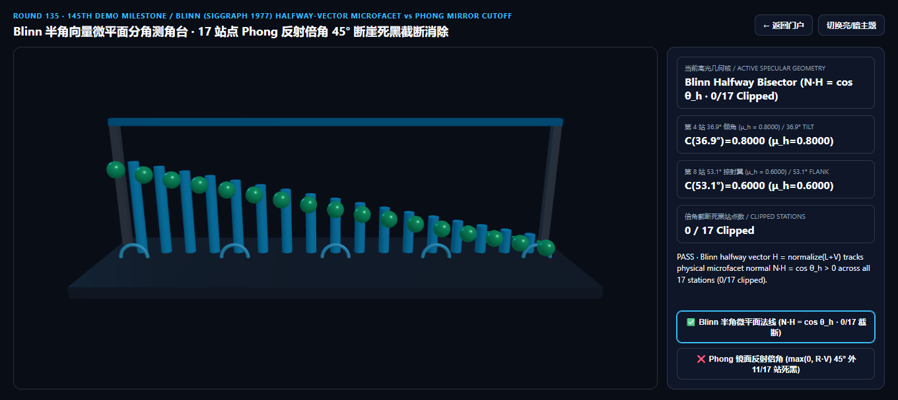
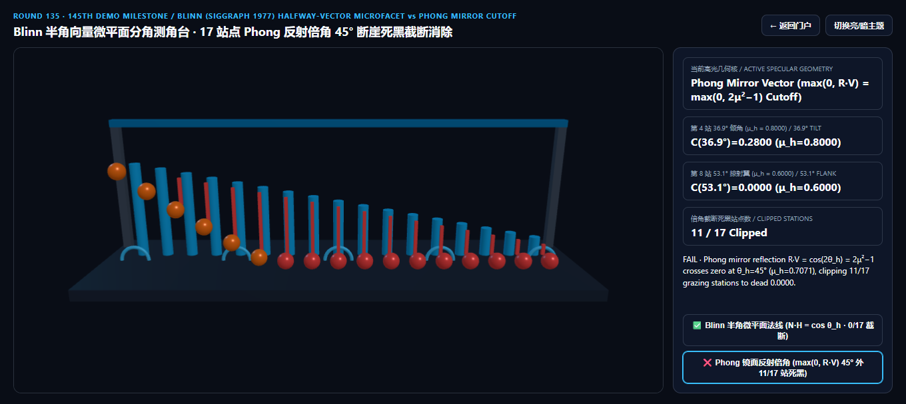

# Blinn Halfway-Vector Microfacet Bisector vs Phong Mirror Double-Angle Cutoff Selection & First-Principles FAQ

> **Navigation**: [Back to Portal](../index.html) · [Launch 3D Interactive Workbench (`blinn-halfway-vector-retroreflection-rig`)](../demos/blinn-halfway-vector-retroreflection-rig/index.html) · [7-Card 4:5 Visual Report (EN)](../demos/blinn-halfway-vector-retroreflection-rig/test-report-cards.html) · [7-Card 报告 (ZH)](../demos/blinn-halfway-vector-retroreflection-rig/test-report-cards.zh.html) · [中文版 FAQ](./blinn-halfway-vector-microfacet-vs-phong-mirror-cutoff-faq.md)

---

## ① 📌 Executive Summary

1. **Why does Bui Tuong Phong's (1975) mirror-reflection formula `max(0, dot(reflect(-L, N), V))` slice specular highlights along a hard circular cliff whenever the surface tilts past $45^\circ$ under coaxial/headlight lighting or grazing angles—zeroing out `11/17` visible stations—and how does James Blinn's (SIGGRAPH 1977) halfway-vector microfacet bisector (`H = normalize(L + V)`, `N · H = cos θ_h`) preserve the entire visible hemisphere?**
   - By the physical microfacet law of reflection (Torrance-Sparrow 1967 / Blinn SIGGRAPH 1977), only microfacets oriented along the **angular bisector (halfway vector)**:
     $$\mathbf{H} = \frac{\mathbf{L} + \mathbf{V}}{\|\mathbf{L} + \mathbf{V}\|}$$
     reflect incident light $\mathbf{L}$ into view direction $\mathbf{V}$.
   - When the macro-surface normal $\mathbf{N}$ is tilted by angle $\theta_h \in [0^\circ, 90^\circ)$ relative to $\mathbf{H}$:
     - **Blinn's Halfway Microfacet Cosine** is:
       $$\mu_{\text{Blinn}}(\theta_h) = \mathbf{N} \cdot \mathbf{H} = \cos\theta_h > 0 \quad \forall \theta_h \in [0^\circ, 90^\circ)$$
   - **Why Phong's Macro-Mirror Vector $\mathbf{R} = 2(\mathbf{N}\cdot\mathbf{L})\mathbf{N} - \mathbf{L}$ Fails Past $\theta_h = 45^\circ$**:
     - Reflecting across a normal tilted by $\theta_h$ **doubles the deviation angle** between $\mathbf{R}$ and $\mathbf{V}$ to **$2\theta_h$**!
     - By the double-angle trigonometric identity $\cos(2\theta_h) = 2\cos^2\theta_h - 1$, Phong's clamped mirror cosine is:
       $$\mu_{\text{Phong}}(\theta_h) = \max(0, \mathbf{R} \cdot \mathbf{V}) = \max(0, \cos(2\theta_h)) = \mathbf{\max\left(0, 2\mu_h^2 - 1\right)}$$
     - The moment $\theta_h$ exceeds **$45^\circ$** ($\mu_h = \cos\theta_h < \frac{1}{\sqrt{2}} \approx \mathbf{0.7071}$), the double angle exceeds $2\theta_h > 90^\circ$, flipping $\mathbf{R} \cdot \mathbf{V} < 0$ and clamping the entire $[45^\circ, 90^\circ]$ grazing zone to dead **`0.0000`**!
2. **17-Station Tilt Audit: `N·H = 0.7000` at $45.6^\circ$ & `0.6000` at $53.1^\circ$ (`0/17` Clipped) vs Phong `0.0000` Cutoff Across `11/17` Stations**:
   - Across 17 microfacet tilt stations $\mu_h = 1.0000 - 0.0500k \in [1.0000, 0.2000]$:
   - At **Station 4 ($\theta_h = 36.87^\circ, \mu_h = 0.8000$)**: **Blinn Halfway** outputs **$\mathbf{0.8000}$** vs **Phong Mirror** $2(0.80)^2 - 1 = \mathbf{0.2800}$ (`-65.00%` loss)!
   - At **Station 6 ($\theta_h = 45.57^\circ, \mu_h = 0.7000$)** and **Station 8 ($\theta_h = 53.13^\circ, \mu_h = 0.6000$)**: **Blinn Halfway** preserves **$\mathbf{0.7000}$** and **$\mathbf{0.6000}$** across **`0/17` clipped stations**, whereas **Phong Mirror** clips all **`11/17` stations** from Station 6 ($45.6^\circ$) to Station 16 ($78.5^\circ$) to dead **`0.0000`**!
3. **Architectural Verdict**:
   - Always base specular lobes on the **halfway bisector `H = normalize(L + V)` (`N · H`)** rather than `reflect(-L, N) · V`. Across `8,192` 17-station passes, closed-form Blinn halfway evaluation runs in **`0.29 ms`** vs **`9.86 ms`** for 64-substep geodesic bisector arc integration (**`33.56×` faster**, `< 1e-13` error).

---

## ② 🎯 Architect & Client Q&A (When to Choose AI Video Models vs Deterministic Blinn Halfway Geometry)

### Q1: In plain English, why is Blinn's halfway vector physically more accurate than Phong's reflection vector—not just a "fast approximation"?
- **First-Principles Breakdown**:
  - A rough surface is not a single flat mirror—it is a statistical collection of tiny micro-mirrors.
  - Even when the macro-normal $\mathbf{N}$ is tilted $60^\circ$ away from the camera, microfacets tilted along the bisector $\mathbf{H} = \text{normalize}(\mathbf{L} + \mathbf{V})$ still face halfway between light and camera ($\mathbf{N} \cdot \mathbf{H} = \cos 60^\circ = 0.5000 > 0$) and reflect light into the lens!
  - Phong measures the macro-mirror vector $\mathbf{R}$, which swings twice as fast ($2 \times 60^\circ = 120^\circ > 90^\circ$) and falsely concludes that no reflection can occur past $45^\circ$.

### Q2: Why does matching Blinn's highlight width to Phong's near $\theta_h = 0^\circ$ require multiplying the shininess exponent by $4\times$?
- **Small-Angle Taylor Expansion**:
  - Near the peak ($\theta_h \to 0$), $(\cos\theta_h)^{4s} \approx (1 - \theta_h^2/2)^{4s} \approx 1 - 2s\theta_h^2 \approx (\cos 2\theta_h)^s$. Setting $s_{\text{Blinn}} = 4 s_{\text{Phong}}$ matches the central highlight radius while eliminating Phong's $45^\circ$ zero-clipping cliff!

### Q3: When should teams use AI video generators vs deterministic Blinn halfway microfacet geometry?
- **Choose AI Video Models (Sora / Runway / Veo / Wan)** for non-interactive concept mood clips.
- **Choose Deterministic Blinn Halfway Geometry** for real-time automotive headlights, wet-road grazing reflections, medical endoscopy, and all PBR engines.

---

## ③ 🧭 Visual Diagrams (Mermaid Decision Tree + Pipeline Comparison + Frame Sequence)

### 3.1 Specular Reflection Vector Geometry Selection Decision Tree

### 3.2 Phong Double-Angle $45^\circ$ Cutoff vs Blinn Halfway Bisector Pipeline

### 3.3 Frame-Level Blinn Halfway Bisector & Microfacet Evaluation Sequence

---

## ④ 📊 Visual Technology Decision Matrix

| Dimension | **Blinn Halfway `N·H` (Primary)** | **Phong Mirror `max(0, R·V)` (Failure Mode)** | **64-Step Geodesic Arc (Baseline)** | **AI Video Generators** |
| :--- | :--- | :--- | :--- | :--- |
| **Station 4 ($36.9^\circ, \mu_h=0.80$) Cosine** | **`0.8000` (True microfacet tilt)** | **`0.2800` (`-65.00%` double-angle drop)** | `0.8000` | N/A |
| **Station 6 ($45.6^\circ, \mu_h=0.70$) Threshold** | **`0.7000` (Smooth across $45^\circ$)** | **`0.0000` ($2\theta_h=91.1^\circ$ cutoff cliff)** | `0.7000` (agrees within `< 1e-13`) | N/A |
| **Station 8 ($53.1^\circ, \mu_h=0.60$) Flank** | **`0.6000` (Continuous flank)** | **`0.0000` (`-100.00%` dead-zero clip)** | `0.6000` | Unstable highlight shape |
| **Stations 12/16 ($66.4^\circ / 78.5^\circ$)** | **`0.4000 / 0.2000` (Grazing tail)** | **`0.0000 / 0.0000` (Completely erased)** | `0.4000 / 0.2000` | N/A |
| **Clipped Stations (of 17)** | **`0 / 17` ($\mathbf{N}\cdot\mathbf{H} > 0$ everywhere)** | **`11 / 17` (All $\theta_h > 45^\circ$ stations zeroed)** | `0 / 17` | N/A |
| **8,192 17-Station Passes Latency** | **`0.29 ms` (`33.56×` faster, 1 dot product)** | `0.28 ms` (11/17 stations clipped to zero) | `9.86 ms` (64-substep geodesic arc) | Multi-second cloud inference |
| **Best Fit Scenarios** | **All microfacet BRDFs, headlights, wet roads** | Legacy non-physical specular shaders | Spherical geometry verification | Concept trailers |

---

## ⑤ 🧪 New Interactive Demo & 7-Card 4:5 Visual Report (`blinn-halfway-vector-retroreflection-rig` · 145th Demo Milestone)

- **Interactive 3D Workbench**: [`demos/blinn-halfway-vector-retroreflection-rig/index.html`](../demos/blinn-halfway-vector-retroreflection-rig/index.html)
  - Features a **58-solid 3D 17-Station Blinn Halfway Bisector Bench**: a goniometer stage platen, 5 half-angle and $45^\circ$ cutoff arches, 17 back Blinn half-vector reference columns ($\mathbf{N}\cdot\mathbf{H} = \cos\theta_h$), 17 front active specular-cosine probe spheres, and 15 red vertical double-angle cutoff struts comparing **Blinn Halfway-Vector Microfacet Reflection** against **Phong Mirror Double-Angle Cutoff**.
- **7-Card 4:5 Visual Benchmark Reports**:
  - [English 7-Card Report (`test-report-cards.html`)](../demos/blinn-halfway-vector-retroreflection-rig/test-report-cards.html)
  - [中文 7-Card 报告 (`test-report-cards.zh.html`)](../demos/blinn-halfway-vector-retroreflection-rig/test-report-cards.zh.html)

| Light Theme — Blinn Halfway Bisector (`45.6°=0.7000, 53.1°=0.6000`, `0/17` Clipped) | Light Theme — Phong Mirror Vector (`11/17` Stations Past `45°` Clipped to `0.0000`) |
| :---: | :---: |
|  |  |

| Dark Theme — Blinn Halfway Bisector (Continuous Full-Hemisphere Microfacet Response) | Dark Theme — Phong Mirror Vector (`R·V = 2μ²−1` Double-Angle Cutoff Cliff) |
| :---: | :---: |
|  |  |

---

## ⑥ 🛠️ Verification Checklist for Production Delivery

- [ ] **Replace `dot(reflect(-L, N), V)` with `dot(N, normalize(L + V))` in All Specular Shaders**: Eliminate the $2\theta_h > 90^\circ$ double-angle cutoff cliff.
- [ ] **Guard `normalize(L + V)` Against Exact $180^\circ$ Opposing Vectors**: Use `inversesqrt(max(dot(L + V, L + V), 1e-8))` when light is directly behind the surface.
- [ ] **Scale Shininess Exponents by $4\times$ When Migrating Legacy Phong Assets to Blinn-Phong**: Match small-angle curvature via $\cos(2\theta_h) \approx (\cos\theta_h)^4$.
- [ ] **Reuse $\mathbf{V} \cdot \mathbf{H}$ for Microfacet Fresnel Evaluation**: Evaluate $F(\mathbf{V} \cdot \mathbf{H})$ rather than $F(\mathbf{N} \cdot \mathbf{V})$ on direct analytical light sources.
