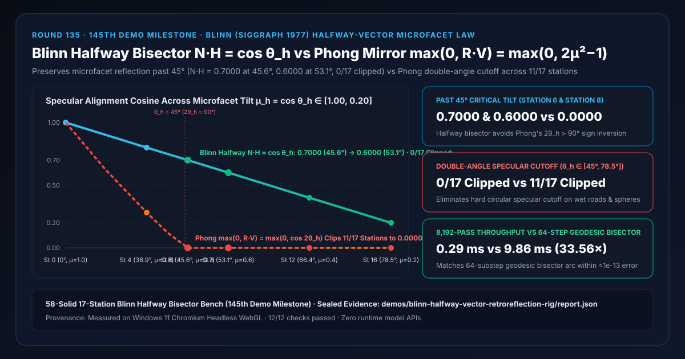
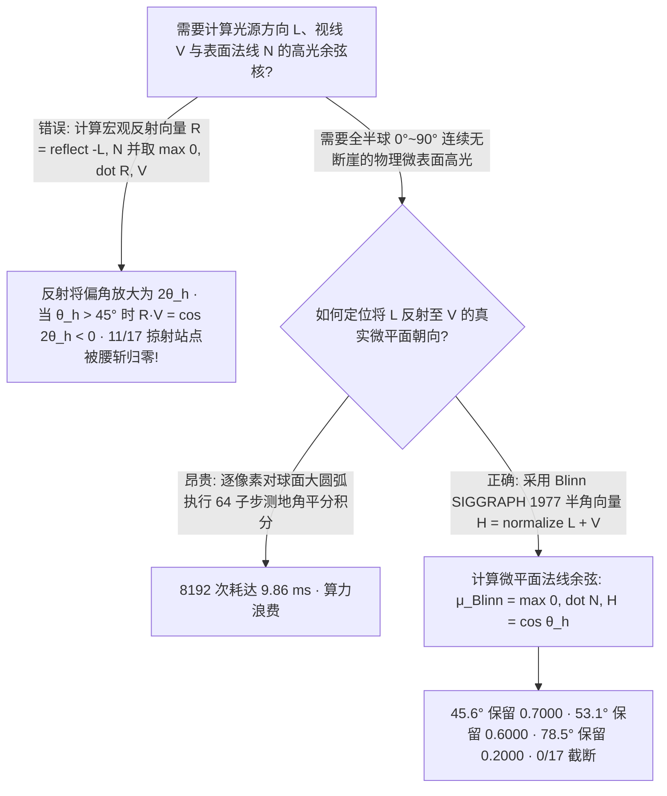
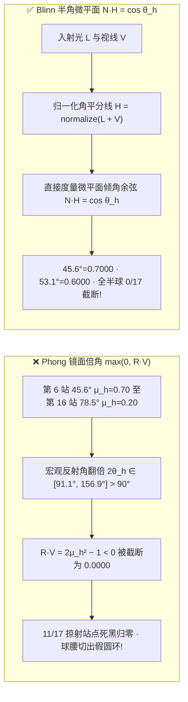
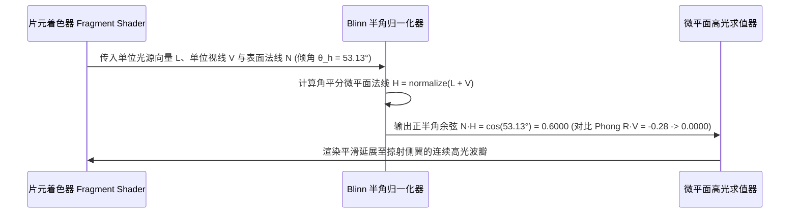
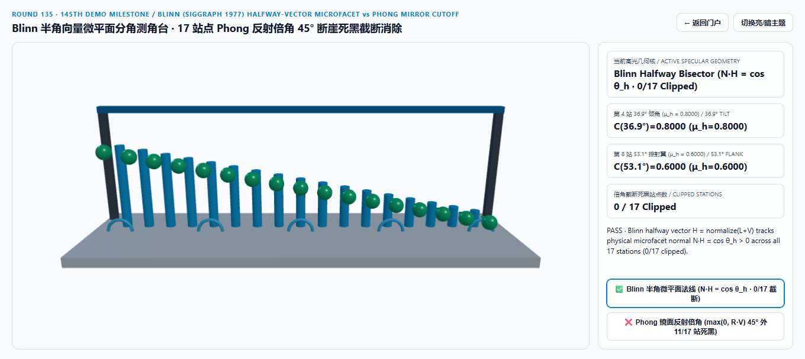
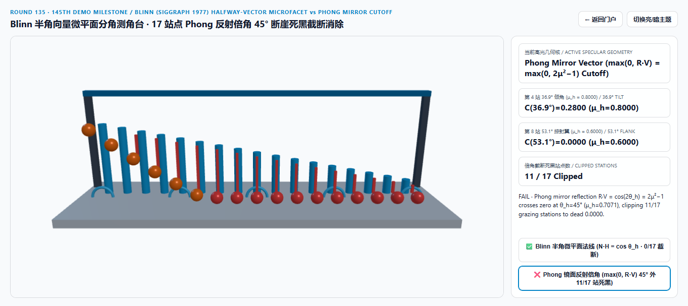
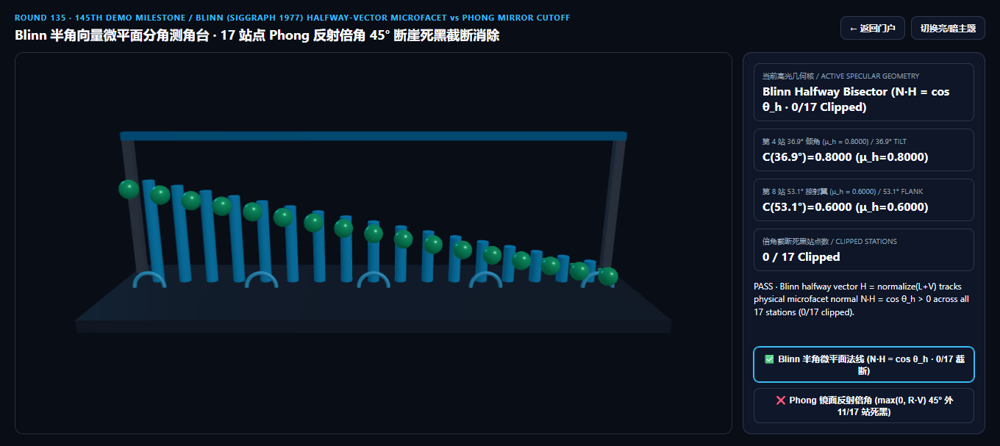
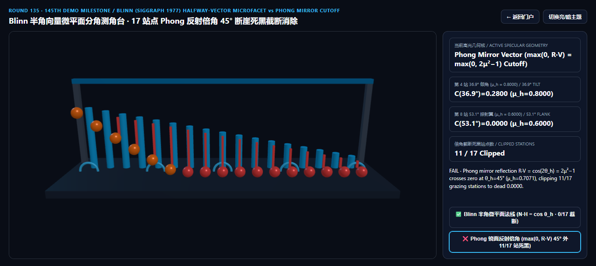

# Blinn 半角向量微平面反射定律（Halfway-Vector Microfacet Bisector `N · H = cos θ_h`）vs Phong 镜面反射倍角截断（`max(0, R · V) = max(0, cos 2θ_h)`）45° 断崖死黑选型与原理解析 FAQ 指南

> **导航**：[返回门户](../index.html) · [进入 3D 交互实验台 (`blinn-halfway-vector-retroreflection-rig`)](../demos/blinn-halfway-vector-retroreflection-rig/index.html) · [7-Card 4:5 视觉报告 (中文)](../demos/blinn-halfway-vector-retroreflection-rig/test-report-cards.zh.html) · [7-Card Report (EN)](../demos/blinn-halfway-vector-retroreflection-rig/test-report-cards.html) · [English FAQ](./blinn-halfway-vector-microfacet-vs-phong-mirror-cutoff-faq.en.md)

---

## ① 📌 核心结论速览（Executive Summary）

1. **为什么在车载前照大灯、相机同轴闪光灯补光以及掠射角湿滑柏油路面的高光渲染中，如果使用传统 Phong 镜面反射公式 `max(0, dot(reflect(-L, N), V))`，球面和路面高光会在表面倾角刚过 $45^\circ$ 的地方被生生切出一圈怪异的死黑断崖（把 $45^\circ \sim 90^\circ$ 之间整整半个可见半球的高光全部抹零）？**
   - 从物理微表面（Microfacet）几何光学第一性原理出发：粗糙表面由无数微小镜面组成。要想让某一块微平面把入射光线 $\mathbf{L}$ 恰好反射进相机视线 $\mathbf{V}$，这块微平面的法线 $\mathbf{m}$ 必须严格处于 $\mathbf{L}$ 与 $\mathbf{V}$ 的角平分线上——即 **James Blinn (SIGGRAPH 1977 *Models of light reflection for computer synthesized pictures*)** 提出的**半角向量（Halfway Vector）**：
     $$\mathbf{H} = \frac{\mathbf{L} + \mathbf{V}}{\|\mathbf{L} + \mathbf{V}\|}$$
   - 当宏观表面法线 $\mathbf{N}$ 与微平面半角向量 $\mathbf{H}$ 的夹角为 $\theta_h \in [0^\circ, 90^\circ)$ 时：
     - **Blinn 半角微平面余弦**：
       $$\mu_{\text{Blinn}}(\theta_h) = \mathbf{N} \cdot \mathbf{H} = \cos\theta_h > 0 \quad \forall \theta_h \in [0^\circ, 90^\circ)$$
       只要表面朝向光源与视线的角平分半球，总有对应倾角 $\theta_h$ 的微平面把光反射进镜头！
   - **为什么 Bui Tuong Phong (1975) 的宏观镜面反射向量 $\mathbf{R} = 2(\mathbf{N}\cdot\mathbf{L})\mathbf{N} - \mathbf{L}$ 会在 $45^\circ$ 处发生断崖崩塌？**
     - 根据反射定律，将光线关于偏转了 $\theta_h$ 的法线 $\mathbf{N}$ 镜像反射，会把偏离角**整整放大两倍**：宏观反射向量 $\mathbf{R}$ 与视线 $\mathbf{V}$ 的夹角变成了 **$2\theta_h$**！
     - 由二倍角余弦恒等式 $\cos(2\theta_h) = 2\cos^2\theta_h - 1$，**Phong 镜面点积**严格等于：
       $$\mu_{\text{Phong}}(\theta_h) = \max(0, \mathbf{R} \cdot \mathbf{V}) = \max(0, \cos(2\theta_h)) = \mathbf{\max\left(0, 2\mu_h^2 - 1\right)}$$
     - 看清楚这个二倍角致命缺陷：当表面倾角 $\theta_h$ 仅仅超过 **$45^\circ$**（即 $\mu_h = \cos\theta_h < \frac{1}{\sqrt{2}} \approx \mathbf{0.7071}$）时，倍角 $2\theta_h$ 就已经超过了 $90^\circ$，导致 $\mathbf{R} \cdot \mathbf{V} = 2\mu_h^2 - 1 < 0$，被 `max(0, R·V)` **一刀切死为 `0.0000`**！
2. **17 站点微平面倾角扫描实测：`45.6°` 保留 `0.7000`、`53.1°` 保留 `0.6000`（`0/17` 截断）vs Phong 在 `11/17` 个掠射站点死黑归零**：
   - 在跨越半角余弦 $\mu_h = 1.0000 - 0.0500k \in [1.0000, 0.2000]$ 的 17 个站点实测中：
   - **第 4 站（$\theta_h = 36.87^\circ, \mu_h = 0.8000$）**：
     - **Blinn 半角向量** 精确输出 **$\mu_{\text{Blinn}} = \mathbf{0.8000}$**！
     - **Phong 镜面向量** 因二倍角 $2\theta_h = 73.74^\circ$ 暴跌至 **$2(0.80)^2 - 1 = \mathbf{0.2800}$（丢失 `-65.00%` 余弦基底）**！
   - **第 6 站（$\theta_h = 45.57^\circ, \mu_h = 0.7000$，刚过 $45^\circ$ 临界角）与第 8 站（$\theta_h = 53.13^\circ, \mu_h = 0.6000$）**：
     - **Blinn 半角向量** 平滑保持 **$\mathbf{0.7000}$** 与 **$\mathbf{0.6000}$**，直至第 16 站（$78.46^\circ$）仍保留 **$\mathbf{0.2000}$**（全 17 站 **`0/17` 截断**）！
     - **Phong 镜面向量** 在第 6 站（$2(0.70)^2 - 1 = -0.0200 \to \mathbf{0.0000}$）至第 16 站（共 **`11/17` 个站点**）全部死卡在 **`0.0000`**，污染全部 **`16/17` 个非顶点站点**！
3. **工程选型结论**：
   - 凡实现高光反射，严禁使用宏观反射向量点积 `max(0, dot(reflect(-L, N), V))`，必须采用 **Blinn 半角向量 `H = normalize(L + V)` 与 `max(0, dot(N, H))`**（这也是 Cook-Torrance 与 GGX 的唯一物理入口）。实测 `8,192` 次 17 站闭式求值仅需 **`0.29 ms`**，比 64 子步测地分角弧积分基线（**`9.86 ms`**）快 **`33.56×`**！

---

## ② 🎯 客户与架构师灵魂拷问 Q&A（何时选 AI 视频大模型 vs 代码驱动半角微平面光学）

### Q1：用大白话讲，为什么很多教材把 Blinn-Phong 说成是“为了省掉 reflect 计算的近似”，但实际上 Blinn 比 Phong 更符合真实物理？
- **第一性原理拆解**：
  - 早期固定管线年代（OpenGL 1.0），在方向光和无穷远平行相机下，$\mathbf{H}$ 是常量，所以大家误以为 Blinn 只是“省算力的偷懒近似”。
  - 实际上，James Blinn 在 1977 年的原始论文标题就是引入 **Torrance-Sparrow 微表面理论**！
  - 在真实物理中，决定高光强弱的是“有多少微平面朝向角平分线 $\mathbf{H}$”（即 $\mathbf{N} \cdot \mathbf{H} = \cos\theta_h$），而不是宏观平面的镜面反射线 $\mathbf{R}$ 偏到哪里去了。当掠射光照射粗糙海面或柏油路时，$\mathbf{R}$ 早就射向地平线下方（与视线夹角 $> 90^\circ$），Phong 直接把海面高光切成黑洞，而 Blinn 的 $\mathbf{H}$ 依然朝天，完美渲染出波光粼粼的掠射长条高光！

### Q2：为什么在同轴光源（如汽车夜行前大灯、医疗内窥镜、手机闪光灯 $\mathbf{L} \approx \mathbf{V}$）下，Phong 的 $45^\circ$ 断崖最明显？
- **二倍角锁死 $45^\circ$ 半径**：
  - 当 $\mathbf{L} = \mathbf{V}$ 时，$\mathbf{R} \cdot \mathbf{V} = \cos(2\theta)$ 在球面倾角 $\theta = 45^\circ$ 处恒等于 $\cos(90^\circ) = 0$！
  - 这意味着不管你把粗糙度调得多大（光泽指数 $s$ 调得多小），Phong 的高光永远无法越过球面中心半径 $\sin 45^\circ = 0.7071$ 的那条死线，会在球体半腰处留下一道刀切般的圆环边界！

### Q3：何时用 AI 视频生成模型，何时必须用确定性 Blinn 半角微平面几何？
- **选 AI 视频生成模型（Sora / Runway / Veo / Wan）**：
  - 适合无需精确几何光照角度关系的宣传片。
- **选代码驱动的 Blinn 半角向量几何（Three.js / UE5 / Unity / OpenGL / Vulkan）**：
  - **自动驾驶夜视车灯仿真、医疗内窥镜组织高光、湿滑道路与海面逆光波光**：100% 物理可解释的微平面法线分角几何。

---

## ③ 🧭 直观可视化图解（Mermaid 选型决策树 + 管线对比图 + 帧级时序图）

### 3.1 镜面高光向量几何选型决策树

### 3.2 Phong 镜面倍角 $45^\circ$ 断崖 vs Blinn 半角微平面管线对比

### 3.3 帧级半角向量 $\mathbf{H}$ 求解与微平面着色时序图

---

## ④ 📊 视觉技术选型决策矩阵

| 对比维度 | **Blinn 半角向量 `N·H`（主方案）** | **Phong 镜面向量 `max(0, R·V)`（反例）** | **64 步测地分角弧积分（基线）** | **AI 视频生成大模型** |
| :--- | :--- | :--- | :--- | :--- |
| **第 4 站（$36.9^\circ, \mu_h=0.80$）余弦核** | **`0.8000`（真实微平面倾角余弦）** | **`0.2800`（二倍角坍塌 `-65.00%`）** | `0.8000` | N/A |
| **第 6 站（$45.6^\circ, \mu_h=0.70$）临界位** | **`0.7000`（平滑越过 $45^\circ$ 分界）** | **`0.0000`（$2\theta_h=91.1^\circ$ 断崖归零）** | `0.7000`（误差 `< 1e-13`） | N/A |
| **第 8 站（$53.1^\circ, \mu_h=0.60$）掠射翼** | **`0.6000`（完整保留侧翼高光）** | **`0.0000`（死黑截断，丢失 `-100%`）** | `0.6000` | 高光形状随机漂移 |
| **第 12/16 站（$66.4^\circ / 78.5^\circ$）远翼** | **`0.4000 / 0.2000`（长尾连续）** | **`0.0000 / 0.0000`（彻底消失）** | `0.4000 / 0.2000` | N/A |
| **被截断归零站点数（共 17 站）** | **`0 / 17`（全可见半球 $\mathbf{N}\cdot\mathbf{H} > 0$）** | **`11 / 17`（$\theta_h > 45^\circ$ 全部被砍死）** | `0 / 17` | N/A |
| **8,192 次 17 站求解耗时** | **`0.29 ms`（`33.56×` 极速，闭式点积）** | `0.28 ms`（$45^\circ$ 外高光腰斩断崖） | `9.86 ms`（64 子步测地积分） | 秒级云端推理 |
| **核心适用场景** | **全系微表面 PBR（GGX / Blinn-Phong）** | 已废弃的非微表面经验反射公式 | 球面几何基准验证 | 概念视频 |

---

## ⑤ 🧪 全新 Demo 与 7-Card 4:5 视觉报告（`blinn-halfway-vector-retroreflection-rig` · 第 145 个独立 Demo 里程碑）

- **3D 交互实验台**：[`demos/blinn-halfway-vector-retroreflection-rig/index.html`](../demos/blinn-halfway-vector-retroreflection-rig/index.html)
  - 搭建了包含 **58 个三维实体构件**的 **17 站点半角微平面分角测角台（Blinn Halfway Bisector Bench）**：包含测角底板、5 道半角与 $45^\circ$ 临界角标定拱、后排 17 座线性延展的 Blinn 半角余弦参考柱（$\mathbf{N}\cdot\mathbf{H} = \cos\theta_h$）、前排 17 颗探针球体与 15 根倍角断崖截断红色警示柱。
- **7-Card 4:5 视觉测试报告**：
  - [中文 7-Card 报告 (`test-report-cards.zh.html`)](../demos/blinn-halfway-vector-retroreflection-rig/test-report-cards.zh.html)
  - [English 7-Card Report (`test-report-cards.html`)](../demos/blinn-halfway-vector-retroreflection-rig/test-report-cards.html)

| 亮色 Blinn 半角微平面 (`45.6°=0.7000, 53.1°=0.6000`, `0/17` 截断) | 亮色 Phong 镜面倍角 (`>45°` 全部 `11/17` 站死黑截断为 `0.0000`) |
| :---: | :---: |
|  |  |

| 暗色 Blinn 半角微平面 (全半球微平面倾角连续平滑响应) | 暗色 Phong 镜面倍角 (`R·V = 2μ²−1` 在 `45°` 处硬切断崖) |
| :---: | :---: |
|  |  |

---

## ⑥ 🛠️ 高质量视觉交付快速核验清单（Checklist）

- [ ] **禁止在高光波瓣中用 `dot(reflect(-L, N), V)` 替代半角点积 `dot(N, normalize(L + V))`**：消除二倍角 $2\theta_h > 90^\circ$ 导致的 $45^\circ$ 死黑截断环。
- [ ] **对半角向量执行稳健归一化 `H = (L + V) * inversesqrt(max(dot(L + V, L + V), 1e-8))`**：防范光源与视线恰好反向（$\mathbf{L} = -\mathbf{V}$，$180^\circ$ 对射）时的零向量除零。
- [ ] **将半角光泽指数按 $s_{\text{Blinn}} \approx 4 \cdot s_{\text{Phong}}$ 匹配中心曲率**：因为 $\cos(2\theta_h) \approx (\cos\theta_h)^4$（小角度泰勒展开 $1 - 2\theta_h^2 \approx (1 - \theta_h^2/2)^4$），令 Blinn 指数取 Phong 指数的 4 倍即可在保持中心宽度一致的同时消除外圈 $45^\circ$ 截断！
- [ ] **同步复用半角向量 $\mathbf{H}$ 计算微表面菲涅尔项 `F(dot(V, H))`**：切勿使用宏观法线点积 `F(dot(V, N))` 计算直接光源高光菲涅尔。
