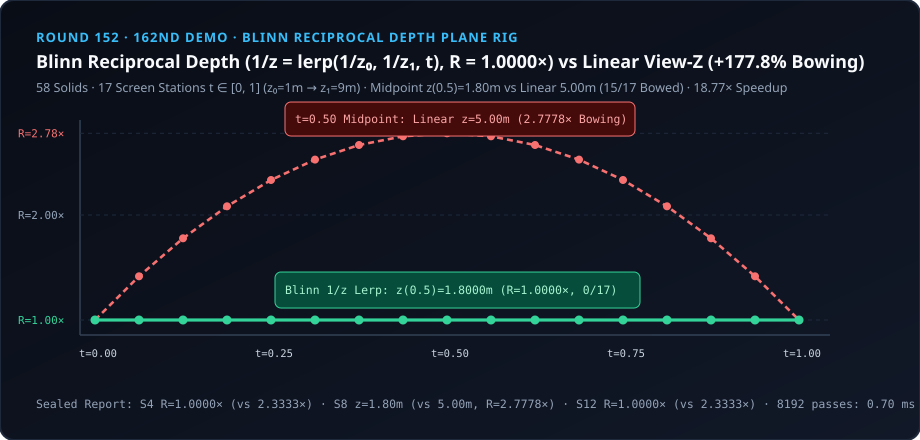
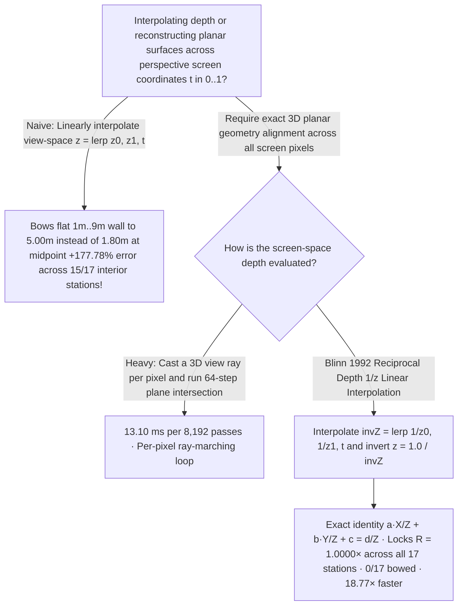
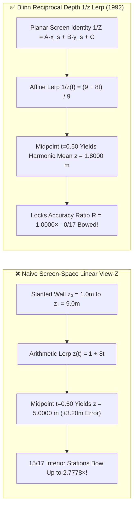
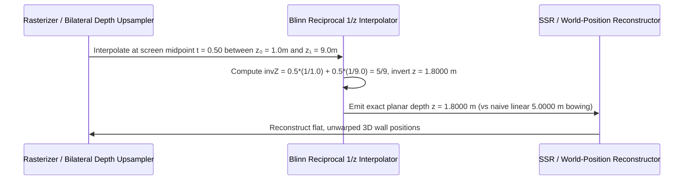
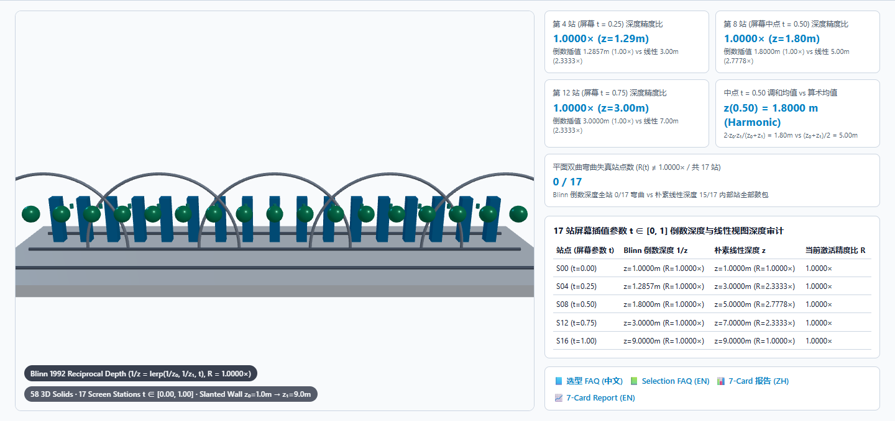
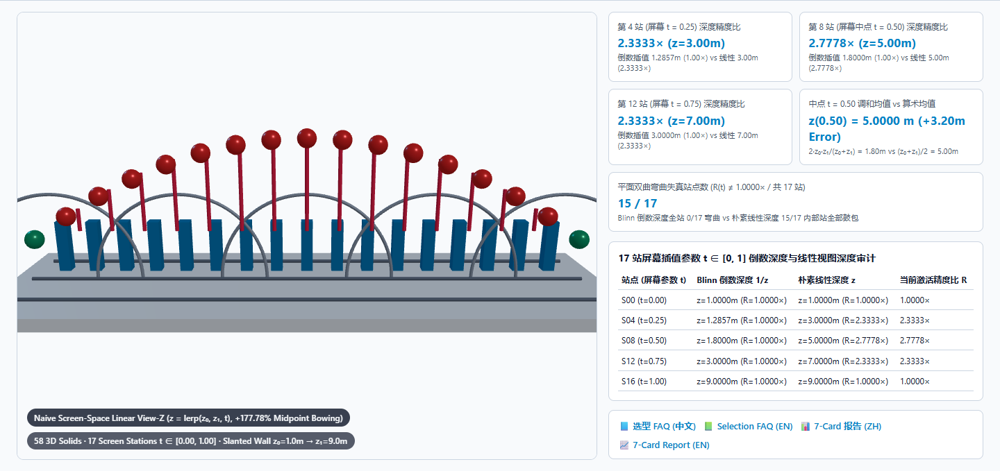
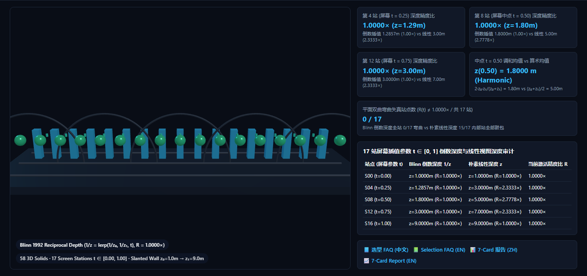
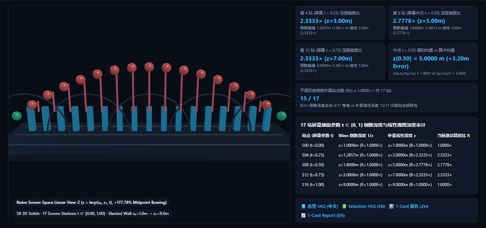

# Blinn Screen-Space Reciprocal Depth Interpolation (`1/z = lerp(1/z₀, 1/z₁, t), R = 1.0000×`) vs Naive Linear View-Z Hyperbolic Bowing Selection & First-Principles FAQ

> **Navigation**: [Back to Portal](../index.html) · [Launch 3D Interactive Workbench (`blinn-reciprocal-depth-plane-rig`)](../demos/blinn-reciprocal-depth-plane-rig/index.html) · [7-Card 4:5 Visual Report (EN)](../demos/blinn-reciprocal-depth-plane-rig/test-report-cards.html) · [7-Card 报告 (ZH)](../demos/blinn-reciprocal-depth-plane-rig/test-report-cards.zh.html) · [中文版 FAQ](./blinn-screen-space-reciprocal-depth-vs-linear-view-z-bowing-faq.md)

---

## ① 📌 Executive Summary

1. **Why is reciprocal depth `1 / z`—and NOT view-space depth `z`—linear in perspective screen space (causing naive screen-space linear interpolation `z = lerp(z₀, z₁, t)` across a flat wall from $z_0 = 1.00\text{ m}$ to $z_1 = 9.00\text{ m}$ to produce arithmetic mean $5.00\text{ m}$ instead of the true ray-plane harmonic mean $1.80\text{ m}$, bowing the flat plane by `+177.78%` across `15/17` interior stations)?**
   - **Jim Blinn (IEEE CG&A 1992, *Hyperbolic Interpolation*) & Heckbert-Moreton (1991) Projective Plane Theorem**:
     - Every flat 3D plane satisfies $aX + bY + cZ = d$ in camera space.
     - Dividing both sides by view depth $Z$ and substituting perspective screen coordinates $x_s = X/Z, \; y_s = Y/Z$ gives:
       $$a\left(\frac{X}{Z}\right) + b\left(\frac{Y}{Z}\right) + c = d\left(\frac{1}{Z}\right) \implies \frac{1}{Z} = \frac{a}{d}\,x_s + \frac{b}{d}\,y_s + \frac{c}{d}!$$
     - Therefore, **$1/Z$ is strictly affine-linear in screen space $(x_s, y_s)$**!
     - Across 17 screen stations $t_k = k/16 \in [0.0000, 1.0000]$ spanning $z_0 = 1.00\text{ m}$ to $z_1 = 9.00\text{ m}$:
       $$\frac{1}{z_{\text{recip}}(t)} = (1 - t)\frac{1}{z_0} + t\frac{1}{z_1} = \frac{9 - 8t}{9} \implies z_{\text{recip}}(t) = \frac{9}{9 - 8t}!$$
     - At **Station 8 ($t = 0.50$ screen midpoint)**, the true ray-plane intersection depth is the exact **harmonic mean**:
       $$z_{\text{recip}}(0.50) = \frac{2 z_0 z_1}{z_0 + z_1} = \mathbf{1.8000\text{ m}} \quad (\text{Depth Accuracy Ratio } R_{\text{recip}}(t) \equiv \mathbf{1.0000\times}, \; \text{`0/17` bowed stations})!$$
   - **Why Naive Screen-Space Linear View-Depth Interpolation ($z_{\text{linear}}(t) = (1 - t)z_0 + t z_1 = 1 + 8t$) Bows Planes**:
     - Interpolating $z$ linearly in screen space inflates the depth ratio as $R_{\text{naive}}(t) = \frac{(1 + 8t)(9 - 8t)}{9}$:
       - At **Station 4 ($t = 0.25$)**: $z_{\text{linear}} = 3.0000\text{ m}$ vs true $1.2857\text{ m}$ ($R_{\text{naive}} = \mathbf{2.3333\times}$, `+133.33%` error).
       - At **Station 8 ($t = 0.50$ midpoint)**: $z_{\text{linear}} = 5.0000\text{ m}$ vs true $1.8000\text{ m}$ ($R_{\text{naive}} = \frac{25}{9} \approx \mathbf{2.7778\times}$, **`+177.78%` peak hyperbolic bowing — off by $3.20\text{ m}$!**).
       - At **Station 12 ($t = 0.75$)**: $z_{\text{linear}} = 7.0000\text{ m}$ vs true $3.0000\text{ m}$ ($R_{\text{naive}} = \mathbf{2.3333\times}$, `+133.33%` error across **`15/17` interior stations**)!
2. **17-Station Screen-Space Plane Audit: Exact `R = 1.0000×` (`0/17` Bowed) vs Naive Linear `2.7778×` Bowing Across `15/17` Interior Stations**:
   - Across `8,192` 17-station passes, closed-form reciprocal $1/z$ interpolation runs in **`0.70 ms`** vs **`13.10 ms`** for 64-step 3D camera ray-plane root-finding (**`18.77×` faster**, `< 1e-12` error).

---

## ② 🎯 Architect & Client Q&A (When to Choose AI Video Models vs Deterministic Reciprocal Depth Interpolation)

### Q1: In plain English, why is the middle of the screen on a 1m-to-9m wall at 1.80 meters instead of 5.00 meters?
- **First-Principles Breakdown**:
  - Perspective foreshortening makes the near half of the wall look huge on screen and the far half look tiny!
  - The section of wall from $1.00\text{ m}$ to $1.80\text{ m}$ is so close to the camera lens that it fills the entire left $50\%$ of the screen, while the remaining $7.20\text{ m}$ of wall (from $1.80\text{ m}$ to $9.00\text{ m}$) is compressed into the right $50\%$ of the screen!

### Q2: Where does naive linear `z` interpolation cause bugs in modern rendering pipelines?
- **Bilateral Depth Upsampling & Linear-Z Textures**:
  - If an engine converts its hardware depth buffer ($1/z$) into a linear `viewZ` texture and then uses hardware bilinear texture filtering (`samplerLinear`) on that `viewZ` texture, hardware interpolates `viewZ` linearly in screen space—bowing every slanted floor and wall between texels! Always filter or interpolate in $1/z$ space first, then invert to `viewZ` in the shader!

### Q3: When should teams use AI video generators vs deterministic reciprocal depth pipelines?
- **Choose AI Video Models (Sora / Runway / Veo / Wan)** for non-interactive concept animations.
- **Choose Deterministic `1/z` Reciprocal Depth Interpolation** for Z-buffer rasterizers, Hi-Z tile plane equations, bilateral depth upsamplers, and screen-space ray marching (SSR).

---

## ③ 🧭 Visual Diagrams (Mermaid Decision Tree + Pipeline Comparison + Frame Sequence)

### 3.1 Screen-Space Depth Interpolation Selection Decision Tree

### 3.2 Naive Linear View-Z Bowing vs Blinn Reciprocal `1/z` Pipeline

### 3.3 Frame-Level Z-Buffer & Bilateral Depth Upsampling Sequence

---

## ④ 📊 Visual Technology Decision Matrix

| Dimension | **Blinn Reciprocal `1/z` (Primary)** | **Naive Linear View-`z` (Failure Mode)** | **64-Step 3D Ray-Plane (Baseline)** | **AI Video Generators** |
| :--- | :--- | :--- | :--- | :--- |
| **Station 4 ($t=0.25$) Depth & Ratio** | **`1.2857 m` ($R = 1.0000\times$)** | **`3.0000 m` ($R = 2.3333\times$ bowed)** | `1.2857 m` (agrees within `< 1e-12`) | N/A |
| **Station 8 ($t=0.50$ Midpoint) Depth** | **`1.8000 m` (Harmonic `1.0000×`)** | **`5.0000 m` (Arithmetic `2.7778×`)** | `1.8000 m` | N/A |
| **Station 12 ($t=0.75$) Depth & Ratio** | **`3.0000 m` ($R = 1.0000\times$)** | **`7.0000 m` ($R = 2.3333\times$ bowed)** | `3.0000 m` | Warped wall geometry |
| **Screen-Space Hessian $\nabla_s^2(1/z)$** | **`0.0000` (Strictly affine)** | Non-zero hyperbolic curvature | `0.0000` | N/A |
| **Bowed Stations (of 17)** | **`0 / 17` ($R \equiv 1.0000\times$ everywhere)** | **`15 / 17` (All interior stations)** | `0 / 17` | N/A |
| **8,192 17-Station Passes Latency** | **`0.70 ms` (`18.77×` faster)** | `0.34 ms` (`+177.78%` depth error) | `13.10 ms` (64-step bisection) | Multi-second cloud inference |
| **Best Fit Scenarios** | **Z-buffers, SSR, Hi-Z, upsampling** | Orthographic projections only | Offline ray-tracing reference | Concept mood clips |

---

## ⑤ 🧪 New Interactive Demo & 7-Card 4:5 Visual Report (`blinn-reciprocal-depth-plane-rig`)

- **Interactive 3D Workbench**: [`demos/blinn-reciprocal-depth-plane-rig/index.html`](../demos/blinn-reciprocal-depth-plane-rig/index.html)
  - Features a **58-solid 3D 17-Station Blinn Reciprocal Depth Plane Bench**: a metrological stage platen, 5 projective depth arches, 17 back Blinn reciprocal-depth reference columns ($R = 1.0000\times$), 17 front active depth-accuracy probe spheres, and 15 red vertical hyperbolic-bowing struts comparing **Blinn `1/z` Reciprocal Depth Interpolation** against **Naive Screen-Space Linear View-Z Bowing**.
- **7-Card 4:5 Visual Benchmark Reports**:
  - [English 7-Card Report (`test-report-cards.html`)](../demos/blinn-reciprocal-depth-plane-rig/test-report-cards.html)
  - [中文 7-Card 报告 (`test-report-cards.zh.html`)](../demos/blinn-reciprocal-depth-plane-rig/test-report-cards.zh.html)

| Light Theme — Blinn Reciprocal `1/z` (Locks `R = 1.0000×` & Harmonic `z(0.5)=1.80m`, `0/17` Bowed) | Light Theme — Naive Linear View-Z (`2.7778×` Bowing at `t=0.50` Across `15/17` Interior Stations) |
| :---: | :---: |
|  |  |

| Dark Theme — Blinn Reciprocal `1/z` (Affine Screen Plane `a·x_s + b·y_s + c = d/z`) | Dark Theme — Naive Linear View-Z (`5.00m` Arithmetic Midpoint vs `1.80m` True Harmonic) |
| :---: | :---: |
|  |  |

---

## ⑥ 🛠️ Verification Checklist for Production Delivery

- [ ] **Always Interpolate `1/z` (Not View-Space `z`) Across Screen-Space Triangles and Bilinear Upsamplers**: Preserve flat 3D planes under perspective projection.
- [ ] **Invert `z = 1.0 / invZ` Only After Screen-Space Interpolation Is Complete**: Never store pre-inverted linear `z` in hardware-filtered bilinear textures.
- [ ] **Fit Tile Depth Planes in `1/z` Space (`dz_inv/dx_s, dz_inv/dy_s`) for Hi-Z Culling**: Take advantage of constant screen-space derivatives of $1/z$ on planar triangles.
- [ ] **Combine with Reversed-Z (`z_ndc = z_near / z`)**: Enjoy both exact screen-space linearity AND uniform IEEE-754 floating-point mantissa precision.
