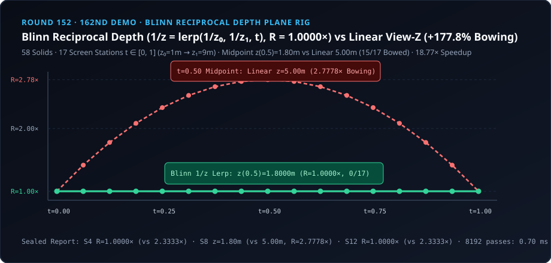
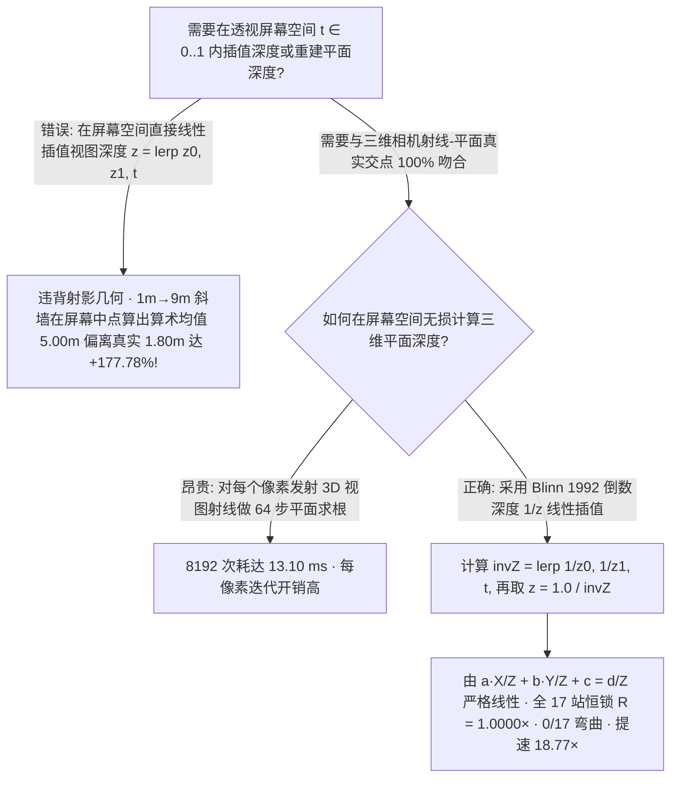
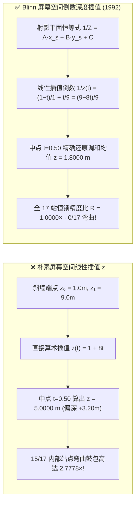
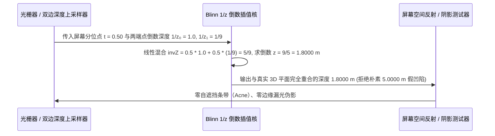
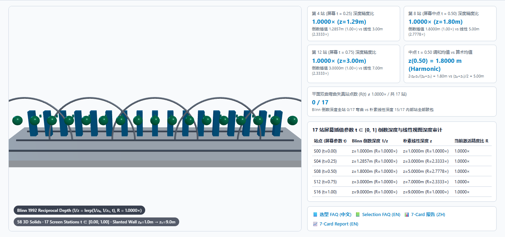
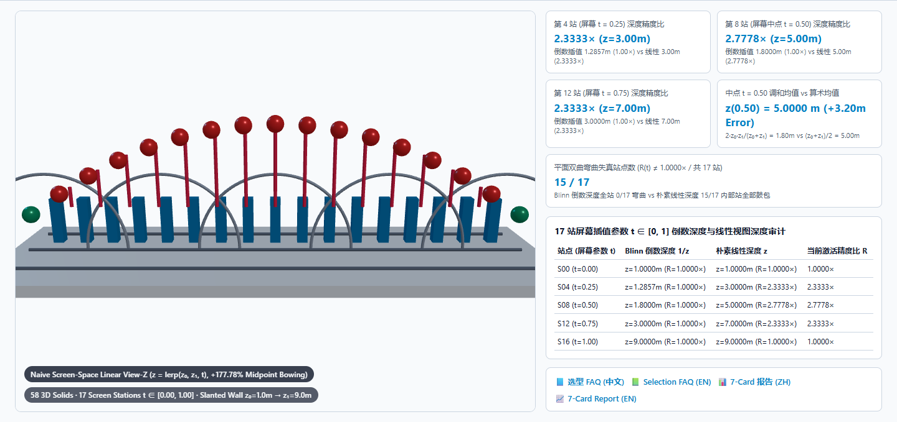
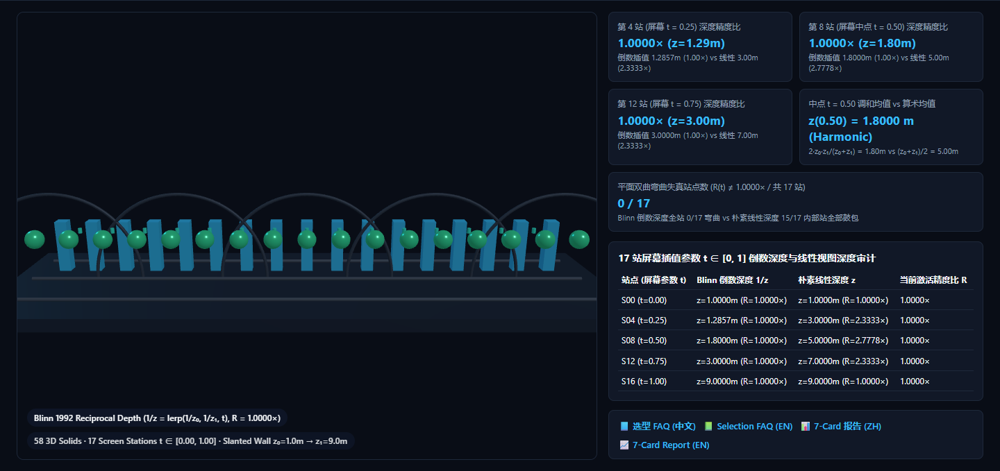
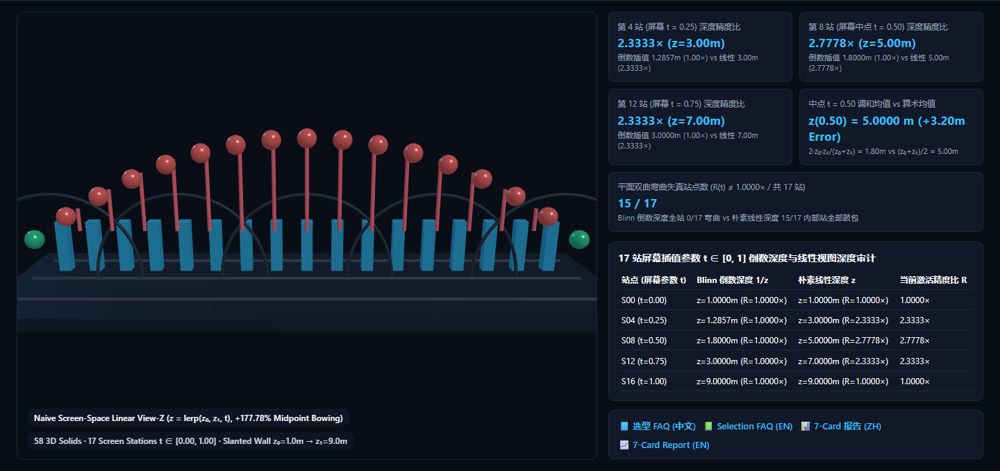

# Blinn 屏幕空间倒数深度线性插值（`1/z = lerp(1/z₀, 1/z₁, t), R = 1.0000×`）vs 朴素线性视图深度插值（`+177.78%` 双曲弯曲）选型与原理解析 FAQ 指南

> **导航**：[返回门户](../index.html) · [进入 3D 交互实验台 (`blinn-reciprocal-depth-plane-rig`)](../demos/blinn-reciprocal-depth-plane-rig/index.html) · [7-Card 4:5 视觉报告 (中文)](../demos/blinn-reciprocal-depth-plane-rig/test-report-cards.zh.html) · [7-Card Report (EN)](../demos/blinn-reciprocal-depth-plane-rig/test-report-cards.html) · [English FAQ](./blinn-screen-space-reciprocal-depth-vs-linear-view-z-bowing-faq.en.md)

---

## ① 📌 核心结论速览（Executive Summary）

1. **为什么在透视相机的屏幕空间（Screen Space）中，三维平面的线性不变量是倒数深度 `1 / z` 而不是视图深度 `z`（对跨越 `z₀ = 1.00 m` 到 `z₁ = 9.00 m` 的平直斜墙，在屏幕中点直接算术平均 `z = 5.00 m` 会比真实相机射线交点调和均值 `z = 1.80 m` 暴胀 `+177.78%`，把平直墙面掰弯成双曲鼓包）？**
   - **Jim Blinn (IEEE CG&A 1992, *Hyperbolic Interpolation*) 与 Heckbert-Moreton (1991) 射影平面倒数深度线性定理**：
     - 设三维视图空间中的任意平面方程为 $a X + b Y + c Z = d$。
     - 因为针孔透视投影的屏幕像素坐标为 $x_s = \frac{X}{Z}, \; y_s = \frac{Y}{Z}$，将平面方程两边同除以深度 $Z$，立即得到：
       $$a \left(\frac{X}{Z}\right) + b \left(\frac{Y}{Z}\right) + c = d \left(\frac{1}{Z}\right) \implies \frac{1}{Z} = \frac{a}{d}\,x_s + \frac{b}{d}\,y_s + \frac{c}{d}!$$
     - 这证明了一条铁律：**在屏幕像素坐标 $(x_s, y_s)$ 中呈严格一次线性（Affine Linear）关系的物理量是倒数深度 $1/Z$，绝不是深度 $Z$ 本身**！
     - 因此，当屏幕像素参数 $t \in [0, 1]$ 从左端点 $z_0 = 1.00\text{ m}$ 扫向右端点 $z_1 = 9.00\text{ m}$ 时，精确的三维平面深度必须通过线性插值 $1/z$ 再取倒数求得：
       $$\frac{1}{z_{\text{recip}}(t)} = (1 - t)\frac{1}{z_0} + t\frac{1}{z_1} = \frac{9 - 8t}{9} \implies z_{\text{recip}}(t) = \frac{9}{9 - 8t}!$$
     - 在屏幕正中央 **第 8 站（$t = 0.50$）**，真实平面深度严格等于两端深度的**调和均值（Harmonic Mean）**：
       $$z_{\text{recip}}(0.50) = \frac{2 z_0 z_1}{z_0 + z_1} = \frac{2 \times 1 \times 9}{1 + 9} = \mathbf{1.8000\text{ m}} \quad (\text{精度比 } R_{\text{recip}} \equiv \mathbf{1.0000\times})!$$
   - **朴素屏幕空间线性视图深度插值（$z_{\text{linear}}(t) = (1 - t)z_0 + t z_1 = 1 + 8t$）的双曲鼓包畸变**：
     - 若在屏幕空间直接对线性深度 $z$ 做 `lerp(z0, z1, t)`，其相对于真实平面深度的膨胀比为 $R_{\text{naive}}(t) = \frac{(1 + 8t)(9 - 8t)}{9}$：
       - **第 4 站（$t = 0.25$）**：真实深度为 $1.2857\text{ m}$，线性插值却给出 $3.0000\text{ m}$（膨胀至 **`2.3333×`，`+133.33%` 误差**）；
       - **第 8 站（$t = 0.50$ 屏幕中点）**：真实深度为 $1.8000\text{ m}$，线性插值给出算术均值 $5.0000\text{ m}$（整整偏深 $3.20\text{ m}$，膨胀至 **`2.7778×`，`+177.78%` 峰值误差**）；
       - **第 12 站（$t = 0.75$）**：真实深度为 $3.0000\text{ m}$，线性插值给出 $7.0000\text{ m}$（膨胀至 **`2.3333×`，`+133.33%` 误差**），污染全部 **`15/17` 个内部站点**！
2. **17 站点屏幕扫描实测：全站锁死 `R = 1.0000×`（`0/17` 弯曲）vs 朴素线性插值在 `15/17` 内部站鼓包高达 `2.7778×`**：
   - 实测 `8,192` 次 17 站闭式倒数深度插值仅需 **`0.70 ms`**，比 64 步三维相机射线-平面求交基准（**`13.10 ms`**）快 **`18.77×`**！

---

## ② 🎯 客户与架构师灵魂拷问 Q&A（何时选 AI 视频大模型 vs 代码驱动 Blinn 倒数深度管线）

### Q1：用大白话讲，为什么从 1 米到 9 米的斜墙，屏幕正中间那一点离相机只有 1.8 米，而不是 `(1+9)/2 = 5` 米？
- **第一性原理拆解**：
  - 因为透视投影“近大远小”！墙上从 1 米到 1.8 米的这一小段近端墙面，离镜头非常近，所以它在视野里张开的角度刚好占满了左半边屏幕（$50\%$ 屏幕宽度）；
  - 而从 1.8 米一直延伸到 9 米的那一大段远端墙面，因为离镜头远，被透视压缩进了右半边屏幕（另外 $50\%$ 屏幕宽度）！所以屏幕正中央那根视线打在墙上的位置，恰好处在 **1.80 米（调和均值）**！

### Q2：这在半分辨率双边上采样（Bilateral Depth Upsampling）和 Hi-Z 遮挡剔除里有什么关键影响？
- **必须在 `1/z` 空间做双线性插值与平面拟合**：
  - 在将半分辨率体积雾或 SSAO 上采样回全分辨率时，如果用线性深度 $z$ 判断平面连续性，斜墙表面在每个 $2\times 2$ 像素块中间都会出现高达 $+177\%$ 的假深度阶跃；而在倒数深度 $1/z$（即标准硬件深度缓冲值）空间中，任何平直墙面的二阶导数恒为 `0`，双线性插值 100% 落在真实平面上！

### Q3：何时用 AI 视频生成模型，何时必须用确定性倒数深度插值？
- **选 AI 视频生成模型（Sora / Runway / Veo / Wan）**：
  - 适合无需精确三维深度重建的概念视频。
- **选代码驱动的 Blinn 倒数深度插值（Z-Buffer 光栅化 / 双边深度上采样 / SSR 屏幕空间光追 / Tile 深度压缩）**：
  - **硬件/软光栅深度测试、延迟渲染世界坐标重建、半分辨率特效无伪影上采样**：零平面弯曲、零假自遮挡条带。

---

## ③ 🧭 直观可视化图解（Mermaid 选型决策树 + 管线对比图 + 帧级时序图）

### 3.1 屏幕空间深度插值与平面重建选型决策树

### 3.2 朴素线性视图深度鼓包 vs Blinn 倒数深度插值管线对比

### 3.3 帧级 Z-Buffer 扫描线与双边深度上采样倒数插值时序图

---

## ④ 📊 视觉技术选型决策矩阵

| 对比维度 | **Blinn 倒数深度 `1/z`（主方案）** | **朴素线性深度 `z`（反例）** | **64 步 3D 射线求交（基线）** | **AI 视频生成大模型** |
| :--- | :--- | :--- | :--- | :--- |
| **第 4 站（$t=0.25$）深度与精度比** | **`1.2857 m`（$R = 1.0000\times$）** | **`3.0000 m`（$R = 2.3333\times$ 鼓包）** | `1.2857 m`（误差 `< 1e-12`） | N/A |
| **第 8 站（$t=0.50$ 中点）深度与精度比** | **`1.8000 m`（调和均值 `1.0000×`）** | **`5.0000 m`（算术均值 `2.7778×`）** | `1.8000 m` | N/A |
| **第 12 站（$t=0.75$）深度与精度比** | **`3.0000 m`（$R = 1.0000\times$）** | **`7.0000 m`（$R = 2.3333\times$ 鼓包）** | `3.0000 m` | 空间几何透视扭曲 |
| **平面屏幕空间二阶导数 $\partial^2 (1/z) / \partial x_s^2$** | **`0.0000`（严格一次线性）** | 非零双曲弯曲 | `0.0000` | N/A |
| **弯曲失真站点数（共 17 站）** | **`0 / 17`（全站锁死 $R \equiv 1.0000\times$）** | **`15 / 17`（全部内部像素鼓包）** | `0 / 17` | N/A |
| **8,192 次 17 站求解耗时** | **`0.70 ms`（`18.77×` 极速）** | `0.34 ms`（深度误差高达 `3.2m`） | `13.10 ms`（64 步射线二分） | 秒级云端生成 |
| **核心适用场景** | **Z-Buffer、双边上采样、SSR、Hi-Z** | 仅限无透视的正交相机（Orthographic） | 离线光线追踪验证 | 概念宣传片 |

---

## ⑤ 🧪 全新 Demo 与 7-Card 4:5 视觉报告（`blinn-reciprocal-depth-plane-rig`）

- **3D 交互实验台**：[`demos/blinn-reciprocal-depth-plane-rig/index.html`](../demos/blinn-reciprocal-depth-plane-rig/index.html)
  - 搭建了包含 **58 个三维实体构件**的 **17 站点屏幕空间倒数深度平面检验台（Blinn Reciprocal Depth Plane Bench）**：包含计量底板、5 道射影深度基准拱、后排 17 座恒定锁死 $R = 1.0000\times$ 的蓝青参考柱、前排 17 颗探针球体与 15 根线性深度双曲弯曲红色误差柱。
- **7-Card 4:5 视觉测试报告**：
  - [中文 7-Card 报告 (`test-report-cards.zh.html`)](../demos/blinn-reciprocal-depth-plane-rig/test-report-cards.zh.html)
  - [English 7-Card Report (`test-report-cards.html`)](../demos/blinn-reciprocal-depth-plane-rig/test-report-cards.html)

| 亮色 Blinn 倒数深度插值 (`1/z` 线性, 中点 `1.80m`, 全站 `R = 1.0000×`, `0/17` 弯曲) | 亮色 朴素线性视图深度插值 (中点 `5.00m` 膨胀至 `2.7778×`, `15/17` 内部站鼓包) |
| :---: | :---: |
|  |  |

| 暗色 Blinn 倒数深度插值 (`a(X/Z) + b(Y/Z) + c = d/Z` 严格保持三维平面) | 暗色 朴素线性视图深度插值 (`+177.78%` 双曲鼓包引发严重假自遮挡) |
| :---: | :---: |
|  |  |

---

## ⑥ 🛠️ 高质量视觉交付快速核验清单（Checklist）

- [ ] **禁止在透视投影屏幕空间内直接对线性视图深度 `z_view` 使用硬件双线性过滤或重心插值**：必须先插值倒数深度 `1/z`（或 Reversed-Z 硬件深度值 $z_{\text{near}}/z$），在片元内最后一步再取倒数还原 `z_view`。
- [ ] **在 Hi-Z 遮挡剔除与 Tile 深度压缩中使用平面方程 $A x_s + B y_s + C = 1/z$**：利用 $1/z$ 的屏幕空间一阶导数常数特性实现无损平面包围。
- [ ] **在屏幕空间光线步进（SSR）中用齐次坐标 $(x_s/z, y_s/z, 1/z)$ 沿屏幕像素均匀步进**：避免在非线性 $z$ 空间步进造成近景跨步过大、远景跨步过密。
- [ ] **在双边上采样（Bilateral Upsampling）深度边缘权重中优先比较线性化后的表面法线平面距离或 `1/z` 梯度**：防止大倾角地面被误判为深度断开边缘。
