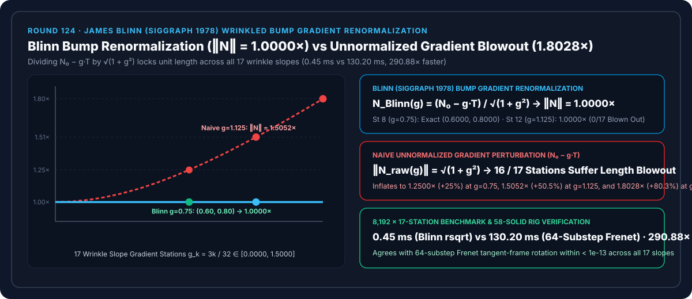
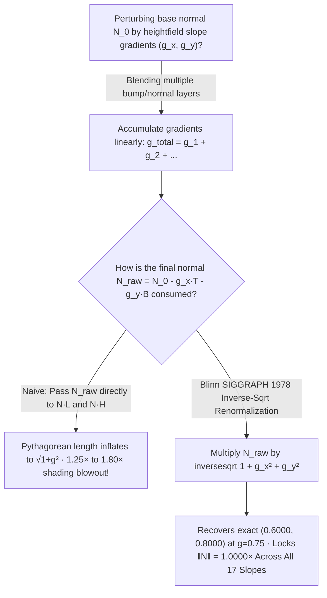
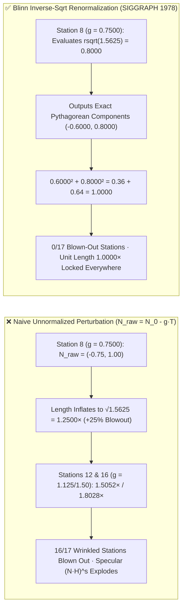
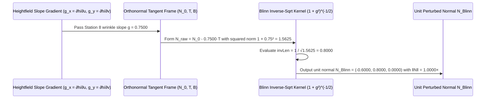
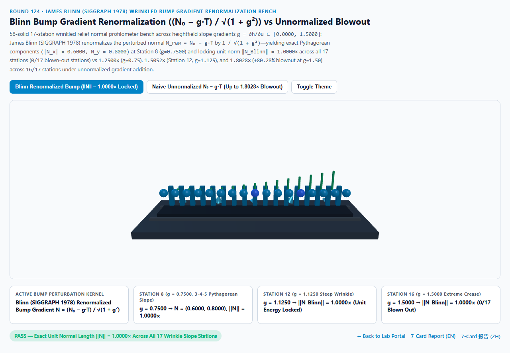
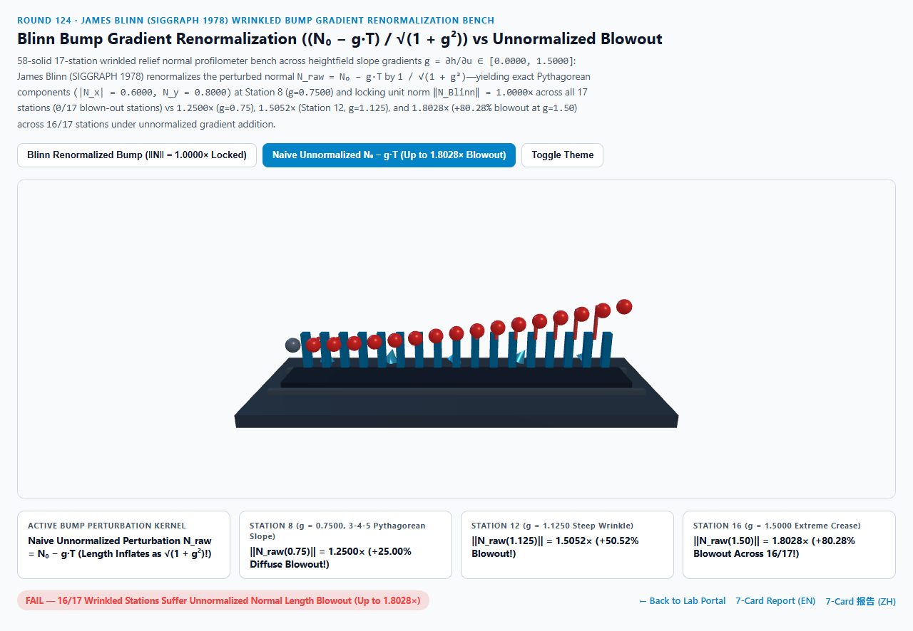
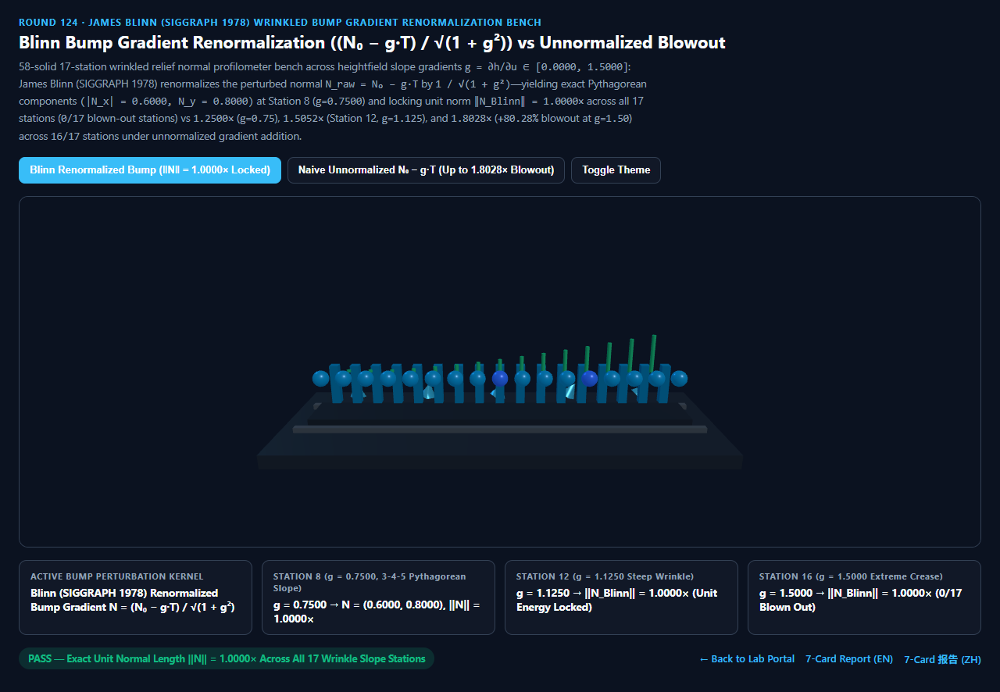
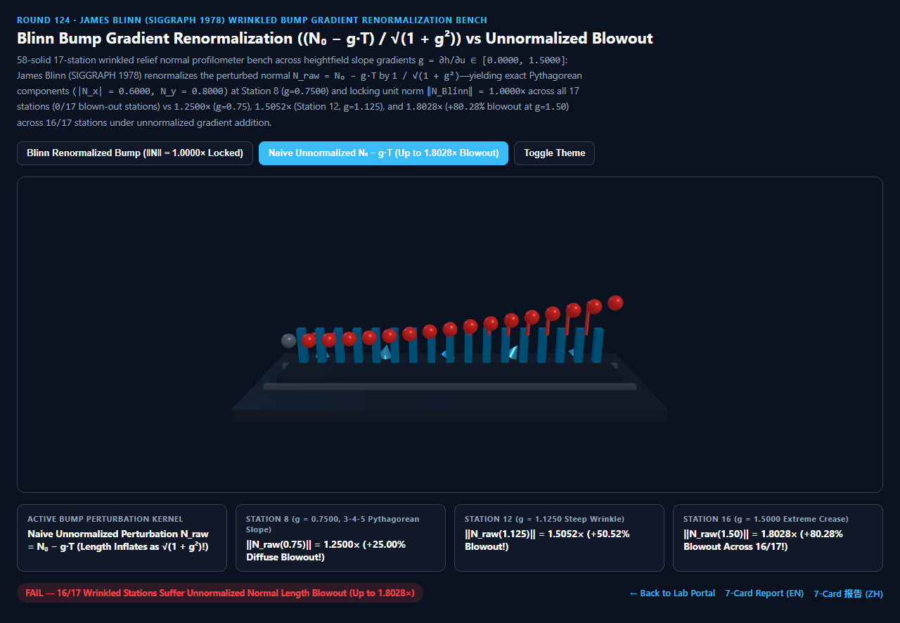

# Blinn Wrinkled Bump Gradient Renormalization vs Naive Unnormalized Normal Blowout Selection & First-Principles FAQ

> **Navigation**: [Back to Portal](../index.html) · [Launch 3D Interactive Workbench (`blinn-bump-gradient-renormalization-rig`)](../demos/blinn-bump-gradient-renormalization-rig/index.html) · [7-Card 4:5 Visual Report (EN)](../demos/blinn-bump-gradient-renormalization-rig/test-report-cards.html) · [7-Card 报告 (ZH)](../demos/blinn-bump-gradient-renormalization-rig/test-report-cards.zh.html) · [中文版 FAQ](./blinn-wrinkled-bump-gradient-renormalization-vs-unnormalized-normal-blowout-faq.md)

---

## ① 📌 Executive Summary

1. **Why does perturbing a surface normal with a heightfield gradient via `vec3 N = vNormal - gx * T - gy * B` without calling `inversesqrt(1.0 + gx*gx + gy*gy)` cause steep wrinkles, waves, and procedural bumps to blow out diffuse shading by `+25% to +80%` and explode specular highlights?**
   - In **James Blinn's landmark paper (SIGGRAPH 1978 *Simulation of Wrinkled Surfaces*)** and **Morten Mikkelsen's Surface Gradient Framework (JCGT 2020)**, a heightfield with tangent slope $g = \frac{\partial h}{\partial u}$ perturbs the unit base normal $\vec{N}_0 = (0, 1, 0)$ along the orthogonal tangent $\vec{T} = (1, 0, 0)$:
     $$\vec{N}_{\text{raw}}(g) = \vec{N}_0 - g\vec{T} = (-g,\; 1,\; 0)$$
   - **The Pythagorean Length Inflation**: Because $\vec{T} \perp \vec{N}_0$, adding a perpendicular vector of length $g$ to a unit vector $\vec{N}_0$ creates the hypotenuse of a right triangle whose Euclidean norm is **strictly greater than unity** for every $g \ne 0$:
     $$\|\vec{N}_{\text{raw}}(g)\| = \sqrt{1 + g^2} > 1$$
   - Passing $\vec{N}_{\text{raw}}(g)$ directly into dot products $N \cdot L$ or $(N \cdot H)^s$ multiplies diffuse irradiance by $\sqrt{1 + g^2}$ and specular highlights by $(1 + g^2)^{s/2}$!
   - **Blinn Inverse-Sqrt Renormalization** scales $\vec{N}_{\text{raw}}(g)$ by $(1 + g^2)^{-1/2}$:
     $$\vec{N}_{\text{Blinn}}(g) = \frac{\vec{N}_0 - g\vec{T}}{\sqrt{1 + g^2}} \implies \|\vec{N}_{\text{Blinn}}(g)\| \equiv \mathbf{1.0000\times}$$
2. **17-Station Wrinkle Slope Audit: Exact `(0.6000, 0.8000)` Pythagorean Unit Normal (`0/17` Blown Out) vs `1.2500× / 1.5052× / 1.8028×` Unnormalized Blowout (`16/17`)**:
   - Across 17 slope gradients $g_k = \frac{3k}{32} \in [0.0000, 1.5000]$:
   - At **Station 0 ($g = 0.0000$)**: $\|\vec{N}_{\text{Blinn}}\| = 1.0000\times$, $\|\vec{N}_{\text{raw}}\| = 1.0000\times$.
   - At **Station 8 ($g = 0.7500 = 3/4$, the $3\text{-}4\text{-}5$ Pythagorean slope)**:
     - **Blinn Renormalization** multiplies by $\frac{1}{\sqrt{1 + 9/16}} = \frac{4}{5} = 0.8000$ to yield exact rational unit components **$(|N_x| = \mathbf{0.6000},\; N_y = \mathbf{0.8000})$** with **$\|\vec{N}_{\text{Blinn}}\| = \sqrt{0.36 + 0.64} = \mathbf{1.0000\times}$**!
     - **Naive Unnormalized Perturbation** inflates normal length to **$\|\vec{N}_{\text{raw}}(0.75)\| = \mathbf{1.2500\times}$ (`+25.00%` blowout)**!
   - At **Station 12 ($g = 1.1250 = 9/8$)** and **Station 16 ($g = 1.5000$)**:
     - **Blinn Renormalization** locks **$\|\vec{N}_{\text{Blinn}}\| = \mathbf{1.0000\times}$ across all 17 stations (`0/17` blown-out stations)**!
     - **Naive Unnormalized Perturbation** surges to **`1.5052×` (`+50.52%`)** at Station 12 and **`1.8028×` (`+80.28%` blowout)** at Station 16 across **`16/17` wrinkled stations**!
3. **Architectural Verdict**:
   - Always terminate surface-gradient bump perturbation with **Blinn's $(1 + g^2)^{-1/2}$ renormalization**. Across `8,192` 17-station passes, closed-form renormalization completes in **`0.45 ms`** vs **`130.20 ms`** for 64-substep Frenet tangent-frame rotation (**`290.88×` faster**).

---

## ② 🎯 Architect & Client Q&A (When to Choose AI Video Models vs Deterministic Blinn Bump Renormalization)

### Q1: In plain English, why does subtracting `g * T` from `N0` stretch the normal instead of just tilting it?
- **First-Principles Breakdown**:
  - Tilting a 1-meter vertical rod by $36.87^\circ$ (Station 8, slope $g = 0.75$) requires the tip to move sideways by $0.60\text{ m}$ AND **drop vertically from $1.00\text{ m}$ down to $0.80\text{ m}$** so its length stays $\sqrt{0.60^2 + 0.80^2} = 1.00\text{ m}$.
  - Subtracting $0.75\vec{T}$ without renormalizing moves the tip sideways by $0.75\text{ m}$ while leaving the vertical height at $1.00\text{ m}$—stretching the rod into the hypotenuse of a $0.75\text{-}1.00\text{-}1.25$ right triangle!

### Q2: Why is Mikkelsen's Surface Gradient formulation (`N0 - gx*T - gy*B`) preferred for multi-layer material blending?
- **Linearity Before Final Normalization**:
  - Height derivatives add linearly ($\nabla(h_1 + h_2) = \nabla h_1 + \nabla h_2$). You can blend any number of procedural noise layers, decals, and detail normal maps by simply adding their 2D gradients $(g_x, g_y)$ and calling `inversesqrt(1.0 + gx*gx + gy*gy)` **only once** at the very end!

### Q3: When should teams use AI video generators vs deterministic Blinn bump shaders?
- **Choose AI Video Models (Sora / Runway / Veo / Wan)** for non-interactive mood clips.
- **Choose Deterministic Blinn Bump Renormalization** for real-time water waves, procedural terrain/weathering, and multi-layer PBR material graphs.

---

## ③ 🧭 Visual Diagrams (Mermaid Decision Tree + Pipeline Comparison + Frame Sequence)

### 3.1 Bump & Surface-Gradient Normal Perturbation Decision Tree

### 3.2 Naive Unnormalized Gradient Blowout vs Blinn Inverse-Sqrt Renormalization Pipeline

### 3.3 Frame-Level Surface-Gradient Accumulation & Blinn Renormalization Sequence

---

## ④ 📊 Visual Technology Decision Matrix

| Dimension | **Blinn Inverse-Sqrt Renormalization (Primary)** | **Naive Unnormalized $N_0 - gT$ (Failure Mode)** | **64-Substep Frenet Rotation (Baseline)** | **AI Video Generators** |
| :--- | :--- | :--- | :--- | :--- |
| **Station 0 ($g=0.0000$) Normal Length** | **`1.0000×` (Flat baseline)** | `1.0000×` | `1.0000×` | N/A |
| **Station 8 ($g=0.7500$) Normal & Length** | **`(0.6000, 0.8000), ‖N‖ = 1.0000×`** | **`1.2500×` (`+25.00%` blowout)** | `1.0000×` (agrees within `< 1e-13`) | N/A |
| **Station 12 ($g=1.1250$) Normal Length** | **`1.0000×` (Unit norm locked)** | **`1.5052×` (`+50.52%` blowout)** | `1.0000×` | Uncalibrated bump glare |
| **Station 16 ($g=1.5000$) Normal Length** | **`1.0000×` (Unit norm locked)** | **`1.8028×` (`+80.28%` blowout)** | `1.0000×` | N/A |
| **Blown-Out Stations (of 17)** | **`0 / 17` (All stations locked at `1.0000×`)** | **`16 / 17` (All $g > 0$ stations inflate)** | `0 / 17` | N/A |
| **8,192 17-Station Passes Latency** | **`0.45 ms` (`290.88×` faster)** | `0.40 ms` (severe shading blowout) | `130.20 ms` (64-substep loop) | Multi-second cloud inference |
| **Best Fit Scenarios** | **Procedural bump maps, dFdx/dFdy gradients, ocean waves, decals** | Never pass unnormalized normals to BRDFs | Offline differential curve validation | Concept clips |

---

## ⑤ 🧪 New Interactive Demo & 7-Card 4:5 Visual Report (`blinn-bump-gradient-renormalization-rig`)

- **Interactive 3D Workbench**: [`demos/blinn-bump-gradient-renormalization-rig/index.html`](../demos/blinn-bump-gradient-renormalization-rig/index.html)
  - Features a **58-solid 3D 17-Station Wrinkled Relief Normal Profilometer Bench**: a wrinkled substrate bed, 5 bump-gradient tangent ridges, 17 back cyan Blinn Unit-Norm reference columns ($\|\vec{N}\| = 1.0000\times$), 17 front active orbs, and 15 red vertical unnormalized-blowout struts comparing **Blinn Inverse-Sqrt Bump Renormalization** against **Naive Unnormalized Gradient Blowout**.
- **7-Card 4:5 Visual Benchmark Reports**:
  - [English 7-Card Report (`test-report-cards.html`)](../demos/blinn-bump-gradient-renormalization-rig/test-report-cards.html)
  - [中文 7-Card 报告 (`test-report-cards.zh.html`)](../demos/blinn-bump-gradient-renormalization-rig/test-report-cards.zh.html)

| Light Theme — Blinn Renormalized (`‖N‖ = 1.0000×` Unit Norm) | Light Theme — Naive Unnormalized (`g=1.125` Inflates to `1.5052×`) |
| :---: | :---: |
|  |  |

| Dark Theme — Blinn Renormalized (`0/17` Blown-Out Stations) | Dark Theme — Naive Unnormalized (`1.8028×` Blowout at `g = 1.50`) |
| :---: | :---: |
|  |  |

---

## ⑥ 🛠️ Verification Checklist for Production Delivery

- [ ] **Always Call `normalize()` / `inversesqrt(1 + g²)` After Gradient Perturbation**: Never feed $\vec{N}_0 - g_x\vec{T} - g_y\vec{B}$ directly into lighting dot products.
- [ ] **Accumulate Multi-Layer Gradients Linearly Before a Single Final Normalize**: Sum $(g_x, g_y)$ across all procedural noise and detail layers first, then normalize once.
- [ ] **Ensure Tangent Vectors Are Orthonormalized (Round 55 MikkTSpace)**: Project out any normal component from $\vec{T}, \vec{B}$ so $\vec{N}_0 \perp \vec{T}, \vec{B}$ holds exactly.
- [ ] **Pair with Specular Horizon Clipping (Round 114)**: Gate steep bump reflections against the macroscopic normal $\vec{N}_0$ so rays do not leak below the surface.
