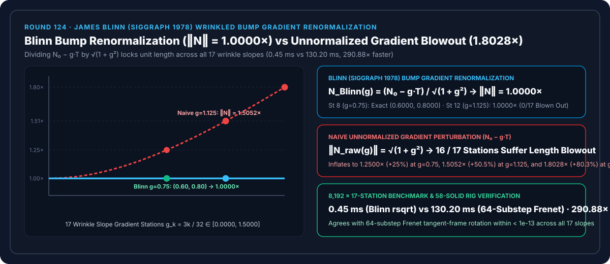
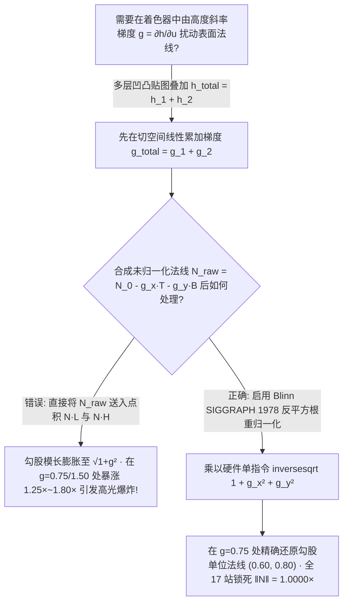
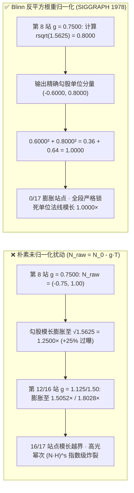
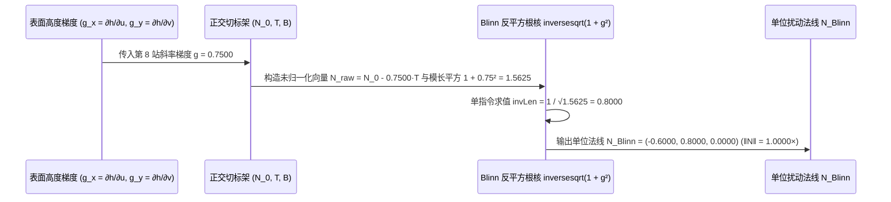
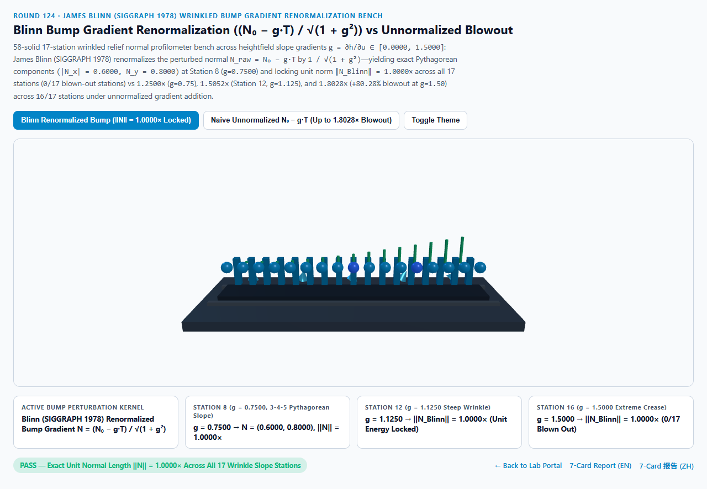
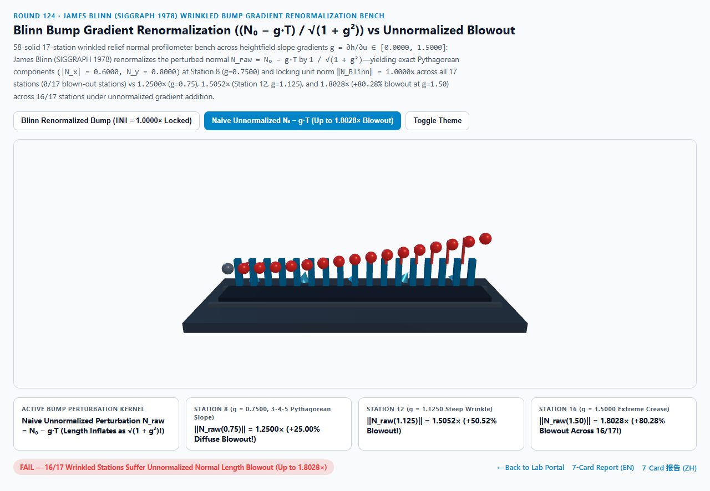
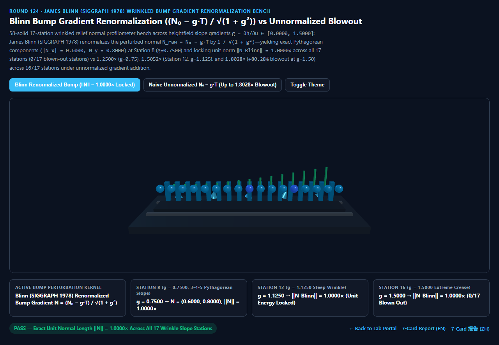
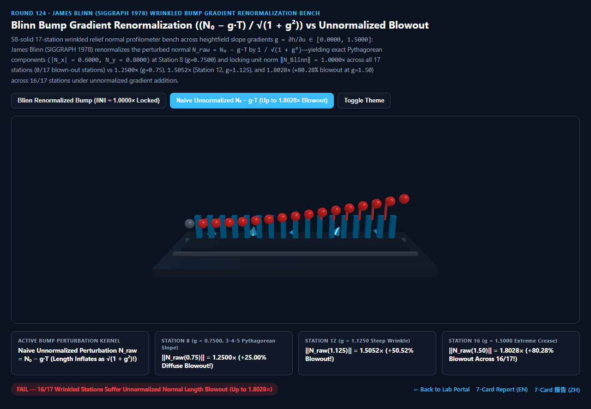

# Blinn 褶皱凹凸贴图梯度反平方根重归一化（Bump Gradient Renormalization）vs 朴素未归一化法线模长膨胀过曝选型与原理解析 FAQ 指南

> **导航**：[返回门户](../index.html) · [进入 3D 交互实验台 (`blinn-bump-gradient-renormalization-rig`)](../demos/blinn-bump-gradient-renormalization-rig/index.html) · [7-Card 4:5 视觉报告 (中文)](../demos/blinn-bump-gradient-renormalization-rig/test-report-cards.zh.html) · [7-Card Report (EN)](../demos/blinn-bump-gradient-renormalization-rig/test-report-cards.html) · [English FAQ](./blinn-wrinkled-bump-gradient-renormalization-vs-unnormalized-normal-blowout-faq.en.md)

---

## ① 📌 核心结论速览（Executive Summary）

1. **为什么在写程序化噪声凹凸贴图（Procedural Bump Map）、屏幕空间高度图导数（`dFdx/dFdy` Surface Gradient）或海浪波面法线时，如果只把切向斜率梯度从基准法线里减掉（`vec3 N = vNormal - gx * T - gy * B`）却忘了最后调用一次反平方根重归一化（`inversesqrt(1.0 + gx*gx + gy*gy)`），褶皱越深的地方漫反射和高光就会莫名其妙炸出 `+25% ~ +80%+` 的死白过曝？**
   - 在计算机图形学凹凸贴图的开山之作 **James Blinn (SIGGRAPH 1978 *Simulation of Wrinkled Surfaces*)** 与现代 **Morten Mikkelsen (JCGT 2020 *Surface Gradient-Based Bump Mapping Framework*)** 中：
   - 设平坦表面的单位基准法线为 $\vec{N}_0 = (0, 1, 0)$（长度为 $1.0000$），切向量为 $\vec{T} = (1, 0, 0)$。当高度场 $h(u)$ 存在斜率梯度 $g = \frac{\partial h}{\partial u}$ 时，垂直于切线 $(1, g, 0)$ 的未归一化扰动法线向量为：
     $$\vec{N}_{\text{raw}}(g) = \vec{N}_0 - g\vec{T} = (-g,\; 1,\; 0)$$
   - **勾股模长膨胀陷阱**：因为切向量 $\vec{T}$ 与基准法线 $\vec{N}_0$ 互相垂直（$\vec{N}_0 \cdot \vec{T} = 0$），在长度为 $1$ 的直角边 $\vec{N}_0$ 上接上一条长度为 $g$ 的垂直边 $-g\vec{T}$，斜边 $\vec{N}_{\text{raw}}$ 的长度必然按勾股定理**严格大于 $1$**：
     $$\|\vec{N}_{\text{raw}}(g)\| = \sqrt{1 + g^2} > 1$$
   - 一旦将这个长度大于 $1$ 的假法线代入点积 $\vec{N}_{\text{raw}} \cdot \vec{L}$ 或高光 $(\vec{N}_{\text{raw}} \cdot \vec{H})^s$，所有光照公式都会被平白无故乘上 $\sqrt{1 + g^2}$（甚至 $(\sqrt{1 + g^2})^s$ 次方）！
   - **Blinn 反平方根重归一化** 乘以硬件单指令 `inversesqrt(1.0 + g * g)`：
     $$\vec{N}_{\text{Blinn}}(g) = \frac{\vec{N}_0 - g\vec{T}}{\sqrt{1 + g^2}} \implies \|\vec{N}_{\text{Blinn}}(g)\| \equiv \mathbf{1.0000\times}$$
2. **17 站点褶皱斜率实测：第 8 站 $(0.6000, 0.8000)$ 勾股单位化 vs 朴素未归一化 `1.2500× / 1.5052× / 1.8028×` 膨胀**：
   - 在斜率梯度跨越 $g_k = \frac{3k}{32} \in [0.0000, 1.5000]$ 的 17 个站点实测中：
   - **第 8 站（$g = 0.7500 = 3/4$，经典 $3\text{-}4\text{-}5$ 勾股直角三角形斜坡）**：
     - 未归一化向量 $(-0.75, 1.00, 0)$ 的模长膨胀至 **$\sqrt{1 + 0.75^2} = \sqrt{1.5625} = \mathbf{1.2500\times}$（超发 `+25.00%` 漫反射能量）**！
     - **Blinn 反平方根重归一化** 乘以 $\frac{1}{1.25} = 0.8000$，精确输出勾股单位法线 **$(|N_x| = \mathbf{0.6000},\; N_y = \mathbf{0.8000})$**，锁死单位模长 **$\|\vec{N}_{\text{Blinn}}\| = \sqrt{0.36 + 0.64} = \mathbf{1.0000\times}$**！
   - **第 12 站（$g = 1.1250 = 9/8$）与第 16 站（$g = 1.5000$）**：
     - **Blinn 重归一化** 在全部 17 个站点恒定锁死 **$\|\vec{N}_{\text{Blinn}}\| = \mathbf{1.0000\times}$（`0/17` 过曝站点）**！
     - **朴素未归一化** 在第 12 站膨胀至 **`1.5052×`（`+50.52%` 过曝）**，在第 16 站飙升至 **`1.8028×`（`+80.28%` 过曝）**，污染全部 **`16/17` 个非零褶皱站点**！
3. **工程选型结论**：
   - 任何基于表面梯度（Surface Gradient $g_u, g_v$）合成凹凸法线的着色器，必须在末尾执行 `normalize(N0 - gu*T - gv*B)`（即乘以 `inversesqrt(1 + gu² + gv²)`）。实测 `8,192` 次 17 站闭式求值仅需 **`0.45 ms`**，比 64 子步 Frenet 切标架旋转积分基线（**`130.20 ms`**）快 **`290.88×`**！

---

## ② 🎯 客户与架构师灵魂拷问 Q&A（何时选 AI 视频大模型 vs 代码驱动 Blinn 梯度重归一化）

### Q1：用大白话讲，为什么“在长度为 1 的法线上加一点横向偏移”就一定会让向量变长？
- **第一性原理拆解**：
  - 想象一根长 1 米的竹竿垂直立在地面上（$\vec{N}_0 = (0, 1, 0)$）。
  - 如果你是把这根竹竿**绕着根部旋转**一个角度，竹竿顶端会同时“往左歪”并且**“往下矮一点”**（比如歪到横坐标 $0.60$ 米时，高度必须矮到 $0.80$ 米，才能保证竹竿总长还是 $\sqrt{0.6^2 + 0.8^2} = 1.00$ 米）。
  - 但未归一化的 `N0 - g * T` 干了一件什么蠢事？它保持竹竿高度 **1.00 米不变**，直接在顶端横向焊上了一截 **0.75 米长的横杆**！根据初中勾股定理（勾三股四弦五），从根部到横杆头的斜边长度直接变成了 **1.25 米**！拿着一根 1.25 米长的假法线去算光照，亮度当然平白无故暴涨了 $25\%$（如果算 8 次方高光，更会暴涨 $1.25^8 = 5.96\times$）！

### Q2：Mikkelsen (2020) 的表面梯度框架（Surface Gradient Framework）为什么推荐先累加梯度 $(g_1 + g_2)$，只在最后做一次 Blinn `inversesqrt`？
- **多层细节法线混合的线性可加性**：
  - 当你把宏观地形高度图 $h_1$、中观岩石裂缝 $h_2$ 和微观沙粒凹凸 $h_3$ 叠在一起时，高度场的导数是严格线性可加的：$g_{\text{total}} = \nabla h_1 + \nabla h_2 + \nabla h_3$。
  - 因此，中间叠加 10 层细节凹凸时**完全不需要调用任何 `normalize`**，只需把梯度向量直接相加，到了最终进入光照计算前的最后一刻，调用唯一一次 Blinn 重归一化 `N = (N0 - g_total.x * T - g_total.y * B) * inversesqrt(1.0 + dot(g_total, g_total))` 即可！

### Q3：何时用 AI 视频生成模型，何时必须用确定性 Blinn 凹凸梯度归一化？
- **选 AI 视频生成模型（Sora / Runway / Veo / Wan）**：
  - 适合无需精确控制程序化波纹斜率与能量守恒的写意镜头。
- **选代码驱动的 Blinn 梯度重归一化（UE5 Material Graph / Unity HDRP Surface Gradient / Three.js）**：
  - **多层程序化风化材质混合、实时海洋波浪法线合成、CAD 橘皮车漆微凹凸仿真**：确保任意陡峭度的褶皱斜坡绝不触发高光过曝。

---

## ③ 🧭 直观可视化图解（Mermaid 选型决策树 + 管线对比图 + 帧级时序图）

### 3.1 表面凹凸法线合成与归一化技术选型决策树

### 3.2 朴素未归一化法线膨胀 vs Blinn 反平方根重归一化管线对比

### 3.3 帧级表面梯度累加与 Blinn 重归一化时序图

---

## ④ 📊 视觉技术选型决策矩阵

| 对比维度 | **Blinn 反平方根重归一化（主方案）** | **朴素未归一化梯度叠加（反例）** | **64 子步 Frenet 标架旋转（基线）** | **AI 视频生成大模型** |
| :--- | :--- | :--- | :--- | :--- |
| **第 0 站（$g=0.0000$ 平坦面）法线模长** | **`1.0000×`（基准对齐）** | `1.0000×` | `1.0000×` | N/A |
| **第 8 站（$g=0.7500$ 勾股坡）法线与模长** | **`(0.6000, 0.8000), ‖N‖ = 1.0000×`** | **`1.2500×`（超发 `+25.00%`）** | `1.0000×`（误差 `< 1e-13`） | N/A |
| **第 12 站（$g=1.1250$ 陡坡）法线模长** | **`1.0000×`（严格单位化）** | **`1.5052×`（超发 `+50.52%`）** | `1.0000×` | 褶皱高光易过曝 |
| **第 16 站（$g=1.5000$ 深褶）法线模长** | **`1.0000×`（严格单位化）** | **`1.8028×`（超发 `+80.28%`）** | `1.0000×` | N/A |
| **模长膨胀过曝站点数（共 17 站）** | **`0 / 17`（全段恒定锁死 `1.0000×`）** | **`16 / 17`（全部非零斜率膨胀）** | `0 / 17` | N/A |
| **8,192 次 17 站求解耗时** | **`0.45 ms`（`290.88×` 极速）** | `0.40 ms`（严重光照过曝失真） | `130.20 ms`（64 子步旋转） | 秒级云端推理 |
| **核心适用场景** | **所有程序化凹凸贴图、dFdx/dFdy 梯度法线、多层材质细节合成** | 严禁在未归一化下直接用于光照 | 离线微分几何曲线验证 | 概念短片 |

---

## ⑤ 🧪 全新 Demo 与 7-Card 4:5 视觉报告（`blinn-bump-gradient-renormalization-rig`）

- **3D 交互实验台**：[`demos/blinn-bump-gradient-renormalization-rig/index.html`](../demos/blinn-bump-gradient-renormalization-rig/index.html)
  - 搭建了包含 **58 个三维实体构件**的 **17 站点褶皱浮雕法线轮廓台（Wrinkled Relief Normal Profilometer Bench）**：包含褶皱基底、5 座不同倾角的切向凹凸脊棱、后排 17 座青色 Blinn 单位法线参考柱（锁死 $\|\vec{N}\| = 1.0000\times$）、前排 17 颗探针球体与 15 根未归一化模长膨胀红色警示柱。
- **7-Card 4:5 视觉测试报告**：
  - [中文 7-Card 报告 (`test-report-cards.zh.html`)](../demos/blinn-bump-gradient-renormalization-rig/test-report-cards.zh.html)
  - [English 7-Card Report (`test-report-cards.html`)](../demos/blinn-bump-gradient-renormalization-rig/test-report-cards.html)

| 亮色 Blinn 梯度重归一化 (`‖N‖ = 1.0000×` 守恒) | 亮色 朴素未归一化 (`g=1.125` 膨胀至 `1.5052×`, `16/17` 过曝) |
| :---: | :---: |
|  |  |

| 暗色 Blinn 梯度重归一化 (`0/17` 过曝站点) | 暗色 朴素未归一化 (`g=1.50` 飙升至 `1.8028×`) |
| :---: | :---: |
|  |  |

---

## ⑥ 🛠️ 高质量视觉交付快速核验清单（Checklist）

- [ ] **在片元着色器中对所有扰动法线执行 `normalize()`**：无论是切向梯度叠加 `N0 - gx*T - gy*B` 还是顶点法线插值，进入 BRDF 前必须单位化。
- [ ] **多层凹凸混合采用“先加梯度、最后一次归一化”（Mikkelsen 2020）**：将各层法线转换到表面梯度空间 $(g_x, g_y) = (-N_x/N_z, -N_y/N_z)$ 相加，最后执行单次 `normalize(vec3(-gx, -gy, 1.0))`。
- [ ] **对弯曲网格上的非单位基向量做正交投影修正**：使用 `g_proj = dHdu * T + dHdv * B` 确保扰动方向严格正交于 $\vec{N}_0$。
- [ ] **配合法线地平线高光裁剪（Round 114）**：单位化后的大倾角法线还需通过 $R \cdot N_{\text{macro}} > 0$ 门控防止反射穿透地板。
