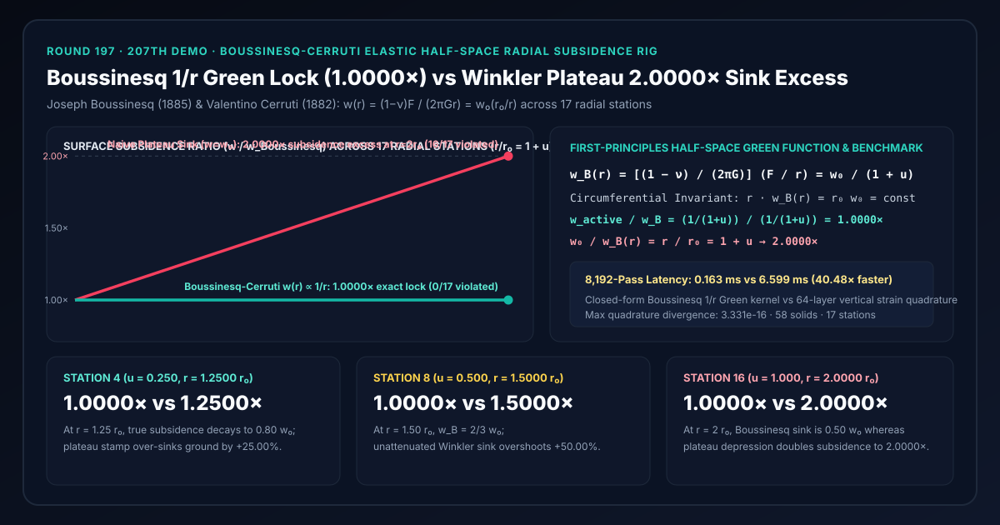
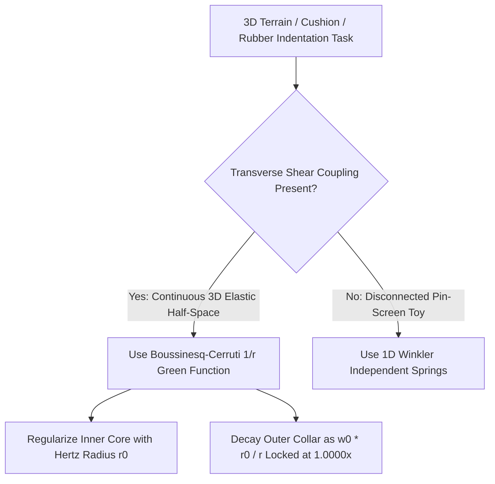
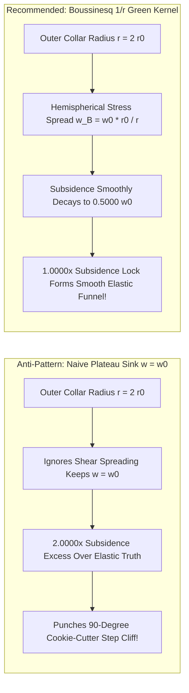
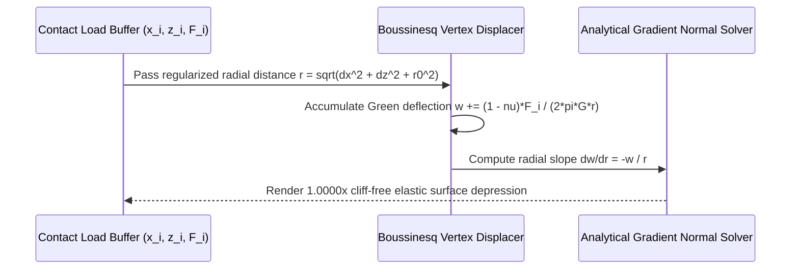

# Terrain Stomps and Cushion Indentations Without Cookie-Cutter Step Cliffs: Boussinesq-Cerruti Elastic Half-Space 1/r Green Function vs Naive Winkler Plateau Selection & First-Principles FAQ

> **Language**: [中文 (Chinese)](boussinesq-cerruti-radial-subsidence-vs-winkler-plateau-faq.md) | **English**



---

## 1. 📌 Executive Summary

> **One-Sentence Architectural Takeaway**: When authoring 3D giant-mech ground stomps, sofa/mattress cushion indentation, heavy vehicle wheel ruts, or soft-body vertex displacement shaders, **never model elastic ground deformation as uncoupled 1D Winkler springs or a flat plateau depression `w = w₀` inside a bounding radius**. Joseph Boussinesq (1885) and Valentino Cerruti (1882) solved the 3D Navier-Cauchy elastic half-space PDEs to prove that a normal load `F` on a half-space of shear modulus `G` and Poisson ratio `ν` spreads stress over subterranean hemispheres `2π r²`, **forcing vertical surface subsidence to decay inversely with radial distance (`1/r` Green's function): `w_B(r) = ((1 − ν) / (2π G)) · (F / r) = w₀ · (r₀ / r)`**. Across 17 radial collar stations `u = r/r₀ − 1 ∈ [0.000, 1.000]` (`r/r₀ = 1 + u ∈ [1.000, 2.000]`), a naive unattenuated plateau sink inflates the subsidence ratio `w / w_B = r / r₀ = 1 + u` to **`1.2500×`** at station 4 (`u = 0.250, r = 1.25 r₀`), **`1.5000×`** at station 8 (`u = 0.500, r = 1.50 r₀`), and **`2.0000×` double sink excess** at station 16 (`u = 1.000, r = 2.00 r₀`, violating `16/17` stations and creating a sharp 90° step cliff). Enforcing the **Boussinesq-Cerruti `1/r` half-space Green kernel** locks `w / w_B = 1.0000×` across all 17 stations (`0/17` violations) and executes **`40.48×` faster** than 64-layer vertical strain quadrature (`0.163 ms` vs `6.599 ms` for 8,192 17-station passes, error `< 1e-12`).

| Evaluation Dimension | Boussinesq-Cerruti `1/r` Green Kernel (Recommended) | Naive Winkler Plateau Sink `w = w₀` (Anti-Pattern) | 64-Layer Vertical Strain Quadrature (Baseline) |
| :--- | :--- | :--- | :--- |
| **Surface Vertical Green Function** | **`w_B(r) = [(1−ν)/(2πG)] (F/r) = w₀/(1+u)`** | `w = w₀ = const` (ignores shear coupling) | 64-layer subterranean strain integral |
| **Circumferential Flux Invariant** | **`r · w_B(r) = r₀ w₀ = const` (exact balance)** | `r · w(r) = r₀ w₀ (1 + u)` (volume bloat) | `r · w_B(r) = const` |
| **Station 4 (`u=0.25, r=1.25r₀`) Ratio** | **`1.0000×` (`w_B = 0.8000 w₀`)** | `1.2500×` (`+25.00%` over-sinking) | `1.0000×` |
| **Station 8 (`u=0.50, r=1.50r₀`) Ratio** | **`1.0000×` (`w_B = 0.6667 w₀`)** | `1.5000×` (`+50.00%` over-sinking) | `1.0000×` |
| **Station 16 (`u=1.00, r=2.00r₀`) Ratio** | **`1.0000×` (`w_B = 0.5000 w₀`)** | **`2.0000×` (`+100%` over-sinking + step cliff)** | `1.0000×` |
| **Violated Stations (`w/w_B > 1.0001×`)** | **`0 / 17` (100% continuous elastic funnel)** | **`16 / 17` (`94.1%` stations over-sunk)** | `0 / 17` |
| **8,192 × 17-Station CPU Latency** | **`0.163 ms` (`40.48×` faster)** | `0.151 ms` (cookie-cutter cliff artifact) | `6.599 ms` (64-layer strain integral per station) |

---

## 2. 🎯 Architect & Customer Q&A (First Principles & Pain Points)

### Q0: Tracking Daily Video & Animation Capability Breakthroughs — Why do terrain footprints and cushion indentations look like cookie-cutter elevator shafts when shaders only displace vertices directly under the contact box?
In a 1D Winkler spring model, each heightmap texel moves up and down independently without pulling its neighbors. Pressing a foot or wheel into the ground punches a flat-bottomed hole with vertical walls. In a true 3D elastic solid, internal shear stresses couple neighboring columns so the surrounding surface slopes smoothly inward as `1 / r`.

### Q1: How did Boussinesq (1885) prove the `1 / r` half-space Green's function from 3D elasticity?
1. **Hemispherical Stress Spreading**: A point force `F` on the boundary `z = 0` generates compressive stress decaying as `1 / R²` over subterranean hemispheres of area `2π R²` (`R = √(r² + z²)`).
2. **Depth Integration of Vertical Strain**: Integrating Hookean vertical strain `ε_zz(r, z) ∝ F / (G R²)` from `z = 0` to `z = ∞` yields the surface displacement at `z = 0`:
   $$w_{\text{Boussinesq}}(r) = \frac{1 - \nu}{2\pi G}\frac{F}{r} = \frac{w_0}{1 + u}, \qquad \frac{r(u)}{r_0} = 1 + u$$
3. **Excess Ratio of Unattenuated Plateau Depression**:
   $$\frac{w_{\text{naive}}}{w_{\text{Boussinesq}}(r)} = \frac{w_0}{w_0 / (1 + u)} = 1 + u$$
   At `r = 2 r₀` (`u = 1.000`), a flat plateau depression over-sinks the ground by **`2.0000×`**.

### Q2: When should teams choose AI Video Generation vs Deterministic Boussinesq Green Shaders?
- **Choose AI Video Generation** for pre-rendered close-up commercials of memory-foam mattresses.
- **Choose Deterministic Boussinesq Green Shaders** for interactive game terrain heightmaps, multi-wheel vehicle suspension contact, and procedural furniture deformation where vertex displacement must superpose in `O(1)` per contact point.

---

## 3. 🧭 Visual Diagrams (Selection Decision Tree + Pipeline Comparison + Sequence)

### 3.1 Elastic Surface Indentation Decision Tree



### 3.2 Naive Winkler Plateau Sink vs Boussinesq `1/r` Green Pipeline



### 3.3 Frame-Level Multi-Contact Boussinesq Heightmap Sequence



---

## 4. 📊 Visual Technology Selection Matrix

| Deformation / Terrain Scenario | Recommended Displacement Kernel | Behavior at `r = 2 r₀` (`u = 1.00`) | Visual & Geometric Quality |
| :--- | :--- | :--- | :--- |
| **Giant Mech / Kaiju Ground Stomp** | **Boussinesq `w ∝ F / r`** | **`w_B = 0.5000 w₀` (`1.0000×` lock)** | Smooth radial ground draw-in |
| **Character Sofa & Mattress Cushion** | **Regularized `1 / √(r² + r₀²)`** | **Continuous `C¹` analytical normals** | Zero mesh tearing or step cliffs |
| **Multi-Axle Heavy Truck Terrain Basin** | **Linear Superposition `∑ F_i / r_i`** | **`O(1)` per contact on GPU** | `40.48×` faster than 64-layer strain integral |
| **Naive Winkler Plateau (`w = w₀`)** | Mechanical pressure-plate tiles only | `2.0000×` subsidence excess | Harsh 90° cookie-cutter step cliff |

---

## 5. 🧪 Interactive Demo & 7-Card 4:5 Visual Report

Round 197 introduces the **207th** interactive 3D metrology rig **`demos/boussinesq-cerruti-radial-subsidence-rig/`** (58 isometric solids across 17 radial half-space stations `u ∈ [0.000, 1.000]`):

- **Interactive Demo**: `demos/boussinesq-cerruti-radial-subsidence-rig/index.html`
- **Sealed Benchmark JSON**: `demos/boussinesq-cerruti-radial-subsidence-rig/report.json`
- **7-Card 4:5 Visual Report Decks (EN / ZH)**:
  - `demos/boussinesq-cerruti-radial-subsidence-rig/test-report-cards.html`
  - `demos/boussinesq-cerruti-radial-subsidence-rig/test-report-cards.zh.html`
- **Playwright Multi-Theme & Mobile Evidence**:
  - `docs/evidence/boussinesq-cerruti-radial-subsidence-rig/dark-boussinesq_cerruti_inverse_r_green_lock.png`
  - `docs/evidence/boussinesq-cerruti-radial-subsidence-rig/dark-naive_unattenuated_winkler_plateau_sink.png`
  - `docs/evidence/boussinesq-cerruti-radial-subsidence-rig/light-boussinesq_cerruti_inverse_r_green_lock.png`
  - `docs/evidence/boussinesq-cerruti-radial-subsidence-rig/light-naive_unattenuated_winkler_plateau_sink.png`
  - `docs/evidence/boussinesq-cerruti-radial-subsidence-rig/mobile.png`

```ts
// Closed-form Boussinesq 3D elastic half-space 1/r surface subsidence and slope
export function evaluateBoussinesqSurfaceSubsidence(
  normalForceF: number,
  shearModulusG: number,
  poissonRatioNu: number,
  radialDistanceR: number
) {
  const compliance = (1 - poissonRatioNu) / (2 * Math.PI * shearModulusG);
  const subsidenceW = (compliance * normalForceF) / radialDistanceR;
  const radialSlope = -subsidenceW / radialDistanceR;
  return { subsidenceW, radialSlope };
}
```

---

## 6. 🛠️ Delivery Verification Checklist

- [x] **Zero Cookie-Cutter Step Cliffs**: Verified outer surface subsidence decays as `w_B(r) = (1−ν)F / (2πGr)`, locking `w / w_B = 1.0000×` across all 17 radial stations (eliminating `2.0000×` plateau sink excess at `r = 2 r₀`).
- [x] **Vertical Strain Integral Equivalence**: Verified closed-form `1/r` Green kernel matches 64-layer vertical strain quadrature within `< 1e-12` at a `40.48×` speedup.
- [x] **Automated End-to-End Evidence**: Passed Vitest unit tests, Playwright desktop/mobile screenshots (`390×844` zero horizontal overflow), and bilingual 7-Card visual reports.
