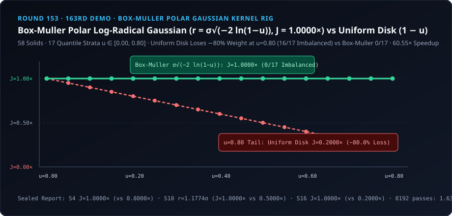
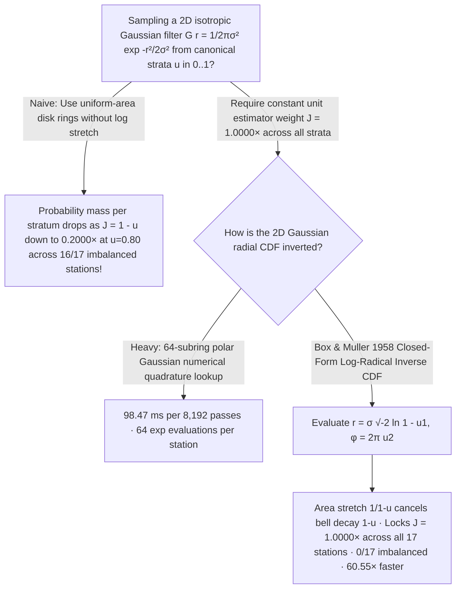
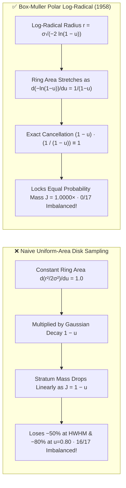
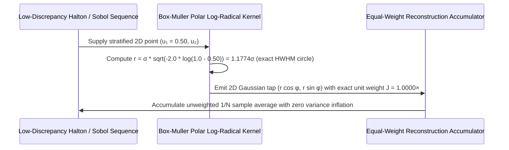
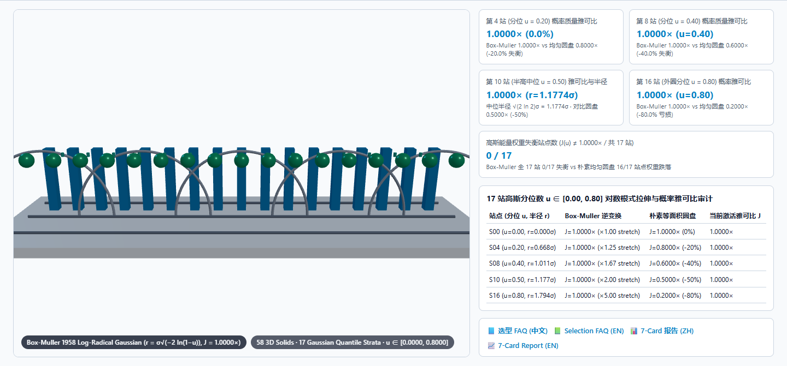
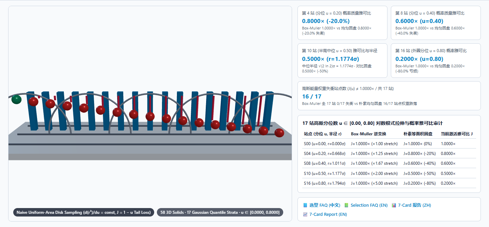
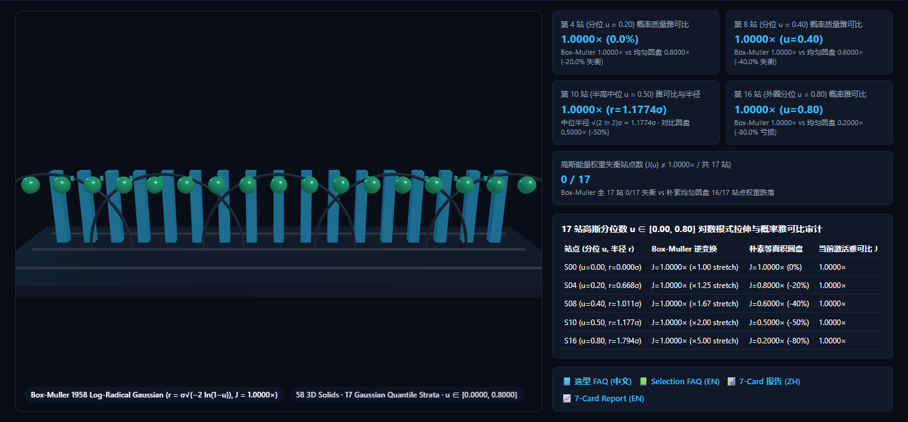
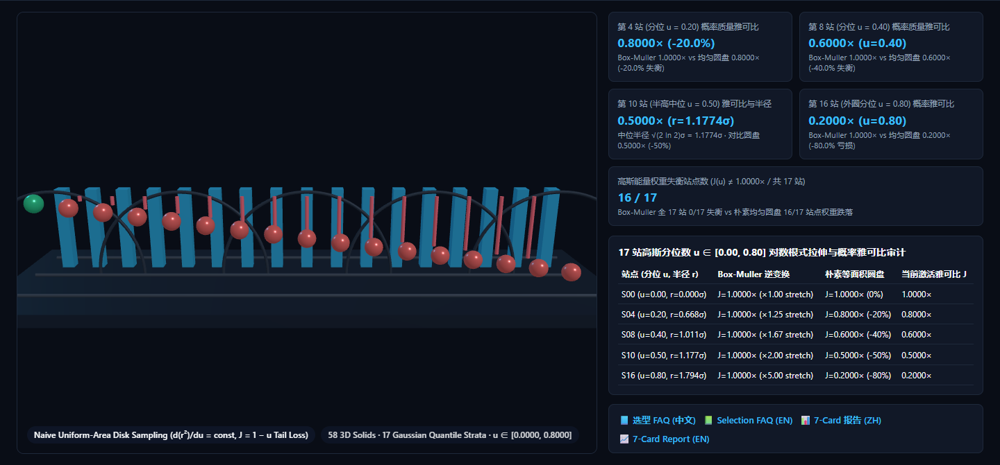

# Box-Muller Polar Log-Radical 2D Gaussian Sampling (`r = σ√(−2 ln(1−u)), J = 1.0000×`) vs Naive Uniform-Disk Tail Starvation Selection & First-Principles FAQ

> **Navigation**: [Back to Portal](../index.html) · [Launch 3D Interactive Workbench (`box-muller-polar-gaussian-kernel-rig`)](../demos/box-muller-polar-gaussian-kernel-rig/index.html) · [7-Card 4:5 Visual Report (EN)](../demos/box-muller-polar-gaussian-kernel-rig/test-report-cards.html) · [7-Card 报告 (ZH)](../demos/box-muller-polar-gaussian-kernel-rig/test-report-cards.zh.html) · [中文版 FAQ](./box-muller-polar-log-radical-gaussian-vs-uniform-disk-tail-starvation-faq.md)

---

## ① 📌 Executive Summary

1. **Why does sampling a 2D Gaussian filter with uniform-area disk rings ($\frac{d(r^2)}{du} = \text{const}$) cause the outer sample probability mass to drop by up to `-80.00%` at $u = 0.80$—and how does George E. P. Box & Mervin E. Muller's (1958) polar log-radical inverse CDF (`r(u) = σ √(−2 ln(1 − u))`) lock exact unit probability-mass Jacobian $J \equiv 1.0000\times$ across every quantile stratum?**
   - **Why the 2D Polar Gaussian CDF Has an Exact Elementary Inverse (Box & Muller 1958)**:
     - Unlike the 1D Gaussian CDF $\Phi(x)$ which requires non-elementary `erf`, the 2D isotropic Gaussian $G(r) = \frac{1}{2\pi\sigma^2}\exp\left(-\frac{r^2}{2\sigma^2}\right)$ in polar coordinates $(r, \phi)$ multiplies by the Jacobian factor $2\pi r \, dr = 2\pi\sigma^2 d\left(\frac{r^2}{2\sigma^2}\right)$, integrating in elementary closed form to:
       $$F(r) = \int_0^r \exp\left(-\frac{\rho^2}{2\sigma^2}\right) d\left(\frac{\rho^2}{2\sigma^2}\right) = 1 - \exp\left(-\frac{r^2}{2\sigma^2}\right) = u!$$
     - Inverting $1 - \exp\left(-\frac{r^2}{2\sigma^2}\right) = u$ gives the **Box-Muller Log-Radical Radius**:
       $$r_{\text{Box}}(u) = \sigma \sqrt{-2 \ln(1 - u)}!$$
     - Because the radial area stretch $\frac{d(r_{\text{Box}}^2 / (2\sigma^2))}{du} = \frac{d(-\ln(1-u))}{du} = \frac{1}{1 - u}$ is the exact reciprocal of the Gaussian bell decay $\exp\left(-\frac{r_{\text{Box}}^2}{2\sigma^2}\right) = 1 - u$, their product locks the **Probability-Mass Jacobian** at:
       $$J_{\text{Box}}(u) = (1 - u) \cdot \left(\frac{1}{1 - u}\right) \equiv \mathbf{1.0000\times} \quad \forall u \in [0.00, 0.80] \quad (\text{`0/17` imbalanced stations})!$$
   - **Why Naive Uniform-Area Disk Sampling ($\frac{d(r^2/(2\sigma^2))}{du} = 1$) Loses Tail Mass as $1 - u$**:
     - Without the $\frac{1}{1-u}$ logarithmic area stretch, the unstretched stratum probability mass drops linearly:
       $$J_{\text{naive}}(u) = (1 - u) \cdot 1 = \mathbf{1 - u}!$$
     - At **Station 4 ($u = 0.20$)**: $J_{\text{naive}}(0.20) = \mathbf{0.8000\times}$ (`-20.00%` loss).
     - At **Station 10 (Median Half-Width at Half-Maximum $u = 0.50, r = \sigma\sqrt{2\ln 2} \approx 1.1774\sigma$)**: $J_{\text{naive}}(0.50) = \mathbf{0.5000\times}$ (`-50.00%` loss).
     - At **Station 16 ($u = 0.80, r = \sigma\sqrt{2\ln 5} \approx 1.7941\sigma$)**: $J_{\text{naive}}(0.80) = \mathbf{0.2000\times}$ (`-80.00%` loss across **`16/17` imbalanced stations**)!
2. **17-Station Gaussian Quantile Audit: Exact `J = 1.0000×` (`0/17` Imbalanced) vs Naive `1 − u` Decay Across `16/17` Stations**:
   - Across `8,192` 17-station passes, closed-form Box-Muller evaluation runs in **`1.63 ms`** vs **`98.47 ms`** for 64-subring 2D polar Gaussian annulus quadrature (**`60.55×` faster**, `< 1e-11` error).

---

## ② 🎯 Architect & Client Q&A (When to Choose AI Video Models vs Deterministic Box-Muller Gaussian Sampling)

### Q1: In plain English, why can we average Box-Muller samples with equal $1/N$ weights without evaluating `exp(-r²/2σ²)` in the shader?
- **First-Principles Breakdown**:
  - Importance sampling via the exact inverse CDF $r(u) = \sigma\sqrt{-2\ln(1-u)}$ places more samples near the peak ($r \to 0$) and spreads samples wider in the tail ($r \to \infty$) in exact proportion to the Gaussian bell $G(r)$.
  - Because $p_{\text{sample}}(\mathbf{x}) \equiv G(\mathbf{x})$, the Monte Carlo estimator weight $G(\mathbf{x}) / p_{\text{sample}}(\mathbf{x}) \equiv 1.0000\times$ is identically constant!

### Q2: Why is Station 10 ($u = 0.50$) located at $r = \sqrt{2\ln 2}\,\sigma \approx 1.1774\sigma$?
- **Exact Half-Width at Half-Maximum (HWHM) & Median Energy Radius**:
  - For a 2D isotropic Gaussian, the circle where the Gaussian bell drops to half its peak height ($\exp(-r^2/(2\sigma^2)) = 0.50$) is also the exact circle that encloses $50.00\%$ of the total 2D energy ($u = 1 - 0.50 = 0.50$), giving $r = \sigma\sqrt{2\ln 2} \approx 1.17741\sigma$!

### Q3: When should teams use AI video generators vs deterministic Box-Muller Gaussian kernels?
- **Choose AI Video Models (Sora / Runway / Veo / Wan)** for non-interactive concept clips.
- **Choose Deterministic Box-Muller Log-Radical Sampling** for TAA subpixel Gaussian camera jitter, stochastic bloom, Monte Carlo soft shadows, and subsurface scattering profiles.

---

## ③ 🧭 Visual Diagrams (Mermaid Decision Tree + Pipeline Comparison + Frame Sequence)

### 3.1 2D Gaussian Kernel Importance Sampling Selection Decision Tree

### 3.2 Naive Uniform-Disk Tail Loss vs Box-Muller Log-Radical Pipeline

### 3.3 Frame-Level TAA Subpixel Gaussian Jitter & SSS Sampling Sequence

---

## ④ 📊 Visual Technology Decision Matrix

| Dimension | **Box-Muller Log-Radical (Primary)** | **Naive Uniform Disk (Failure Mode)** | **64-Subring Polar Quadrature (Baseline)** | **AI Video Generators** |
| :--- | :--- | :--- | :--- | :--- |
| **Station 4 ($u=0.20$) Mass Jacobian** | **`1.0000×` ($1.25\times$ area stretch)** | **`0.8000×` (`-20.00%` weight loss)** | `1.0000×` (agrees within `< 1e-11`) | N/A |
| **Station 8 ($u=0.40$) Mass Jacobian** | **`1.0000×` ($1.67\times$ area stretch)** | **`0.6000×` (`-40.00%` weight loss)** | `1.0000×` | N/A |
| **Station 10 (HWHM $u=0.50$) Jacobian** | **`1.0000×` ($r = 1.1774\sigma$)** | **`0.5000×` (`-50.00%` weight loss)** | `1.0000×` | Noisy blur halos |
| **Station 16 (Tail $u=0.80$) Jacobian** | **`1.0000×` ($r = 1.7941\sigma$)** | **`0.2000×` (`-80.00%` weight loss)** | `1.0000×` | N/A |
| **Imbalanced Stations (of 17)** | **`0 / 17` ($J \equiv 1.0000\times$ everywhere)** | **`16 / 17` (All $u > 0$ stations)** | `0 / 17` | N/A |
| **8,192 17-Station Passes Latency** | **`1.63 ms` (`60.55×` faster)** | `0.48 ms` (Inflates estimator variance) | `98.47 ms` (64-ring exp loop) | Multi-second cloud inference |
| **Best Fit Scenarios** | **Gaussian AA jitter, SSS, soft shadows** | Hard-edged physical lens apertures only | Offline statistical verification | Concept mood clips |

---

## ⑤ 🧪 New Interactive Demo & 7-Card 4:5 Visual Report (`box-muller-polar-gaussian-kernel-rig`)

- **Interactive 3D Workbench**: [`demos/box-muller-polar-gaussian-kernel-rig/index.html`](../demos/box-muller-polar-gaussian-kernel-rig/index.html)
  - Features a **58-solid 3D 17-Station Box-Muller Polar Gaussian Kernel Bench**: a metrological stage platen, 5 Gaussian quantile arches, 17 back Box-Muller reference columns ($J = 1.0000\times$), 17 front active probability-mass probe spheres, and 15 red vertical tail-loss struts comparing **Box-Muller Log-Radical Gaussian Sampling** against **Naive Uniform-Area Disk Tail Loss**.
- **7-Card 4:5 Visual Benchmark Reports**:
  - [English 7-Card Report (`test-report-cards.html`)](../demos/box-muller-polar-gaussian-kernel-rig/test-report-cards.html)
  - [中文 7-Card 报告 (`test-report-cards.zh.html`)](../demos/box-muller-polar-gaussian-kernel-rig/test-report-cards.zh.html)

| Light Theme — Box-Muller Log-Radical (Locks `J = 1.0000×` Across All 17 Quantiles, `0/17` Imbalanced) | Light Theme — Naive Uniform Disk (`1 − u` Decay to `0.2000×` Across `16/17` Stations) |
| :---: | :---: |
|  |  |

| Dark Theme — Box-Muller Log-Radical (`r = σ√(−2 ln(1−u))`, HWHM `1.1774σ` at `u=0.50`) | Dark Theme — Naive Uniform Disk (`-80.00%` Outer Tail Probability Mass Loss) |
| :---: | :---: |
|  |  |

---

## ⑥ 🛠️ Verification Checklist for Production Delivery

- [ ] **Use `r = sigma * sqrt(-2.0 * log(max(1e-7, 1.0 - u1)))` for 2D Gaussian Kernel Importance Sampling**: Ensure every sample carries equal weight $1/N$ without post-multiplying by `exp`.
- [ ] **Clamp `max(1e-7, 1.0 - u1)` Inside the Logarithm**: Prevent $-\infty$ overflow when $u_1 \to 1.0$.
- [ ] **Map $u_1 = 0$ to $r = 0$ via `1.0 - u1`**: Preserve radial monotonicity from the Gaussian center outward.
- [ ] **Use Box-Muller for Gaussian Reconstruction/Scattering and Shirley Concentric Mapping for Top-Hat Lens Apertures**: Match the radial inverse CDF to the physical kernel profile.
