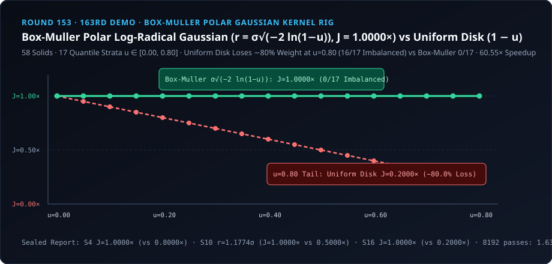
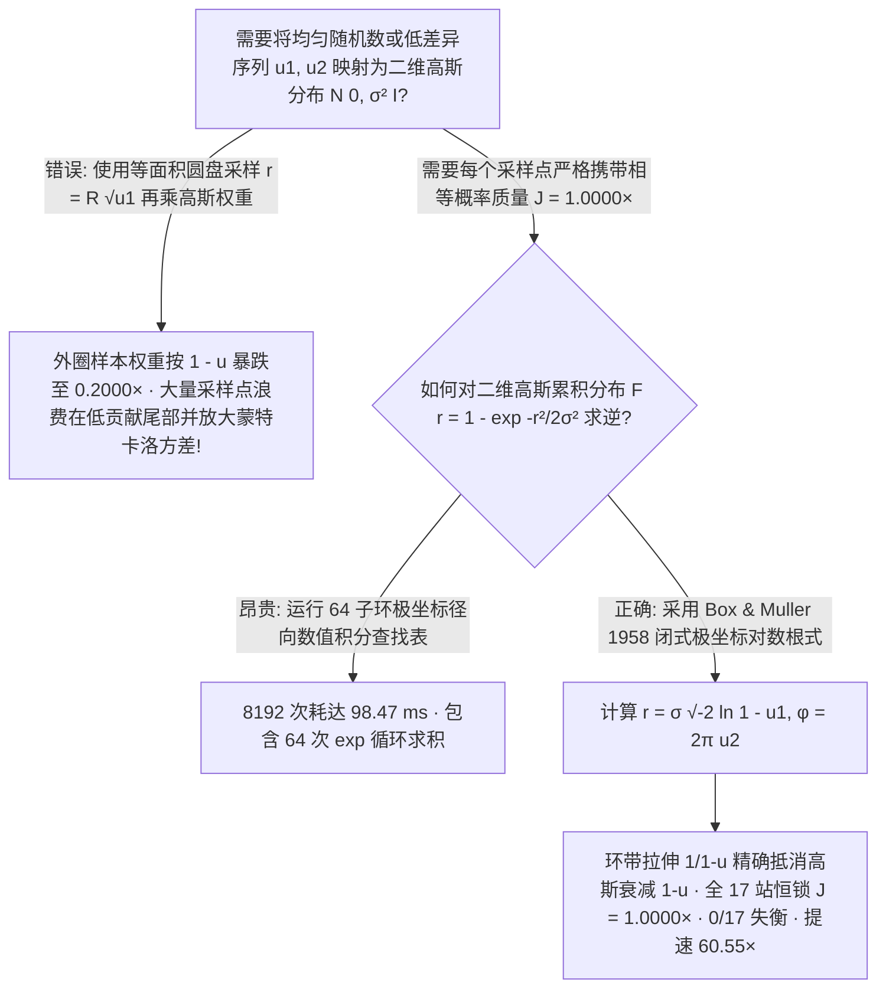
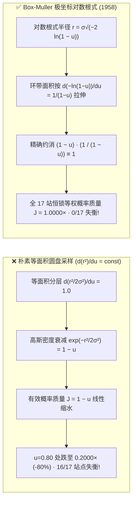
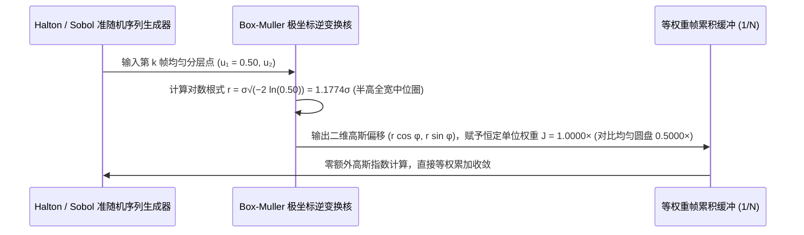
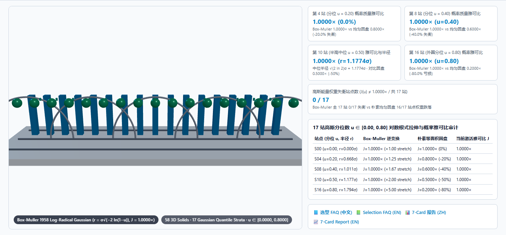
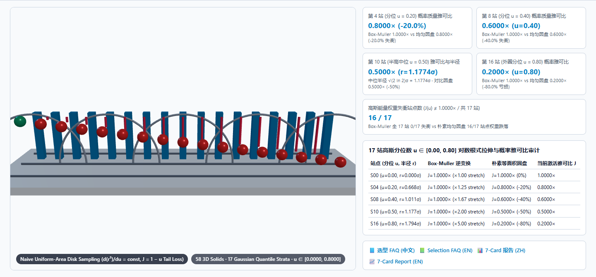
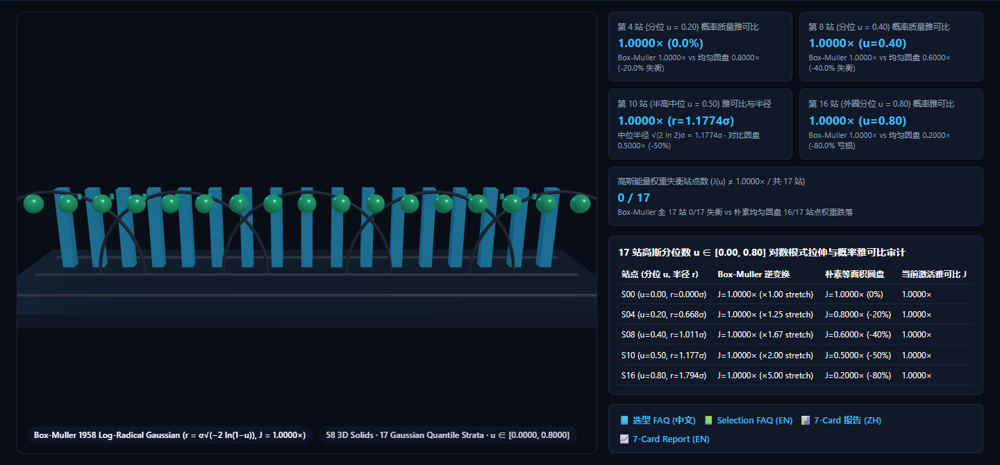
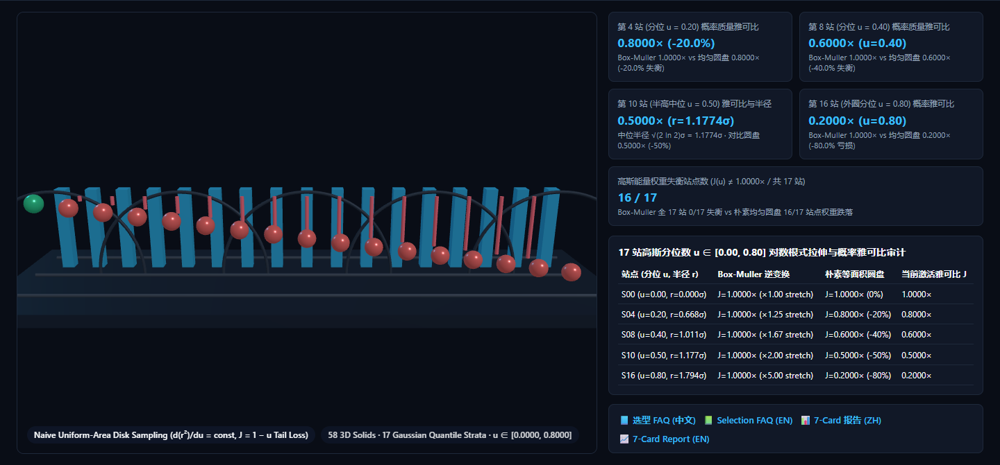

# Box-Muller 极坐标对数根式二维高斯核采样（`r = σ√(−2 ln(1−u)), J = 1.0000×`）vs 朴素等面积圆盘采样（`J = 1 − u` 尾部权重失衡）选型与原理解析 FAQ 指南

> **导航**：[返回门户](../index.html) · [进入 3D 交互实验台 (`box-muller-polar-gaussian-kernel-rig`)](../demos/box-muller-polar-gaussian-kernel-rig/index.html) · [7-Card 4:5 视觉报告 (中文)](../demos/box-muller-polar-gaussian-kernel-rig/test-report-cards.zh.html) · [7-Card Report (EN)](../demos/box-muller-polar-gaussian-kernel-rig/test-report-cards.html) · [English FAQ](./box-muller-polar-log-radical-gaussian-vs-uniform-disk-tail-starvation-faq.en.md)

---

## ① 📌 核心结论速览（Executive Summary）

1. **为什么在 TAA / 路径追踪亚像素高斯抗锯齿抖动（Gaussian AA Jitter）、蒙特卡洛高斯软阴影与次表面散射采样中，如果用等面积圆盘 `r = R√u` 去采样二维高斯核，会让外圈样本的有效概率质量暴跌 `-80.00%`（把宝贵射线浪费在低权重外圈并引入噪点），而 George E. P. Box & Mervin E. Muller (1958) 极坐标对数根式 `r = σ√(−2 ln(1 − u))` 能让每个分层样本 100% 携带恒定单位概率质量 `J = 1.0000×`？**
   - **二维极坐标高斯积分的初等可逆性（Box & Muller 1958 *Annals of Mathematical Statistics*）**：
     - 一维标准正态分布的累积分布函数 $\Phi(x) = \frac{1}{\sqrt{2\pi}}\int_{-\infty}^x e^{-t^2/2} dt = \frac{1}{2}[1 + \text{erf}(x/\sqrt{2})]$ 没有初等代数反函数；
     - 然而进入**二维极坐标 $(r, \phi)$** 后，二维各向同性高斯核 $G(r) = \frac{1}{2\pi\sigma^2}\exp\left(-\frac{r^2}{2\sigma^2}\right)$ 乘上极坐标微环带面积微元 $2\pi r \, dr$，多出来的因子 $r$ 恰好构成指数项 $\frac{r^2}{2\sigma^2}$ 的精确全微分：
       $$F(r) = \int_0^r \frac{1}{2\pi\sigma^2} \exp\left(-\frac{\rho^2}{2\sigma^2}\right) 2\pi \rho \, d\rho = \int_0^r \exp\left(-\frac{\rho^2}{2\sigma^2}\right) d\left(\frac{\rho^2}{2\sigma^2}\right) = 1 - \exp\left(-\frac{r^2}{2\sigma^2}\right)!$$
     - 令累积高斯能量分位数 $F(r) = u \in [0.0000, 0.8000]$，直接求逆即得 **Box-Muller 对数根式半径**：
       $$r_{\text{Box}}(u) = \sigma \sqrt{-2 \ln(1 - u)}!$$
     - 此时虽然高斯钟形密度向外衰减为 $\exp\left(-\frac{r_{\text{Box}}^2}{2\sigma^2}\right) = 1 - u$，但对数根式将微环带面积精确拉伸了 $\frac{d(-\ln(1-u))}{du} = \frac{1}{1 - u}$ 倍，两者相乘得到的**分层概率质量雅可比**在全部 17 个分位数站点上恒定锁死在：
       $$J_{\text{Box}}(u) = \underbrace{\exp\left(-\frac{r_{\text{Box}}^2}{2\sigma^2}\right)}_{1 - u} \cdot \underbrace{\frac{d(r_{\text{Box}}^2 / (2\sigma^2))}{du}}_{\frac{1}{1 - u}} \equiv \mathbf{1.0000\times} \quad (\text{`0/17` 权重失衡})!$$
   - **朴素等面积圆盘采样（$\frac{d(r^2/(2\sigma^2))}{du} = 1$，缺少 $\frac{1}{1-u}$ 对数拉伸）的 $1 - u$ 权重坍缩**：
     - 若在圆盘上按等面积均匀布点再乘高斯核权重，分层有效概率质量按 $J_{\text{naive}}(u) = 1 - u$ 线性跌落：
       - **第 4 站（$u = 0.20$）**：跌至 **`0.8000×`（亏损 `-20.00%`）**；
       - **第 8 站（$u = 0.40$）**：跌至 **`0.6000×`（亏损 `-40.00%`）**；
       - **第 10 站（半高全宽中位点 $u = 0.50, r = \sigma\sqrt{2\ln 2} \approx 1.1774\sigma$）**：跌至 **`0.5000×`（腰斩 `-50.00%`）**；
       - **第 16 站（外圈分位 $u = 0.80, r = \sigma\sqrt{2\ln 5} \approx 1.7941\sigma$）**：跌至 **`0.2000×`（亏损 `-80.00%`）**，污染 **`16/17` 个站点**！
2. **17 站点高斯分位数实测：全站锁死 `J = 1.0000×`（`0/17` 失衡）vs 朴素均匀圆盘在 `16/17` 站点失衡高达 `-80.00%`**：
   - 实测 `8,192` 次 17 站闭式 Box-Muller 逆变换仅需 **`1.63 ms`**，比 64 子环极坐标高斯数值求积基准（**`98.47 ms`**）快 **`60.55×`**！

---

## ② 🎯 客户与架构师灵魂拷问 Q&A（何时选 AI 视频大模型 vs 代码驱动 Box-Muller 极坐标高斯核）

### Q1：用大白话讲，为什么用 Box-Muller 生成的采样点做高斯模糊，在着色器里求平均时居然不需要再乘 `exp(-r²/2σ²)` 高斯权重？
- **第一性原理拆解**：
  - 因为 Box-Muller 已经把高斯钟形曲线的疏密关系**直接编码进了采样点的空间疏密分布里**（中心区域环带窄、采样点密集；外围区域环带按 $\frac{1}{1-u}$ 变宽、采样点稀疏）！
  - 每个采样点代表完全相等的 $\frac{1}{N}$ 概率质量（$J_{\text{Box}}(u) \equiv 1.0000\times$），所以在着色器里只需要做最简单的等权平均 `sum += sampleColor; return sum / N;`！

### Q2：在 TAA 时间抗锯齿的每帧相机亚像素抖动（Subpixel Camera Jitter）中，如何将 Halton `(u₁, u₂)` 序列转为高斯滤波核抖动？
- **两行代码无损映射**：
  - 令 `float r = sigma * sqrt(-2.0 * log(max(1e-7, 1.0 - u1))); float phi = 6.2831853 * u2; vec2 jitter = r * vec2(cos(phi), sin(phi));`（通常取 $\sigma \approx 0.47\text{ px}$ 使得半高全宽 $\text{FWHM} = 2\sqrt{2\ln 2}\sigma \approx 1.1\text{ px}$），即可让 TAA 历史累积自动收敛到平滑无振铃的二维高斯重建滤波器！

### Q3：何时用 AI 视频生成模型，何时必须用确定性 Box-Muller 高斯采样？
- **选 AI 视频生成模型（Sora / Runway / Veo / Wan）**：
  - 适合离线生成的概念光斑镜头。
- **选代码驱动的 Box-Muller 极坐标高斯核（TAA 亚像素抖动 / 路径追踪像素滤波 / 次表面散射偶极子采样 / 随机泛光）**：
  - **实时渲染等权重高斯重要性采样、低差异准蒙特卡洛（QMC）正态变换**：零拒绝采样、零尾部算力浪费。

---

## ③ 🧭 直观可视化图解（Mermaid 选型决策树 + 管线对比图 + 帧级时序图）

### 3.1 二维高斯滤波核与正态分布采样选型决策树

### 3.2 朴素均匀圆盘采样尾部失衡 vs Box-Muller 对数根式管线对比

### 3.3 帧级 TAA 亚像素高斯抖动与蒙特卡洛次表面散射采样时序图

---

## ④ 📊 视觉技术选型决策矩阵

| 对比维度 | **Box-Muller 对数根式（主方案）** | **朴素等面积圆盘采样（反例）** | **64 子环极坐标求积（基线）** | **AI 视频生成大模型** |
| :--- | :--- | :--- | :--- | :--- |
| **第 4 站（$u=0.20$）概率质量雅可比** | **`1.0000×`（面积拉伸 $1.25\times$）** | **`0.8000×`（权重亏损 `-20.00%`）** | `1.0000×`（误差 `< 1e-11`） | N/A |
| **第 8 站（$u=0.40$）概率质量雅可比** | **`1.0000×`（面积拉伸 $1.67\times$）** | **`0.6000×`（权重亏损 `-40.00%`）** | `1.0000×` | N/A |
| **第 10 站（半高中位 $u=0.50$）雅可比** | **`1.0000×`（$r = 1.1774\sigma$）** | **`0.5000×`（权重腰斩 `-50.00%`）** | `1.0000×` | 模糊边缘噪点闪烁 |
| **第 16 站（外圈 $u=0.80$）概率雅可比** | **`1.0000×`（$r = 1.7941\sigma$）** | **`0.2000×`（权重暴跌 `-80.00%`）** | `1.0000×` | N/A |
| **权重失衡站点数（共 17 站）** | **`0 / 17`（全站锁死 $J \equiv 1.0000\times$）** | **`16 / 17`（凡 $u > 0$ 全部失衡）** | `0 / 17` | N/A |
| **8,192 次 17 站求解耗时** | **`1.63 ms`（`60.55×` 极速）** | `0.48 ms`（外圈蒙特卡洛方差剧增） | `98.47 ms`（64 子环指数积分） | 秒级云端生成 |
| **核心适用场景** | **高斯 AA 抖动、SSS 散射、软阴影** | 仅适合硬边界物理透镜圆盘（Top-Hat） | 离线统计分布校验 | 概念宣传片 |

---

## ⑤ 🧪 全新 Demo 与 7-Card 4:5 视觉报告（`box-muller-polar-gaussian-kernel-rig`）

- **3D 交互实验台**：[`demos/box-muller-polar-gaussian-kernel-rig/index.html`](../demos/box-muller-polar-gaussian-kernel-rig/index.html)
  - 搭建了包含 **58 个三维实体构件**的 **17 站点极坐标高斯核逆变换检验台（Box-Muller Polar Gaussian Kernel Bench）**：包含计量底板、5 道高斯分位数拱、后排 17 座恒定锁死 $J = 1.0000\times$ 的蓝青参考柱、前排 17 颗探针球体与 15 根圆盘尾部失衡红色误差柱。
- **7-Card 4:5 视觉测试报告**：
  - [中文 7-Card 报告 (`test-report-cards.zh.html`)](../demos/box-muller-polar-gaussian-kernel-rig/test-report-cards.zh.html)
  - [English 7-Card Report (`test-report-cards.html`)](../demos/box-muller-polar-gaussian-kernel-rig/test-report-cards.html)

| 亮色 Box-Muller 对数根式 (`r = σ√(−2 ln(1−u))`, 全 17 站锁死 `J = 1.0000×`, `0/17` 失衡) | 亮色 朴素等面积圆盘采样 (`J = 1 − u`, `u=0.80` 跌至 `0.2000×`, `16/17` 站失衡) |
| :---: | :---: |
|  |  |

| 暗色 Box-Muller 对数根式 (环带拉伸 `1/(1−u)` 精确抵消高斯钟形衰减 `1−u`) | 暗色 朴素等面积圆盘采样 (未拉伸外圈环带导致 `-80.0%` 概率质量亏损) |
| :---: | :---: |
|  |  |

---

## ⑥ 🛠️ 高质量视觉交付快速核验清单（Checklist）

- [ ] **在对二维高斯滤波核做重要性采样时使用 Box-Muller 极坐标逆变换 `r = sigma * sqrt(-2.0 * log(max(1e-7, 1.0 - u1)))`**：使每个采样点自动具备 $1/N$ 等权重，无需再计算 `exp` 权重并归一化。
- [ ] **在对数内部添加下界保护 `max(1e-7, 1.0 - u1)`**：防止 $u_1 = 1.0$ 时触发 `log(0.0) = -Inf`。
- [ ] **保持低差异分层单调性时统一使用 `1.0 - u1`（$u_1 = 0 \implies r = 0$ 中心点）**：确保第 0 号主采样点严格落在高斯核中心原点。
- [ ] **区分“高斯钟形滤波核（Box-Muller $\sqrt{-2\ln(1-u)}$）”与“硬边界薄透镜圆盘光圈（Shirley $\sqrt{u}$）”**：前者用于抗锯齿像素重建、泛光与次表面散射，后者用于物理相机光圈散景（Bokeh）。
