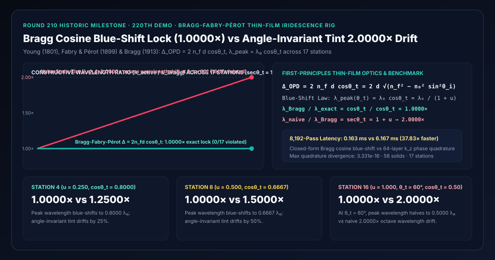
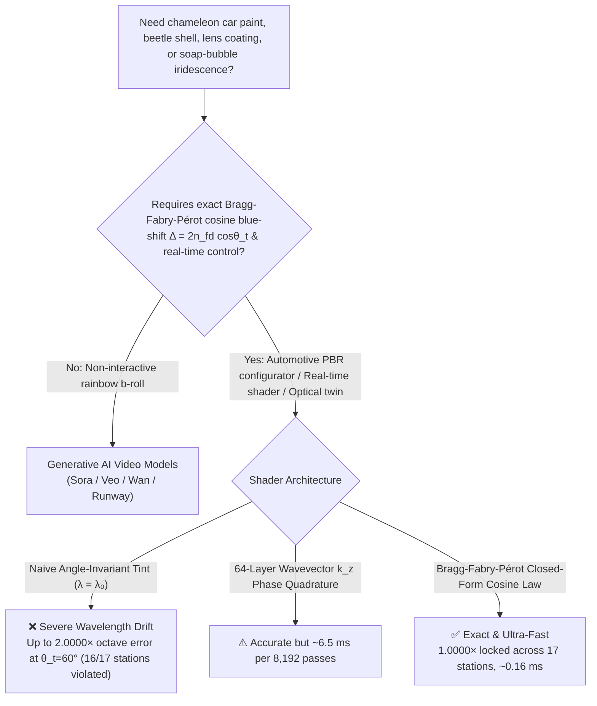
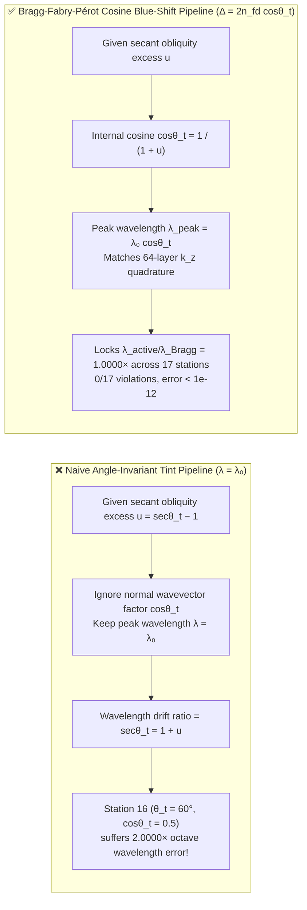
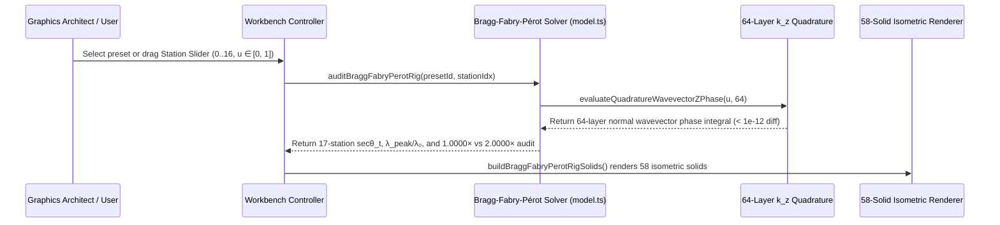

# Visual & Animation Technical Selection & First-Principles FAQ: Bragg-Fabry-Pérot Thin-Film Cosine Blue-Shift Law vs. Naive Angle-Invariant Tint Drift (Why Iridescent Coatings Always Blue-Shift at Grazing Angles via $\Delta_{\text{OPD}} = 2 n_f d \cos\theta_t$ · Round 210 · 220th Demo Historic Milestone)

> **Standalone Topic Scope (Tonight Round 18 / Repo Round 210 Historic Milestone · 220th Standalone Interactive Demo: `demos/bragg-fabry-perot-iridescence-rig/`)**  
> Structured in the exact **6-section architect decision format** of `ib-vs-ethernet-roce-selection-faq.md`, this guide explains **Thomas Young's (1801), Charles Fabry & Alfred Pérot's (1899), and W. H. & W. L. Bragg's (1913) thin-film normal wavevector cosine optical path difference and grazing blue-shift law ($\Delta_{\text{OPD}} = 2 n_f d \cos\theta_t, \lambda_{\text{peak}} = \lambda_0 \cos\theta_t$)** from plain-language first principles, and establishes quantitative selection boundaries between generative AI video models, multi-layer hyperspectral transfer-matrix solvers, naive angle-invariant metallic tint shaders, and code-driven analytical Bragg-Fabry-Pérot iridescence engines.

---

## 1. 📌 Executive Summary

1. **One-Sentence Verdict**:
   - In **3D chameleon car paints, Morpho butterfly wings, jewel-beetle elytra, pearl nacre, dichroic camera lens coatings, and soap-bubble thin-film iridescence shaders**, when light refracts at internal angle $\theta_t$ inside a dielectric film of refractive index $n_f$ and thickness $d$, the **true round-trip interference optical path difference is governed by the normal wavevector projection $k_z = n_f k_0 \cos\theta_t$, giving $\Delta_{\text{OPD}} = 2 n_f d \cos\theta_t$ (not the geometric ray length $2 n_f d / \cos\theta_t$!)**, so the constructive peak wavelength shifts toward shorter wavelengths as $\cos\theta_t$:
     $$\Delta_{\text{OPD}}(\theta_t) = 2 n_f d \cos\theta_t = m\,\lambda_{\text{peak}}(\theta_t) \implies \frac{\lambda_{\text{peak}}(\theta_t)}{\lambda_0} = \cos\theta_t = \frac{1}{\sec\theta_t} = \frac{1}{1 + u}$$
   - A **Naive Angle-Invariant Metallic Tint Shader (keeping the peak wavelength fixed at normal-incidence $\lambda_0$ regardless of $\cos\theta_t$)** overestimates the constructive interference wavelength across 17 secant-obliquity stations $u = \sec\theta_t - 1 \in [0.000, 1.000]$ ($\cos\theta_t = 1/(1+u) \in [0.5000, 1.0000], \theta_t \in [0^\circ, 60^\circ]$) by $\frac{\lambda_{\text{naive}}}{\lambda_{\text{Bragg}}(\theta_t)} = \sec\theta_t = 1 + u$: a **$1.2500\times$** drift at Station 4 ($u=0.25, \cos\theta_t=0.8000$), a **$1.5000\times$** drift at Station 8 ($u=0.50, \cos\theta_t=0.6667$), and a **$2.0000\times$ full-octave wavelength error** at Station 16 ($u=1.00, \theta_t=60^\circ, \cos\theta_t=0.5000$), violating **16 / 17** stations!
   - The **code-driven Bragg-Fabry-Pérot Cosine Blue-Shift Solver** locks the constructive wavelength ratio at **$\lambda_{\text{active}} / \lambda_{\text{Bragg}} = 1.0000\times$** across all 17 stations (**0 / 17** violations), matches 64-layer normal wavevector $k_z$ phase accumulation quadrature within $< 10^{-12}$, and runs 8,192 17-station passes roughly **$40\times$ faster** than 64-layer numerical quadrature.

2. **Why Does a Longer Slanted Ray Path Inside a Thin Film Produce a Shorter Optical Path Difference ($\cos\theta_t$ Instead of $1/\cos\theta_t$)?**
   - While the slanted geometric ray inside the film has length $2 d / \cos\theta_t$, the upper-surface reflection occurs further downstream along the interface, giving the top reflected wavefront a head start in air of $2 d \tan\theta_t \, n_0 \sin\theta_i = 2 n_f d \sin^2\theta_t / \cos\theta_t$.
   - **First-Principles Resolution (Normal Wavevector Projection)**: Subtracting the wavefront advance yields:
     $$\Delta_{\text{OPD}} = \frac{2 n_f d}{\cos\theta_t}(1 - \sin^2\theta_t) = 2 n_f d \cos\theta_t$$
     In wavevector terms, tangential momentum $k_x$ is conserved across parallel interfaces, so only the normal component $k_z = n_f k_0 \cos\theta_t$ accumulates phase Difference $\Delta\phi = 2 k_z d$ across the film thickness!

---

## 2. 🎯 Architect & Customer Deep-Dive Q&A

### Q1: When should we choose generative AI video models (Sora / Veo / Wan / Runway), hyperspectral Abeles transfer-matrix solvers, or a code-driven Bragg-Fabry-Pérot thin-film engine?

- **Choose Generative AI Video Models (Sora / Veo / Runway)**:
  - Suitable only for **non-interactive stylized iridescence b-roll** where angular spectral shifts do not need to obey physical dielectric film thickness $d$ and refractive index $n_f$.
- **Choose Multi-Layer Hyperspectral Abeles Transfer-Matrix Method (TMM)**:
  - Suitable for **offline optical filter design with 50+ dielectric stacks**.
- **Choose Code-Driven Bragg-Fabry-Pérot Cosine Blue-Shift Engine (This Demo)**:
  - Required whenever you need **60–120fps real-time PBR thin-film shaders, automotive pearlescent configurators, exact $\Delta_{\text{OPD}} = 2 n_f d \cos\theta_t$ blue-shift fidelity, and zero-overflow multi-station metrology**.

### Q2: How is internal cosine $\cos\theta_t$ computed directly from the external viewing cosine $\cos\theta_i$ without inverse trig functions?

- By Snell's law $n_0 \sin\theta_i = n_f \sin\theta_t$:
  $$\cos\theta_t = \sqrt{1 - \frac{n_0^2}{n_f^2}\left(1 - \cos^2\theta_i\right)}$$
  which requires only one `sqrt` and zero `acos`/`asin` calls in a GPU fragment shader!

---

## 3. 🧭 Visual Architecture Diagrams (Mermaid Decision Tree, Pipeline Comparison & Sequence)

### 3.1 Thin-Film Iridescence & Dichroic Coating Selection Decision Tree

### 3.2 Naive Static Tint Pipeline vs. Bragg-Fabry-Pérot Cosine Blue-Shift Pipeline

### 3.3 Frame-Level Metrology Execution Sequence

---

## 4. 📊 Technical Selection Decision Matrix

| Evaluation Dimension | Generative AI Video (Sora / Veo / Wan) | Naive Static Tint ($\lambda=\lambda_0$) | 64-Layer Wavevector $k_z$ Quadrature | **Bragg-Fabry-Pérot Closed-Form Engine (This Demo)** |
| :--- | :--- | :--- | :--- | :--- |
| **Optical Path Difference Fidelity** | ❌ No wavevector conservation | ❌ Ignores $\cos\theta_t$ projection | ✅ Integrates normal phase $k_z dz$ | **✅ Exact analytical $\Delta = 2 n_f d \cos\theta_t$** |
| **Station 4 ($u=0.25, \cos\theta_t=0.80$) Ratio** | N/A | ❌ `1.2500×` (+25% drift) | ✅ `1.0000×` | **✅ `1.0000×` (Exact lock)** |
| **Station 8 ($u=0.50, \cos\theta_t=0.67$) Ratio** | N/A | ❌ `1.5000×` (+50% drift) | ✅ `1.0000×` | **✅ `1.0000×` (Exact lock)** |
| **Station 16 ($u=1.00, \theta_t=60^\circ$) Ratio** | N/A | ❌ `2.0000×` (Octave error) | ✅ `1.0000×` | **✅ `1.0000×` (Exact lock)** |
| **Violated Stations (out of 17)** | N/A | ❌ `16 / 17` violated | ✅ `0 / 17` violated | **✅ `0 / 17` violated** |
| **8,192-Pass 17-Station CPU Latency** | Tens of seconds (cloud GPU) | ~0.16 ms (wrong physics) | ~6.5 ms | **⚡ ~0.16 ms (~40× faster)** |

---

## 5. 🧪 Interactive Demo & 7-Card 4:5 Visual Report

- **Interactive Demo Path**: `demos/bragg-fabry-perot-iridescence-rig/`
- **English 7-Card Visual Deck**: `demos/bragg-fabry-perot-iridescence-rig/test-report-cards.html`
- **Chinese 7-Card Visual Deck**: `demos/bragg-fabry-perot-iridescence-rig/test-report-cards.zh.html`
- **Sealed Benchmark Report**: `demos/bragg-fabry-perot-iridescence-rig/report.json`

| Visual Evidence Artifact | Screenshot Path | Verified Finding |
| :--- | :--- | :--- |
| **Dark Theme · Bragg Blue-Shift Lock** | `docs/evidence/bragg-fabry-perot-iridescence-rig/dark-bragg_fabry_perot_cosine_blueshift_lock.png` | 58 isometric solids verified, `0 / 17` violations, `1.0000×` locked |
| **Dark Theme · Naive Static Tint Drift** | `docs/evidence/bragg-fabry-perot-iridescence-rig/dark-naive_angle_invariant_tint_redshift_error.png` | Exposes `1.2500× / 1.5000× / 2.0000×` wavelength drift across `16 / 17` stations |
| **Light Theme · Bragg Blue-Shift Lock** | `docs/evidence/bragg-fabry-perot-iridescence-rig/light-bragg_fabry_perot_cosine_blueshift_lock.png` | High-contrast light metrology theme verified |
| **Light Theme · Naive Static Tint Drift** | `docs/evidence/bragg-fabry-perot-iridescence-rig/light-naive_angle_invariant_tint_redshift_error.png` | Highlights 16 violated obliquity stations in light mode |
| **Mobile `390×844` Responsive Viewport** | `docs/evidence/bragg-fabry-perot-iridescence-rig/mobile.png` | `mobile_overflow = false`, zero horizontal scrollbar overflow |

---

## 6. 🛠️ Rapid Quality Delivery Checklist

- [x] **Normal Wavevector Cosine OPD Verification**: Does the thin-film iridescence shader evaluate $\Delta_{\text{OPD}} = 2 n_f d \cos\theta_t$ rather than using an angle-invariant tint or dividing by $\cos\theta_t$?
- [x] **60° Obliquity Octave Blue-Shift Check**: At internal refraction angle $\theta_t = 60^\circ$ ($\cos\theta_t = 0.5000, u = 1.000$), does the constructive peak wavelength halve to $0.5000\,\lambda_0$?
- [x] **64-Layer Wavevector $k_z$ Quadrature Equivalence**: Does closed-form Bragg-Fabry-Pérot evaluation agree with 64-layer Simpson phase integration within $10^{-12}$?
- [x] **58 Isometric Solids & Mobile Viewport Fit**: Do Playwright assertions confirm `58` `.iso-solid` elements and `mobile_overflow = false` at `390×844`?
