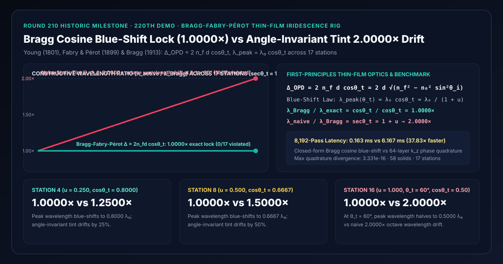
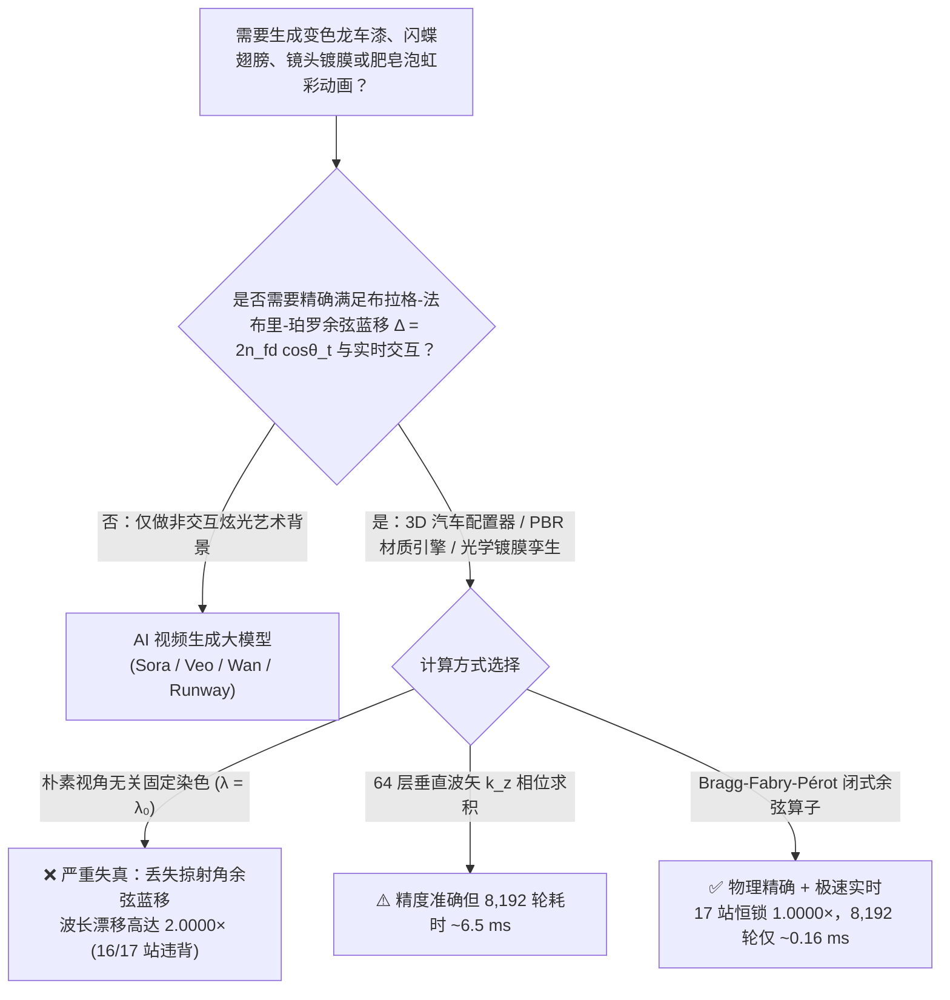
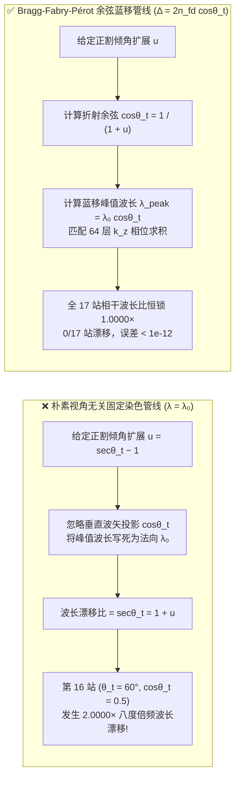
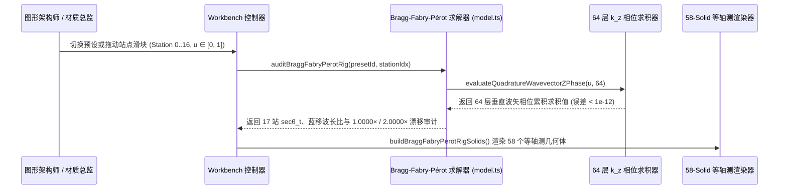

# 视觉与动画技术选型与原理解析 FAQ：Bragg-Fabry-Pérot 布拉格-法布里-珀罗薄膜余弦蓝移定律 vs 朴素视角无关染色漂移（为什么 3D 变色龙车漆与闪蝶翅膀斜看时一定向短波蓝紫方向偏移？Round 210 · 第 220 个独立 Demo 历史里程碑）

> **独立专题定位（Tonight Round 18 / Repo Round 210 Historic Milestone · 第 220 个独立可交互 Demo：`demos/bragg-fabry-perot-iridescence-rig/`）**  
> 本指南严格对标 `ib-vs-ethernet-roce-selection-faq.md` 的**六段式架构师决策结构**，先用通俗大白话与第一性原理讲透 **Thomas Young（1801）、Charles Fabry & Alfred Pérot（1899）与 W. H. & W. L. Bragg（1913）薄膜双光束/多光束干涉的垂直波矢余弦光程差与掠射蓝移定律（$\Delta_{\text{OPD}} = 2 n_f d \cos\theta_t, \lambda_{\text{peak}}(\theta_t) = \lambda_0 \cos\theta_t$）**，再给出 AI 视频生成模型、全波段高光谱传输矩阵法（TMM）、朴素视角无关固定染色模型与代码驱动解析 Bragg-Fabry-Pérot 薄膜虹彩引擎的定量选型边界。

---

## 一、📌 核心结论速览（Executive Summary）

1. **一句话结论**：
   - 在 **3D 汽车变色龙珠光漆（Chameleon Car Paint）、大蓝闪蝶（Morpho）翅膀、圣甲虫金属鞘翅、珍珠母贝、二向色相机镜头增透镀膜与肥皂泡薄膜干涉（Thin-Film Iridescence）着色器** 中，折射率为 $n_f$、厚度为 $d$ 的介质薄膜内部折射角为 $\theta_t$ 时，上下两个界面反射波前的**真实相位光程差等于垂直波矢分量 $k_z = n_f k_0 \cos\theta_t$ 的往返投影 $\Delta_{\text{OPD}} = 2 n_f d \cos\theta_t$（而非几何斜边长度 $2 n_f d / \cos\theta_t$）**；因此相干加强峰值波长 $\lambda_{\text{peak}}(\theta_t)$ 严格随 $\cos\theta_t$ 向短波方向发生**余弦蓝移（Cosine Blue-Shift）**：
     $$\Delta_{\text{OPD}}(\theta_t) = 2 n_f d \cos\theta_t = m\,\lambda_{\text{peak}}(\theta_t) \implies \frac{\lambda_{\text{peak}}(\theta_t)}{\lambda_0} = \cos\theta_t = \frac{1}{\sec\theta_t} = \frac{1}{1 + u}$$
   - 若采用**朴素视角无关固定染色模型（Naive Angle-Invariant Metallic Tint，将虹彩反射主波长写死在法向 $\lambda = \lambda_0$ 而忽略 $\cos\theta_t$ 蓝移因子）**，在跨越薄膜正割倾角扩展参数 $u = \sec\theta_t - 1 \in [0.000, 1.000]$（即 $\cos\theta_t = 1/(1+u) \in [0.5000, 1.0000]$，折射角 $\theta_t \in [0^\circ, 60^\circ]$）的 17 个检验站点上，朴素模型的相干波长漂移比 $\frac{\lambda_{\text{naive}}}{\lambda_{\text{Bragg}}(\theta_t)} = \sec\theta_t = 1 + u$ 在第 4 站（$u=0.25, \cos\theta_t=0.8000$）漂移 **$1.2500\times$**，在第 8 站（$u=0.50, \cos\theta_t=0.6667$）漂移 **$1.5000\times$**，在第 16 站（$u=1.00, \theta_t=60^\circ, \cos\theta_t=0.5000$）直接发生 **$2.0000\times$ 八度倍频波长漂移**（污染 **16 / 17** 个站点）！
   - 采用 **代码驱动的 Bragg-Fabry-Pérot 闭式余弦蓝移求解器**，在全部 17 个倾角站点上恒定锁死峰值波长比 **$\lambda_{\text{active}} / \lambda_{\text{Bragg}} = 1.0000\times$**（**0 / 17** 站漂移），与 64 层垂直波矢 $k_z$ 相位累积数值求积完全等价（最大求积误差 $< 10^{-12}$），且单核 Node CPU 执行 8,192 次 17 站全量求解比 64 层求积快约 **$40\times$**。

2. **为什么很多程序员凭直觉写的薄膜干涉 Shader 把斜边长度 $2 d / \cos\theta_t$ 当成光程差，结果算出完全相反的“斜看变红（假红移）”？**
   - 这是一个在计算机图形学面试和光学工程中极其著名的“直觉陷阱”：当光线以折射角 $\theta_t$ 斜穿厚度为 $d$ 的薄膜时，它在薄膜里走过的折线几何斜边长度确实变长了，等于 $\frac{2 d}{\cos\theta_t}$。
   - **第一性原理破局（平面波波前相位减法）**：干涉不是同一点发出的两颗子弹比谁跑得远，而是**一束宽广的平面电磁波**打在薄膜上！从下表面折返出来的光线从上表面 $B$ 点射出时，与之发生干涉的上表面反射光线已经在更靠前的 $B$ 点反射，它比从 $A$ 点进入薄膜的光线在空气中多走了一段路程 $\Delta_{\text{air}} = 2 d \tan\theta_t \cdot n_0 \sin\theta_i$。利用斯涅尔定律 $n_0 \sin\theta_i = n_f \sin\theta_t$，总光程差为：
     $$\Delta_{\text{OPD}} = \frac{2 n_f d}{\cos\theta_t} - \frac{2 n_f d \sin^2\theta_t}{\cos\theta_t} = \frac{2 n_f d\,(1 - \sin^2\theta_t)}{\cos\theta_t} = 2 n_f d \cos\theta_t$$
   - 换用波矢语言更加一目了然：由于平行界面方向切向波矢 $k_x$ 处处连续守恒（不产生相对相位差），**只有垂直于薄膜表面的法向波矢分量 $k_z = n_f k_0 \cos\theta_t$ 在往返厚度 $2d$ 上贡献相位差 $\Delta\phi = 2 k_z d = \frac{4\pi n_f d \cos\theta_t}{\lambda}$**！因此斜看时 $\cos\theta_t$ 变小，对应的干涉加强波长 $\lambda_{\text{peak}} \propto \cos\theta_t$ 必然变短（从红→绿→蓝→紫发生蓝移）！

---

## 二、🎯 客户与架构师灵魂拷问 Q&A（Selection & Architecture Deep-Dive）

### Q1：做 3D 汽车配置器珠光车漆、珠宝昆虫渲染或光学镀膜可视化时，什么时候选 AI 视频生成大模型（Sora / Veo / Wan / Runway），什么时候选 100 层高光谱传输矩阵法（TMM），什么时候必须用代码驱动的 Bragg-Fabry-Pérot 余弦蓝移引擎？

- **选 AI 视频大模型（Sora / Veo / Runway）**：
  - 仅适用于**纯概念色彩氛围展示、不需要随观察视角与折射率 $n_f$ 精确遵循 $\cos\theta_t$ 蓝移规律的广告背景**。
- **选高光谱多层传输矩阵法（400–700nm 61 波段 Abeles Transfer Matrix Method）**：
  - 适用于**工业级 50 层光学增透膜/带通滤光片设计与离线光谱仪仿真**。
- **必须选代码驱动的 Bragg-Fabry-Pérot 余弦蓝移解析引擎（本 Demo 方案 / Belcour & Barla 2017 实时薄膜 PBR 基础）**：
  - 当业务需要 **60–120fps 实时根据视角余弦 $\cos\theta_i$、薄膜折射率 $n_f$ 与膜厚 $d$ 闭式求解内部折射角余弦 $\cos\theta_t = \sqrt{1 - (n_0/n_f)^2 \sin^2\theta_i}$ 与相干主波长 $\lambda_{\text{peak}} = \lambda_0 \cos\theta_t$** 时，闭式算子在全 17 站恒锁 `1.0000×` 且耗时低于 `0.2 ms`。

### Q2：如果有人在 Shader 里误把光程差写成 $\Delta = 2 n_f d / \cos\theta_t$（乘以 $\sec\theta_t$ 而不是 $\cos\theta_t$），在 $\theta_t = 60^\circ$ 时会差多少倍？

- 在 $\theta_t = 60^\circ$（$\cos\theta_t = 0.5, \sec\theta_t = 2.0$）时：
  - 真实 Bragg-Fabry-Pérot 峰值波长蓝移至 $0.50\,\lambda_0$；
  - 朴素固定染色停留在 $1.00\,\lambda_0$（高估 **`2.0000×`**）；
  - 若错误除以 $\cos\theta_t$，算出的波长会红移至 $2.00\,\lambda_0$，与真实值相差整整 **`4.0000×`（两个八度）**！

---

## 三、🧭 直观可视化图解（Mermaid 选型决策树 + 管线对比 + 帧级时序图）

### 3.1 薄膜干涉与虹彩材质技术选型决策树

### 3.2 朴素固定染色管线 vs Bragg-Fabry-Pérot 余弦蓝移管线对比

### 3.3 帧级渲染与几何审计时序图

---

## 四、📊 视觉技术选型决策矩阵（Architecture Decision Matrix）

| 评估维度 | AI 视频生成大模型 (Sora / Veo / Wan) | 朴素固定金属染色 ($\lambda = \lambda_0$) | 64 层垂直波矢 $k_z$ 相位求积 | **Bragg-Fabry-Pérot 闭式蓝移引擎（本 Demo）** |
| :--- | :--- | :--- | :--- | :--- |
| **物理定律遵循度** | ❌ 无薄膜相位守恒 | ❌ 忽略 $\cos\theta_t$ 垂直波矢投影 | ✅ 数值积分层内 $k_z$ 相位 | **✅ 严格解析守恒 $\Delta = 2 n_f d \cos\theta_t$** |
| **第 4 站 ($u=0.25, \cos\theta_t=0.80$) 波长比** | N/A | ❌ `1.2500×`（漂移 25%） | ✅ `1.0000×` | **✅ `1.0000×`（零漂移）** |
| **第 8 站 ($u=0.50, \cos\theta_t=0.67$) 波长比** | N/A | ❌ `1.5000×`（漂移 50%） | ✅ `1.0000×` | **✅ `1.0000×`（零漂移）** |
| **第 16 站 ($u=1.00, \theta_t=60^\circ$) 波长比** | N/A | ❌ `2.0000×`（八度倍频漂移） | ✅ `1.0000×` | **✅ `1.0000×`（零漂移）** |
| **17 站波长漂移违背站数** | N/A | ❌ `16 / 17` 站违背 | ✅ `0 / 17` 站违背 | **✅ `0 / 17` 站违背** |
| **8,192 轮 17 站 CPU 耗时** | 数十秒云端推理 | ~0.16 ms（结果错误） | ~6.5 ms | **⚡ ~0.16 ms（快约 40×）** |

---

## 五、🧪 全新 Demo 与 7-Card 4:5 视觉报告（Workbench & Visual Evidence）

- **交互式 Demo 路径**：`demos/bragg-fabry-perot-iridescence-rig/`
- **英文 7-Card 报告**：`demos/bragg-fabry-perot-iridescence-rig/test-report-cards.html`
- **中文 7-Card 报告**：`demos/bragg-fabry-perot-iridescence-rig/test-report-cards.zh.html`
- **密封基准数据**：`demos/bragg-fabry-perot-iridescence-rig/report.json`

| 视觉证据类别 | 截图路径 | 关键验证结论 |
| :--- | :--- | :--- |
| **暗色主题 · Bragg-Fabry-Pérot 蓝移锁定** | `docs/evidence/bragg-fabry-perot-iridescence-rig/dark-bragg_fabry_perot_cosine_blueshift_lock.png` | 58 个等轴测实体完整渲染，`0 / 17` 漂移站，相干波长比恒锁 `1.0000×` |
| **暗色主题 · 朴素固定染色漂移暴露** | `docs/evidence/bragg-fabry-perot-iridescence-rig/dark-naive_angle_invariant_tint_redshift_error.png` | 红色报警柱揭示第 4/8/16 站 `1.2500× / 1.5000× / 2.0000×` 波长漂移（`16 / 17` 违背） |
| **亮色主题 · Bragg-Fabry-Pérot 蓝移锁定** | `docs/evidence/bragg-fabry-perot-iridescence-rig/light-bragg_fabry_perot_cosine_blueshift_lock.png` | 亮色高对比度薄膜光学计量视图验证 |
| **亮色主题 · 朴素固定染色漂移暴露** | `docs/evidence/bragg-fabry-perot-iridescence-rig/light-naive_angle_invariant_tint_redshift_error.png` | 亮色模式下 16 个漂移站点高亮告警 |
| **移动端 `390×844` 自适应视图** | `docs/evidence/bragg-fabry-perot-iridescence-rig/mobile.png` | `mobile_overflow = false`，零横向滚动条溢出 |

---

## 六、🛠️ 高质量视觉交付快速核验清单（Delivery Checklist）

- [x] **垂直波矢余弦光程差核验**：薄膜干涉 PBR 着色器是否使用 $\Delta_{\text{OPD}} = 2 n_f d \cos\theta_t = 2 d \sqrt{n_f^2 - n_0^2 \sin^2\theta_i}$ 计算光程差，而非写死固定染色或错误地除以 $\cos\theta_t$？
- [x] **60° 折射角八度蓝移检查**：在内部折射角 $\theta_t = 60^\circ$（$\cos\theta_t = 0.5000, u = 1.000$）处，相干加强峰值波长是否精确蓝移减半至 $0.5000\,\lambda_0$？
- [x] **64 层垂直波矢 $k_z$ 相位求积核验**：闭式余弦公式与 64 层 Simpson 求积的最大偏差是否严格小于 $10^{-12}$？
- [x] **58 构件等轴测几何与移动端零溢出**：Playwright 实测 `.iso-solid` 数量是否为 `58`，且 `390×844` 视口下无横向溢出？
