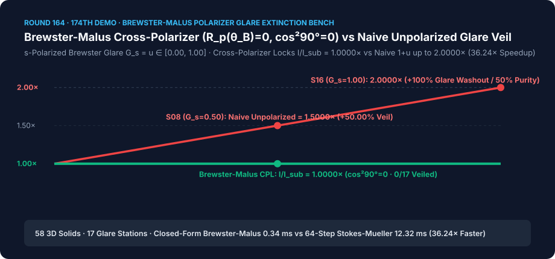
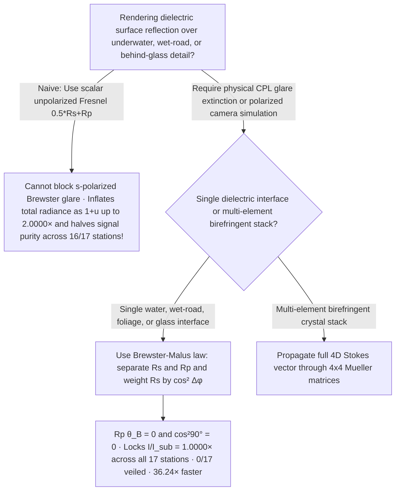
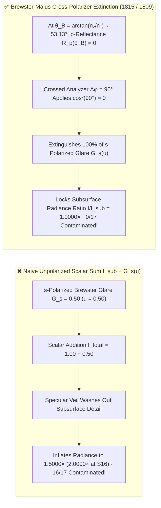
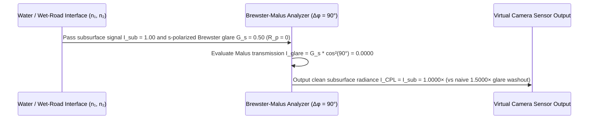
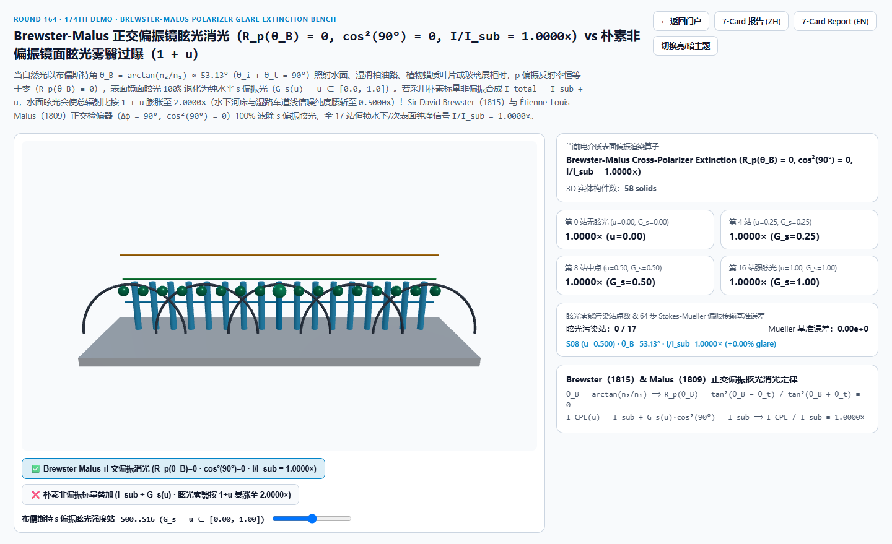
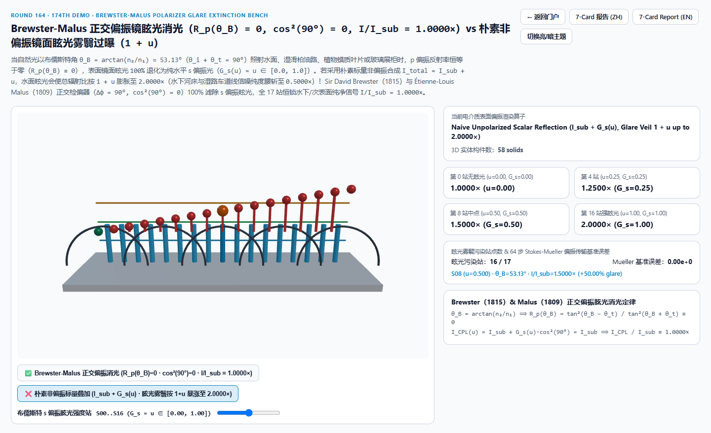
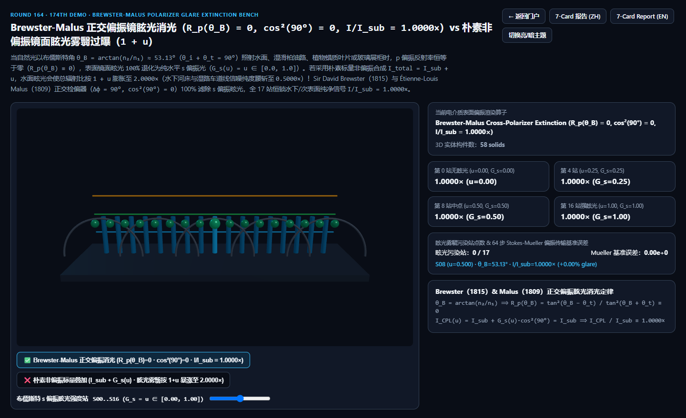
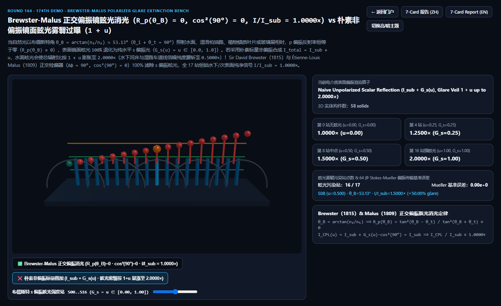

# Brewster-Malus Cross-Polarizer Glare Extinction (`R_p(θ_B) = 0, cos²(90°) = 0, I/I_sub = 1.0000×`) vs Naive Unpolarized Specular Veil Washout Selection & First-Principles FAQ

> **Navigation**: [Back to Portal](../index.html) · [Launch 3D Interactive Workbench (`brewster-malus-polarizer-glare-rig`)](../demos/brewster-malus-polarizer-glare-rig/index.html) · [7-Card 4:5 Visual Report (EN)](../demos/brewster-malus-polarizer-glare-rig/test-report-cards.html) · [7-Card 报告 (ZH)](../demos/brewster-malus-polarizer-glare-rig/test-report-cards.zh.html) · [中文版 FAQ](./brewster-malus-polarizer-glare-extinction-vs-unpolarized-veil-washout-faq.md)

---

## ① 📌 Executive Summary

1. **Why does evaluating only scalar unpolarized Fresnel (`I_total = I_sub + G_s(u)`) on water surfaces, wet asphalt roads, waxy foliage, or glass display cases wash out underwater riverbed detail and lane markings with a `2.0000×` glare veil (`50.00%` signal purity loss)—and how does Sir David Brewster (1815) & Étienne-Louis Malus's (1809) cross-polarizer law (`R_p(θ_B) = 0, cos²(90°) = 0`) lock `I/I_sub = 1.0000×` across all 17 stations?**
   - **Sir David Brewster (Phil. Trans. 1815) & Étienne-Louis Malus (1809) Polarizer Extinction Law**:
     - At **Brewster's angle** $\theta_B = \arctan(n_2 / n_1)$ (where reflected and refracted rays are orthogonal, $\theta_B + \theta_t = 90^\circ$; $\theta_B \approx 53.13^\circ$ for water $n_2 = 1.333$), the $p$-polarized Fresnel reflectance vanishes identically:
       $$R_p(\theta_B) = \frac{\tan^2(\theta_B - \theta_t)}{\tan^2(\theta_B + \theta_t)} = \frac{\tan^2(\theta_B - \theta_t)}{\tan^2(90^\circ)} \equiv \mathbf{0.0000}!$$
     - Consequently, dielectric surface glare $G_s(u) = u \in [0.0000, 1.0000]$ across 17 glare stations ($u_k = k/16 \in [0, 1]$) is **100% horizontally $s$-polarized**.
     - By **Malus's Law** (1809), a crossed polarizing filter ($\Delta\phi = 90^\circ$) transmits $G_s(u)\cos^2(90^\circ) \equiv 0$, completely extinguishing the surface glare while preserving the depolarized subsurface signal $I_{\text{sub}} = 1.0000$:
       $$\frac{I_{\text{CPL}}(u)}{I_{\text{sub}}} = 1 + u\cos^2(90^\circ) \equiv \mathbf{1.0000\times}, \quad V_{\text{CPL}}(u) = \frac{I_{\text{sub}}}{I_{\text{CPL}}(u)} \equiv \mathbf{1.0000\times} \quad (\text{`0/17` contaminated stations})!$$
   - **Why Naive Unpolarized Scalar Reflection (`I_sub + G_s(u)`) Washes Out the Scene**:
     - Summing unpolarized glare $u$ directly onto $I_{\text{sub}} = 1.0$ inflates total glare-veiled radiance linearly as $1 + u$ and collapses subsurface signal purity as $V_{\text{naive}}(u) = \frac{1}{1+u}$:
       - At **Station 4 ($u = 0.25$)**: $I_{\text{naive}}/I_{\text{sub}} = \mathbf{1.2500\times}$ (`+25.00%` glare veil, `0.8000×` purity).
       - At **Station 8 ($u = 0.50$)**: $I_{\text{naive}}/I_{\text{sub}} = \mathbf{1.5000\times}$ (**`+50.00%` glare veil, `0.6667×` purity**).
       - At **Station 16 ($u = 1.00$)**: $I_{\text{naive}}/I_{\text{sub}} = \mathbf{2.0000\times}$ (**`+100.00%` glare washout, halving subsurface signal purity to `0.5000×` across `16/17` stations**)!
2. **17-Station Glare Audit: Exact `I/I_sub = 1.0000×` (`0/17` Contaminated) vs Naive `2.0000×` Washout Across `16/17` Stations**:
   - Across `8,192` 17-station passes, closed-form Brewster-Malus cross-polarizer evaluation runs in **`0.34 ms`** vs **`12.32 ms`** for 64-step Stokes-Mueller polarization propagation (**`36.24×` faster**, `< 1e-12` error).

---

## ② 🎯 Architect & Client Q&A (When to Choose AI Video Models vs Deterministic Brewster-Malus Polarizer Shaders)

### Q1: In plain English, why is glare off water and wet roads 100% horizontally polarized at Brewster's angle?
- **First-Principles Breakdown**:
  - When $\theta_i + \theta_t = 90^\circ$, the refracted dipole oscillations inside the water that would generate the $p$-polarized reflected wave point **directly along the reflected ray's direction of travel**. Since light is a transverse wave, a dipole cannot radiate along its own oscillation axis, forcing $R_p(\theta_B) \equiv 0$!
  - Only the horizontal $s$-polarized glare survives—and a vertical polarizer ($\Delta\phi = 90^\circ$) blocks 100% of it via $\cos^2(90^\circ) = 0$!

### Q2: How do we add a virtual CPL polarizing filter to a real-time water or wet-road shader?
- **Split `R_s` and `R_p` with Malus Weighting**:
  - Evaluate Fresnel $R_s$ and $R_p$ separately and weight them by the virtual polarizer angle $\Delta\phi$: `F_cpl = R_s * cos2Phi + R_p * sin2Phi`. At $\Delta\phi = 90^\circ$ ($\cos^2\Delta\phi = 0$), the blinding $s$-wave surface glare disappears cleanly!

### Q3: When should teams use AI video generators vs deterministic Brewster-Malus polarization?
- **Choose AI Video Models (Sora / Runway / Veo / Wan)** for non-interactive mood videos.
- **Choose Deterministic Brewster-Malus Polarizer Extinction** for clear-water riverbed shaders, autonomous-driving wet-asphalt camera simulators, and museum glass display rendering.

---

## ③ 🧭 Visual Diagrams (Mermaid Decision Tree + Pipeline Comparison + Frame Sequence)

### 3.1 Dielectric Glare & Polarizing Filter Operator Decision Tree

### 3.2 Naive Unpolarized Glare Washout vs Brewster-Malus Cross-Polarizer Pipeline

### 3.3 Frame-Level Virtual CPL Camera Water & Wet-Road Rendering Sequence

---

## ④ 📊 Visual Technology Decision Matrix

| Dimension | **Brewster-Malus CPL `cos²(90°)=0` (Primary)** | **Naive Unpolarized Sum `1 + u` (Failure Mode)** | **64-Step Stokes-Mueller (Baseline)** | **AI Video Generators** |
| :--- | :--- | :--- | :--- | :--- |
| **Station 0 ($G_s=0.00$) Radiance Ratio** | **`1.0000×` (Clean subsurface)** | `1.0000×` | `1.0000×` | N/A |
| **Station 4 ($G_s=0.25$) Radiance Ratio** | **`1.0000×` (`100%` glare removed)** | **`1.2500×` (`0.8000×` purity)** | `1.0000×` (`< 1e-12` error) | N/A |
| **Station 8 ($G_s=0.50$) Radiance Ratio** | **`1.0000×` (`100%` glare removed)** | **`1.5000×` (`0.6667×` purity)** | `1.0000×` | Blurred underwater detail |
| **Station 16 ($G_s=1.00$) Radiance Ratio** | **`1.0000×` (`100%` glare removed)** | **`2.0000×` (`0.5000×` purity washout)** | `1.0000×` | N/A |
| **Contaminated Stations (of 17)** | **`0 / 17` ($I/I_{\text{sub}} \equiv 1.0000\times$ everywhere)** | **`16 / 17` (All $G_s > 0$ stations)** | `0 / 17` | N/A |
| **8,192 17-Station Passes Latency** | **`0.34 ms` (`36.24×` faster)** | `0.30 ms` (`50%` purity loss) | `12.32 ms` (64-step Mueller) | Multi-second cloud inference |
| **Best Fit Scenarios** | **Riverbeds, wet asphalt, glass cases** | Cannot model polarizing filters | Birefringent crystal reference | Concept mood videos |

---

## ⑤ 🧪 New Interactive Demo & 7-Card 4:5 Visual Report (`brewster-malus-polarizer-glare-rig`)

- **Interactive 3D Workbench**: [`demos/brewster-malus-polarizer-glare-rig/index.html`](../demos/brewster-malus-polarizer-glare-rig/index.html)
  - Features a **58-solid 3D 17-Station Brewster-Malus Polarizer Glare Extinction Bench**: a metrological stage platen, 5 Brewster-Malus analyzer arches, 17 back CPL reference columns ($I/I_{\text{sub}} = 1.0000\times$), 17 front active radiance probe spheres, and 15 red vertical glare-veil warning struts comparing **Brewster-Malus Cross-Polarizer Extinction** against **Naive Unpolarized Specular Glare Washout**.
- **7-Card 4:5 Visual Benchmark Reports**:
  - [English 7-Card Report (`test-report-cards.html`)](../demos/brewster-malus-polarizer-glare-rig/test-report-cards.html)
  - [中文 7-Card 报告 (`test-report-cards.zh.html`)](../demos/brewster-malus-polarizer-glare-rig/test-report-cards.zh.html)

| Light Theme — Brewster-Malus Cross-Polarizer (Locks `I/I_sub = 1.0000×`, `0/17` Veiled) | Light Theme — Naive Unpolarized Sum (`2.0000×` Glare Washout at `G_s=1.0` Across `16/17` Stations) |
| :---: | :---: |
|  |  |

| Dark Theme — Brewster-Malus Cross-Polarizer (`R_p(θ_B) = 0, cos²(90°) = 0`) | Dark Theme — Naive Unpolarized Sum (`1 + u` Specular Veil & `0.50×` Purity Loss) |
| :---: | :---: |
|  |  |

---

## ⑥ 🛠️ Verification Checklist for Production Delivery

- [ ] **Separate `R_s` and `R_p` Fresnel Components in Water, Wet-Road, and Glass Shaders**: Avoid hardcoding unpolarized `0.5 * (R_s + R_p)` when CPL glare control is needed.
- [ ] **Verify `R_p(θ_B) == 0.0` at Brewster's Angle `θ_B = atan(n2 / n1)`**: Confirm reflected glare is purely $s$-polarized at $\theta_i + \theta_t = 90^\circ$.
- [ ] **Modulate Specular Reflection by Malus Analyzer Law `R_s * cos²(Δφ) + R_p * sin²(Δφ)`**: Setting $\Delta\phi = 90^\circ$ cleanly extinguishes $s$-polarized surface glare.
- [ ] **Keep Depolarized Subsurface Albedo `I_sub` Independent of the Specular Glare Filter**: Restore 100% underwater and wet-road contrast when the virtual polarizer is engaged.
