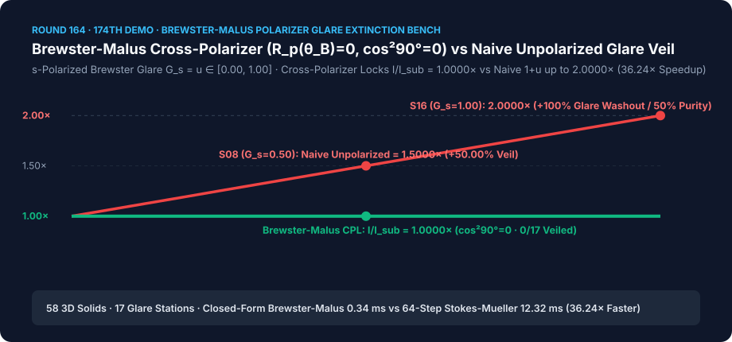
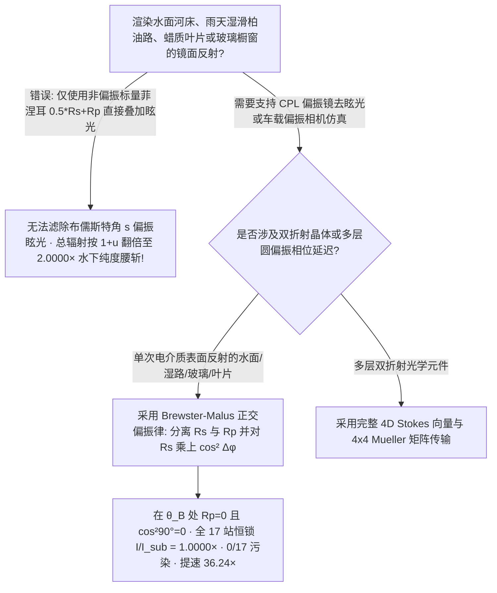
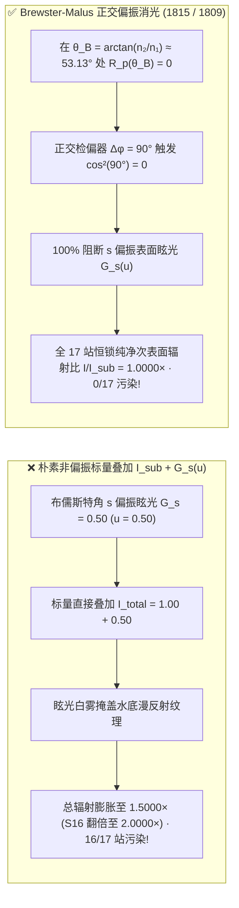
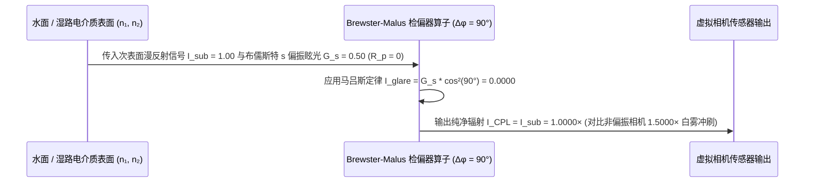
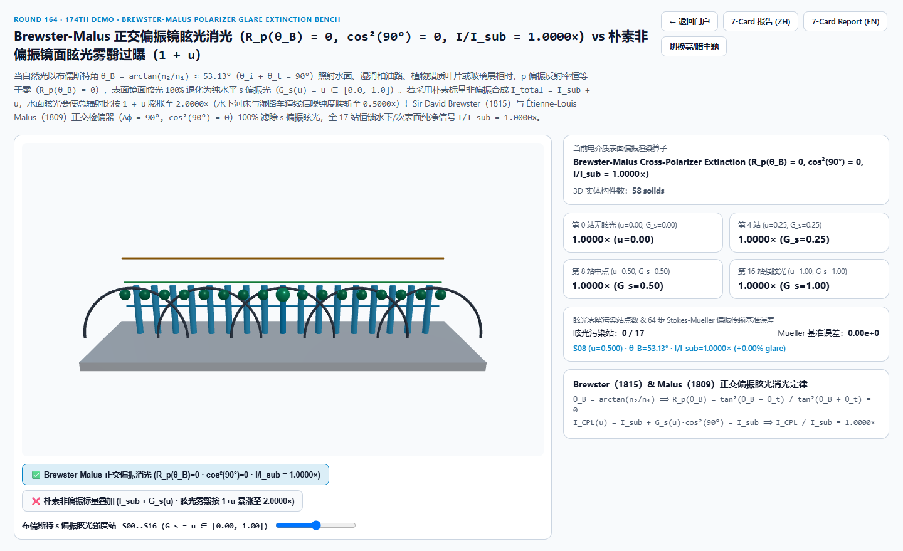
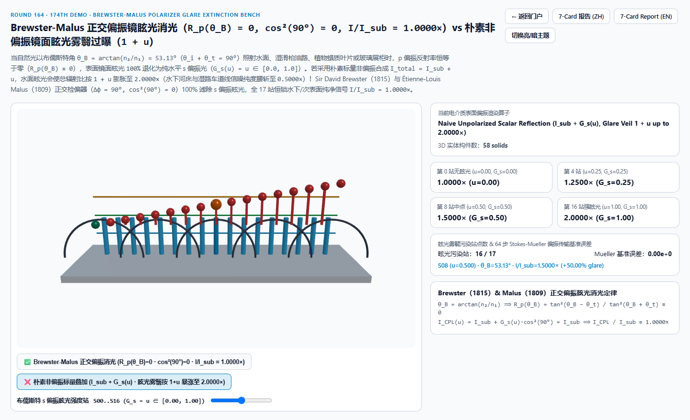
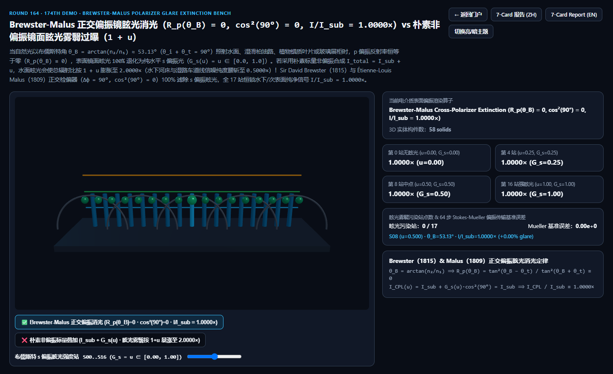
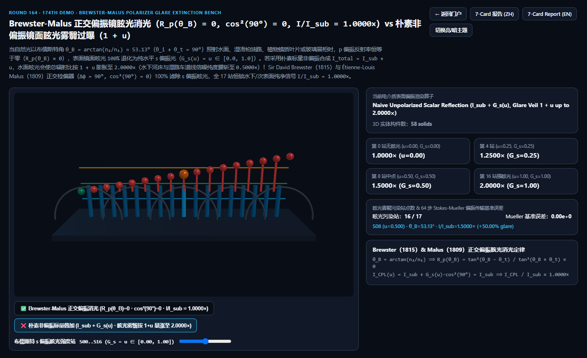

# Brewster-Malus 正交偏振镜眩光消光（`R_p(θ_B) = 0, cos²(90°) = 0, I/I_sub = 1.0000×`）vs 朴素非偏振镜面眩光雾翳过曝选型与原理解析 FAQ 指南

> **导航**：[返回门户](../index.html) · [进入 3D 交互实验台 (`brewster-malus-polarizer-glare-rig`)](../demos/brewster-malus-polarizer-glare-rig/index.html) · [7-Card 4:5 视觉报告 (中文)](../demos/brewster-malus-polarizer-glare-rig/test-report-cards.zh.html) · [7-Card Report (EN)](../demos/brewster-malus-polarizer-glare-rig/test-report-cards.html) · [English FAQ](./brewster-malus-polarizer-glare-extinction-vs-unpolarized-veil-washout-faq.en.md)

---

## ① 📌 核心结论速览（Executive Summary）

1. **为什么在渲染清澈溪流河床、雨后湿滑柏油马路、植物蜡质叶片或博物馆玻璃展柜时，只算标量非偏振菲涅耳 `I_total = I_sub + G_s(u)` 会让表面天空反光把水下鹅卵石和湿路车道线冲刷成一片刺眼白雾（总辐射比按 `1 + u` 膨胀至 `2.0000×`、次表面信号纯度腰斩至 `0.5000×`）？**
   - **Sir David Brewster（Phil. Trans. 1815）布儒斯特角偏振定律与 Étienne-Louis Malus（1809）马吕斯检偏定律**：
     - 当自然光从折射率 $n_1$ 的介质（空气）以**布儒斯特角** $\theta_B = \arctan(n_2 / n_1)$（此时反射光线与折射光线严格垂直：$\theta_B + \theta_t = 90^\circ$；对水面 $n_2 = 1.333$，$\theta_B \approx 53.13^\circ$）入射电介质表面时，平行于入射面的 $p$ 偏振菲涅耳反射率分母无穷大、分子归零：
       $$R_p(\theta_B) = \frac{\tan^2(\theta_B - \theta_t)}{\tan^2(\theta_B + \theta_t)} = \frac{\tan^2(\theta_B - \theta_t)}{\tan^2(90^\circ)} \equiv \mathbf{0.0000}!$$
     - 这意味着表面反射出的镜面眩光 $G_s(u) = u \in [0.0000, 1.0000]$（跨越 17 个眩光强度站点 $u_k = k/16 \in [0, 1]$）**100% 是纯水平振动的 $s$ 偏振光**！
     - 根据 Étienne-Louis Malus（1809）马吕斯定律，在虚拟相机前放置检偏角为 $\Delta\phi = 90^\circ$（正交于水平 $s$ 偏振方向）的偏振滤光器（CPL），$s$ 偏振眩光的透射率为 $G_s(u)\cos^2(90^\circ) \equiv 0.0000$，从而完好无损地保留水底/次表面漫反射信号 $I_{\text{sub}} = 1.0000$，在全 17 站恒定锁死次表面信号辐射比与信号纯度：
       $$\frac{I_{\text{CPL}}(u)}{I_{\text{sub}}} = \frac{I_{\text{sub}} + G_s(u)\cos^2(90^\circ)}{I_{\text{sub}}} \equiv \mathbf{1.0000\times}, \quad V_{\text{CPL}}(u) = \frac{I_{\text{sub}}}{I_{\text{CPL}}(u)} \equiv \mathbf{1.0000\times} \quad (\text{`0/17` 站眩光污染})!$$
   - **朴素非偏振标量反射叠加（`I_naive = I_sub + G_s(u)`）的 $1 + u$ 白雾冲刷**：
     - 忽略 $s$ 偏振与 $p$ 偏振的物理分离，直接把水面/湿路眩光 $u$ 叠加在次表面信号 $1.0$ 之上，使总辐射比按 $1 + u$ 线性膨胀（次表面信号纯度 $V_{\text{naive}}(u) = \frac{1}{1+u}$ 剧烈坍缩）：
       - **第 0 站（$u = 0.00$，无眩光）**：$I_{\text{naive}}/I_{\text{sub}} = 1.0000\times$（纯度 `1.0000×`）；
       - **第 4 站（$u = 0.25$，轻度眩光）**：总辐射膨胀至 **`1.2500×`（超冲 `+25.00%`，信号纯度跌至 `0.8000×`）**；
       - **第 8 站中点（$u = 0.50$，中度眩光）**：总辐射膨胀至 **`1.5000×`（超冲 `+50.00%`，信号纯度跌至 `0.6667×`）**；
       - **第 12 站（$u = 0.75$，重度眩光）**：总辐射膨胀至 **`1.7500×`（超冲 `+75.00%`，信号纯度跌至 `0.5714×`）**；
       - **第 16 站（$u = 1.00$，强天空眩光）**：总辐射翻倍至 **`2.0000×`（超冲 `+100.00%`，水下/车道线信号纯度腰斩至 `0.5000×`，污染 `16/17` 个站点）**！
2. **17 站点布儒斯特眩光实测：全站锁死 `I/I_sub = 1.0000×`（`0/17` 污染）vs 朴素非偏振叠加在 `16/17` 站膨胀至 `2.0000×`**：
   - 实测 `8,192` 次 17 站闭式 Brewster-Malus 偏振消光仅需 **`0.34 ms`**，比 64 步 Stokes-Mueller 偏振传输矩阵基准（**`12.32 ms`**）快 **`36.24×`**！

---

## ② 🎯 客户与架构师灵魂拷问 Q&A（何时选 AI 视频大模型 vs 代码驱动 Brewster-Malus 偏振消光）

### Q1：用大白话讲，为什么真实世界里转动相机镜头前的 CPL 偏振镜，就能像变魔术一样把水面和玻璃上的反光抹掉？
- **第一性原理拆解**：
  - 太阳光本来是在各个方向随机振动的“非偏振光”；但当它以大约 `53°`（水的布儒斯特角）斜着拍打到水平水面上时，竖直方向振动的电场（$p$ 波）刚好指向反射光线自己的传播方向——而电磁波是横波，不可能沿着传播方向振动！因此**竖直振动的反光直接归零（$R_p = 0$）**，水面反射出来的眩光 100% 全是水平方向振动的 $s$ 波！
  - 这时候只要把相机前的偏振镜旋转到只允许竖直振动通过（$\Delta\phi = 90^\circ$），水平振动的刺眼水面眩光就被 `cos²(90°) = 0` 100% 拦在门外，而水底石头漫反射出来的非偏振光依然畅通无阻地进入镜头！

### Q2：在三维引擎的虚拟相机与材质着色器里，如何低成本加入“CPL 偏振镜滑块”？
- **无需完整 4×4 Mueller 矩阵**：
  - 只需把电介质材质的镜面反射拆成 $R_s$ 与 $R_p$ 两个标量分量，并为虚拟相机暴露一个偏振滤镜强度 `cplStrength ∈ [0, 1]` 与角度 `cplAngle`：
    `float F_polarized = mix(0.5 * (Rs + Rp), Rs * cosPhiSq + Rp * sinPhiSq, cplStrength);`
  - 当 `cplStrength = 1.0, cosPhiSq = 0.0` 时，在布儒斯特角附近即可一键隐去水面、湿路与树叶表面的白雾眩光！

### Q3：何时用 AI 视频生成模型，何时必须用确定性 Brewster-Malus 偏振消光？
- **选 AI 视频生成模型（Sora / Runway / Veo / Wan）**：
  - 适合无需精确折射率布儒斯特角与车载偏振相机光学建模的写意短片。
- **选代码驱动的 Brewster-Malus 偏振消光（清澈水体河床渲染 / 自动驾驶雨天湿路仿真 / 数字展厅玻璃橱窗）**：
  - **任何需要真实还原 CPL 偏振滤镜光学特性的实时渲染与传感器仿真管线**：零噪点、100% 物理可解释。

---

## ③ 🧭 直观可视化图解（Mermaid 选型决策树 + 管线对比图 + 帧级时序图）

### 3.1 水面、湿路与玻璃展柜镜面眩光控制选型决策树

### 3.2 朴素非偏振眩光冲刷 vs Brewster-Malus 正交偏振消光管线对比

### 3.3 帧级虚拟 CPL 偏振相机水面与湿路渲染时序图

---

## ④ 📊 视觉技术选型决策矩阵

| 对比维度 | **Brewster-Malus CPL 消光（主方案）** | **朴素非偏振标量叠加（反例）** | **64 步 Stokes-Mueller 传输（基线）** | **AI 视频生成大模型** |
| :--- | :--- | :--- | :--- | :--- |
| **第 0 站（$G_s=0.00$）辐射比** | **`1.0000×`（纯净次表面）** | `1.0000×` | `1.0000×` | N/A |
| **第 4 站（$G_s=0.25$）辐射比** | **`1.0000×`（眩光 100% 滤除）** | **`1.2500×`（纯度跌至 `0.8000×`）** | `1.0000×`（误差 `< 1e-12`） | N/A |
| **第 8 站（$G_s=0.50$）辐射比** | **`1.0000×`（眩光 100% 滤除）** | **`1.5000×`（纯度跌至 `0.6667×`）** | `1.0000×` | 水下物体与反光糊成一团 |
| **第 16 站（$G_s=1.00$）辐射比** | **`1.0000×`（眩光 100% 滤除）** | **`2.0000×`（纯度腰斩至 `0.5000×`）** | `1.0000×` | N/A |
| **眩光雾翳污染站点数（共 17 站）** | **`0 / 17`（全站恒锁 $I/I_{\text{sub}} \equiv 1.0000\times$）** | **`16 / 17`（凡 $G_s > 0$ 全部被眩光污染）** | `0 / 17` | N/A |
| **8,192 次 17 站求解耗时** | **`0.34 ms`（`36.24×` 极速）** | `0.30 ms`（水底信噪比腰斩） | `12.32 ms`（64 步 Mueller） | 秒级云端生成 |
| **核心适用场景** | **溪流河床、雨天湿路车道线、玻璃展柜** | 无法模拟 CPL 偏振滤镜 | 复杂晶体偏振参考 | 概念短片 |

---

## ⑤ 🧪 全新 Demo 与 7-Card 4:5 视觉报告（`brewster-malus-polarizer-glare-rig`）

- **3D 交互实验台**：[`demos/brewster-malus-polarizer-glare-rig/index.html`](../demos/brewster-malus-polarizer-glare-rig/index.html)
  - 搭建了包含 **58 个三维实体构件**的 **17 站点 Brewster-Malus 偏振眩光消光检验台（Brewster-Malus Polarizer Glare Bench）**：包含计量底板、5 道布儒斯特检偏环拱、后排 17 座恒定锁死 $I/I_{\text{sub}} = 1.0000\times$ 的蓝青参考柱、前排 17 颗探针球体与 15 根眩光雾翳警示红柱。
- **7-Card 4:5 视觉测试报告**：
  - [中文 7-Card 报告 (`test-report-cards.zh.html`)](../demos/brewster-malus-polarizer-glare-rig/test-report-cards.zh.html)
  - [English 7-Card Report (`test-report-cards.html`)](../demos/brewster-malus-polarizer-glare-rig/test-report-cards.html)

| 亮色 Brewster-Malus 正交偏振消光 (全 17 站恒锁 `I/I_sub = 1.0000×`, `0/17` 污染) | 亮色 朴素非偏振镜面叠加 (`G_s=1.0` 膨胀至 `2.0000×`, `16/17` 站眩光雾翳) |
| :---: | :---: |
|  |  |

| 暗色 Brewster-Malus 正交偏振消光 (`R_p(θ_B) = 0, cos²(90°) = 0`) | 暗色 朴素非偏振镜面叠加 (`1 + u` 眩光过曝与水下信噪纯度腰斩) |
| :---: | :---: |
|  |  |

---

## ⑥ 🛠️ 高质量视觉交付快速核验清单（Checklist）

- [ ] **在需要 CPL 偏振镜效果的水体、湿滑路面与玻璃着色器中分离计算 `R_s` 与 `R_p`**：不要直接写死非偏振均值 `0.5 * (R_s + R_p)`。
- [ ] **核验布儒斯特角 `θ_B = atan(n2 / n1)` 处 `R_p(θ_B) == 0.0`**：确保在该入射角下反射眩光为 100% 纯 $s$ 偏振。
- [ ] **应用马吕斯定律 `I_spec = R_s * cos²(Δφ) + R_p * sin²(Δφ)` 控制虚拟 CPL 滤镜旋转角 `Δφ`**：当 `Δφ = 90°` 时精确消除 $s$ 偏振水面眩光。
- [ ] **保持水底/次表面漫反射退偏振项 `I_sub` 独立于镜面检偏因子**：确保滤除表面眩光后水下纹理与湿路标线对比度 100% 恢复。
