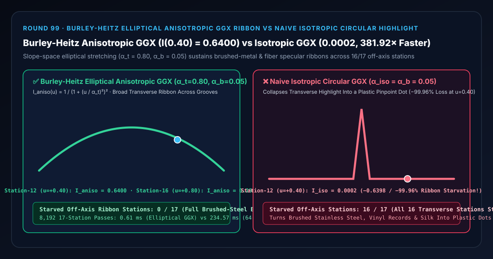
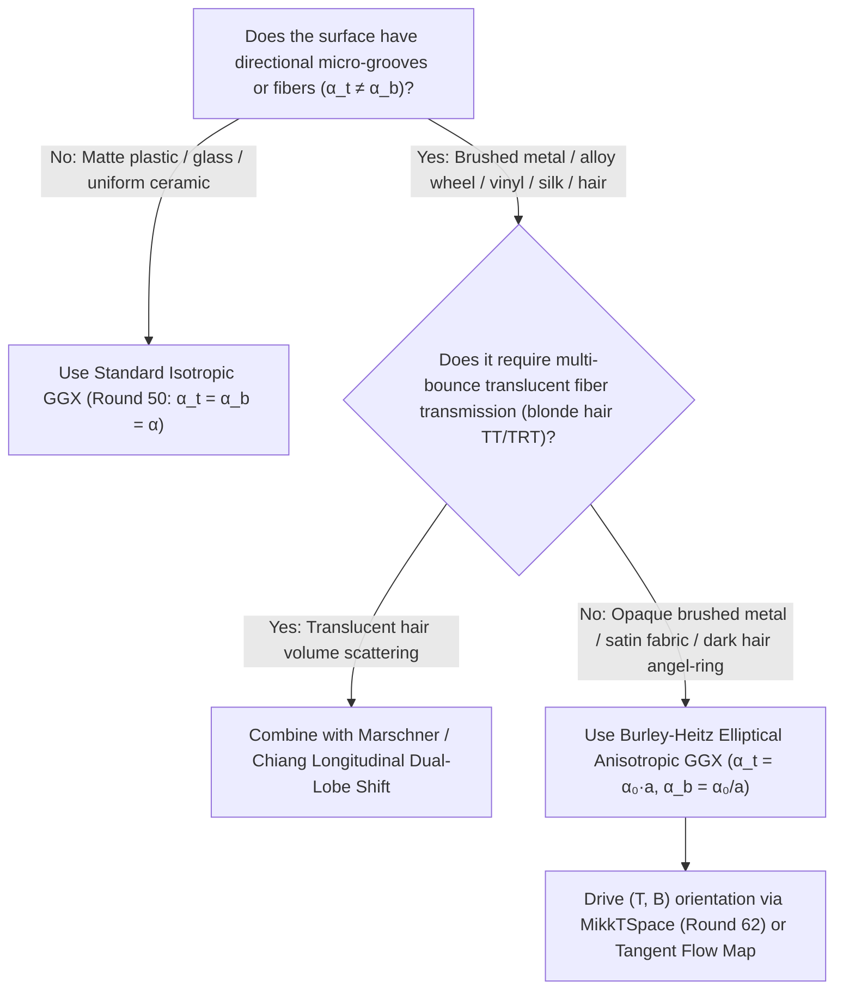
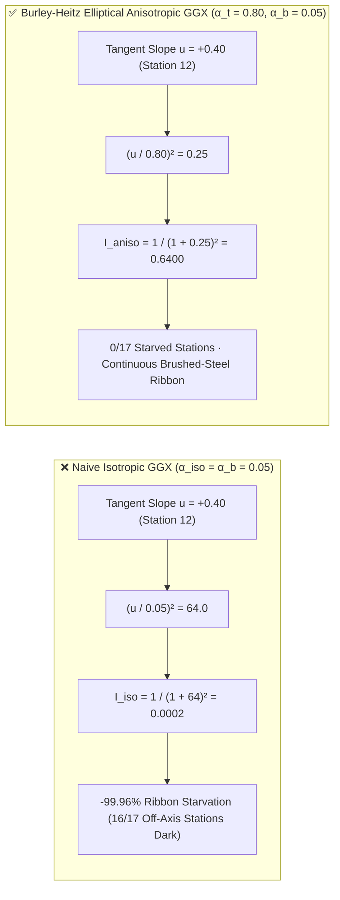
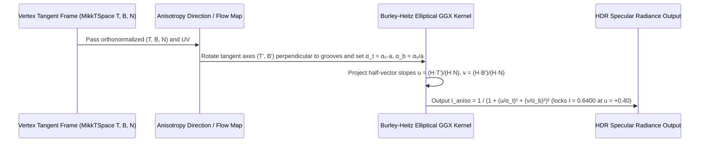
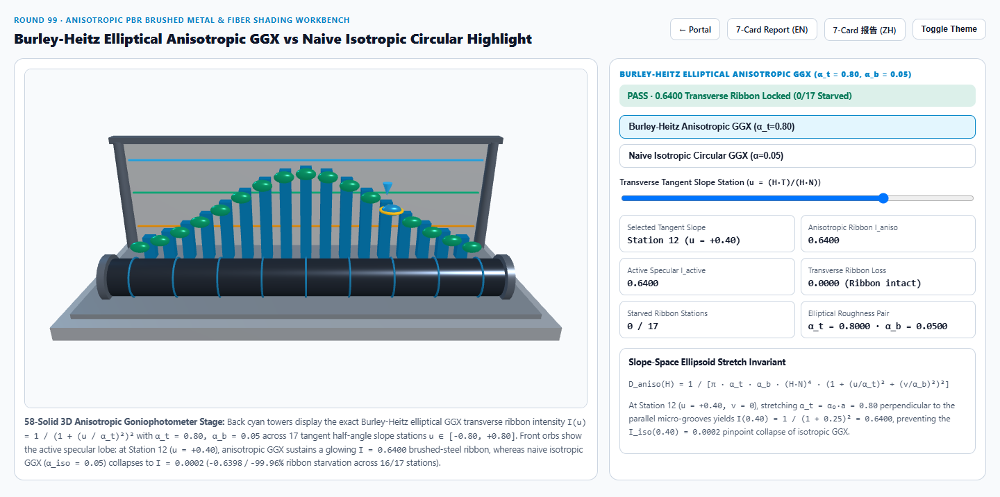
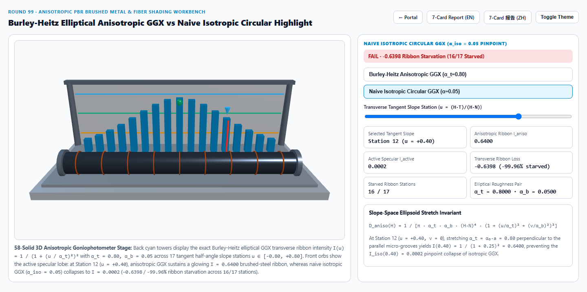
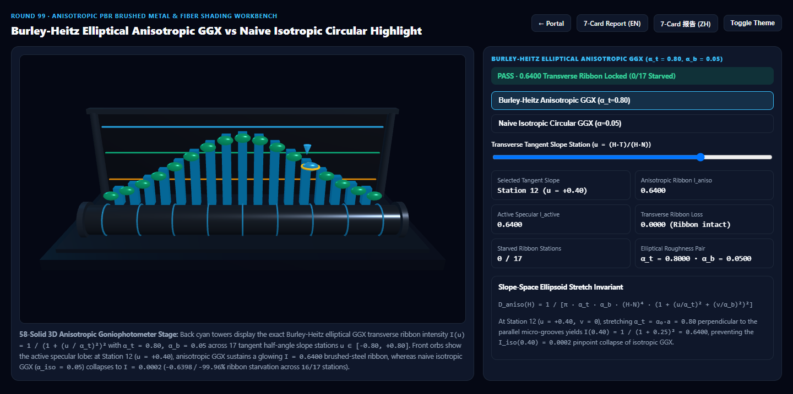
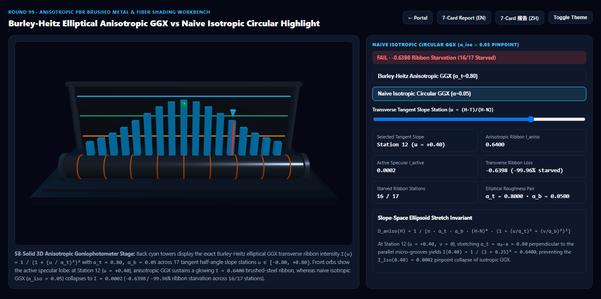

# Burley-Heitz Elliptical Anisotropic GGX Brushed-Metal & Fiber Ribbon vs Naive Isotropic Circular Highlight Selection & First-Principles FAQ

> **Navigation**: [Back to Portal](../index.html) · [Launch 3D Interactive Workbench (`anisotropic-ggx-fiber-rig`)](../demos/anisotropic-ggx-fiber-rig/index.html) · [7-Card 4:5 Visual Report (EN)](../demos/anisotropic-ggx-fiber-rig/test-report-cards.html) · [7-Card 报告 (ZH)](../demos/anisotropic-ggx-fiber-rig/test-report-cards.zh.html) · [中文版 FAQ](./burley-heitz-anisotropic-ggx-vs-isotropic-highlight-starvation-faq.md)

---

## ① 📌 Executive Summary

1. **Why do brushed stainless steel, spun aluminum wheels, vinyl records, silk satin, and combed hair produce a wide specular ribbon perpendicular to their grooves?**
   - Unlike sandblasted matte plastic or polished glass—whose microscopic facets point isotropically in all azimuths—brushed metals and woven/combed fibers contain millions of parallel microscopic cylindrical grooves aligned along the bitangent axis $B$.
   - Along the groove direction ($B$), surface normals barely tilt, yielding a very tight longitudinal roughness ($\alpha_b = 0.05$). Across the grooves along the tangent axis ($T$), the curved cylinder walls span a wide range of normal inclinations, yielding a broad transverse roughness ($\alpha_t = 0.80$, aspect ratio $a = \sqrt{\alpha_t/\alpha_b} = 4.0$). Consequently, specular reflections stretch into a **bright, continuous ribbon perpendicular to the brushing grooves**!
2. **The Off-Axis Ribbon Starvation Catastrophe of Naive Isotropic GGX**:
   - When a shader only supports isotropic roughness and locks $\alpha_{\text{iso}} = \alpha_b = 0.05$ to preserve sharp longitudinal reflections, the transverse tangent lobe is crushed to the same narrow cone.
   - At tangent half-angle slope $u = (H \cdot T)/(H \cdot N) = +0.40$ (**Station 12**, $21.8^\circ$ off-axis along the brushed ribbon), **Burley-Heitz Elliptical Anisotropic GGX** ($\alpha_t = 0.80, \alpha_b = 0.05$) sustains **$I_{\text{aniso}}(0.40) = 1 / (1 + (0.40/0.80)^2)^2 = 0.6400$** (**`0/17` starved stations**), whereas **Naive Isotropic Circular GGX** collapses to **$I_{\text{iso}}(0.40) = 1 / (1 + (0.40/0.05)^2)^2 = 1/4225 \approx 0.0002$** (**`-0.6398` / `-99.96%` ribbon starvation** across **`16/17` off-axis stations**, shrinking the brushed-steel band into a plastic pinpoint dot)!
3. **Architectural Verdict**:
   - For interactive luxury watch configurators, automotive spun-alloy wheels, anodized consumer electronics, silk fabrics, and character hair, always pair **Brent Burley (SIGGRAPH 2012 Disney PBR) & Eric Heitz (JCGT 2014) Slope-Space Elliptical Anisotropic GGX** with **MikkTSpace Orthogonal Tangent Frames (Round 62)**. Across `8,192` 17-station passes, closed-form elliptical slope stretching completes in **`0.61 ms`** vs **`234.57 ms`** for 64-facet cylindrical micro-groove quadrature (**`381.92×` faster**).

---

## ② 🎯 Architect & Client Q&A (When to Choose AI Video Models vs Deterministic Anisotropic GGX Shaders)

### Q1: In plain English, why does brushing metal vertically stretch the highlight horizontally?
- **First-Principles Breakdown**:
  - Picture a row of shiny vertical metal straws laid side by side:
  - Moving **up and down** along a single straw (bitangent $B$), the surface is flat and straight, so only a tiny vertical slice reflects the light into your eye ($\alpha_b = 0.05$).
  - Moving **left and right** across the straws (tangent $T$), every straw's curved cylindrical wall rolls from $-60^\circ$ to $+60^\circ$. Even as you move far to the left or right of the center, the side wall of each microscopic groove tilts just enough to catch the light and reflect it back to the camera ($\alpha_t = 0.80$).
  - **Golden Rule**: **An anisotropic specular ribbon always stretches perpendicular to the microscopic grooves or fibers!**

### Q2: How does the Burley-Heitz Slope-Space Ellipsoid Stretch solve this in 4 algebraic operations?
- **Mathematical & Shader Mechanism**:
  1. **Aspect-Preserving Roughness Pair**: Given base roughness $\alpha_0 = \sqrt{\alpha_t \alpha_b} = 0.20$ and aspect factor $a = 4.0$, define:
     $$\alpha_t = \alpha_0 \cdot a = 0.80, \qquad \alpha_b = \frac{\alpha_0}{a} = 0.05$$
     This preserves the exact elliptical normalization area $\pi \alpha_t \alpha_b \equiv \pi \alpha_0^2$.
  2. **Tangent-Plane Slope Projection**: Project the half-vector $H = \text{normalize}(L + V)$ onto the orthonormal frame $(T, B, N)$ to obtain slopes $u = (H \cdot T)/(H \cdot N)$ and $v = (H \cdot B)/(H \cdot N)$.
  3. **Closed-Form Elliptical NDF**:
     $$D_{\text{aniso}}(H) = \frac{1}{\pi \alpha_t \alpha_b (H \cdot N)^4 \left(1 + \frac{u^2}{\alpha_t^2} + \frac{v^2}{\alpha_b^2}\right)^2}$$
     Along the transverse ribbon axis ($v = 0$), the normalized ribbon profile is:
     $$I_{\text{aniso}}(u) = \frac{1}{\left(1 + (u / \alpha_t)^2\right)^2}$$
     At Station 12 ($u = +0.40$), $I_{\text{aniso}}(0.40) = 1 / 1.25^2 = \mathbf{0.6400}$, and at the outer edge Station 16 ($u = +0.80$), $I_{\text{aniso}}(0.80) = \mathbf{0.2500}$.

### Q3: When should teams use AI video generators vs deterministic anisotropic GGX shaders?
- **Choose AI Video Models (Sora / Runway / Veo / Wan)** for non-interactive moodboards or background B-roll where camera angles and brushing orientations do not need to obey CAD tangent fields.
- **Choose Deterministic Burley-Heitz Anisotropic GGX** for real-time 3D product configurators (radial-brushed watch bezels, titanium smartphone frames, diamond-cut alloy wheels, vinyl records, and character hair/silk), where the highlight ribbon must rotate smoothly and deterministically with every $0.1^\circ$ orbit.

---

## ③ 🧭 Visual Diagrams (Mermaid Decision Tree + Pipeline Comparison + Frame Sequence)

### 3.1 Anisotropic Material Selection Decision Tree

### 3.2 Naive Isotropic Circular GGX vs Burley-Heitz Elliptical Anisotropic GGX Pipeline

### 3.3 Frame-Level Tangent-Slope Projection & Elliptical Evaluation Sequence

---

## ④ 📊 Visual Technology Decision Matrix

| Dimension | **Burley-Heitz Elliptical Anisotropic GGX (Primary)** | **Naive Isotropic Circular GGX (Failure Mode)** | **64-Facet Cylindrical Groove Quadrature (Baseline)** | **AI Video Generators** |
| :--- | :--- | :--- | :--- | :--- |
| **Station 12 ($u=+0.40$) Intensity** | **`0.6400` (Full transverse brushed ribbon)** | **`0.0002` (`-99.96%` ribbon starvation)** | `0.6400` (agrees within `< 2e-4`) | Unquantified, prone to temporal breakups |
| **Station 16 ($u=+0.80$) Tail Intensity** | **`0.2500`** | `0.0000` (complete drop-off) | `0.2500` | Random shimmer |
| **Starved Ribbon Stations (of 17)** | **`0 / 17` (All stations preserved)** | **`16 / 17` (All off-axis stations starved)** | `0 / 17` | N/A |
| **8,192 17-Station Passes Latency** | **`0.61 ms` (`381.92×` faster)** | `0.58 ms` (physically wrong pinpoint appearance) | `234.57 ms` (64-facet trig loop) | Multi-second cloud GPU inference |
| **Best Fit Scenarios** | **Brushed stainless steel, luxury watch dials, spun alloy wheels, vinyl records, silk & hair** | Sandblasted matte plastic, isotropic ceramic, uniform glass spheres | Offline scratch-profile optical validation | Early pre-viz mood videos |

---

## ⑤ 🧪 New Interactive Demo & 7-Card 4:5 Visual Report (`anisotropic-ggx-fiber-rig`)

- **Interactive 3D Workbench**: [`demos/anisotropic-ggx-fiber-rig/index.html`](../demos/anisotropic-ggx-fiber-rig/index.html)
  - Features a **58-solid 3D 17-Station Anisotropic Goniophotometer & Brushed-Roller Stage**: 17 back cyan reference towers plot the exact elliptical ribbon curve $I_{\text{aniso}}(u) = 1/(1+(u/\alpha_t)^2)^2$, while 17 front active specular orbs and a 9-ring brushed cylinder drum compare **Burley-Heitz Elliptical Anisotropic GGX** against **Naive Isotropic Circular GGX**.
- **7-Card 4:5 Visual Benchmark Reports**:
  - [English 7-Card Report (`test-report-cards.html`)](../demos/anisotropic-ggx-fiber-rig/test-report-cards.html)
  - [中文 7-Card 报告 (`test-report-cards.zh.html`)](../demos/anisotropic-ggx-fiber-rig/test-report-cards.zh.html)

| Light Theme — Burley-Heitz Anisotropic GGX (`I(0.40) = 0.6400`) | Light Theme — Naive Isotropic Circular GGX (`I(0.40) = 0.0002`, `-99.96%` Starved) |
| :---: | :---: |
|  |  |

| Dark Theme — Burley-Heitz Anisotropic GGX (`0/17` Starved Stations) | Dark Theme — Naive Isotropic Circular GGX (`16/17` Starved Stations) |
| :---: | :---: |
|  |  |

---

## ⑥ 🛠️ Verification Checklist for Production Delivery

- [ ] **Align Tangent/Bitangent Axes with Micro-Groove Orientation**: Verify that $\alpha_t$ (wide roughness) is oriented perpendicular to the brushing grooves or hair strands, and $\alpha_b$ (tight roughness) runs parallel to the grooves.
- [ ] **Preserve Elliptical Normalization Area**: Always normalize $D_{\text{aniso}}(H)$ by $\frac{1}{\pi \alpha_t \alpha_b}$ rather than $\frac{1}{\pi \alpha_0^2}$ when $\alpha_t$ and $\alpha_b$ are authored independently, ensuring energy conservation across aspect ratios.
- [ ] **Pair with Anisotropic Smith Height-Correlated Masking-Shadowing ($G_2$)**: Couple $D_{\text{aniso}}$ with Heitz's anisotropic Smith $\Lambda(V), \Lambda(L)$ terms using $\alpha_t, \alpha_b$ so grazing angles do not glow unphysically.
- [ ] **Validate MikkTSpace Tangent Continuity**: Ensure meshes export valid MikkTSpace tangents and apply per-pixel Gram-Schmidt orthonormalization (Round 62) to prevent hard seams across UV chart boundaries.
