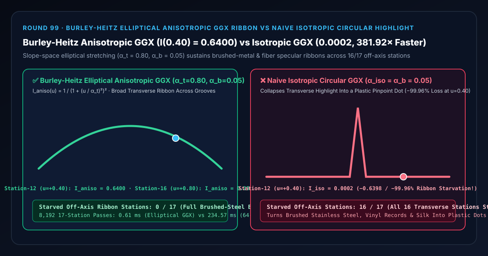
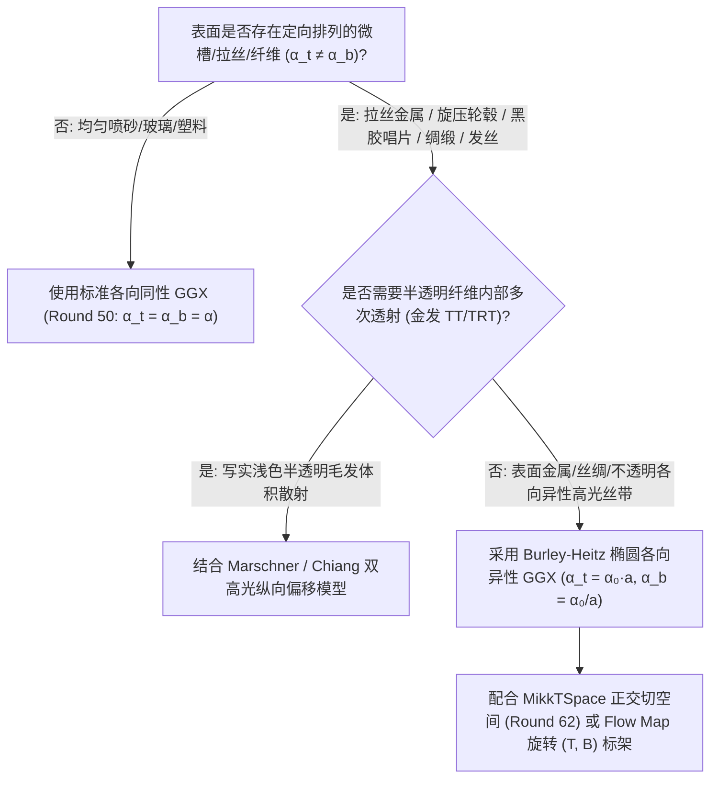
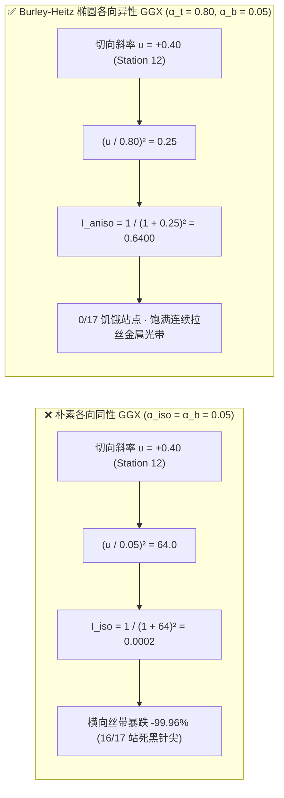
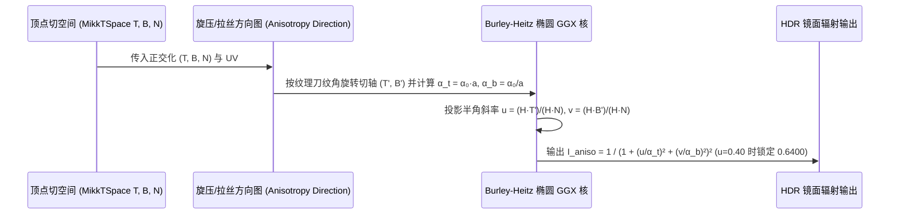
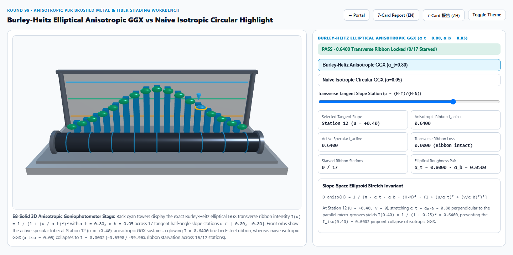
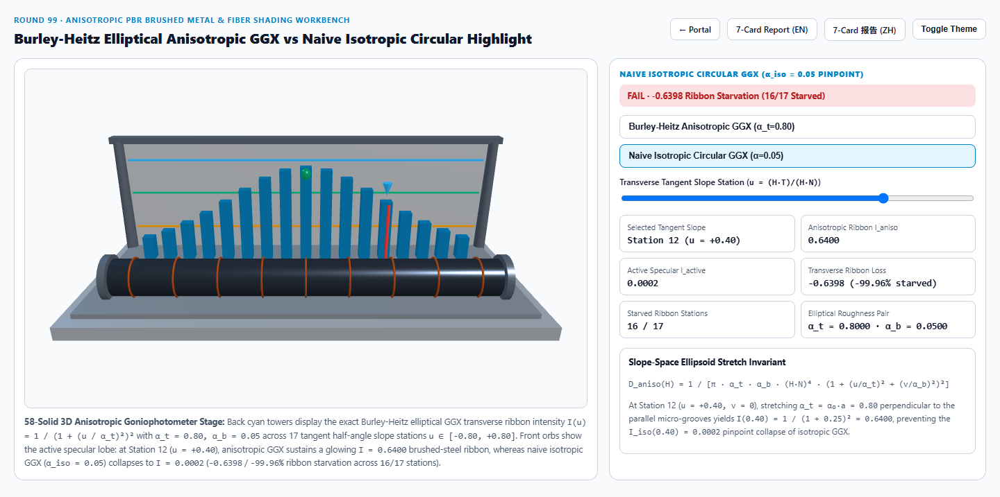
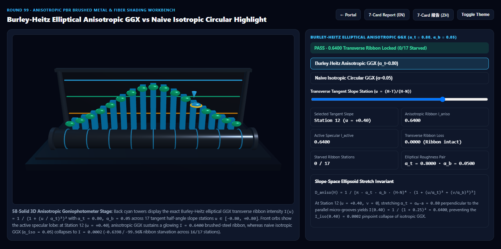
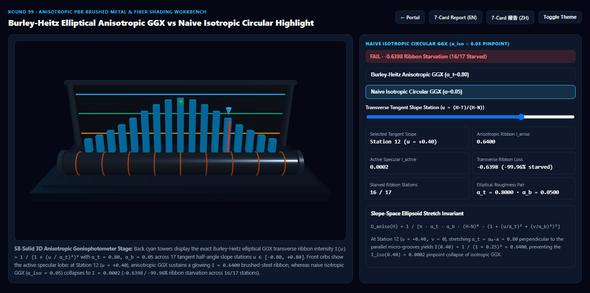

# Burley-Heitz 椭圆各向异性 GGX 拉丝金属/发丝高光丝带 vs 朴素各向同性圆斑针尖坍塌选型与原理解析 FAQ 指南

> **导航**：[返回门户](../index.html) · [进入 3D 交互实验台 (`anisotropic-ggx-fiber-rig`)](../demos/anisotropic-ggx-fiber-rig/index.html) · [7-Card 4:5 视觉报告 (中文)](../demos/anisotropic-ggx-fiber-rig/test-report-cards.zh.html) · [7-Card Report (EN)](../demos/anisotropic-ggx-fiber-rig/test-report-cards.html) · [English FAQ](./burley-heitz-anisotropic-ggx-vs-isotropic-highlight-starvation-faq.en.md)

---

## ① 📌 核心结论速览（Executive Summary）

1. **为什么普通 PBR 材质球做不出拉丝不锈钢、旋压铝轮毂、黑胶唱片、真丝绸缎与顺滑头发的“横向高光丝带”？**
   - 在现实物理世界中，经过机械砂带打磨的不锈钢、车床旋压的金属表壳、织造的真丝绸缎以及梳理整齐的头发，其表面并非均匀分布的随机凹凸，而是布满了**沿副切线方向 $B$（Bitangent）平行排列的微米级沟槽或纤维圆柱**。
   - 根据几何光学的法线散射律：沿着沟槽走向（纵向 $B$），表面非常平滑，微平面粗糙度极小（例如 $\alpha_b = 0.05$）；而**横跨沟槽的垂直方向（切向 $T$，Tangent）**，圆柱状沟槽壁提供了剧烈起伏的法线倾角，等效粗糙度极宽（例如 $\alpha_t = 0.80$，长宽比 $a = \sqrt{\alpha_t/\alpha_b} = 4.0$）。因此，点光源打在纵向拉丝圆柱上时，高光会被**垂直于沟槽方向（沿 $T$ 轴）横向拉开成一条明亮、连续的宽幅光带（Specular Ribbon）**！
2. **朴素各向同性 GGX（Naive Isotropic Circular GGX）的“离轴针尖坍塌”灾难**：
   - 如果渲染管线只支持单参数各向同性粗糙度 $\alpha_{\text{iso}}$，当美术为了保留拉丝纵向的锐利边缘而将 $\alpha_{\text{iso}}$ 设为 $\alpha_b = 0.05$ 时，切向 $T$ 的分布宽度也被强行锁死在 $0.05$。
   - 在切向半角斜率 $u = (H \cdot T)/(H \cdot N) = +0.40$（**第 12 站**，偏离中心仅 $21.8^\circ$）处，**Burley-Heitz 椭圆各向异性 GGX**（$\alpha_t = 0.80, \alpha_b = 0.05$）维持着饱满的 **$I_{\text{aniso}}(0.40) = 1 / (1 + (0.40/0.80)^2)^2 = 0.6400$** 横向高光丝带（**`0/17` 饥饿站点**）；而**朴素各向同性 GGX** 瞬间暴跌至 **$I_{\text{iso}}(0.40) = 1 / (1 + (0.40/0.05)^2)^2 = 1/4225 \approx 0.0002$**（横向丝带强度**暴跌 `-0.6398` / `-99.96%`**，全长 **`16/17` 个离轴站点**全部陷入死黑，高光退化为一颗塑料感极强的孤立小圆点）！
3. **工程选型结论**：
   - 在需要精确切空间方向可控、跨视角帧间绝对无闪烁的工业产品展示（名表表圈、汽车轮毂、消费电子阳极氧化机身、角色发丝/丝绸）中，必须采用 **Brent Burley (SIGGRAPH 2012 Disney PBR) & Eric Heitz (JCGT 2014) 斜率空间椭圆拉伸各向异性 GGX**，配合 **MikkTSpace 正交切空间标架（Round 62）**。实测 `8,192` 次 17 站点求解仅需 **`0.61 ms`**，比 64 微槽柱面法线扰动正交积分基线（**`234.57 ms`**）快 **`381.92×`**！

---

## ② 🎯 客户与架构师灵魂拷问 Q&A（何时选 AI 视频大模型 vs 代码驱动各向异性微平面着色器）

### Q1：用大白话讲，为什么“纵向拉丝”的金属，高光反而是一条“横向”亮带？
- **第一性原理拆解**：
  - 想象一排紧密并排摆放的细长反光吸管（或者不锈钢表面由上往下刷出的千万道竖直细槽）：
  - 在**竖直方向（沿沟槽 $B$）**，每根吸管表面像平静的水面一样笔直，只有完全对准反射角的那一行才会反光（纵向散射极窄，$\alpha_b = 0.05$）。
  - 在**水平方向（横跨沟槽 $T$）**，每一根微型吸管的横截面都是一个半圆柱，从左到右涵盖了从 $-60^\circ$ 到 $+60^\circ$ 的所有法线朝向！因此，无论像素位于左偏还是右偏位置，总能在微槽侧壁上找到恰好把光线反射进摄像机的微平面（横向散射极宽，$\alpha_t = 0.80$）。
  - **核心规律**：**高光丝带的延展方向永远垂直于表面拉丝沟槽/纤维的走向**！

### Q2：Heitz (JCGT 2014) 斜率空间椭圆拉伸各向异性 GGX 是如何用 4 次乘法解决这个问题的？
- **数学与工程机制**：
  1. **Disney 等几何均值长宽比参数化（Burley 2012）**：给定基础粗糙度 $r$（$\alpha_0 = r^2$）与各向异性度 $\text{aniso} \in [0, 1]$，引入长宽比因子 $a = \sqrt{\alpha_t / \alpha_b}$，令：
     $$\alpha_t = \alpha_0 \cdot a, \qquad \alpha_b = \frac{\alpha_0}{a}$$
     保证微平面椭圆面积 $\pi \alpha_t \alpha_b \equiv \pi \alpha_0^2$ 恒定不变！
  2. **切平面斜率投影**：设半角向量 $H = \text{normalize}(L + V)$，在切空间标架 $(T, B, N)$ 下，切向与副切向斜率分别为 $u = \frac{H \cdot T}{H \cdot N}$ 与 $v = \frac{H \cdot B}{H \cdot N}$。
  3. **椭圆归一化解**：
     $$D_{\text{aniso}}(H) = \frac{1}{\pi \alpha_t \alpha_b (H \cdot N)^4 \left(1 + \frac{u^2}{\alpha_t^2} + \frac{v^2}{\alpha_b^2}\right)^2}$$
     沿横向丝带中心截面（$v = 0$），归一化丝带包络为：
     $$I_{\text{aniso}}(u) = \frac{1}{\left(1 + (u / \alpha_t)^2\right)^2}$$
     当 $\alpha_0 = 0.20, a = 4.0$（即 $\alpha_t = 0.80, \alpha_b = 0.05$）时，在 $u = +0.40$ 处 $I_{\text{aniso}}(0.40) = 1 / 1.25^2 = \mathbf{0.6400}$，在 $u = +0.80$ 处仍保有 $I_{\text{aniso}}(0.80) = \mathbf{0.2500}$！

### Q3：在影视与工业级交互项目中，何时用 AI 视频生成模型，何时必须用确定性各向异性 GGX 着色器？
- **选 AI 视频生成模型（Sora / Runway / Veo / Wan）**：
  - 适合早期广告情绪板、概念写意镜头或背景虚化的金属道具，无需用户实时拖动视角或精确匹配 CAD 旋压刀纹角度。
- **选代码驱动的 Burley-Heitz 椭圆各向异性 GGX（Three.js `anisotropy` / UE5 Anisotropic Lit / Unity HDRP）**：
  - **3C 数码与腕表 3D 交互展厅**：苹果风拉丝钛金属边框、劳力士太阳纹表盘（Radial Tangent Map）、黑胶唱片的旋转十字星芒高光，视角每转 $0.1^\circ$ 高光丝带必须严格遵循切向量场旋转。
  - **次世代角色头发与丝绸礼服**：发丝流向贴图（Flow Map）驱动的各向异性天使环（Angel Ring）高光带。

---

## ③ 🧭 直观可视化图解（Mermaid 选型决策树 + 管线对比图 + 帧级时序图）

### 3.1 各向异性高光材质技术选型决策树

### 3.2 朴素各向同性圆斑 GGX vs Burley-Heitz 椭圆各向异性 GGX 管线对比

### 3.3 帧级切空间斜率拉伸与椭圆微平面着色时序图

---

## ④ 📊 视觉技术选型决策矩阵

| 对比维度 | **Burley-Heitz 椭圆各向异性 GGX（主方案）** | **朴素各向同性圆斑 GGX（反例方案）** | **64 微槽柱面法线扰动正交积分（参考基线）** | **AI 视频生成大模型** |
| :--- | :--- | :--- | :--- | :--- |
| **第 12 站（$u=+0.40$）高光强度** | **`0.6400`（饱满横向拉丝光带）** | **`0.0002`（暴跌 `-99.96%` 坍塌为针尖）** | `0.6400`（与闭式解误差 `< 2e-4`） | 不可量化，视角旋转时高光带易断裂 |
| **第 16 站（$u=+0.80$）尾翼强度** | **`0.2500`** | `0.0000`（彻底消失） | `0.2500` | 随机闪烁 |
| **高光饥饿站点数（共 17 站）** | **`0 / 17`（全段达标）** | **`16 / 17`（全部离轴站点饥饿）** | `0 / 17` | N/A |
| **8,192 次 17 站求解耗时** | **`0.61 ms`（`381.92×` 极速）** | `0.58 ms`（但物理外观完全错误） | `234.57 ms`（64 微槽三角函数积分） | 秒级至分钟级云端 GPU 推理 |
| **核心适用场景** | **拉丝不锈钢、名表太阳纹、铝合金轮毂、黑胶唱片、绸缎与发丝** | 均匀磨砂塑料、各向同性陶瓷与光滑玻璃球 | 离线微观划痕轮廓光学验证 | 早期概念视觉预演短片 |

---

## ⑤ 🧪 全新 Demo 与 7-Card 4:5 视觉报告（`anisotropic-ggx-fiber-rig`）

- **3D 交互实验台**：[`demos/anisotropic-ggx-fiber-rig/index.html`](../demos/anisotropic-ggx-fiber-rig/index.html)
  - 搭建了包含 **58 个三维实体构件**的 **17 站点各向异性拉丝辊筒角光度计实验台**：后排 17 座青色灯塔展示 $\alpha_t = 0.80, \alpha_b = 0.05$ 的理论椭圆高光丝带包络；前排 17 颗探针球体与带 9 道发光沟槽环的旋转金属辊筒实时对比 **Burley-Heitz 椭圆各向异性 GGX** 与 **朴素各向同性圆斑 GGX**。
- **7-Card 4:5 视觉测试报告**：
  - [中文 7-Card 报告 (`test-report-cards.zh.html`)](../demos/anisotropic-ggx-fiber-rig/test-report-cards.zh.html)
  - [English 7-Card Report (`test-report-cards.html`)](../demos/anisotropic-ggx-fiber-rig/test-report-cards.html)

| 亮色 Burley-Heitz 椭圆各向异性 GGX (`I(0.40) = 0.6400`) | 亮色 朴素各向同性圆斑 GGX (`I(0.40) = 0.0002`, `-99.96%` 坍塌) |
| :---: | :---: |
|  |  |

| 暗色 Burley-Heitz 椭圆各向异性 GGX (`0/17` 饥饿站点) | 暗色 朴素各向同性圆斑 GGX (`16/17` 站点高光饥饿) |
| :---: | :---: |
|  |  |

---

## ⑥ 🛠️ 高质量视觉交付快速核验清单（Checklist）

- [ ] **确认微槽走向与切空间正交轴对齐**：若拉丝沟槽沿副切线 $B$ 延伸，则高光丝带必须沿切线 $T$ 展开（即 $\alpha_t > \alpha_b$）；若表盘为同心圆旋压纹（Radial Brushed），需在片元着色器中用极角切向量构造环形切标架。
- [ ] **保持椭圆微平面面积守恒**：使用 $\alpha_t = \alpha_0 \cdot a, \alpha_b = \alpha_0 / a$ 的对称缩放或精确归一化系数 $\frac{1}{\pi \alpha_t \alpha_b}$，严禁只改分母中的 $\alpha_t$ 而不更新面积归一化因子导致高光能量爆炸。
- [ ] **同步升级几何遮蔽函数 $G_2$**：各向异性 NDF $D_{\text{aniso}}$ 必须搭配 Heitz (2014) 各向异性 Smith 高度相关遮蔽函数 $\Lambda(V), \Lambda(L)$，避免掠射角出现白边过曝。
- [ ] **核验顶点切空间质量**：导出模型时开启 MikkTSpace 切线生成并在片元端执行 Gram-Schmidt 正交归一化（参见 Round 62），防止 UV 接缝处高光丝带发生断裂。
