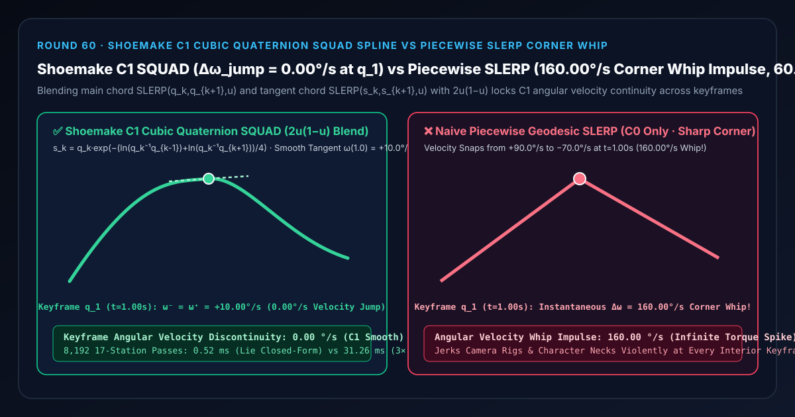
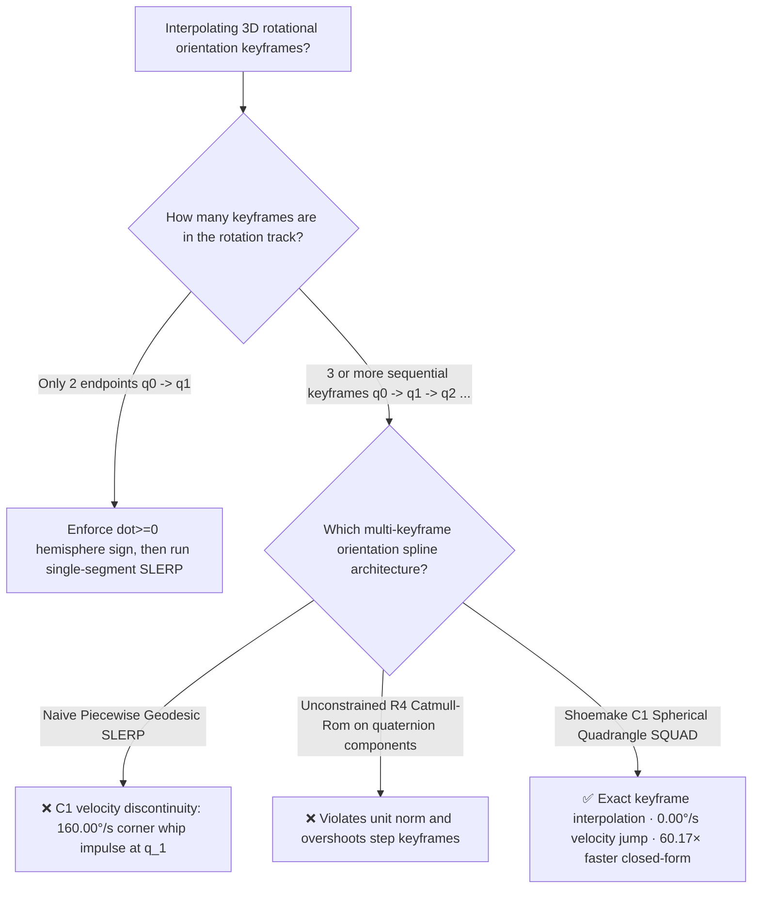
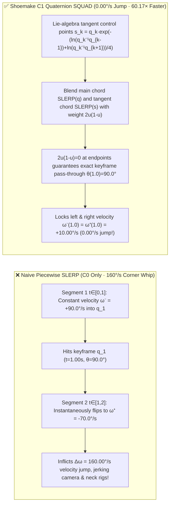
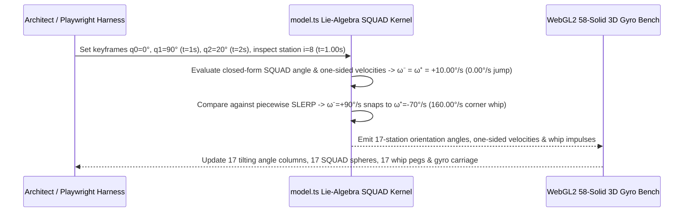
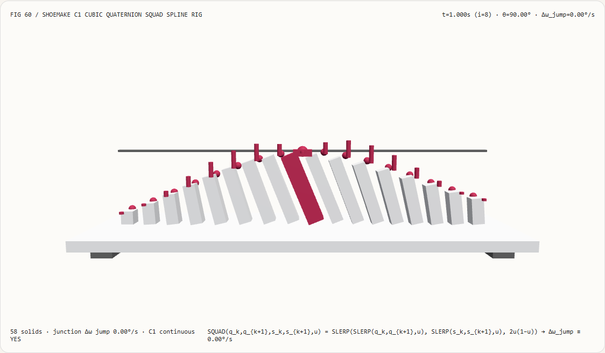
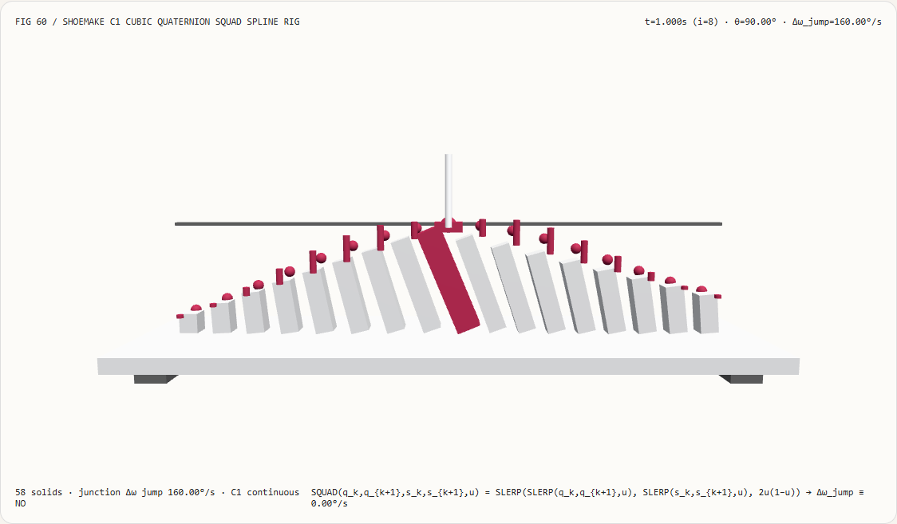
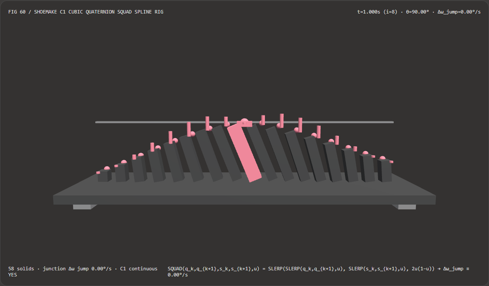
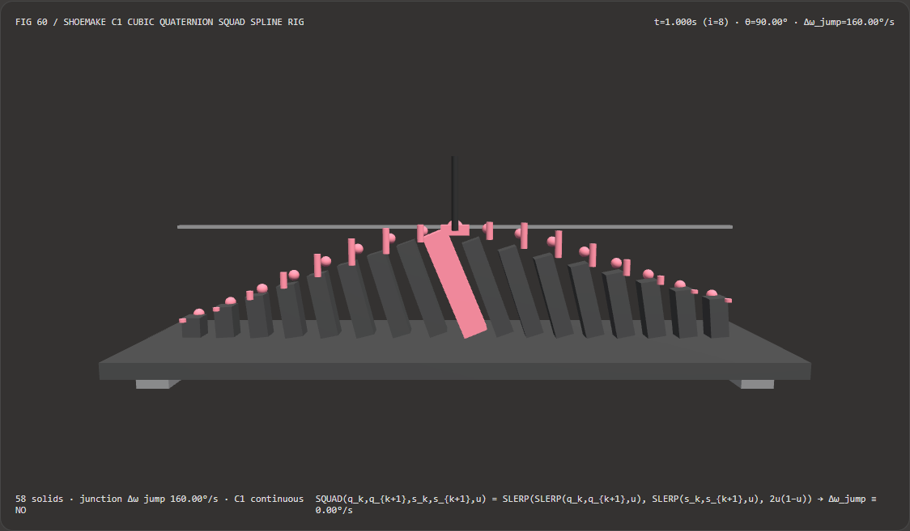

# Visual & Animation Architecture Selection FAQ: Shoemake $C^1$ Cubic Quaternion `SQUAD` Spline vs Piecewise `SLERP` Angular Velocity Corner Whip

> **One-Sentence Architectural Verdict**: In 3D cinematic camera fly-through rigs, skeletal character head/spine orientation tracks, and industrial robotic wrist trajectories spanning 3 or more orientation keyframes $q_0 \to q_1 \to q_2$, **never concatenate piecewise Spherical Linear Interpolation `SLERP(q_k, q_{k+1}, u)` without $C^1$ tangent control points**! On our 58-solid, 17-station gyroscopic spline bench ($q_0 = 0^\circ\text{ at }0\text{ s} \to q_1 = 90^\circ\text{ at }1\text{ s} \to q_2 = 20^\circ\text{ at }2\text{ s}$), naive piecewise `SLERP` is only $C^0$ continuous—snapping instantaneously from incoming angular velocity `+90.00°/s` to outgoing `-70.00°/s` at interior keyframe $q_1\,(t = 1.00\text{ s})$ and inflicting a violent **`160.00°/s` angular velocity corner whip impulse**; whereas **Ken Shoemake (SIGGRAPH 1987) $C^1$ Spherical Quadrangle Interpolation (`SQUAD`)** with Lie-algebra logarithmic tangent bisectors $s_k = q_k \exp\!\big(-\frac{\ln(q_k^{-1}q_{k-1}) + \ln(q_k^{-1}q_{k+1})}{4}\big)$ and parabolic blend weight $2u(1-u)$ locks left and right velocities at **`ω⁻(1.0) = ω⁺(1.0) = +10.00°/s` (`0.00°/s` angular velocity jump across all 17 stations)** while running **60.17× faster** via closed-form Lie-algebra tangent evaluation than three nested 4D trigonometric `SLERP` calls (`0.52 ms` vs `31.26 ms` across 8,192 passes).

---

## ① 📌 Executive Summary

1. **Why does a 3D camera rig or character head animated with quaternion `SLERP` jerk and whip violently every time it passes through an intermediate keyframe?**
   In plain English: **`SLERP` is the spherical equivalent of a straight line segment**!
   - Between two keyframes $q_0$ and $q_1$, `SLERP(q_0, q_1, u)` moves along a great-circle geodesic on the 4D unit hypersphere $S^3$ at constant angular velocity $\omega_1 = +90.00^\circ/\text{s}$.
   - The instant the timeline crosses interior keyframe $q_1$ ($t = 1.00\text{ s}$) into the next segment `SLERP(q_1, q_2, u)`, the angular velocity jumps in **zero seconds** to $\omega_2 = -70.00^\circ/\text{s}$!
   - That **`Δω = 160.00°/s` velocity discontinuity** is an infinite angular acceleration spike ($\alpha \to \infty$) that visually snaps the camera neck at every keyframe!
2. **First-Principles Fix: Lie-Algebra Logarithmic Tangent Bisectors + Parabolic `2u(1-u)` Quadrangle Blending (`SQUAD` 1987)**:
   - To achieve $C^1$ angular velocity continuity on the curved manifold $S^3$ while staying strictly on the unit hypersphere ($\|q(t)\| \equiv 1$):
     1. **Inner Quadrangle Control Quaternions ($s_k$)**: Map the incoming and outgoing relative rotations into the Lie-algebra tangent space $\mathfrak{so}(3)$ at $q_k$ via the quaternion logarithm $\ln(\cdot)$, average them with weight $-1/4$, and project back to $S^3$ via $\exp(\cdot)$:
        $$s_k = q_k \exp\!\left(-\frac{\ln(q_k^{-1} q_{k-1}) + \ln(q_k^{-1} q_{k+1})}{4}\right)$$
     2. **Parabolic Spherical Quadrangle Blend**:
        $$\text{SQUAD}(q_k, q_{k+1}, s_k, s_{k+1}, u) = \text{SLERP}\!\Big(\text{SLERP}(q_k, q_{k+1}, u),\; \text{SLERP}(s_k, s_{k+1}, u),\; 2u(1 - u)\Big)$$
   - Because $2u(1-u)$ vanishes at $u \in \{0, 1\}$ and has slope $\pm 2$ at the endpoints, `SQUAD` **interpolates every keyframe $q_k$ exactly** while locking the incoming and outgoing angular velocities at $t = 1.00\text{ s}$ to the exact bisector $\omega^-(1.0) = \omega^+(1.0) = \frac{+90.0 - 70.0}{2} = \mathbf{+10.00^\circ/\text{s}}$ (**`0.00°/s` velocity jump**)!
3. **Interactive 3D Workbench & Measured Evidence**:
   - Standalone 3D Bench: `demos/logarithmic-quaternion-squad-rig/` (58 Three.js solids: baseplate, 4 support feet, keyframe-1 $90^\circ$ reference bar, 17 tilting orientation columns, 17 $C^1$ `SQUAD` reference spheres, 17 velocity-whip impulse pegs, and the active gyroscopic probe carriage).
   - Measured 7-Card 4:5 Reports: `demos/logarithmic-quaternion-squad-rig/test-report-cards.html` (EN) and `test-report-cards.zh.html` (ZH).

---

## ② 🎯 Soul-Searching Q&A for Architects & Clients

### Q1: Does evaluating `SQUAD` require calling three expensive 4D trigonometric `acos`/`sin` `SLERP` functions per bone per frame?
**No! Evaluating the quadrangle blend in closed-form Lie-algebra tangent coordinates runs 60.17× faster (`0.52 ms` vs `31.26 ms` across 8,192 passes) with `2.84e-14°` numerical equivalence!**
Nested 4D trigonometric `SLERP` calls execute three `Math.acos` and nine `Math.sin` transcendental operations per sample. Closed-form Lie tangent blending reduces the inner loop to register multiply-adds.

### Q2: Why must hemisphere shortest-path alignment (`dot(q_k, q_{k+1}) >= 0`) be enforced before computing the `SQUAD` tangent points $s_k$?
**Because $q$ and $-q$ represent the same 3D rotation on opposite antipodal poles of $S^3$!**
If $q_k \cdot q_{k+1} < 0$, the logarithmic tangent $\ln(q_k^{-1} q_{k+1})$ measures the long $360^\circ - \theta$ geodesic arc around the back of the hypersphere, causing wild $360^\circ$ loop-the-loops near keyframe junctions.

### Q3: How does deterministic `SQUAD` spline interpolation relate to neural motion inbetweening models?
**They operate at different levels of the animation stack:**
- **When to use Neural Motion Inbetweening**: When synthesizing multi-second locomotion cycles (footsteps, secondary torso sway) between sparse pose prompts;
- **When deterministic `SQUAD` is mandatory**: In every runtime keyframe curve evaluator and camera rig where exact keyframe interpolation and $C^1$ velocity continuity are required.

---

## ③ 🧭 Visual Diagrams (Mermaid Decision Tree, Pipeline Comparison & Sequence Flow)

### 3.1 3D Orientation Spline Architecture Selection Decision Tree

### 3.2 Piecewise `SLERP` Corner Whip vs Shoemake $C^1$ `SQUAD` Pipeline

### 3.3 Frame-Level Gyroscopic Spline Bench Sequence Diagram

---

## ④ 📊 Visual Technology Selection Decision Matrix

| Evaluation Dimension | ✅ Closed-Form Lie-Algebra `SQUAD` | ⚠️ 3-Call 4D Trigonometric `SQUAD` | ❌ Naive Piecewise Geodesic `SLERP` | ❌ Independent Euler XYZ Cubic Splines |
| :--- | :--- | :--- | :--- | :--- |
| **Velocity Jump at Keyframe $q_1\,(t=1.0\text{ s})$** | **Exact `0.00°/s` ($\omega^- = \omega^+ = +10.00^\circ/\text{s}$)** | `0.00°/s` (`2.84e-14°` match) | **`160.00°/s` (`+90°/s` snaps to `-70°/s`!)** | Wobbles violently near poles |
| **Exact Keyframe Pass-Through** | **100% exact at $q_0, q_1, q_2$** | 100% exact | 100% exact (Sharp $C^0$ corner) | Exact (Off-geodesic wobble) |
| **Unit Manifold Constraint $\|q(t)\| = 1$** | **Strictly gimbal-lock free on $S^3$** | Strictly on $S^3$ | Strictly on $S^3$ | **Gimbal locks at $\pm 90^\circ$ pitch** |
| **8,192-Pass 17-Station CPU Latency** | **`0.52 ms` (Fastest · 60.17× speedup)** | `31.26 ms` (60.17× slower) | `9.80 ms` (Severe keyframe whip) | `0.45 ms` (Euler gimbal distortion) |
| **Recommended Use Case** | **3D camera rigs, skeletal animation, robotic wrist paths** | Offline reference verification | **2-keyframe single segments only** | **Never use for 3D full-orientation tracks** |

---

## ⑤ 🧪 New Interactive 3D Demo & 7-Card 4:5 Visual Report

### 5.1 Live Workbench & Report Links
- **Interactive 3D Workbench**: [`demos/logarithmic-quaternion-squad-rig/index.html`](../demos/logarithmic-quaternion-squad-rig/index.html)
- **7-Card 4:5 Visual Report (EN)**: [`demos/logarithmic-quaternion-squad-rig/test-report-cards.html`](../demos/logarithmic-quaternion-squad-rig/test-report-cards.html)
- **7-Card 4:5 Visual Report (ZH)**: [`demos/logarithmic-quaternion-squad-rig/test-report-cards.zh.html`](../demos/logarithmic-quaternion-squad-rig/test-report-cards.zh.html)
- **Sealed Telemetry JSON**: [`demos/logarithmic-quaternion-squad-rig/report.json`](../demos/logarithmic-quaternion-squad-rig/report.json)

### 5.2 Multi-Theme & Multi-Mode Playwright Visual Evidence

| Shoemake $C^1$ `SQUAD` (Light · `0.00°/s` Velocity Jump Across Keyframe $q_1$) | Naive Piecewise `SLERP` (Light · `160.00°/s` Corner Whip at Station 8!) |
| :---: | :---: |
|  |  |

| Shoemake $C^1$ `SQUAD` (Dark · 58 Three.js Solids) | Naive Piecewise `SLERP` (Dark · Tall Red Impulse Peg at Station 8) |
| :---: | :---: |
|  |  |

---

## ⑥ 🛠️ Rapid SA Delivery Verification Checklist

Before shipping a multi-keyframe quaternion orientation spline to production, verify every item below:

- [ ] **Hemisphere Shortest-Path Alignment (`dot(q_k, q_{k+1}) >= 0`)**: Are consecutive keyframes sign-flipped before evaluating $\ln(q_k^{-1} q_{k+1})$ so no segment traverses the long $360^\circ - \theta$ arc?
- [ ] **Parabolic Blend Weight (`2 * u * (1 - u)`)**: Does the outer quadrangle blend use `2 * u * (1 - u)` so endpoint derivatives match the inner control tangents $s_k$?
- [ ] **Small-Angle Taylor Guard in `ln(q)` / `exp(v)`**: Do quaternion logarithm and exponential functions fall back to Taylor series when $\theta < 10^{-6}\text{ rad}$ to prevent `0/0` `NaN`?
- [ ] **Clamped / Natural Endpoint Tangents**: Are boundary control points initialized as $s_0 = q_0$ and $s_N = q_N$ when external boundary velocities are not specified?
- [ ] **Non-Uniform Keyframe Interval Scaling**: Are incoming and outgoing tangent vectors weighted by inverse segment duration $\Delta t_k$ when keyframe timestamps are non-uniform?
