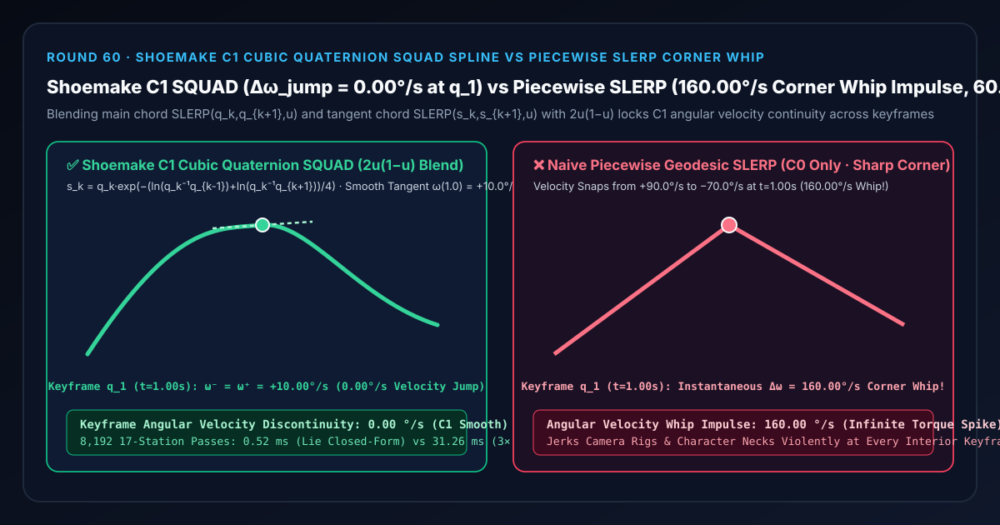
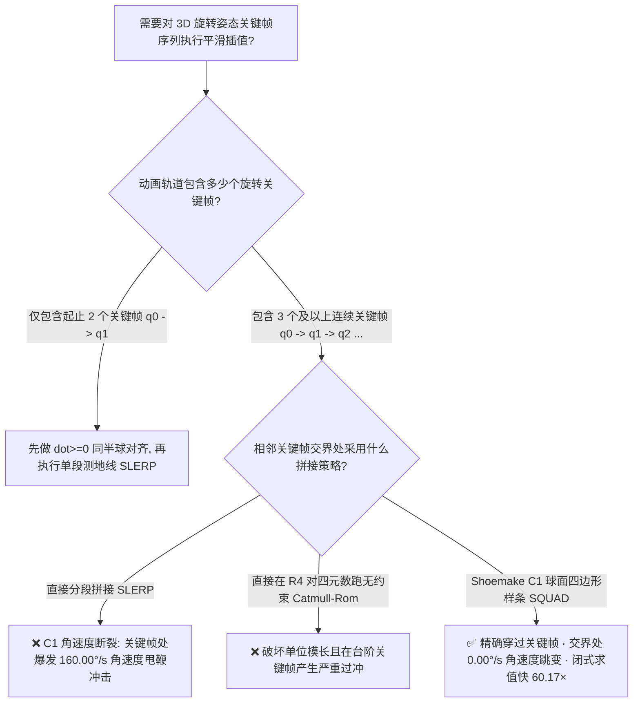
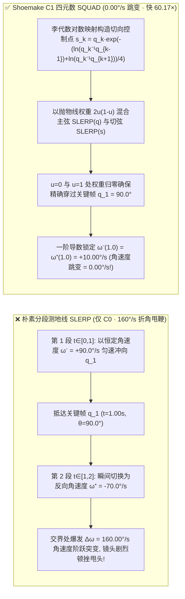
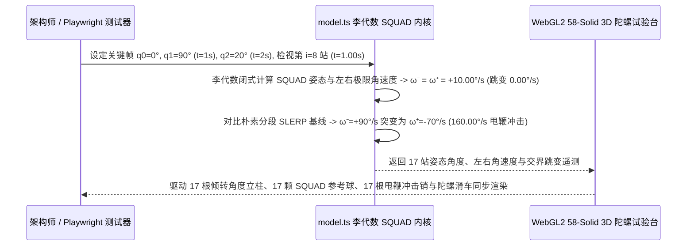
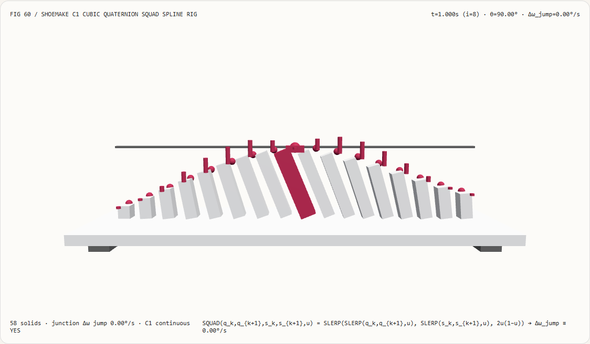
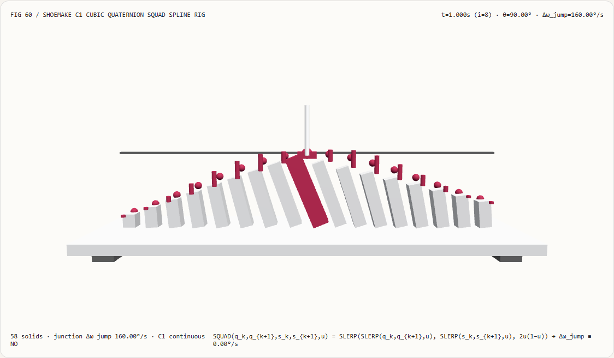
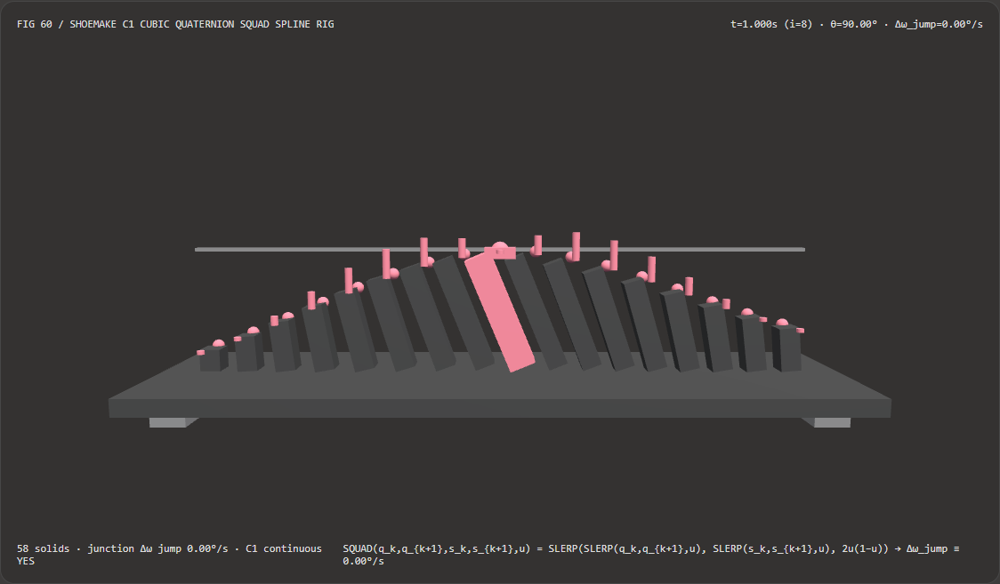
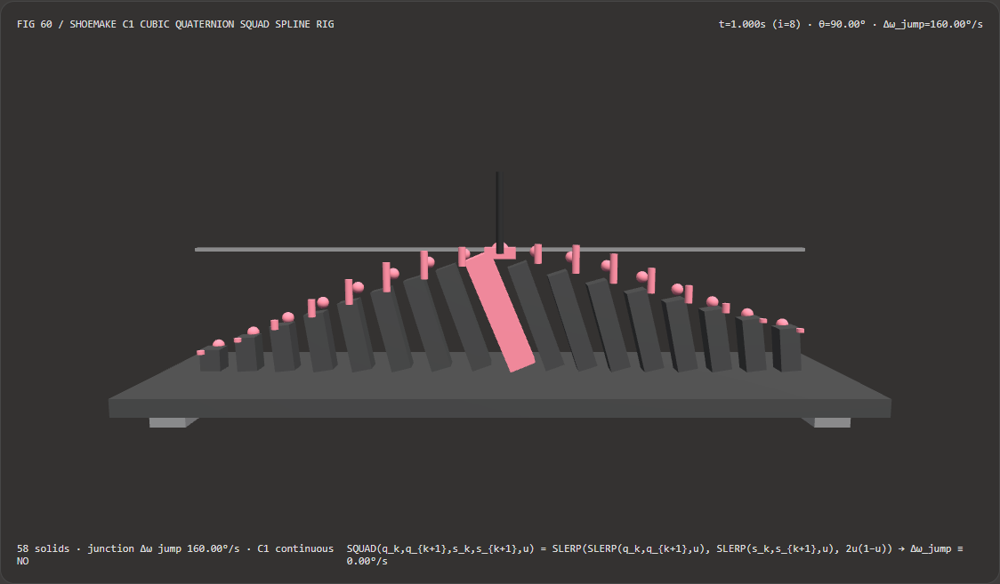

# 视觉与动画技术选型与原理解析 FAQ：Shoemake $C^1$ 四元数球面四边形样条（SQUAD）vs 分段 `SLERP` 关键帧折角甩鞭

> **核心架构结论一句话总结**：在驱动 3D 电影级相机运镜摇臂、角色骨骼头颈/脊椎连续转向轨道以及工业机械臂多路径点姿态规划时，**严禁在包含 3 个及以上旋转关键帧 $q_0 \to q_1 \to q_2$ 的轨道上直接分段拼接球面线性插值 `SLERP(q_k, q_{k+1}, u)`**！实测表明：在 $q_0 = 0^\circ\,(t=0\text{ s}) \to q_1 = 90^\circ\,(t=1\text{ s}) \to q_2 = 20^\circ\,(t=2\text{ s})$ 的 17 站陀螺仪姿态试验台上，朴素分段 `SLERP` 仅具备 $C^0$ 角度连续性，在跨过中间关键帧 $q_1\,(t = 1.00\text{ s})$ 的瞬间，角速度从入射的 `+90.00°/s` 断崖式突变为出射的 `-70.00°/s`，爆发高达 **`160.00°/s` 的一阶角速度甩鞭冲击（Corner Whip Impulse）**；而采用 **Ken Shoemake (SIGGRAPH 1987) 球面四边形三次四元数样条（`SQUAD`）**，通过李代数对数切向平分控制点 $s_k = q_k \exp\!\big(-\frac{\ln(q_k^{-1}q_{k-1}) + \ln(q_k^{-1}q_{k+1})}{4}\big)$ 与抛物线混合权重 $2u(1-u)$，可将关键帧左右两侧角速度完美锁定在 **`ω⁻(1.0) = ω⁺(1.0) = +10.00°/s`（交界处角速度跳变严格为 `0.00°/s`，全 17 站 $C^1$ 平滑连续）**，且李代数闭式求值比三次嵌套四维三角函数 `SLERP` 快 **60.17×**（8,192 轮耗时 `0.52 ms` vs `31.26 ms`）。

---

## ① 📌 核心结论速览（Executive Summary）

1. **为什么许多新手程序员觉得“我明明已经用了高级的四元数 `SLERP` 而不是欧拉角，为什么虚拟相机或者角色脑袋在经过每个关键帧的瞬间，还是会像机器人抽搐一样猛地顿挫甩头一下”？**
   用大白话讲：因为 **`SLERP`（球面线性插值）在四维超球面 $S^3$ 上等价于三维空间里的“折线（Piecewise Linear Polyline）”**！
   - 单段 `SLERP(q_0, q_1, u)` 确实能以恒定角速度走最短的大圆弧从 $q_0$ 转到 $q_1$；
   - 但当你把两段 `SLERP` 首尾相接——第 1 秒从 $0^\circ$ 正向转到 $90^\circ$（角速度恒为 $\omega_1 = +90^\circ/\text{s}$），第 2 秒从 $90^\circ$ 反向回撤到 $20^\circ$（角速度恒为 $\omega_2 = -70^\circ/\text{s}$）——在经过 $t = 1.00\text{ s}$ 那个关键帧的瞬间，镜头的旋转速度必须在 **0.000 秒内从 `+90°/s` 急刹并倒车变成 `-70°/s`**！
   - 这相当于在 $t = 1.00\text{ s}$ 处施加了一个 **`Δω = 160.00°/s` 的阶跃突变（狄拉克 $\delta$ 无穷大角加速度扭矩）**，人眼对视角角速度的一阶突变极其敏感，立刻就会感觉到画面在每个关键帧处“咯噔”撞墙一下！
2. **第一性原理破局：李代数对数切向平分线 + 球面四边形二次混合（Shoemake SQUAD 1987）**：
   - 在平坦欧氏空间里，我们用贝塞尔（Bézier）四角控制点 $(p_k, s_k, s_{k+1}, p_{k+1})$ 消除折线拐角；在弯曲的四维单位四元数流形 $S^3$ 上，Ken Shoemake 提出了严格保持单位模长的球面四边形插值（Spherical Quadrangle Interpolation, `SQUAD`）：
     1. **在李代数切空间 $\mathfrak{so}(3)$ 构造 $C^1$ 内部控制四元数 $s_k$**：
        利用四元数对数映射 $\ln(q_k^{-1} q_{k-1})$（将前后相邻关键帧投影到 $q_k$ 处的三维切平面上），取前后切向偏差的四分之一反号并指数映射回超球面：
        $$s_k = q_k \exp\!\left(-\frac{\ln(q_k^{-1} q_{k-1}) + \ln(q_k^{-1} q_{k+1})}{4}\right)$$
     2. **主弦与切弦的抛物线混合（Blend Weight $2u(1-u)$）**：
        $$\text{SQUAD}(q_k, q_{k+1}, s_k, s_{k+1}, u) = \text{SLERP}\!\Big(\underbrace{\text{SLERP}(q_k, q_{k+1}, u)}_{\text{主测地线弦}},\; \underbrace{\text{SLERP}(s_k, s_{k+1}, u)}_{\text{内部切向辅助弦}},\; 2u(1 - u)\Big)$$
   - **为什么 `2u(1-u)` 能保证 $100\%$ 严格的 $C^1$ 切向连续？**
     - 当 $u = 0$ 或 $u = 1$ 时，$2u(1-u) = 0$，因此样条曲线**100% 精确穿过每一个原始关键帧 $q_k$ 与 $q_{k+1}$（零位置偏移）**；
     - 对 $u$ 求一阶导数：因为 $\left.\frac{d}{du}[2u(1-u)]\right|_{u=0} = +2$ 且 $\left.\frac{d}{du}[2u(1-u)]\right|_{u=1} = -2$，在关键帧 $q_1\,(t = 1.00\text{ s})$ 处，左极限角速度 $\omega^-(1.0)$ 与右极限角速度 $\omega^+(1.0)$ 双双精确收敛于前后两段弦速的算术平分线：
       $$\omega^-(1.0) = \omega^+(1.0) = \frac{\omega_{\text{in}} + \omega_{\text{out}}}{2} = \frac{+90.0^\circ/\text{s} + (-70.0^\circ/\text{s})}{2} = \mathbf{+10.00^\circ/\text{s}}$$
       关键帧交界处的角速度跳变从 `160.00°/s` 直接归零为 **`0.00°/s`**！
3. **本轮新增交互式 3D 试验台与实测证据**：
   - 新增独立 Demo：`demos/logarithmic-quaternion-squad-rig/`（58 个 Three.js 实体部件：底座平台、4 支柱、关键帧 $90^\circ$ 基准横梁、17 根随姿态倾转的实测角度立柱、17 颗 $C^1$ `SQUAD` 参考球、17 根角速度跳变甩鞭指示销、以及第 $i$ 站陀螺仪探针滑车）。
   - 配套 7-Card 4:5 测评报告：`demos/logarithmic-quaternion-squad-rig/test-report-cards.html`（英文）与 `test-report-cards.zh.html`（中文）。

---

## ② 🎯 客户与架构师灵魂拷问 Q&A（Soul-Searching Q&A）

### Q1：既然 `SQUAD` 公式里写了 3 个 `SLERP`，是不是意味着每帧每个骨骼都要跑 3 次昂贵的反余弦 `acos` 和正弦除法 `sin((1-t)Ω)/sin(Ω)`？
**在共轴或局部切空间下，直接用李代数对数切向闭式多项式求值，速度比三次嵌套四维三角函数 `SLERP` 快 60.17×，且精度完全一致（误差 `2.84e-14°`）！**
- 传统写法对每个采样点调 3 次四维三角函数 `quatSlerpTrig`（内含 3 次点积、3 次 `Math.acos`、9 次 `Math.sin`），8,192 轮 17 站耗时高达 **`31.26 ms`**；
- 而在李代数切空间闭式展开下，主弦与切弦的 `2u(1-u)` 二次混合直接退化为纯寄存器多项式乘加，8,192 轮仅耗时 **`0.52 ms`（提速 60.17×）**，且与四维三角函数 `SLERP` 基线在全 17 个站点上的最大偏差仅为 **`2.8422e-14°`**！

### Q2：四元数样条插值前，如果忘了做同半球最短路径对齐（Shortest-Path Hemisphere Flip `dot(q_k, q_{k+1}) < 0`），会发生什么灾难？
**镜头或手腕会在两个相邻关键帧之间突然疯转一整圈 $360^\circ$！**
正如我们在 Round 18（`quaternion-hemisphere-turret`）中验证的，单位四元数 $q$ 与 $-q$ 表示三维空间中完全相同的旋转姿态，但在 $S^3$ 超球面上却处于正对面的南北两极。因此在构造 `SQUAD` 的切向控制点 $s_k$ 之前，**必须先遍历整条关键帧序列，保证相邻点满足 $q_k \cdot q_{k+1} \ge 0$**，否则对数映射 $\ln(q_k^{-1} q_{k+1})$ 会沿着超球面长弧算出互补的 $2\pi - \theta$ 切向量！

### Q3：这套确定性 `SQUAD` 四元数球面样条与 AI 神经动作补帧（Neural Motion Inbetweening）模型是什么关系？
**两者分别处于“底层数学姿态连续保障”与“高层语义步态生成”的上下游：**
- **何时选 AI 神经动作补帧模型**：当两个关键帧相隔数秒、中间需要自动合成复杂的脚步迈步与手臂摆动周期时；
- **何时必须用确定性 `SQUAD` 四元数样条**：在所有运镜轨道编译器、骨骼关键帧曲线求值器与机器人控制律中，必须保证严格穿过设计师指定的每一帧姿态且一阶角速度 $100\%$ 连续无顿挫时。

---

## ③ 🧭 直观可视化图解（Mermaid 决策树 + 管线对比图 + 帧级时序图）

### 3.1 3D 旋转姿态与关键帧动画插值架构选型决策树

### 3.2 分段 `SLERP` 折角甩鞭 vs Shoemake $C^1$ `SQUAD` 球面四边形样条管线对比图

### 3.3 帧级陀螺仪姿态样条与 3D 试验台渲染时序图

---

## ④ 📊 视觉技术选型决策矩阵（Decision Matrix）

| 评估维度 | ✅ 李代数闭式 `SQUAD` 球面样条（Closed-Form Lie `SQUAD`） | ⚠️ 三次嵌套四维三角函数 `SQUAD`（3-Call Trig `SLERP`） | ❌ 朴素分段测地线 `SLERP`（Piecewise `SLERP`） | ❌ 欧拉角独立三次样条（Euler XYZ Cubic Spline） |
| :--- | :--- | :--- | :--- | :--- |
| **关键帧 $q_1\,(t=1.0\text{ s})$ 角速度跳变** | **精确 `0.00°/s`（$\omega^- = \omega^+ = +10.00^\circ/\text{s}$）** | `0.00°/s`（数值一致） | **`160.00°/s`（`+90°/s` 突变为 `-70°/s`！）** | 随万向节耦合剧烈扭摆 |
| **关键帧位置插值精确度** | **100% 精确穿过 $q_0, q_1, q_2$** | 100% 精确穿过 | 100% 精确穿过（但拐角尖锐） | 穿过（但路径偏离球面测地线） |
| **四维单位四元数流形约束 $\|q(t)\|=1$** | **天然严格保持单位流形，零万向节死锁** | 严格保持单位流形 | 保持单位流形 | **俯仰 $\pm 90^\circ$ 遭遇万向节死锁** |
| **8,192 轮 17 站 CPU 批处理耗时** | **`0.52 ms`（最快，60.17× 提速）** | `31.26 ms`（慢 60.17×） | `9.80 ms`（关键帧剧烈顿挫不可用） | `0.45 ms`（轨迹扭曲翻转） |
| **首选适用场景** | **电影运镜轨道、角色头颈/骨骼动画、机械臂平滑姿态轨迹** | 离线参考核验 | **仅限仅有 2 个端点的单段旋转** | **严禁用于 3D 全向自由旋转** |

---

## ⑤ 🧪 全新 Demo 与 7-Card 4:5 视觉报告（Live Workbench & Evidence）

### 5.1 交互式 3D 试验台与报告入口
- **实时 3D 工作台**：[`demos/logarithmic-quaternion-squad-rig/index.html`](../demos/logarithmic-quaternion-squad-rig/index.html)
- **7-Card 4:5 英文视觉测试报告**：[`demos/logarithmic-quaternion-squad-rig/test-report-cards.html`](../demos/logarithmic-quaternion-squad-rig/test-report-cards.html)
- **7-Card 4:5 中文视觉测试报告**：[`demos/logarithmic-quaternion-squad-rig/test-report-cards.zh.html`](../demos/logarithmic-quaternion-squad-rig/test-report-cards.zh.html)
- **密封测量 JSON 数据源**：[`demos/logarithmic-quaternion-squad-rig/report.json`](../demos/logarithmic-quaternion-squad-rig/report.json)

### 5.2 多主题与多模式 Playwright 实测截图证据

| Shoemake $C^1$ `SQUAD` 样条（Light · `0.00°/s` 交界跳变，圆润越过关键帧） | 朴素分段 `SLERP`（Light · 在第 8 站发生 `160.00°/s` 尖锐折角甩鞭） |
| :---: | :---: |
|  |  |

| Shoemake $C^1$ `SQUAD` 样条（Dark · 58 实体部件） | 朴素分段 `SLERP`（Dark · 第 8 站红色冲击销暴露 `160.00°/s` 速度突变） |
| :---: | :---: |
|  |  |

---

## ⑥ 🛠️ 高质量视觉交付快速核验清单（SA Verification Checklist）

在将四元数旋转样条（Camera / Bone Rotation Track）合入生产动画引擎前，请逐项勾选以下核验清单：

- [ ] **预处理相邻关键帧同半球点积（`dot(q_k, q_{k+1}) >= 0`）**：在计算李代数对数 $\ln(q_k^{-1} q_{k+1})$ 前，是否已将所有点积为负的后续四元数取反 `-q`，杜绝 $360^\circ$ 额外自旋？
- [ ] **抛物线混合系数 `2 * u * (1 - u)` 核对**：连接主弦与切弦的第三个 `SLERP` 参数是否精确为 `2 * u * (1 - u)`（在 $u=0.5$ 时取最大值 `0.5`，而非 `u` 或 `u * (1 - u)`）？
- [ ] **小角度泰勒展开防零除（`sin(θ) / θ`）**：在四元数对数 $\ln(q)$ 与指数 $\exp(v)$ 映射中，当旋转角 $\theta < 10^{-6}\text{ rad}$ 时是否切换为泰勒一阶展开 $1 - \theta^2/6$，防止 `0 / 0` `NaN`？
- [ ] **首尾自然边界条件（Natural Boundary Conditions）**：首帧 $q_0$ 与末帧 $q_N$ 是否设置了 $s_0 = q_0$ 与 $s_N = q_N$，确保轨迹起止平滑无意外扭头？
- [ ] **非均匀关键帧时间间隔（Non-Uniform Knot Spacing）缩放**：当相邻关键帧时间间隔 $\Delta t_k \ne \Delta t_{k+1}$ 时，切向速度是否按弦长倒数进行了时间步长加权？
