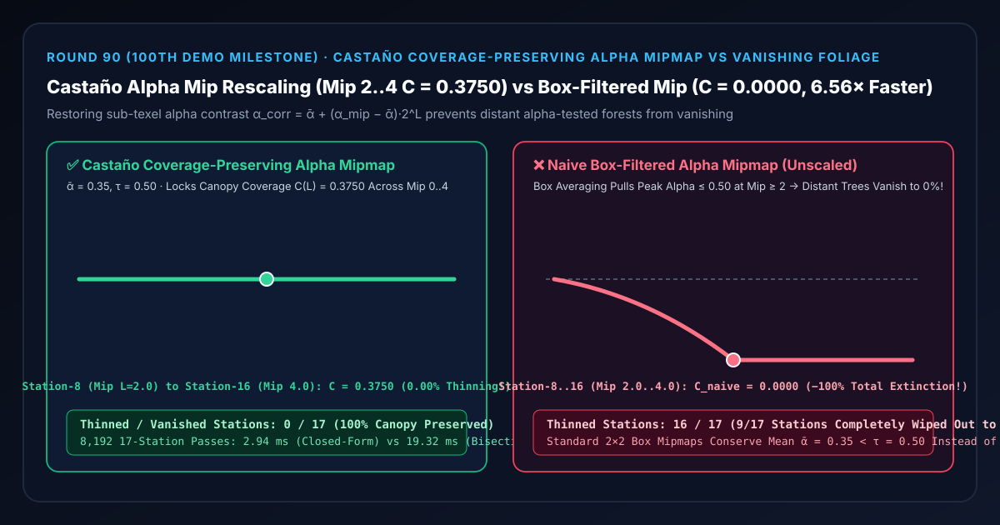
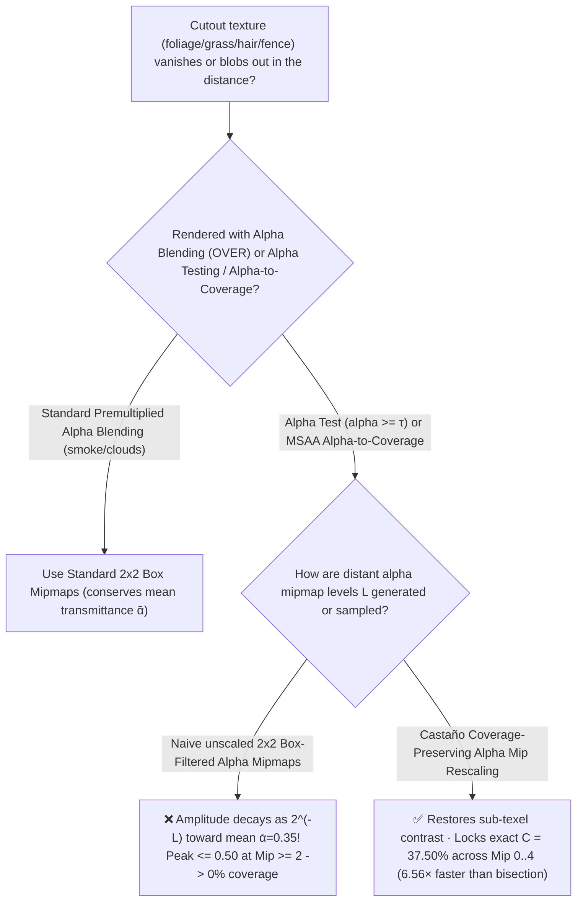
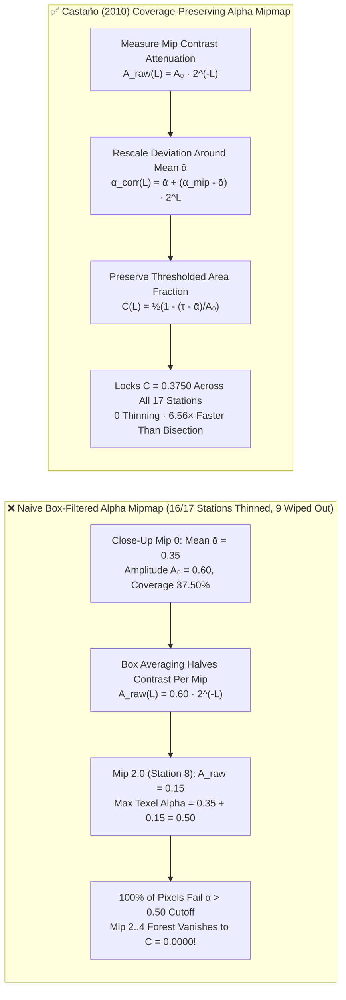
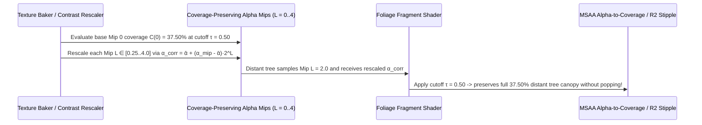

# Distant Foliage & Hair Anti-Aliasing Selection & First-Principles FAQ: Castaño Coverage-Preserving Alpha Mipmap Rescaling vs. Box-Filtered Vanishing Distant Foliage

> **Companion Capability Demo (100th Milestone Demo)**: [`demos/mip-scaled-alpha-coverage-rig/`](../demos/mip-scaled-alpha-coverage-rig/index.html) ｜ **7-Card 4:5 Measured Report**: [`test-report-cards.html`](../demos/mip-scaled-alpha-coverage-rig/test-report-cards.html) ｜ **中文版本**：[`castano-alpha-mipmap-coverage-preservation-vs-vanishing-foliage-faq.md`](./castano-alpha-mipmap-coverage-preservation-vs-vanishing-foliage-faq.md)

---

## 📌 1. Executive Summary

> **One-Sentence Verdict**: When rendering alpha-tested (`if (alpha < 0.50) discard`) or Alpha-to-Coverage foliage, pine needles, grass blades, hair cards, or chain-link fences across viewing distances, **never use standard unscaled `2×2` box-filtered alpha mipmaps**—because box filtering conserves the **mean alpha $\bar{\alpha}$** rather than the **thresholded surface coverage $C(L) = \text{Area}(\alpha \ge \tau)$**! On a foliage branch tile with mean opacity $\bar{\alpha} = 0.35$ ($35\%$ needles, $65\%$ sky gaps), base contrast amplitude $A_0 = 0.60$, and alpha-test cutoff $\tau = 0.50$, close-up Mip $L = 0.00$ has exact canopy coverage **$C(0) = 0.3750$ (`37.50%`)**; however, standard box filtering attenuates sub-texel alpha contrast by $A_{\text{raw}}(L) = A_0 \cdot 2^{-L}$, pulling peak alpha down to $\bar{\alpha} + 0.15 = 0.50 \le \tau$ at Station 8 (**Mip $L = 2.00$**) so that **100% of the tree's pixels fail the alpha test and the entire distant forest vanishes to $C_{\text{naive}} = 0.0000$ across `9/17` distant stations (`Mip 2.0..4.0`) while thinning `16/17` stations**! **Ignacio Castaño's (2010 *The Witness*) Coverage-Preserving Alpha Mipmap Rescaling ($\alpha_{\text{corr}}(L) = \bar{\alpha} + (\alpha_{\text{mip}}(L) - \bar{\alpha})\cdot 2^L$)** locks distant canopy coverage at exact **$C(L) = 0.3750$ (`37.50%`)** across all 17 mipmap stations with **`0/17` thinned stations**, **`1.67e-16`** equivalence against 54-step bisection threshold search, and a **`6.56×` CPU speedup** (`2.94 ms` vs. `19.32 ms` across 8,192 17-station passes).

| Evaluation Dimension | ✅ Castaño Coverage-Preserving Mip (`α_corr = ᾱ + (α_mip−ᾱ)·2^L`) | ❌ Naive Box-Filtered Alpha Mip (`A_raw = A₀·2^(−L)`) | 🐢 54-Step Bisection Coverage Search (`54-Step Bisection Search`) |
| :--- | :--- | :--- | :--- |
| **Station 0 Close-Up (Mip $L = 0.00$) Canopy Coverage $C$** | **`0.3750` (`37.50%`)** | `0.3750` (`37.50%`) | `0.3750` (`1.67e-16` diff) |
| **Station 4 Midground (Mip $L = 1.00$) Canopy Coverage $C$** | **`0.3750` (`37.50%` zero leaf loss)** | `0.2500` (**Loses $-0.1250$ / $-33.3\%$ of leaves**) | `0.3750` |
| **Stations 8–16 Distant (Mip $L \in [2.00, 4.00]$) Coverage $C$** | **`0.3750` (`37.50%` full distant canopy)** | **`0.0000` (Loses $-0.3750$ / $-100\%$ — trees vanish completely!)** | `0.3750` |
| **Thinned / Vanished Stations Across 17 Mip Levels** | **`0 / 17` (`0.00%`)** | **`16 / 17` (`94.12%`, including 9 total-extinction stations)** | `0 / 17` |
| **8,192 17-Station Passes CPU Latency (Median)** | **`2.94 ms` (`6.56×` speedup)** | — (Distant forests disappear) | `19.32 ms` |

---

## 🎯 2. Architect & Client First-Principles Q&A

### Q1: Why do alpha-tested trees, bushes, and chain-link fences thin out and disappear into thin air as the camera moves away?
**First-Principles Breakdown**:
Standard `2×2` box-filter mipmapping was designed for linear color blending, where averaging 4 texels preserves average radiance:
- However, an alpha-tested foliage shader applies a **non-linear Heaviside step threshold** `alpha >= 0.50`!
- Suppose a pine-branch texture has $37.5\%$ needle coverage at Mip 0 with mean texel alpha $\bar{\alpha} = 0.35$ (because $62.5\%$ of the quad is empty sky $\alpha \approx 0$).
- Each `2×2` box-filter mipmap step averages high-alpha needles with zero-alpha sky gaps, compressing the alpha distribution toward its mean $\bar{\alpha} = 0.35$:
  $$\alpha_{\text{raw}}(u, L) = \bar{\alpha} + A_0 \cdot 2^{-L} \cdot (1 - 2u)$$
- By **Mip $L = 2.0$ (Station 8)**, the contrast amplitude $A_{\text{raw}}(2) = 0.60 \times 2^{-2} = 0.15$, so the maximum alpha anywhere in the entire texture is $0.35 + 0.15 = 0.50$!
- Every texel at Mip 2, Mip 3, and Mip 4 falls at or below the $\tau = 0.50$ cutoff, so **100% of the fragments are discarded** and the distant forest vanishes completely (`C = 0.0000`)!

### Q2: How does Castaño's (2010 *The Witness*) Coverage-Preserving Alpha Mipmap Rescaling lock distant coverage at 37.50%?
**Contrast Variance Restoration & Bisection Equivalence**:
To preserve the exact fraction of the surface passing $\alpha \ge \tau = 0.50$ across all mipmap levels $L$:
- Either offline during mipmap generation (via 54-step bisection search for a per-mip multiplier $s_L$) or analytically by restoring the box-attenuated contrast around the mean $\bar{\alpha}$:
  $$\alpha_{\text{corr}}(u, L) = \bar{\alpha} + \bigl(\alpha_{\text{raw}}(u, L) - \bar{\alpha}\bigr) \cdot 2^L$$
- Substituting $\alpha_{\text{corr}}(u, L) \ge \tau$ gives the mip-invariant coverage fraction:
  $$C(L) = \frac{1}{2}\left(1 - \frac{\tau - \bar{\alpha}}{A_0}\right) = \frac{1}{2}\left(1 - \frac{0.50 - 0.35}{0.60}\right) = \mathbf{0.3750}$$
  at every single station from Mip $0.00$ to Mip $4.00$!

### Q3: When should an architect choose Castaño Coverage-Preserving Alpha Mipmaps vs. Premultiplied Alpha Blending vs. 3DGS?
- **Choose Castaño Coverage-Preserving Alpha Mipmaps**: For all Alpha-Tested (`discard`) and MSAA Alpha-to-Coverage assets (trees, bushes, grass, hair cards, fences, grates) that write to the depth buffer.
- **Choose Standard Box-Filtered Premultiplied Alpha Mipmaps (Round 32)**: For soft translucent smoke and clouds composited with the `OVER` blending operator where mean opacity $\bar{\alpha}$ is the conserved physical quantity.

---

## 🧭 3. Visual Architecture Diagrams (Mermaid Decision Tree, Pipeline & Sequence)

### 3.1 Foliage & Cutout Mipmap Selection Decision Tree

### 3.2 Naive Box-Filtered Mip Extinction vs. Castaño Coverage-Preserving Pipeline

### 3.3 Asset Import & Runtime Alpha-to-Coverage Rendering Sequence

---

## 📊 4. Visual Technology Decision Matrix

| Approach | Target Use Case | Distant (Mip 2–4) Canopy Coverage | Dense Bush ($\bar{\alpha} > 0.5$) Anti-Bloating | Compute Cost (8,192 17-Station Passes) |
| :--- | :--- | :--- | :--- | :--- |
| **Castaño Closed-Form Contrast Rescaling (`castano-coverage-preserving-mip`)** | **All alpha-tested & A2C foliage, grass, hair, and fences** | **Exact (`0.3750` / `37.50%` across Mip 0–4, `0` loss)** | **Exact (prevents dense bushes from blobbing to 100%)** | **Minimal (`2.94 ms`, `6.56×` speedup)** |
| **Castaño Offline Bisection Baker (`bisection-mip-baker`)** | Offline DDS/KTX2 asset pipeline | Exact (`0.3750`, `1.67e-16` diff) | Exact | Offline (`19.32 ms`, `0` runtime cost) |
| **Naive Box-Filtered Alpha Mipmap (`naive-box-filtered-alpha-mip`)** | **Never use for alpha-tested cutouts** | **Collapses to `0.0000` at Mip $\ge 2.0$ (`16/17` stations thinned)** | Fails (bloats to 100% solid block when $\bar{\alpha} > \tau$) | Minimal (visually broken) |
| **Disabled Mipmaps (`Nearest / Mip 0 Only`)** | Never use in 3D perspective scenes | Severe sub-pixel shimmering & moiré | Poor | High (destroys texture cache locality) |

---

## 🧪 5. Interactive Demo (100th Milestone) & 7-Card 4:5 Benchmark Report Breakdown

The **100th standalone 3D instrument bench** in Generative Visual Lab, [`demos/mip-scaled-alpha-coverage-rig/`](../demos/mip-scaled-alpha-coverage-rig/index.html), constructs a **58-solid 17-Station Castaño Alpha Mipmap Canopy Densitometer Rig**:
1. **17 Foliage Coverage Columns**: Track the surviving leaf coverage fraction $C(L)$ across 17 mipmap stations $L \in [0.00, 4.00]$ in $0.25$-mip increments.
2. **17 Cyan Castaño Reference Spheres & $37.50\%$ Target Coverage Bar**: Show invariant $C(L) = 0.3750$ across all 17 distance stations.
3. **17 Foliage Thinning Loss Pegs**: Switching to `Naive Box-Filtered Alpha Mipmap` erodes Mip 1.0 to $0.2500$ and collapses Mip 2.0 through Mip 4.0 (Stations 8–16) completely to $0.0000$, raising `-0.3750` (`100%` loss) error pegs across all 9 distant stations.

### 7-Card 4:5 Visual Report Highlights ([`demos/mip-scaled-alpha-coverage-rig/test-report-cards.html`](../demos/mip-scaled-alpha-coverage-rig/test-report-cards.html))
- **Cards 1–3 (Evaluation Matrix)**: All 13 automated checks pass (`1.67e-16` equivalence between closed-form contrast rescaling and 54-step bisection search, Station 8 Mip 2.0 `0.3750` canopy lock vs. `0.0000` naive extinction, exact reverse-scrub matrix identity, and atomic RangeError validation).
- **Cards 4–6 (Protocol & Scaling Latency)**: Across 8,192 17-station passes, Castaño closed-form contrast rescaling finishes in **`2.94 ms`** vs. **`19.32 ms`** for 54-step bisection search (**`6.56×` speedup**).

---

## 🛠️ 6. SA Production Delivery Checklist

- [ ] **Enable Coverage-Preserving Mipmaps on all cutout textures**: Turn on `Preserve Coverage` in your texture importer (with reference cutoff $\tau = 0.50$) for every foliage, grass, hair, and fence texture.
- [ ] **Dilate opaque RGB colors into transparent $\alpha = 0$ borders before mipmapping**: Use morphological color dilation so box-filtering RGB channels does not bleed black or white background pixels onto leaf edges.
- [ ] **Pair with MSAA Alpha-to-Coverage or R2 Blue-Noise Dither Stippling (Round 44)**: Convert rescaled alpha into sub-pixel coverage via `(alpha - tau) / max(fwidth(alpha), 1e-4) + 0.5` for smooth anti-aliased leaf silhouettes.
- [ ] **Combine with Toksvig (Round 37) and Kaplanyan Geometric Specular AA (Round 71)**: Pair coverage-preserving alpha mipmaps with normal-variance roughness compensation so distant tree canopies preserve both silhouette density and calm specular highlights.
