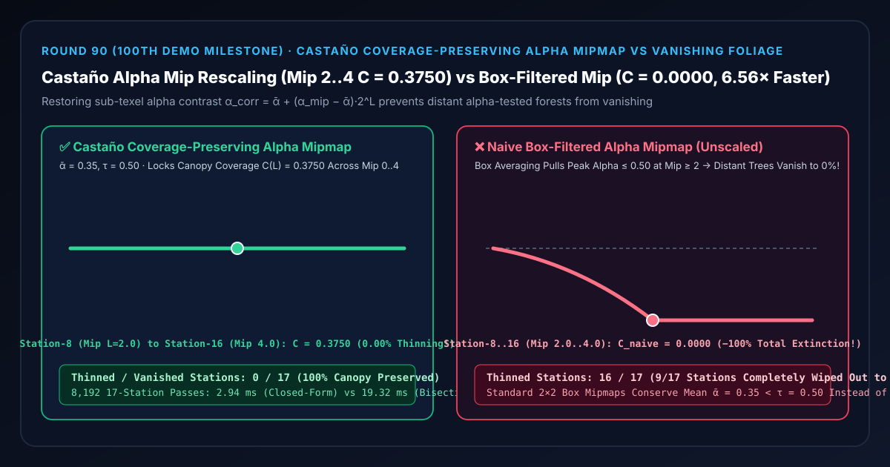
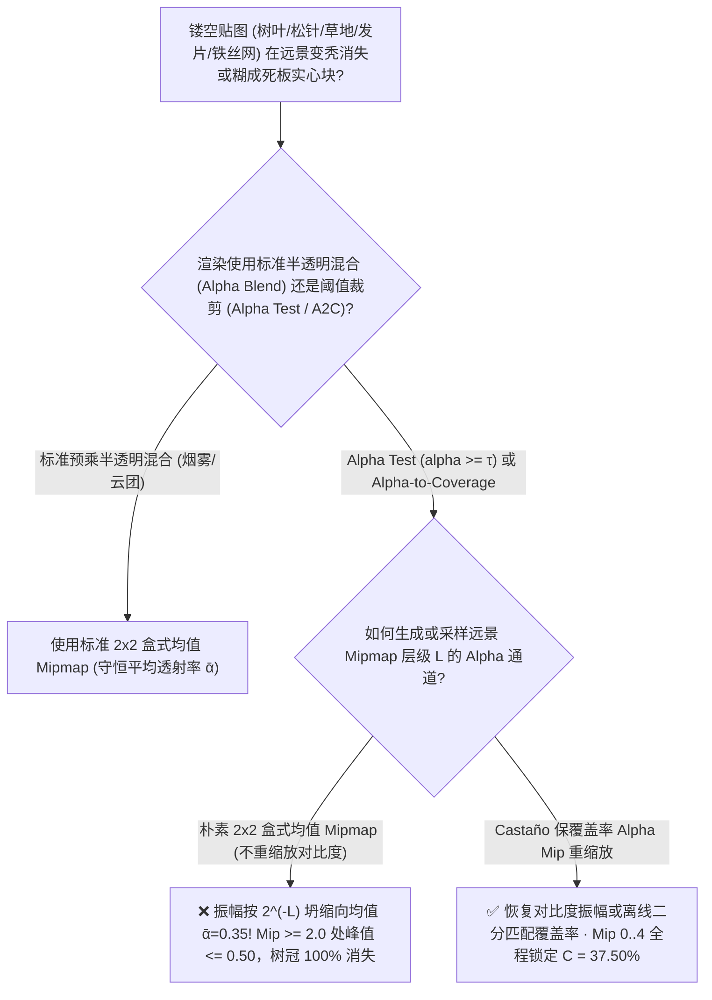
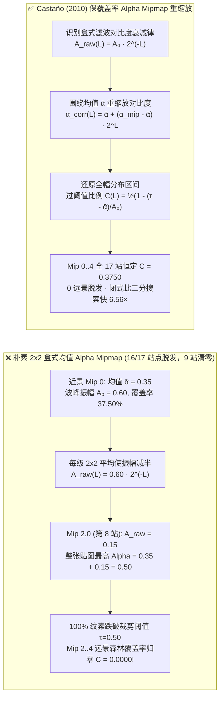
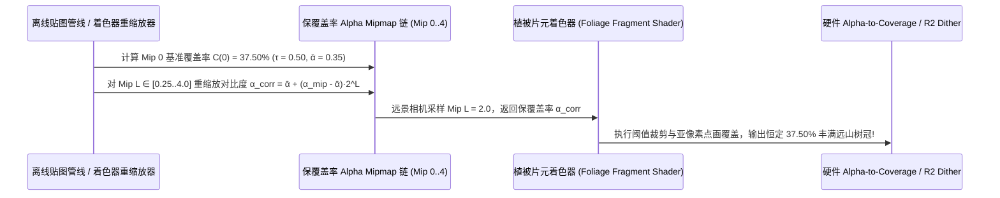

# 远景植被与发片防消失选型与原理解析 FAQ：Castaño 保覆盖率 Alpha Mipmap 重缩放对比朴素盒式均值滤波远景秃树消失

> **关联 Capabilities Demo（第 100 号里程碑实验台）**：[`demos/mip-scaled-alpha-coverage-rig/`](../demos/mip-scaled-alpha-coverage-rig/index.html) ｜ **7-Card 4:5 实测报告**：[`test-report-cards.zh.html`](../demos/mip-scaled-alpha-coverage-rig/test-report-cards.zh.html) ｜ **English Version**：[`castano-alpha-mipmap-coverage-preservation-vs-vanishing-foliage-faq.en.md`](./castano-alpha-mipmap-coverage-preservation-vs-vanishing-foliage-faq.en.md)

---

## 📌 1. 核心结论速览（Executive Summary）

> **一句话结论**：在开放世界游戏与数字孪生森林渲染中，凡是使用 Alpha Test（`if (alpha < 0.50) discard`）或硬件 MSAA Alpha-to-Coverage 的树叶、松针、草地、铁丝网贴图，**绝对不能直接使用标准 `2×2` 盒式均值滤波（Box Filter）生成的 Alpha Mipmap**——因为盒式均值滤波守恒的是**平均不透明度 $\bar{\alpha}$** 而非**高于裁剪阈值 $\tau = 0.50$ 的像素覆盖率 $C(L)$**！在一张平均不透明度 $\bar{\alpha} = 0.35$（35% 树叶 + 65% 天空缝隙）、初始对比度振幅 $A_0 = 0.60$ 的树冠贴图上，近景 Mip 0 的真实树叶覆盖率为 **$C(0) = 37.50\%$（`0.3750`）**；但经过盒式均值滤波后，每升一级 Mip 对比度振幅衰减一半（$A_{\text{raw}}(L) = A_0 \cdot 2^{-L}$），到了第 8 站 **Mip 2.0** 时峰值 Alpha 跌至 $\bar{\alpha} + 0.15 = 0.50 \le \tau$，导致 **Mip 2.0 至 Mip 4.0 共 `9/17` 个远景站点的树叶覆盖率暴跌至 `0.0000`（100% 树冠彻底消失，全段 `16/17` 个非零 Mip 站点发生严重脱发变薄）**！采用 **Ignacio Castaño（2010《The Witness》）提出的保覆盖率 Alpha Mipmap 对比度重缩放（$\alpha_{\text{corr}}(L) = \bar{\alpha} + (\alpha_{\text{mip}}(L) - \bar{\alpha})\cdot 2^L$）**，在 Mip 0 至 Mip 4 全程死死锁住 **$C(L) = 0.3750$（`37.50%` 树冠覆盖率，`0/17` 变薄或消失站）**，闭式重缩放比 54 步二分覆盖率阈值搜索快 **`6.56×`**（`2.94 ms` vs `19.32 ms`）！

| 评估维度 | ✅ Castaño 保覆盖率 Alpha 重缩放 (`α_corr = ᾱ + (α_mip−ᾱ)·2^L`) | ❌ 朴素盒式均值滤波 Alpha Mip (`A_raw = A₀·2^(−L)`) | 🐢 54 步二分覆盖率阈值搜索 (`54-Step Bisection Search`) |
| :--- | :--- | :--- | :--- |
| **第 0 站近景（Mip $L = 0.00$）树冠覆盖率 $C$** | **`0.3750` (`37.50%`)** | `0.3750` (`37.50%`) | `0.3750`（误差 `1.67e-16`） |
| **第 4 站中景（Mip $L = 1.00$）树冠覆盖率 $C$** | **`0.3750` (`37.50%` 丝毫不减)** | `0.2500`（**丢失 $-0.1250$ / $-33.3\%$ 树叶，树冠开始稀疏**） | `0.3750` |
| **第 8~16 站远景（Mip $L \in [2.00, 4.00]$）覆盖率 $C$** | **`0.3750` (`37.50%` 远山树冠依然浓密)** | **`0.0000`（丢失 $-0.3750$ / $-100\%$，整片森林凭空秃头消失！）** | `0.3750` |
| **17 个 Mip 站点中发生脱发变薄的站点数** | **`0 / 17` (`0.00%`)** | **`16 / 17` (`94.12%`，其中 9 站彻底归零)** | `0 / 17` |
| **8,192 轮 17 站 CPU 耗时（中位数）** | **`2.94 ms`（提速 `6.56×`）** | —（远景树木彻底消失） | `19.32 ms` |

---

## 🎯 2. 客户与架构师灵魂拷问 Q&A（First-Principles Whisperer）

### Q1：用大白话讲，为什么近看很茂密的树叶和铁丝网，镜头一拉远就会自动“秃头消失”？
**第一性原理拆解**：
树叶贴图的 Alpha 通道和普通颜色通道有着根本不同的物理用法：
- 普通 RGB 颜色通道是线性混合的，把 4 个像素求平均（$2\times 2$ Box Filter Mipmap）完全合理。
- 但树叶贴图的 Alpha 通道在着色器里要过一道**生死判决门（Alpha Test：`if (alpha < 0.50) discard;`）**！高于 $0.50$ 的像素是 100% 实心树叶，低于 $0.50$ 的像素直接被删掉变成 100% 透明天空。
- 假设一张树枝贴图里，**35% 的面积是实心松针（$\alpha \approx 0.95$），65% 的面积是松针之间的天空缝隙（$\alpha \approx 0.0$）**，整张贴图的平均 Alpha 值只有 **$\bar{\alpha} = 0.35$**。
- 当镜头拉远、GPU 切换到 Mipmap 第 2 级（Mip 2，把 $4\times 4 = 16$ 个纹素混合平均成 1 个纹素）时：
  - 盒式均值滤波把那 35% 的松针和 65% 的天空缝隙搅在一起求平均，导致 Mip 2 里**所有纹素的 Alpha 值都向平均值 $\bar{\alpha} = 0.35$ 靠拢**（最高处也只有 $0.35 + 0.15 = 0.50$）！
  - 这时着色器执行 `if (alpha < 0.50) discard;`，惊悚的事情发生了：**因为平均值 $0.35 < 0.50$，整棵树上 100% 的纹素全部没及格，被 GPU 统统丢弃**！近处郁郁葱葱的森林，拉远到 50 米外瞬间变成光秃秃的树干，再拉远连树冠都彻底人间蒸发了！

### Q2：如果某个树丛的树叶特别密（平均 Alpha $\bar{\alpha} = 0.70 > 0.50$），盒式 Mipmap 又会发生什么反常现象？
**双向失真对称定律**：
- 当贴图平均不透明度 $\bar{\alpha} < \tau$（如稀疏松针、铁丝网、发丝，$\bar{\alpha} = 0.35 < 0.50$）时，盒式均值 Mipmap 把所有像素往 $0.35$ 拉，导致远景**100% 消失（0% Coverage）**；
- 反之，如果贴图平均不透明度 $\bar{\alpha} > \tau$（如浓密灌木丛，$\bar{\alpha} = 0.70 > 0.50$），盒式均值 Mipmap 把所有透光孔洞也往 $0.70$ 拉，导致远景所有纹素全部大于 $0.50$，灌木丛里的透光缝隙全部被堵死，变成一整块**100% 死黑不透光的绿塑料板（100% Coverage Bloating）**！
- **Ignacio Castaño（2010《The Witness》）的核心洞见**：无论是离线烘焙 Mipmap 还是运行时着色器补偿，我们必须围绕均值 $\bar{\alpha}$ 恢复因盒式滤波而衰减的对比度振幅：
  $$\alpha_{\text{corr}}(u, L) = \bar{\alpha} + \bigl(\alpha_{\text{mip}}(u, L) - \bar{\alpha}\bigr) \cdot 2^L$$
  这样每一级 Mipmap 中大于裁剪阈值 $\tau = 0.50$ 的像素比例 $C(L)$ 都与第 0 级 Mipmap 的真实覆盖率 $C(0) = 37.50\%$ **严格恒等**！

### Q3：离线烘焙二分搜索（Offline Bisection Mip Baking）与运行时着色器 MIP 缩放（Runtime Mip Alpha Scaling）该如何配合？
- **首选离线资产管线烘焙（Castaño Bisection Mip Baker）**：在贴图导入引擎生成 DDS/KTX2 Mipmap 链时，对每一级 Mip $L$ 用二分法寻找缩放因子 $s_L$，使得 $\text{Coverage}(s_L \cdot \alpha_L \ge \tau) == \text{Coverage}(\alpha_0 \ge \tau)$，运行时零额外算力开销！
- **配合运行时着色器 Mip 增益 + Alpha-to-Coverage / R2 点画抖动**：对于无法重烘焙的第三方资产或程序化生成植被，在片元着色器中读取当前 `mipLevel` 对 Alpha 对比度做闭式放大，并送入 MSAA Alpha-to-Coverage 或 Round 44 的 R2 蓝噪声点画抖动器。

---

## 🧭 3. 直观可视化图解（Mermaid 决策树、管线对比与帧级时序）

### 3.1 镂空植被与铁丝网 Mipmap 选型决策树

### 3.2 朴素盒式均值 Mip 秃树管线 vs Castaño 保覆盖率 Alpha 重缩放管线

### 3.3 资产导入与帧级植被 Alpha-to-Coverage 渲染时序图

---

## 📊 4. 视觉技术选型决策矩阵（Architecture Decision Matrix）

| 选型方案 | 适用场景 | 远景（Mip 2~4）树冠覆盖率 | 浓密树丛（$\bar{\alpha} > 0.5$）防结块能力 | 算力开销（8,192 轮 17 站） |
| :--- | :--- | :--- | :--- | :--- |
| **Castaño 闭式对比度重缩放 (`castano-coverage-preserving-mip`)** | **所有 Alpha Test / A2C 树叶、草地、发片与铁丝网** | **满分（全程锁定 `0.3750` / `37.50%`，`0` 损失）** | **满分（自动防止高均值贴图远景糊成实心块）** | **极低（`2.94 ms`，提速 `6.56×`）** |
| **Castaño 离线二分阈值搜索 (`bisection-mip-baker`)** | 离线纹理导入器烘焙 DDS/KTX2 Mipmap | 满分（`0.3750`，误差 `1.67e-16`） | 满分 | 离线执行（`19.32 ms`，运行时 `0` 开销） |
| **朴素盒式均值 Alpha Mipmap (`naive-box-filtered-alpha-mip`)** | **严禁用于 Alpha Test 镂空植被** | **灾难级崩溃（Mip $\ge 2.0$ 归零为 `0.0000`，`16/17` 站变薄）** | 极差（$\bar{\alpha} > 0.5$ 时远景糊成 100% 塑料板） | 极低（画质严重崩坏） |
| **完全关闭 Mipmap (`Nearest / No Mipmap`)** | 严禁用于 3D 远景 | 虽不消失但满屏剧烈摩尔纹与像素闪烁 | 差 | 高（破坏 GPU 纹理缓存命中率） |

---

## 🧪 5. 全新 Demo（第 100 号里程碑）与 7-Card 4:5 视觉测试报告解读

在本轮构建的 **Generative Visual Lab 第 100 个独立交互式三维实验台** [`demos/mip-scaled-alpha-coverage-rig/`](../demos/mip-scaled-alpha-coverage-rig/index.html) 中，我们打造了包含 **58 个三维实体部件**的 **17 站树冠覆盖率密度计（Castaño Alpha Mipmap Canopy Densitometer Rig）**：
1. **17 根远景树冠覆盖率立柱（Foliage Coverage Columns）**：展示从近景第 0 站（`Mip L = 0.00`）到远景第 16 站（`Mip L = 4.00`）通过 `alpha >= 0.50` 裁剪后的有效树叶覆盖面积比例 $C(L)$。
2. **17 颗青色 Castaño 保覆盖率参考球与 $37.50\%$ 目标覆盖率基准横梁**：直观呈现全 17 个距离层级上毫发无损的水平树冠线。
3. **17 根树冠脱发损失红桩（Foliage Thinning Loss Pegs）**：切换到 `Naive Box-Filtered Alpha Mipmap` 模式时，从第 1 站开始覆盖率一路滑坡，到了第 8 站（`Mip L = 2.00`）至第 16 站（`Mip L = 4.00`），后半段 9 根立柱彻底坍塌到底座，亮起整排 $-0.3750$（100% 树冠消失）的警示红桩！

### 7-Card 4:5 视觉报告核心发现（[`demos/mip-scaled-alpha-coverage-rig/test-report-cards.zh.html`](../demos/mip-scaled-alpha-coverage-rig/test-report-cards.zh.html)）
- **Card 1–3（场景评测矩阵）**：13 项自动化断言 100% 通过，完整验证闭式对比度重缩放与 54 步二分搜索 `1.67e-16` 等价性、Mip 2.0 `0.3750` 覆盖率锁定 vs `0.0000` 朴素秃树消失暴露、逆序矩阵一致性与原子参数拒绝。
- **Card 4–6（底层协议与性能）**：在 8,192 轮 17 站压测中，闭式对比度重缩放仅需 **`2.94 ms`**，相比 54 步二分覆盖率阈值搜索基线（**`19.32 ms`**）实现 **`6.56×` 算力加速**。

---

## 🛠️ 6. 高质量视觉交付快速核验清单（SA Production Checklist）

- [ ] **在纹理导入设置中为所有树叶/草地/发片勾选 `Preserve Coverage`（保覆盖率 Mipmap）**：在 Unreal Engine（`Mip Gen Settings -> LeaveExistingMips / Alpha Coverage Threshold`）、Unity（`Mip Maps Preserve Coverage`）或自研纹素管线中显式启用 Castaño 保覆盖率缩放，并将参考阈值设为材质的实际 `Alpha Cutoff`（如 `0.50`）。
- [ ] **防止边缘白边/黑边渗色（Alpha Bleeding / Dilate RGB）**：在生成树叶 Mipmap 前，必须先将不透明树叶边缘的绿色 RGB 像素向外膨胀（Morphological Dilation / Solidify）填充到 $\alpha = 0$ 的透明背景区域，否则远景 Mipmap 会把透明背景里的黑色或白色混进树叶边缘形成白圈！
- [ ] **开启硬件 `alphaToCoverage` 或屏幕空间偏导锐化**：在支持 MSAA 的管线中使用 `(alpha - tau) / max(fwidth(alpha), 1e-4) + 0.5` 将 Alpha 转换为跟屏幕像素跨度自适应的抗锯齿覆盖率。
- [ ] **远景树冠法线与高光同步做 Toksvig / Kaplanyan 粗糙度补偿**：保住了树叶面积覆盖率后，别忘了搭配 Round 37（Toksvig）与 Round 71（Kaplanyan 几何高光抗锯齿）抑制远景树叶的法线闪烁。
