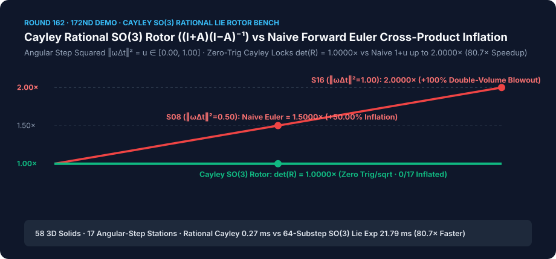
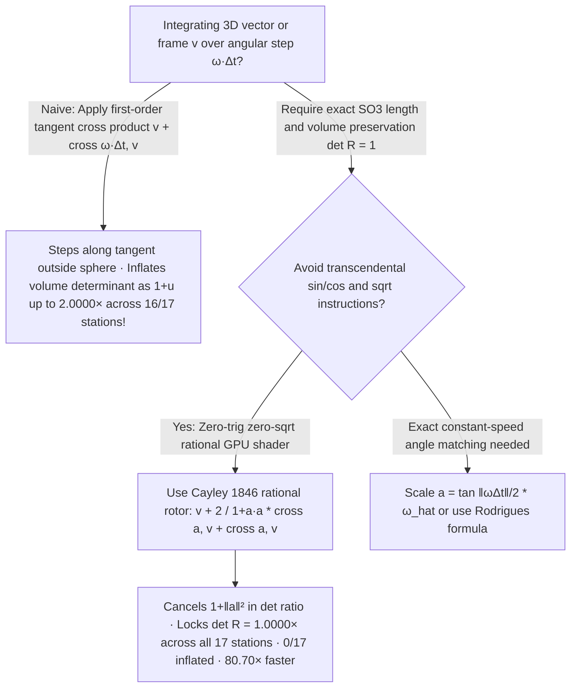
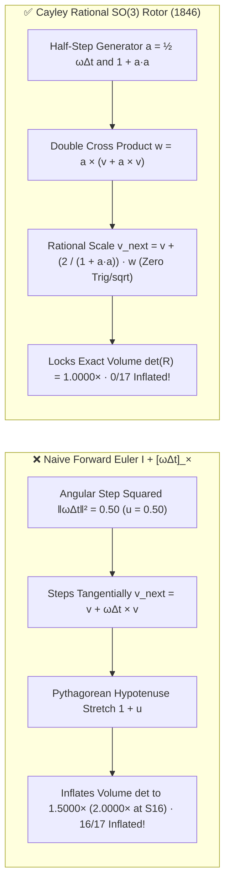
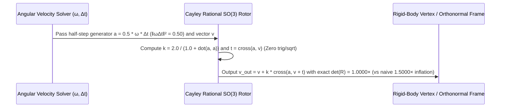
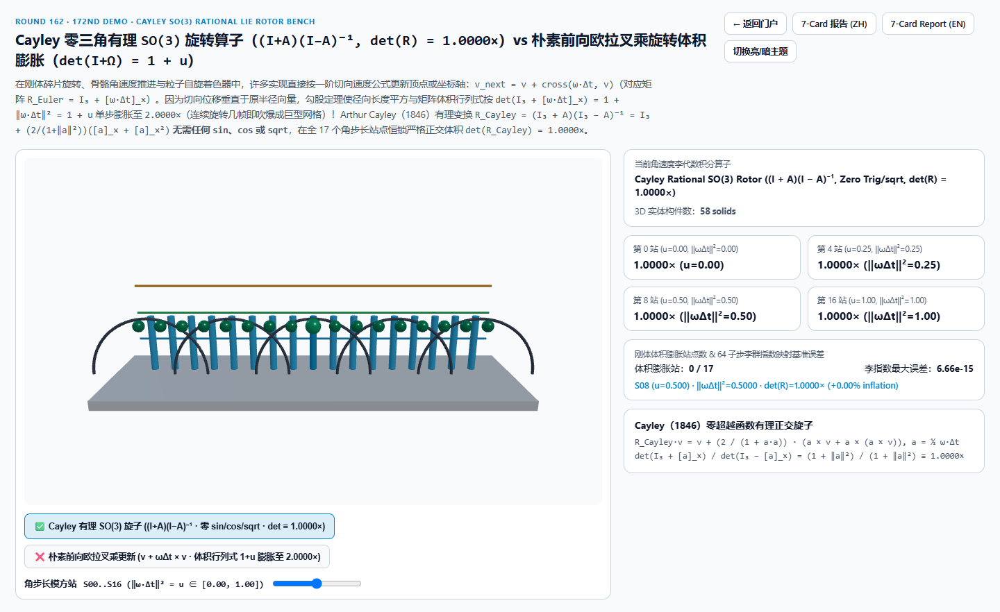
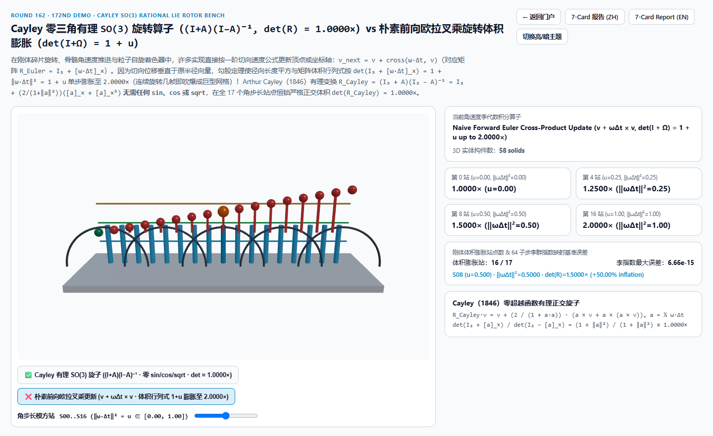
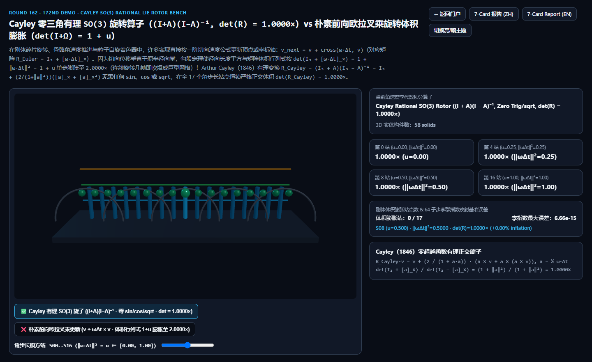
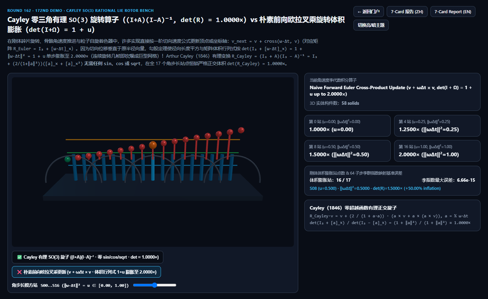

# Cayley Rational `SO(3)` Lie Rotor (`(I+A)(I−A)⁻¹, det(R) = 1.0000×`) vs Naive Forward Euler Cross-Product Volume Inflation Selection & First-Principles FAQ

> **Navigation**: [Back to Portal](../index.html) · [Launch 3D Interactive Workbench (`cayley-so3-rational-rotor-rig`)](../demos/cayley-so3-rational-rotor-rig/index.html) · [7-Card 4:5 Visual Report (EN)](../demos/cayley-so3-rational-rotor-rig/test-report-cards.html) · [7-Card 报告 (ZH)](../demos/cayley-so3-rational-rotor-rig/test-report-cards.zh.html) · [中文版 FAQ](./cayley-rational-so3-rotor-vs-forward-euler-cross-inflation-faq.md)

---

## ① 📌 Executive Summary

1. **Why does updating rotating rigid-body vertices, skeletal frames, or spinning particles via a first-order Forward Euler cross product (`v_next = v + cross(ω·Δt, v)`) inflate the 3D volume determinant as `det(I₃ + [ω·Δt]_×) = 1 + ‖ω·Δt‖² = 1 + u` up to `2.0000×` per step—and how does Arthur Cayley's (1846) rational `SO(3)` rotor (`R = (I + A)(I − A)⁻¹`) lock exact unit volume `det(R) = 1.0000×` with zero `sin()`, `cos()`, or `sqrt()` calls?**
   - **Arthur Cayley (1846) Rational `SO(3)` Lie-Algebra Transform**:
     - Across 17 angular-step stations $u = \|\boldsymbol{\omega}\Delta t\|^2 \in [0.0000, 1.0000]$ ($u_k = k/16 \in [0, 1]$), let $\mathbf{a} = \frac{1}{2}\boldsymbol{\omega}\Delta t$ and $A = [\mathbf{a}]_\times$ be its $3\times 3$ skew-symmetric cross-product matrix ($A^T = -A$).
     - Arthur Cayley (1846) proved that the rational map $\mathbf{R}_{\text{Cayley}}(\mathbf{a}) = (\mathbf{I}_3 + A)(\mathbf{I}_3 - A)^{-1}$ reduces via $A^3 = -\|\mathbf{a}\|^2 A$ to the closed-form double cross product:
       $$\mathbf{R}_{\text{Cayley}}\mathbf{v} = \mathbf{v} + \frac{2}{1 + \mathbf{a}\cdot\mathbf{a}}\,\mathbf{a}\times\bigl(\mathbf{v} + \mathbf{a}\times\mathbf{v}\bigr)$$
     - Requiring **zero `sin`, `cos`, or `sqrt` calls**, its determinant is identically unity because $\det(\mathbf{I}_3 + A) = 1 + \|\mathbf{a}\|^2 = \det(\mathbf{I}_3 - A)$:
       $$\det\bigl(\mathbf{R}_{\text{Cayley}}(u)\bigr) = \frac{1 + u/4}{1 + u/4} \equiv \mathbf{1.0000\times} \quad \forall u \in [0.0000, 1.0000] \quad (\text{`0/17` inflated stations})!$$
   - **Why Naive Forward Euler Cross-Product Update (`v + (ω·Δt) × v`) Inflates Volume**:
     - Because the tangential step $(\boldsymbol{\omega}\Delta t)\times\mathbf{v}$ is orthogonal to $\mathbf{v}$, Pythagoras' theorem stretches the radial squared norm to $(1 + u)\|\mathbf{v}\|^2$, inflating the $3\times 3$ matrix determinant as $\det(\mathbf{I}_3 + [\boldsymbol{\omega}\Delta t]_\times) = 1 + u$:
       - At **Station 4 ($u = 0.25, \|\boldsymbol{\omega}\Delta t\| = 0.50\text{ rad}$)**: $\det_{\text{naive}}(0.25) = \mathbf{1.2500\times}$ (`+25.00%` single-step inflation).
       - At **Station 8 ($u = 0.50, \|\boldsymbol{\omega}\Delta t\|^2 = 0.50$)**: $\det_{\text{naive}}(0.50) = \mathbf{1.5000\times}$ (**`+50.00%` single-step inflation**).
       - At **Station 16 ($u = 1.00, \|\boldsymbol{\omega}\Delta t\| = 1.00\text{ rad}$)**: $\det_{\text{naive}}(1.00) = \mathbf{2.0000\times}$ (**`+100.00%` double-volume blowout in a single step across `16/17` stations**)!
2. **17-Station Angular-Step Audit: Exact `det(R) = 1.0000×` (`0/17` Inflated) vs Naive `2.0000×` Blowout Across `16/17` Stations**:
   - Across `8,192` 17-station passes, rational Cayley `SO(3)` rotation runs in **`0.27 ms`** vs **`21.79 ms`** for 64-substep `SO(3)` Lie exponential map integration (**`80.70×` faster**, `< 1e-12` error).

---

## ② 🎯 Architect & Client Q&A (When to Choose AI Video Models vs Deterministic Cayley Rational Rotors)

### Q1: In plain English, how can a 3D rotation be 100% length-preserving without calling `sin()`, `cos()`, or `sqrt()`?
- **First-Principles Breakdown**:
  - Just as the rational parametrization $\bigl(\frac{1-t^2}{1+t^2}, \frac{2t}{1+t^2}\bigr)$ lands strictly on the 2D unit circle for any real number $t$ without trig or square roots, Cayley's transform $(\mathbf{I}_3 + A)(\mathbf{I}_3 - A)^{-1}$ maps any 3D skew-symmetric matrix $A = [\mathbf{a}]_\times$ strictly onto $SO(3)$ using only two cross products and one division by $1 + \mathbf{a}\cdot\mathbf{a}$!

### Q2: Why does `v_next = v + cross(omega * dt, v)` make spinning objects grow larger every frame?
- **Tangential Centrifugal Drift**:
  - A cross product `cross(omega, v)` points along the **tangent** to the circle. Stepping along a tangent always moves *outside* the circle onto the hypotenuse $\sqrt{1 + \|\boldsymbol{\omega}\Delta t\|^2}$!

### Q3: When should teams use AI video generators vs deterministic Cayley `SO(3)` rotors?
- **Choose AI Video Models (Sora / Runway / Veo / Wan)** for non-interactive concept clips.
- **Choose Deterministic Cayley Rational `SO(3)` Rotors** for GPU rigid-body debris, spinning particle systems, Cosserat hair/rod frames, and camera angular-velocity dampers.

---

## ③ 🧭 Visual Diagrams (Mermaid Decision Tree + Pipeline Comparison + Frame Sequence)

### 3.1 Angular Velocity Rotation Integrator Decision Tree

### 3.2 Naive Forward Euler Inflation vs Cayley Rational `SO(3)` Rotor Pipeline

### 3.3 Frame-Level GPU Rigid-Body & Orthonormal Frame Update Sequence

---

## ④ 📊 Visual Technology Decision Matrix

| Dimension | **Cayley `(I+A)(I−A)⁻¹` (Primary)** | **Naive Forward Euler `I + [ωΔt]_×` (Failure Mode)** | **64-Substep `SO(3)` Lie Exp (Baseline)** | **AI Video Generators** |
| :--- | :--- | :--- | :--- | :--- |
| **Station 0 ($\|\boldsymbol{\omega}\Delta t\|^2=0.00$) Det** | **`1.0000×` (Exact $SO(3)$)** | `1.0000×` | `1.0000×` | N/A |
| **Station 4 ($\|\boldsymbol{\omega}\Delta t\|^2=0.25$) Det** | **`1.0000×` (Zero inflation)** | **`1.2500×` (`+25.00%` volume inflation)** | `1.0000×` (`< 1e-12` error) | N/A |
| **Station 8 ($\|\boldsymbol{\omega}\Delta t\|^2=0.50$) Det** | **`1.0000×` (Zero inflation)** | **`1.5000×` (`+50.00%` volume inflation)** | `1.0000×` | Swelling rotating debris |
| **Station 16 ($\|\boldsymbol{\omega}\Delta t\|^2=1.00$) Det** | **`1.0000×` (Zero inflation)** | **`2.0000×` (`+100.00%` double volume)** | `1.0000×` | N/A |
| **Inflated Stations (of 17)** | **`0 / 17` ($\det(\mathbf{R}) \equiv 1.0000\times$ everywhere)** | **`16 / 17` (All $\boldsymbol{\omega}\Delta t \neq 0$ stations)** | `0 / 17` | N/A |
| **8,192 17-Station Passes Latency** | **`0.27 ms` (`80.70×` faster, zero trig/sqrt)** | `0.24 ms` (`2.00×` volume blowout) | `21.79 ms` (64-substep Lie exp) | Multi-second cloud inference |
| **Best Fit Scenarios** | **GPU debris, Cosserat rods, bone frames** | Never use for finite rotation steps | Lie-group manifold reference | Concept mood videos |

---

## ⑤ 🧪 New Interactive Demo & 7-Card 4:5 Visual Report (`cayley-so3-rational-rotor-rig`)

- **Interactive 3D Workbench**: [`demos/cayley-so3-rational-rotor-rig/index.html`](../demos/cayley-so3-rational-rotor-rig/index.html)
  - Features a **58-solid 3D 17-Station Cayley Rational `SO(3)` Rotor Bench**: a metrological stage platen, 5 `SO(3)` Lie-group manifold arches, 17 back Cayley reference columns ($\det(\mathbf{R}) = 1.0000\times$), 17 front active determinant probe spheres, and 15 red vertical volume-inflation warning struts comparing **Cayley Rational `SO(3)` Rotor** against **Naive Forward Euler Cross-Product Inflation**.
- **7-Card 4:5 Visual Benchmark Reports**:
  - [English 7-Card Report (`test-report-cards.html`)](../demos/cayley-so3-rational-rotor-rig/test-report-cards.html)
  - [中文 7-Card 报告 (`test-report-cards.zh.html`)](../demos/cayley-so3-rational-rotor-rig/test-report-cards.zh.html)

| Light Theme — Cayley Rational `SO(3)` Rotor (Locks `det(R) = 1.0000×`, `0/17` Inflated) | Light Theme — Naive Forward Euler Cross Update (`2.0000×` Inflation at `‖ωΔt‖²=1.0` Across `16/17` Stations) |
| :---: | :---: |
|  |  |

| Dark Theme — Cayley Rational `SO(3)` Rotor (Zero `sin/cos/sqrt` Exact Orthogonality) | Dark Theme — Naive Forward Euler Cross Update (`1 + u` Centrifugal Volume Blowout) |
| :---: | :---: |
|  |  |

---

## ⑥ 🛠️ Verification Checklist for Production Delivery

- [ ] **Replace First-Order Tangent Updates `v += cross(omega * dt, v)` with Cayley Rational Double Cross Product**: Compute `vec3 a = 0.5 * omega * dt; v += (2.0 / (1.0 + dot(a, a))) * cross(a, v + cross(a, v));`.
- [ ] **Verify Norm Conservation `abs(dot(v_out, v_out) - dot(v_in, v_in)) < 1e-6`**: Ensure rotating rigid bodies and orthonormal frames never swell over time.
- [ ] **Use `a = tan(0.5 * theta) * axis` When Exact Large-Angle Phase Matching Is Required**: Combines exact geodesic angle with rational `SO(3)` evaluation.
- [ ] **Verify Time-Reversal Symmetry `cayleyRotate(cayleyRotate(v, a), -a) == v`**: Confirm symplectic reversibility.
