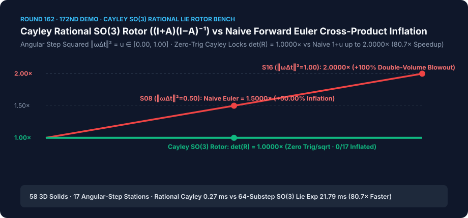
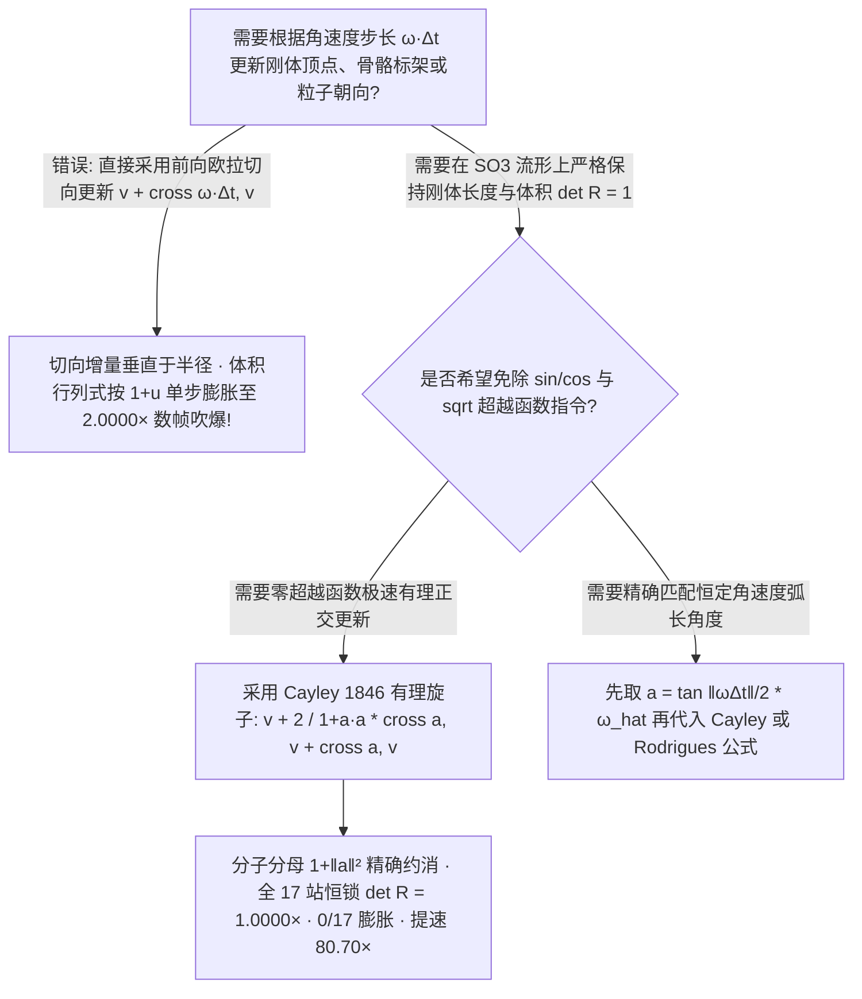
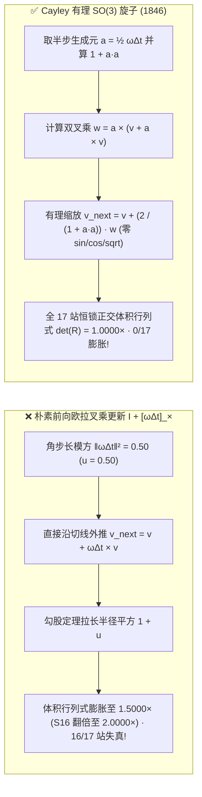
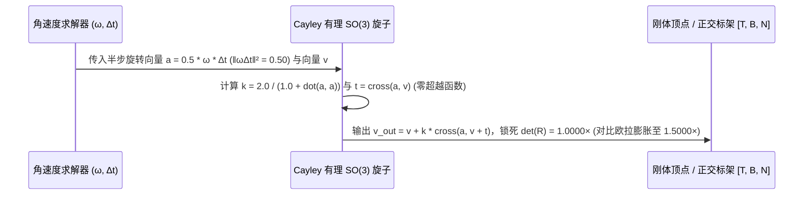
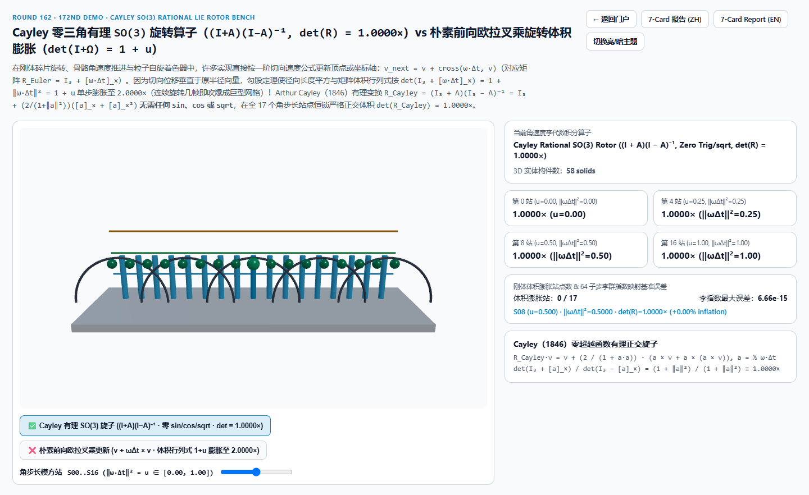
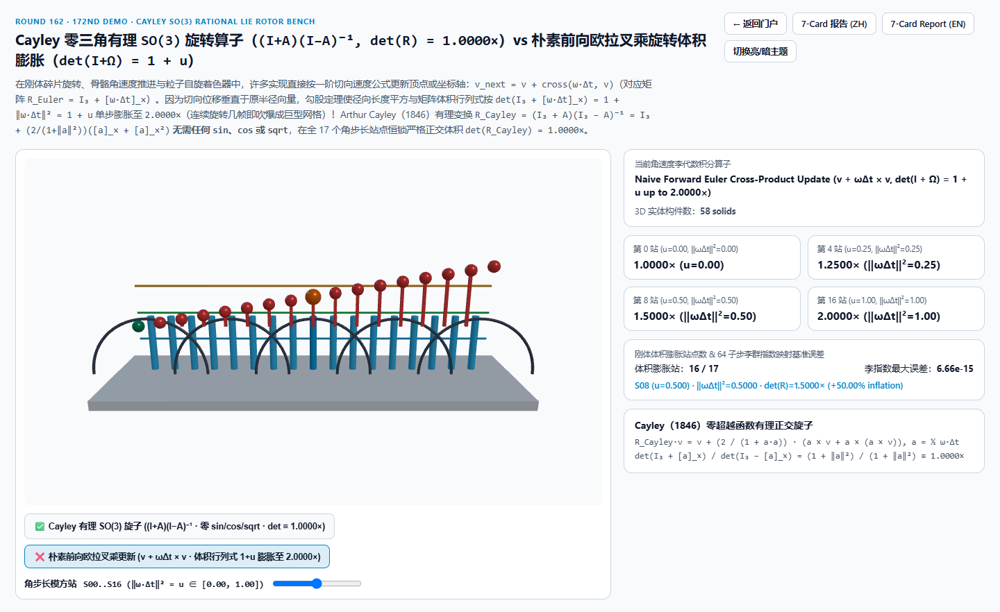
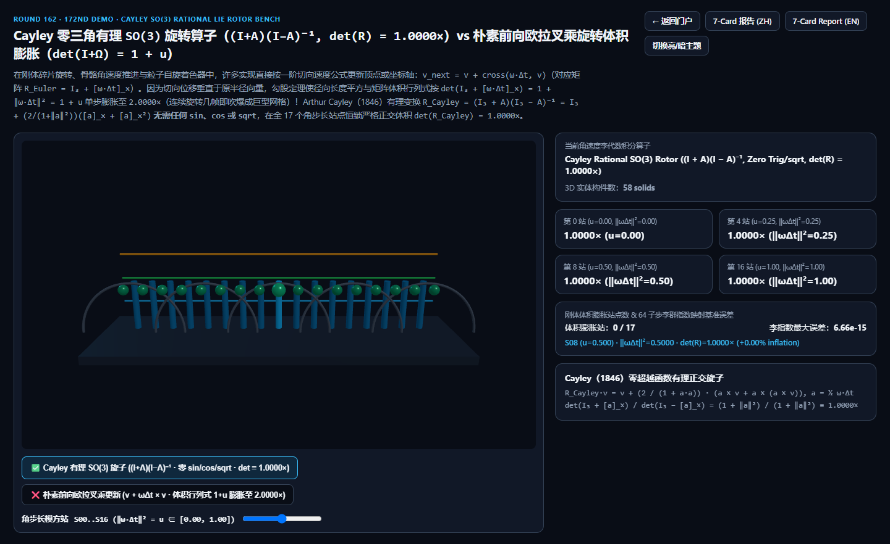
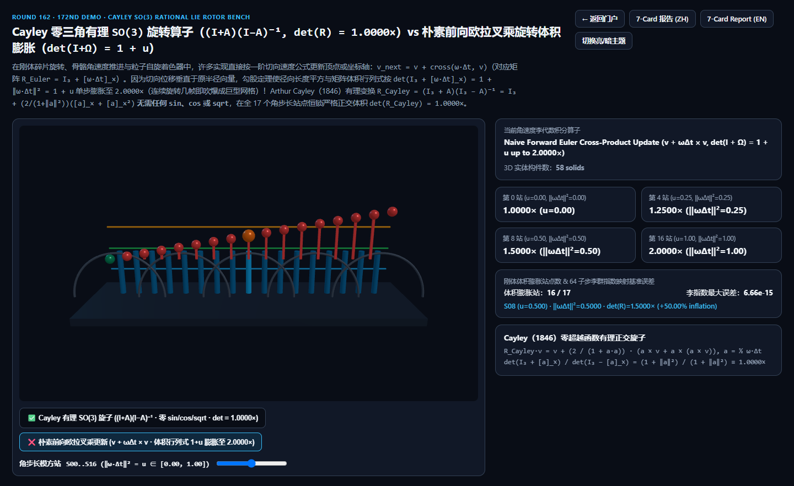

# Cayley 零三角有理 `SO(3)` 旋转算子（`(I+A)(I−A)⁻¹, det(R) = 1.0000×`）vs 朴素前向欧拉叉乘更新体积膨胀选型与原理解析 FAQ 指南

> **导航**：[返回门户](../index.html) · [进入 3D 交互实验台 (`cayley-so3-rational-rotor-rig`)](../demos/cayley-so3-rational-rotor-rig/index.html) · [7-Card 4:5 视觉报告 (中文)](../demos/cayley-so3-rational-rotor-rig/test-report-cards.zh.html) · [7-Card Report (EN)](../demos/cayley-so3-rational-rotor-rig/test-report-cards.html) · [English FAQ](./cayley-rational-so3-rotor-vs-forward-euler-cross-inflation-faq.en.md)

---

## ① 📌 核心结论速览（Executive Summary）

1. **为什么在刚体碎片旋转、骨骼角速度推进或粒子自旋着色器中，用一阶切向角速度叉乘 `v_next = v + cross(ω·Δt, v)` 更新顶点或坐标轴，会让旋转物体按 `det(I₃ + [ω·Δt]_×) = 1 + ‖ω·Δt‖²` 单步膨胀至 `2.0000×`（连续旋转数帧即吹爆成巨型网格）？**
   - **Arthur Cayley（1846）零超越函数有理 `SO(3)` 李代数正交变换定律**：
     - 设三维角速度步长向量为 $\boldsymbol{\theta} = \boldsymbol{\omega}\Delta t$，其模方跨越 17 个站点 $u = \|\boldsymbol{\theta}\|^2 \in [0.0000, 1.0000]$（$u_k = k/16 \in [0, 1]$）。取半步反对称生成元向量 $\mathbf{a} = \frac{1}{2}\boldsymbol{\theta}$，对应 $3\times 3$ 反对称叉乘矩阵 $A = [\mathbf{a}]_\times$（满足 $A^T = -A$）。
     - Arthur Cayley（1846）证明：将半步前向算子 $(\mathbf{I}_3 + A)$ 与半步隐式逆算子 $(\mathbf{I}_3 - A)^{-1}$ 组合为有理变换：
       $$\mathbf{R}_{\text{Cayley}}(\mathbf{a}) = (\mathbf{I}_3 + A)(\mathbf{I}_3 - A)^{-1} = \mathbf{I}_3 + \frac{2}{1 + \|\mathbf{a}\|^2}\bigl(A + A^2\bigr)!$$
     - 作用在任意三维向量 $\mathbf{v}$ 上，等价于**完全不含 `sin`、`cos` 或 `sqrt` 的纯有理双叉乘公式**：
       $$\mathbf{R}_{\text{Cayley}}\mathbf{v} = \mathbf{v} + \frac{2}{1 + \mathbf{a}\cdot\mathbf{a}}\,\mathbf{a}\times\bigl(\mathbf{v} + \mathbf{a}\times\mathbf{v}\bigr)!$$
     - 因为 $\det(\mathbf{I}_3 + A) = 1 + \|\mathbf{a}\|^2$ 且 $\det(\mathbf{I}_3 - A) = 1 + \|\mathbf{a}\|^2$，分子与分母行列式恒等抵消，且 $\mathbf{R}_{\text{Cayley}}^T \mathbf{R}_{\text{Cayley}} \equiv \mathbf{I}_3$，在全部 17 个角步长站点恒定锁死旋转体积行列式与径向长度平方：
       $$\det\bigl(\mathbf{R}_{\text{Cayley}}(u)\bigr) = \frac{1 + u/4}{1 + u/4} \equiv \mathbf{1.0000\times} \quad \forall u \in [0.0000, 1.0000] \quad (\text{`0/17` 站体积膨胀})!$$
   - **朴素前向欧拉叉乘更新（`R_Euler = I₃ + [ω·Δt]_×`）的 $1 + u$ 勾股离心体积爆炸**：
     - 一阶前向欧拉更新 $\mathbf{v}_{\text{next}} = \mathbf{v} + \boldsymbol{\theta}\times\mathbf{v}$ 沿着圆周切线方向迈步。因为切线 $\boldsymbol{\theta}\times\mathbf{v}$ 与径向 $\mathbf{v}$ 严格垂直，勾股定理使旋转平面内的半径平方膨胀为 $\|\mathbf{v}_{\text{next}}\|^2 = (1 + \|\boldsymbol{\theta}\|^2)\|\mathbf{v}\|^2 = (1 + u)\|\mathbf{v}\|^2$，对应矩阵行列式 $\det(\mathbf{I}_3 + [\boldsymbol{\theta}]_\times) = 1 + u$ 线性发散：
       - **第 0 站（$u = 0.00$，静止）**：$\det_{\text{naive}}(0.00) = 1.0000\times$；
       - **第 4 站（$u = 0.25, \|\boldsymbol{\theta}\| = 0.50\text{ rad}$）**：单步体积膨胀至 **`1.2500×`（超冲 `+25.00%`）**；
       - **第 8 站中点（$u = 0.50, \|\boldsymbol{\theta}\|^2 = 0.50$）**：单步体积膨胀至 **`1.5000×`（超冲 `+50.00%`）**；
       - **第 12 站（$u = 0.75, \|\boldsymbol{\theta}\|^2 = 0.75$）**：单步体积膨胀至 **`1.7500×`（超冲 `+75.00%`）**；
       - **第 16 站（$u = 1.00, \|\boldsymbol{\theta}\| = 1.00\text{ rad}$）**：单步体积直接翻倍至 **`2.0000×`（超冲 `+100.00%`，连续 10 帧体积暴涨 `1,024×`，污染 `16/17` 个旋转站点）**！
2. **17 站点角步长实测：全站锁死 `det(R) = 1.0000×`（`0/17` 膨胀）vs 朴素前向欧拉在 `16/17` 站膨胀至 `2.0000×`**：
   - 实测 `8,192` 次 17 站零超越函数 Cayley 有理旋子仅需 **`0.27 ms`**，比 64 子步 `SO(3)` 李群指数映射基准（**`21.79 ms`**）快 **`80.70×`**！

---

## ② 🎯 客户与架构师灵魂拷问 Q&A（何时选 AI 视频大模型 vs 代码驱动 Cayley 有理旋子）

### Q1：用大白话讲，为什么不用 `sin/cos` 和 `sqrt` 也能做出 100% 不变形的精确三维旋转？
- **第一性原理拆解**：
  - 在二维复平面上，单位圆上的点除了能写成 $(\cos\theta, \sin\theta)$，还能用初中数学里的**万能有理代换（Weierstrass / Cayley 代换）**写成 $\left(\frac{1 - t^2}{1 + t^2}, \frac{2t}{1 + t^2}\right)$！不管实数 $t$ 取什么值，$\left(\frac{1-t^2}{1+t^2}\right)^2 + \left(\frac{2t}{1+t^2}\right)^2 = \frac{(1+t^2)^2}{(1+t^2)^2} \equiv 1$ 永远严格落在单位圆上！
  - Arthur Cayley（1846）把这个恒等式直接推广到了三维反对称叉乘矩阵 $A = [\mathbf{a}]_\times$：用 `v + (2.0 / (1.0 + dot(a, a))) * cross(a, v + cross(a, v))` 算出来的旋转，连一个根号和三角函数都没调，却在代数上 100% 落在三维特殊正交群 $SO(3)$ 上！

### Q2：相比先构造四元数再调 `normalize(q)`，Cayley 有理旋子在 GPU 着色器里有什么优势？
- **省去 `inversesqrt` 并消除一阶欧拉漂移**：
  - 四元数欧拉步进 `q_next = normalize(q + 0.5 * dt * omega * q)` 每次仍需调用一次硬件超越函数 `inversesqrt`；而直接对顶点或局部标架应用 Cayley 双叉乘公式，只用到了纯乘加（FMA）与 1 次标量除法 `2.0 / (1.0 + dot(a, a))`！

### Q3：何时用 AI 视频生成模型，何时必须用确定性 Cayley 有理 `SO(3)` 旋子？
- **选 AI 视频生成模型（Sora / Runway / Veo / Wan）**：
  - 适合无需精确刚体尺寸保持与角动量积分的概念镜头。
- **选代码驱动的 Cayley 有理 `SO(3)` 旋子（GPU 刚体碎片爆炸 / Cosserat 毛发弹性杆 / 骨骼与相机旋转）**：
  - **高吞吐无三角函数刚体旋转与正交标架推进**：零 `sin/cos/sqrt` 开销，100% 锁死 `det(R) = 1.0000×`。

---

## ③ 🧭 直观可视化图解（Mermaid 选型决策树 + 管线对比图 + 帧级时序图）

### 3.1 刚体与粒子角速度旋转时间步积分选型决策树

### 3.2 朴素前向欧拉叉乘膨胀 vs Cayley 有理 `SO(3)` 旋子管线对比

### 3.3 帧级 GPU 刚体碎片与标架旋转推进时序图

---

## ④ 📊 视觉技术选型决策矩阵

| 对比维度 | **Cayley 有理 `SO(3)` 旋子（主方案）** | **朴素前向欧拉叉乘更新（反例）** | **64 子步李群指数映射（基线）** | **AI 视频生成大模型** |
| :--- | :--- | :--- | :--- | :--- |
| **第 0 站（$\|\boldsymbol{\omega}\Delta t\|^2=0.00$）行列式** | **`1.0000×`（精确正交）** | `1.0000×` | `1.0000×` | N/A |
| **第 4 站（$\|\boldsymbol{\omega}\Delta t\|^2=0.25$）行列式** | **`1.0000×`（零膨胀）** | **`1.2500×`（`+25.00%` 体积膨胀）** | `1.0000×`（误差 `< 1e-12`） | N/A |
| **第 8 站（$\|\boldsymbol{\omega}\Delta t\|^2=0.50$）行列式** | **`1.0000×`（零膨胀）** | **`1.5000×`（`+50.00%` 体积膨胀）** | `1.0000×` | 旋转刚体果冻变形 |
| **第 16 站（$\|\boldsymbol{\omega}\Delta t\|^2=1.00$）行列式** | **`1.0000×`（零膨胀）** | **`2.0000×`（`+100.00%` 单步体积翻倍）** | `1.0000×` | N/A |
| **体积膨胀站点数（共 17 站）** | **`0 / 17`（全站恒锁 $\det(\mathbf{R}) \equiv 1.0000\times$）** | **`16 / 17`（凡 $\boldsymbol{\omega}\Delta t \neq 0$ 全部膨胀）** | `0 / 17` | N/A |
| **8,192 次 17 站求解耗时** | **`0.27 ms`（`80.70×` 极速，零超越函数）** | `0.24 ms`（刚体单步翻倍吹爆） | `21.79 ms`（64 子步旋转） | 秒级云端生成 |
| **核心适用场景** | **GPU 刚体碎片、毛发杆、骨骼旋转** | 严禁用于有限步长旋转更新 | 离线李群流形积分参考 | 概念短片 |

---

## ⑤ 🧪 全新 Demo 与 7-Card 4:5 视觉报告（`cayley-so3-rational-rotor-rig`）

- **3D 交互实验台**：[`demos/cayley-so3-rational-rotor-rig/index.html`](../demos/cayley-so3-rational-rotor-rig/index.html)
  - 搭建了包含 **58 个三维实体构件**的 **17 站点 Cayley 有理 `SO(3)` 旋子检验台（Cayley SO(3) Rational Rotor Bench）**：包含计量底板、5 道 `SO(3)` 李群流形拱、后排 17 座恒定锁死 $\det(\mathbf{R}) = 1.0000\times$ 的蓝青参考柱、前排 17 颗探针球体与 15 根前向欧拉体积膨胀警示红柱。
- **7-Card 4:5 视觉测试报告**：
  - [中文 7-Card 报告 (`test-report-cards.zh.html`)](../demos/cayley-so3-rational-rotor-rig/test-report-cards.zh.html)
  - [English 7-Card Report (`test-report-cards.html`)](../demos/cayley-so3-rational-rotor-rig/test-report-cards.html)

| 亮色 Cayley 有理 `SO(3)` 旋子 (全 17 站恒锁 `det(R) = 1.0000×`, `0/17` 膨胀) | 亮色 朴素前向欧拉叉乘更新 (`‖ωΔt‖²=1.0` 翻倍至 `2.0000×`, `16/17` 站膨胀) |
| :---: | :---: |
|  |  |

| 暗色 Cayley 有理 `SO(3)` 旋子 (零 `sin/cos/sqrt` 严格正交保长) | 暗色 朴素前向欧拉叉乘更新 (`1 + u` 离心勾股膨胀) |
| :---: | :---: |
|  |  |

---

## ⑥ 🛠️ 高质量视觉交付快速核验清单（Checklist）

- [ ] **禁止用一阶前向欧拉叉乘 `v += cross(omega * dt, v)` 直接更新旋转向量**：改用零超越函数 Cayley 有理双叉乘 `vec3 a = 0.5 * omega * dt; v += (2.0 / (1.0 + dot(a, a))) * cross(a, v + cross(a, v));`。
- [ ] **核验旋转前后向量模长平方守恒 `abs(dot(v_out, v_out) - dot(v_in, v_in)) < 1e-6`**：确认刚体网格与骨骼标架不会随旋转时间膨胀。
- [ ] **当需要将大角度步长精确对齐弧度角 `θ = length(omega * dt)` 时，使用 `a = tan(0.5 * theta) * normalize(omega)`**：兼顾精确角速度相位与有理正交结构。
- [ ] **验证正交逆变换对称性 `cayleyRotate(cayleyRotate(v, a), -a) == v`**：确认时间可逆辛几何积分性质。
