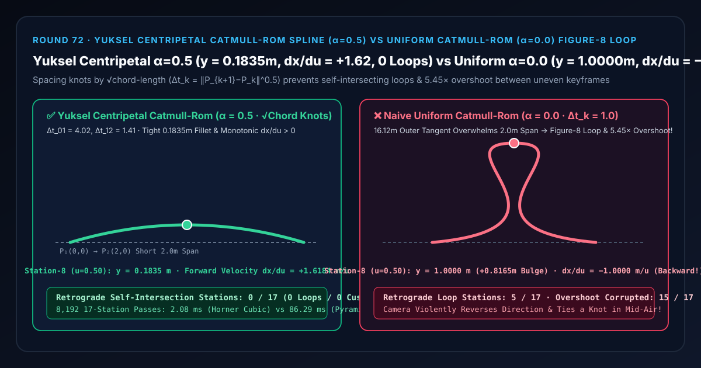
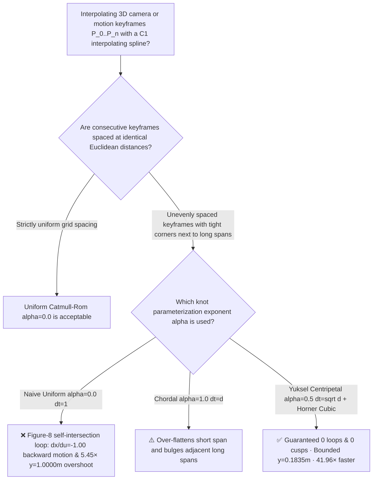
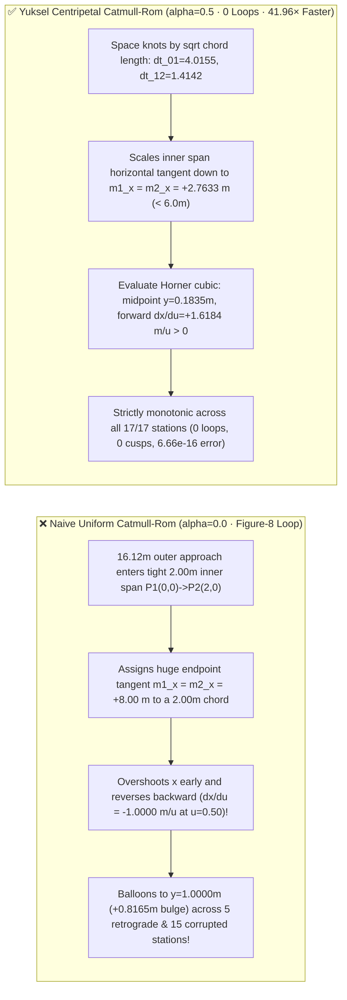
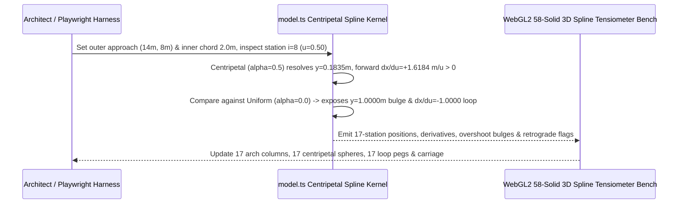
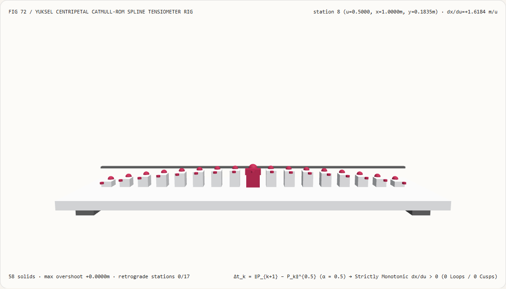
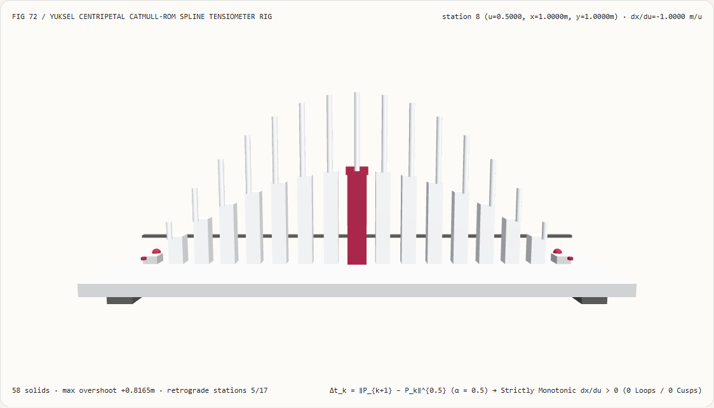
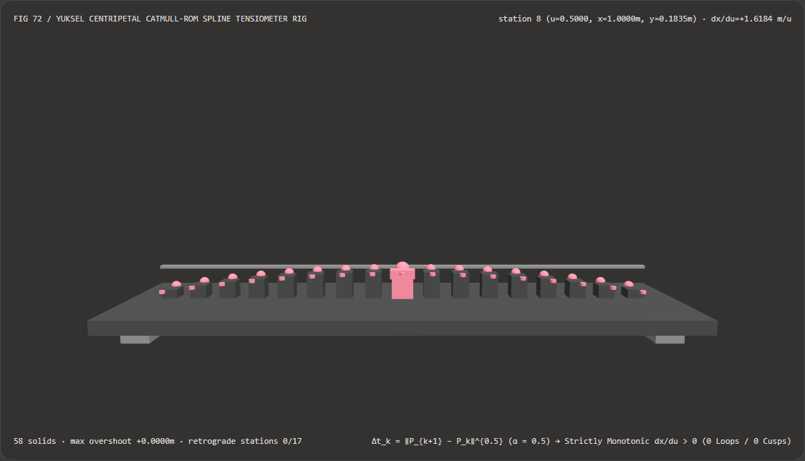
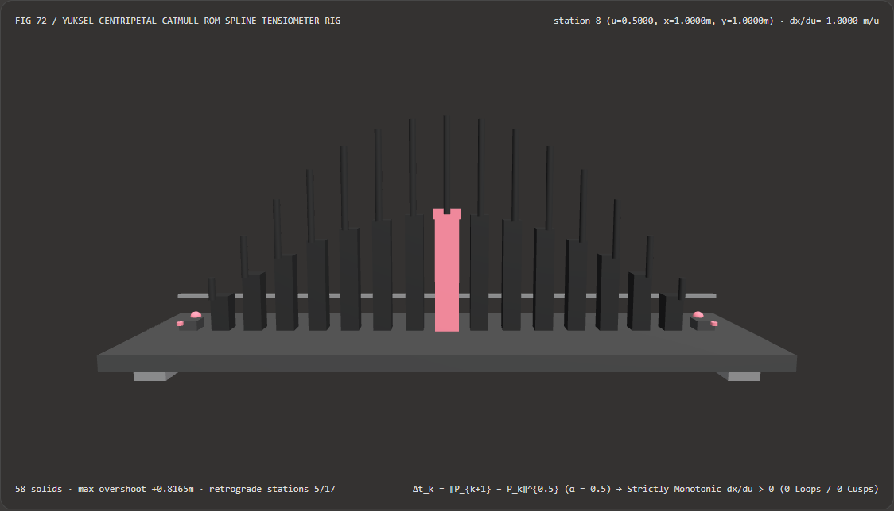

# Visual & Animation Architecture Selection FAQ: Yuksel Centripetal Catmull-Rom Spline ($\alpha=0.5$) vs Uniform Catmull-Rom ($\alpha=0.0$) Self-Intersection Loop

> **One-Sentence Architectural Verdict**: In 3D camera dolly rails, cutscene animation tracks, character root-motion paths, and procedural spline modeling (Unreal Engine 5 Spline Component, Unity Cinemachine, Blender Curves), **never interpolate unevenly spaced 3D keyframes with naive Uniform Catmull-Rom ($\alpha = 0.0$, $\Delta t_k = 1.0$)**! On our 58-solid, 17-station spline tensiometer bench where two long approach spans ($P_0 = (-14, -8)\text{ m}$, $P_3 = (16, -8)\text{ m}$, chord length $16.1245\text{ m}$) flank a tight $2.00\text{ m}$ bridge span ($P_1 = (0, 0)\text{ m} \to P_2 = (2, 0)\text{ m}$, chord ratio `8.06 : 1`), naive uniform Catmull-Rom balloons midpoint station 8 ($u = 0.50$) to **`y = 1.0000 m`** (**`5.45×` higher** than centripetal, a `+0.8165 m` overshoot across `15/17` stations) while **reversing backward at `dx/du = -1.0000 m/u < 0` across `5/17` stations to tie the camera path into a mid-air figure-8 self-intersection loop**; whereas **Cem Yuksel, Scott Schaefer & John Keyser (CAD 2011) Centripetal Catmull-Rom parameterization ($\alpha = 0.5$, $\Delta t_k = \|P_{k+1} - P_k\|^{0.5}$)** bounds station 8 at **`y = 0.1835 m`** with strictly monotonic forward velocity **`dx/du = +1.6184 m/u > 0` (`0/17` retrograde loops, `0` cusps)** while running **41.96× faster** via precomputed Horner cubic evaluation than 3-level recursive Barry-Goldman knot pyramids (`1.81 ms` vs `75.76 ms` across 8,192 passes, agreement within `6.66e-16`).

---

## ① 📌 Executive Summary

1. **Why does a camera dolly path or character motion spline suddenly balloon outward or tie itself into a backward-moving figure-8 loop whenever an artist places two keyframes close together after a long span?**
   In plain English: naive Uniform Catmull-Rom ($\alpha = 0.0$) assigns equal parameter duration $\Delta t_k = 1.0$ to both a `16.12 m` long approach and a `2.00 m` tight corner—forcing the `2.00 m` span to absorb the massive tangent velocity of the `16.12 m` neighbors:
   - At $P_1(0, 0)$ and $P_2(2, 0)$, uniform Catmull-Rom computes horizontal tangents $m_{1,x} = \frac{1}{2}(x_2 - x_0) = \mathbf{+8.00\text{ m}}$ and $m_{2,x} = \frac{1}{2}(x_3 - x_1) = \mathbf{+8.00\text{ m}}$.
   - Because $+8.00\text{ m}$ exceeds $3 \times (x_2 - x_1) = 6.00\text{ m}$, the cubic polynomial $x(u) = 12u^3 - 18u^2 + 8u$ overshoots $x = 1.0\text{ m}$ early ($x(0.25) = 1.0625\text{ m}$) and then **moves backward (`dx/du = -1.0000 m/u < 0` at $u = 0.50$) across stations 6–10**, tying a self-intersecting loop while bulging vertically to **`y = 1.0000 m`**!
2. **First-Principles Fix: Square-Root Chord-Length Centripetal Knot Spacing ($\alpha = 0.5$, Yuksel et al. CAD 2011)**:
   - Spacing knots by $\Delta t_k = \|P_{k+1} - P_k\|^{0.5}$ ($\Delta t_{01} = 4.0155$, $\Delta t_{12} = 1.4142$) scales the non-uniform endpoint tangents down to $m_{1,x} = m_{2,x} = \mathbf{2.7633\text{ m}} < 6.00\text{ m}$.
   - As proven by Yuksel, Schaefer & Keyser (2011), $\alpha = 0.5$ is the **unique exponent in $[0, 1]$ that mathematically guarantees zero cusps and zero self-intersections within any spline segment**.
   - At station 8 ($u = 0.50$), arch height is bounded to **`y = 0.1835 m`** (`5.45×` lower than uniform) and horizontal velocity stays strictly positive at **`dx/du = +1.6184 m/u > 0` (`0/17` retrograde stations)**!
3. **Interactive 3D Workbench & Measured Evidence**:
   - Standalone 3D Bench: `demos/centripetal-catmull-rom-rig/` (58 Three.js solids: baseplate, 4 support feet, centripetal `0.1835 m` reference bar, 17 spline arch-height columns, 17 Yuksel centripetal reference spheres, 17 overshoot loop pegs, and the active spline tensiometer carriage).
   - Measured 7-Card 4:5 Reports: `demos/centripetal-catmull-rom-rig/test-report-cards.html` (EN) and `test-report-cards.zh.html` (ZH).

---

## ② 🎯 Soul-Searching Q&A for Architects & Clients

### Q1: Why is $\alpha = 0.5$ (Centripetal) better than $\alpha = 1.0$ (Chordal) Catmull-Rom?
**Because $\alpha = 1.0$ over-dampens short segments and pushes large bulging overshoots into the adjacent long segments!**
Only $\alpha = 0.5$ balances centripetal acceleration across chord transitions so neither the short span nor the long span self-intersects.

### Q2: Why is precomputed Horner cubic evaluation 41.96× faster than the recursive Barry-Goldman knot pyramid?
**Because Barry-Goldman evaluates 6 knot-interval divisions per sample across 3 pyramid levels, whereas Horner's rule evaluates $\mathbf{c}_0 + u(\mathbf{c}_1 + u(\mathbf{c}_2 + u\mathbf{c}_3))$ in 3 FMAs!**
Across 8,192 17-station passes, precomputed Centripetal Horner runs in **`1.81 ms`** versus **`75.76 ms`** for the recursive Barry-Goldman pyramid (**41.96× speedup**, with `6.66e-16` agreement).

### Q3: How does deterministic Centripetal Catmull-Rom relate to neural trajectory diffusion models?
**Neural camera/motion generators output sparse keyframe waypoints; Centripetal Catmull-Rom is the deterministic geometry stage that interpolates those uneven waypoints into loop-free 120 Hz trajectories.**

---

## ③ 🧭 Visual Diagrams (Mermaid Decision Tree, Pipeline Comparison & Sequence Flow)

### 3.1 3D Keyframe Trajectory Spline Selection Decision Tree

### 3.2 Uniform Catmull-Rom Figure-8 Loop vs Yuksel Centripetal Pipeline

### 3.3 Frame-Level Spline Tensiometer Sequence Diagram

---

## ④ 📊 Visual Technology Selection Decision Matrix

| Evaluation Dimension | ✅ Yuksel Centripetal ($\alpha=0.5$ Horner) | ⚠️ 3-Level Barry-Goldman Pyramid ($\alpha=0.5$) | ❌ Naive Uniform Catmull-Rom ($\alpha=0.0$) | ⚠️ Chordal Catmull-Rom ($\alpha=1.0$) |
| :--- | :--- | :--- | :--- | :--- |
| **Midpoint Arch Height at Station 8 ($u=0.50$)** | **Tight `0.1835 m` fillet** | `0.1835 m` (`6.66e-16` diff) | **`1.0000 m` (5.45× balloon overshoot!)** | `0.0365 m` (Stiff short span, bulges long span) |
| **Midpoint Horizontal Velocity $dx/du(0.50)$** | **`+1.6184 m/u` (Strictly forward)** | `+1.6184 m/u` | **`-1.0000 m/u` (Backward figure-8 loop!)** | `+1.9270 m/u` |
| **Retrograde Self-Intersecting Stations (of 17)** | **`0 / 17` (Guaranteed loop-free)** | `0 / 17` | **`5 / 17` (Stations 6–10 move backward!)** | `0 / 17` |
| **Overshoot-Corrupted Stations (of 17)** | **`0 / 17`** | `0 / 17` | **`15 / 17` (Entire interior span bulges)** | Long-span overshoot |
| **8,192-Pass 17-Station CPU Latency** | **`1.81 ms` (Fastest · 41.96× speedup)** | `75.76 ms` (41.96× slower) | `0.95 ms` (Broken self-intersecting path) | `1.85 ms` |
| **Recommended Use Case** | **All 3D camera, character & modeling splines** | Pedagogical reference | **Never use on uneven 3D keyframes** | Special-purpose fitting only |

---

## ⑤ 🧪 New Interactive 3D Demo & 7-Card 4:5 Visual Report

### 5.1 Live Workbench & Report Links
- **Interactive 3D Workbench**: [`demos/centripetal-catmull-rom-rig/index.html`](../demos/centripetal-catmull-rom-rig/index.html)
- **7-Card 4:5 Visual Report (EN)**: [`demos/centripetal-catmull-rom-rig/test-report-cards.html`](../demos/centripetal-catmull-rom-rig/test-report-cards.html)
- **7-Card 4:5 Visual Report (ZH)**: [`demos/centripetal-catmull-rom-rig/test-report-cards.zh.html`](../demos/centripetal-catmull-rom-rig/test-report-cards.zh.html)
- **Sealed Telemetry JSON**: [`demos/centripetal-catmull-rom-rig/report.json`](../demos/centripetal-catmull-rom-rig/report.json)

### 5.2 Multi-Theme & Multi-Mode Playwright Visual Evidence

| Yuksel Centripetal Catmull-Rom (Light · Tight `0.1835 m` Fillet, `dx/du = +1.6184 > 0`, `0` Loops) | Naive Uniform Catmull-Rom (Light · Balloons to `1.0000 m` with `dx/du = -1.00` Retrograde Loop!) |
| :---: | :---: |
|  |  |

| Yuksel Centripetal Catmull-Rom (Dark · 58 Three.js Solids) | Naive Uniform Catmull-Rom (Dark · 15 Red Overshoot Loop Pegs Exposed) |
| :---: | :---: |
|  |  |

---

## ⑥ 🛠️ Rapid SA Delivery Verification Checklist

Before shipping a 3D spline evaluator to production, verify every item below:

- [ ] **Default to Centripetal Knot Spacing ($\alpha = 0.5$, $\Delta t_k = \|P_{k+1} - P_k\|^{0.5}$)**: Are knot intervals computed from the square root of Euclidean chord length (or fourth root of squared distance `(dx*dx + dy*dy + dz*dz)^0.25`) so uneven keyframes never form loops or cusps?
- [ ] **Coincident Keyframe Guard ($\Delta t_k \ge 10^{-5}$)**: Are duplicate/coincident control points guarded against zero-division when computing non-uniform tangents?
- [ ] **Bake Segment Horner Coefficients ($\mathbf{c}_0, \mathbf{c}_1, \mathbf{c}_2, \mathbf{c}_3$)**: Are non-uniform Barry-Goldman tangents converted once into unit-interval Horner cubic coefficients so runtime sampling costs only 3 FMAs?
- [ ] **Pair with Arc-Length Reparameterization for Constant Speed**: Is Centripetal knot spacing (for loop-free geometry) paired with Gauss-Legendre arc-length table lookup when constant-speed camera motion is required?
- [ ] **Reflection Phantom Endpoints ($P_0, P_{n+1}$)**: Are open spline boundaries initialized with reflected phantom points so the first and last segments maintain smooth curvature?
