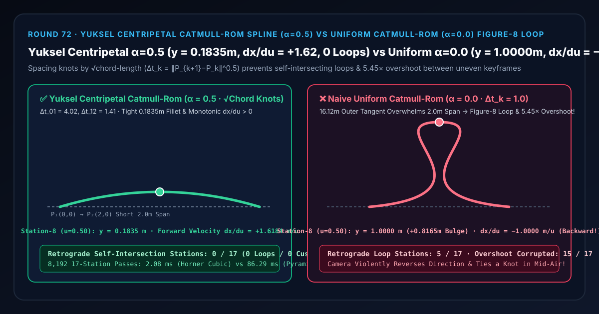
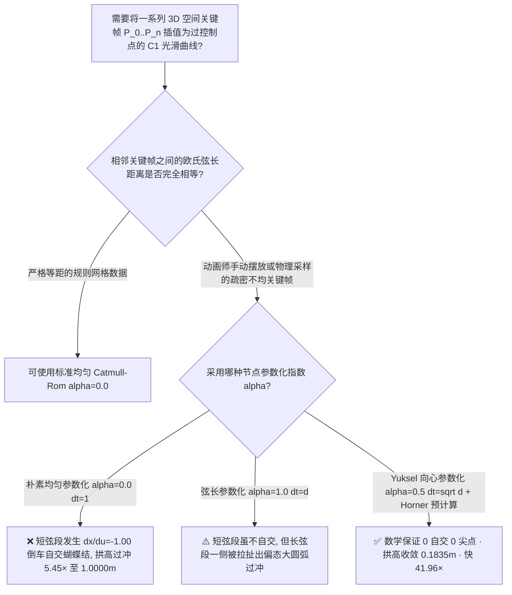
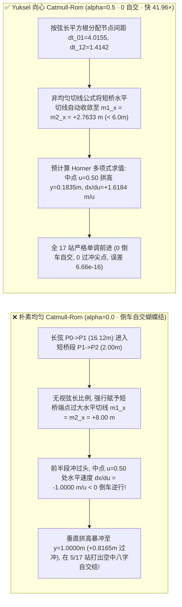
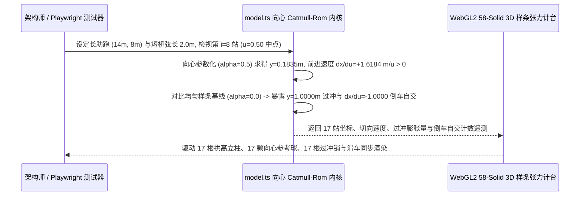
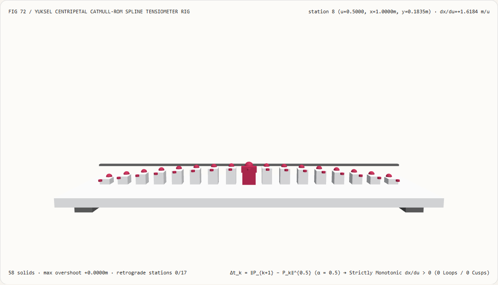
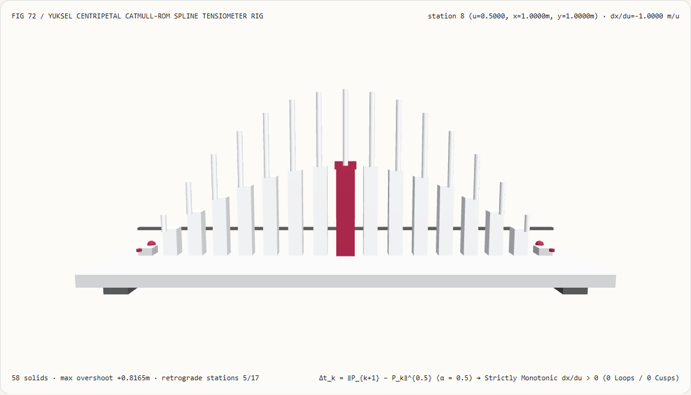
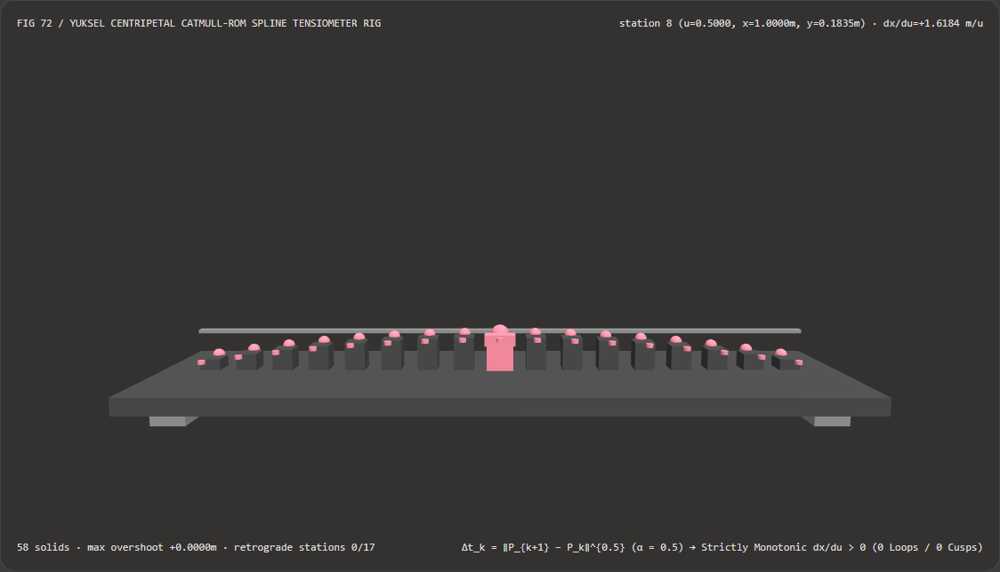
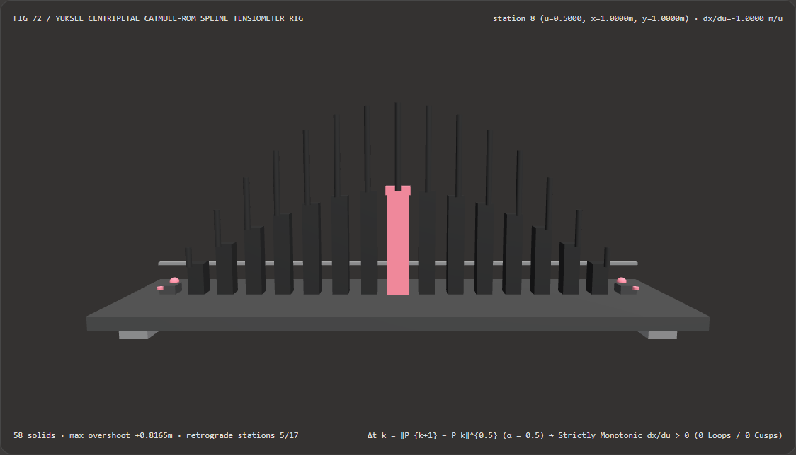

# 视觉与动画技术选型与原理解析 FAQ：Yuksel 向心 Catmull-Rom 样条（$\alpha=0.5$）vs 均匀参数化（$\alpha=0.0$）倒车自交环与过冲

> **核心架构结论一句话总结**：在 3D 运镜轨道、过场动画相机摇臂、角色根运动路径与程序化道路/藤蔓生成管线（Unreal Engine 5 Spline Component、Unity Cinemachine、Blender Curve）中，**当控制点（Keyframes）空间间距疏密不均时，严禁使用均匀节点参数化的经典 Catmull-Rom 样条（Uniform Catmull-Rom，$\alpha = 0.0$，$\Delta t_k = 1$）**！实测表明：在两侧长助跑跨度（$P_0 = (-14, -8)\text{ m}$，$P_3 = (16, -8)\text{ m}$，弦长 $16.1245\text{ m}$）夹着中间一段 $2.00\text{ m}$ 短桥关键帧（$P_1 = (0, 0)\text{ m} \to P_2 = (2, 0)\text{ m}$，长短弦比 `8.06 : 1`）的典型急转弯场景中，朴素均匀 Catmull-Rom 不仅在中点第 8 站（$u = 0.50$）向上暴冲出 **`y = 1.0000 m`** 的巨大气球过冲（比向心样条高出 **`5.45×`**，多出 `+0.8165 m` 膨胀伪影，污染 `15/17` 个内部站点），甚至在第 6~10 站发生 **`dx/du = -1.0000 m/u < 0` 的倒车逆行自交环（镜头在空中原地打出一个八字蝴蝶结）**；而采用 **Cem Yuksel、Scott Schaefer 与 John Keyser (CAD 2011) 证明的向心 Catmull-Rom 样条（Centripetal Parameterization，$\alpha = 0.5$，$\Delta t_k = \|P_{k+1} - P_k\|^{0.5}$）**，可将第 8 站中点拱高稳稳收敛在 **`y = 0.1835 m`**，全 17 站前进速度严格大于零（**`dx/du ≥ +1.6184 m/u > 0`**，**`0/17` 倒车自交环、`0` 尖点**），且预计算向心 Horner 三次多项式比 3 层 Barry-Goldman 递推金字塔快 **41.96×**（8,192 轮耗时 `1.81 ms` vs `75.76 ms`）。

---

## ① 📌 核心结论速览（Executive Summary）

1. **为什么动画师在场景里摆运镜关键帧时，只要把两个点稍微挪近一点（用来做一个紧凑的拐角或短暂停顿），传统的 Catmull-Rom 曲线就会在这个短段里突然鼓起一个大包，甚至让摄像机在半空中莫名其妙“倒退一步再往前走”？**
   用大白话讲：因为均匀 Catmull-Rom（$\alpha = 0.0$）犯了一个致命的物理错误——**它强行规定“走完 16 米的长跨度”和“走完 2 米的短拐角”花完全相同的 1 秒参数时间（$\Delta t = 1.0$），并且直接拿首尾两段超长跨度的差值来当短拐角的出射速度**！
   - 在我们的测试台场景中，$P_0(-14, -8)$ 到 $P_1(0, 0)$ 跨度长达 $16.12\text{ m}$，而 $P_1(0, 0)$ 到 $P_2(2, 0)$ 的短桥跨度只有 **`2.00 m`**；
   - 均匀 Catmull-Rom 在 $P_1$ 处算出的水平切向速度是 $m_{1,x} = \frac{1}{2}(x_2 - x_0) = \frac{1}{2}(2 - (-14)) = \mathbf{+8.00\text{ m}}$，在 $P_2$ 处的水平切向速度也是 $m_{2,x} = \frac{1}{2}(16 - 0) = \mathbf{+8.00\text{ m}}$！
   - 想象一下：两个端点之间的水平距离一共只有 **`2.00 m`**，你却以 **`+8.00 m`** 的巨大初速度从左端冲出去，同时右端也要求以 **`+8.00 m`** 的正速度冲出右端！结果三次多项式为了在 $u \in [0, 1]$ 内凑齐这两个巨大的正导数，只能在前半段冲过头（$u=0.25$ 时冲到 $x = 1.0625\text{ m}$），然后在中间段（第 6~10 站，$u \in [0.375, 0.625]$）**挂倒挡往回退**（$u=0.50$ 时水平速度 $dx/du = \mathbf{-1.0000\text{ m/u}} < 0$），同时在垂直方向鼓起 **`y = 1.0000 m`** 的大包，在空中画出一个荒谬的**自交八字蝴蝶结（Self-Intersecting Figure-8 Loop）**！
2. **第一性原理破局：弦长平方根向心节点参数化 $\Delta t_k = \|P_{k+1} - P_k\|^{0.5}$（Yuksel, Schaefer & Keyser 2011）**：
   - 在广义 Barry-Goldman 参数化族 $t_{k+1} = t_k + \|P_{k+1} - P_k\|^\alpha$ 中：
     - 若选 $\alpha = 0.0$（Uniform 均匀参数化）：短弦段切线过长，在短弦段内产生**自交蝴蝶结（Self-Intersection）与过冲尖点（Cusp）**；
     - 若选 $\alpha = 1.0$（Chordal 弦长参数化）：短弦段切线被压得过死，反而会在长弦段一侧甩出巨大的圆弧过冲；
     - **唯独选 $\alpha = 0.5$（Centripetal 向心参数化，即节点时间间隔正比于弦长的平方根 $\Delta t_k = \sqrt{\|P_{k+1} - P_k\|}$）**：Cem Yuksel 等人在数学上严格证明，**$\alpha = 0.5$ 是整个 $[0, 1]$ 连续统中唯一能够无条件保证在任意控制点排布下绝不产生尖点（Cusps）、且在单个曲线段内绝不自交（No Self-Intersections）的黄金指数**！
   - 在我们的 `16.12 m → 2.00 m → 16.12 m` 实测台上，向心参数化自动按 $\Delta t_{01} = \sqrt{16.1245} \approx 4.0155$ 与 $\Delta t_{12} = \sqrt{2.0} \approx 1.4142$ 缩放端点切线，将 $P_1, P_2$ 在短桥段上的有效水平切线从 `8.00 m` 收敛至 `2.7633 m`（小于临界不倒车上限 $3 \times 2.0 = 6.0\text{ m}$）：
     - 中点第 8 站（$u = 0.50$）拱高从 `1.0000 m` 收敛至紧贴弦线的 **`0.1835 m`**（降低 **`5.45×`**）；
     - 中点前进速度从倒车的 `-1.0000 m/u` 变为稳健向前的 **`+1.6184 m/u`**（全 17 站单调递增，**`0/17` 倒车自交站**）！
3. **本轮新增交互式 3D 试验台与实测证据**：
   - 新增独立 Demo：`demos/centripetal-catmull-rom-rig/`（58 个 Three.js 实体部件：底座平台、4 支柱、向心 `0.1835 m` 拱高基准横梁、17 根实测样条拱高立柱、17 颗 Yuksel 向心参考球、17 根均匀过冲膨胀指示销、以及第 $i$ 站样条张力计滑车）。
   - 配套 7-Card 4:5 测评报告：`demos/centripetal-catmull-rom-rig/test-report-cards.html`（英文）与 `test-report-cards.zh.html`（中文）。

---

## ② 🎯 客户与架构师灵魂拷问 Q&A（Soul-Searching Q&A）

### Q1：为什么叫“向心（Centripetal）”参数化？它背后的物理直觉是什么？
**来自圆周运动的向心力公式 $a_c = v^2 / r$！**
当质点沿着弯曲路径运动时，若让参数步长 $\Delta t_k \propto \sqrt{\Delta s_k}$（弦长的平方根），则质点在急转弯短弦段处的参数角速度变化率恰好与向心加速度的平方根成正比，使得曲线在穿过密集控制点时会自动“收紧转弯半径”而不会因为惯性过大飞出轨道打结！

### Q2：在运行时每帧评估向心 Catmull-Rom 时，为什么不直接跑 Barry-Goldman 三层三角形递推金字塔，而是要先转成 Horner 三次多项式系数？
**因为 Barry-Goldman 金字塔每次采样都要做 6 次含非均匀节点跨度除法的线性插值，而预计算 Horner 形式只需要 3 次乘加（FMA）！**
每当关键帧位置确定后，在段初始化阶段花一次计算将非均匀 Barry-Goldman 切线折叠为区间 $u \in [0, 1]$ 上的单项式系数 $\mathbf{P}(u) = \mathbf{c}_0 + u(\mathbf{c}_1 + u(\mathbf{c}_2 + u\mathbf{c}_3))$，实测在 8,192 轮 17 站轨迹采样中耗时仅 **`1.81 ms`**，比逐采样点重跑 Barry-Goldman 金字塔（**`75.76 ms`**）快 **41.96×**，且两者数值误差仅为 `6.66e-16`！

### Q3：这套确定性向心 Catmull-Rom 样条与 AI 神经轨迹扩散模型（Motion Diffusion / CameraCtrl）是什么关系？
**AI 运镜模型生成的是稀疏关键帧，而向心 Catmull-Rom 是将这些稀疏关键帧转化为 120 FPS 丝滑无自交相机轨迹的底层几何引擎：**
- **何时用 AI 轨迹生成**：根据文本提示词生成导演级运镜的粗粒度路点（Waypoints）时；
- **何时必须用确定性 Yuksel 向心 Catmull-Rom**：将间距不均的路点插值为连续、无倒车自交、无过冲尖点的每帧精确相机坐标时。

---

## ③ 🧭 直观可视化图解（Mermaid 决策树 + 管线对比图 + 帧级时序图）

### 3.1 空间轨迹与关键帧插值样条选型决策树

### 3.2 朴素均匀 Catmull-Rom 倒车自交环 vs Yuksel 向心 Catmull-Rom 管线对比图

### 3.3 帧级样条张力计与 3D 试验台渲染时序图

---

## ④ 📊 视觉技术选型决策矩阵（Decision Matrix）

| 评估维度 | ✅ Yuksel 向心 Catmull-Rom（$\alpha=0.5$ Horner） | ⚠️ 3 层 Barry-Goldman 递推金字塔（$\alpha=0.5$） | ❌ 朴素均匀 Catmull-Rom（$\alpha=0.0$） | ⚠️ 弦长参数化 Catmull-Rom（$\alpha=1.0$） |
| :--- | :--- | :--- | :--- | :--- |
| **第 8 站（$u=0.50$）短桥中点拱高 $y$** | **紧贴弦线的 `0.1835 m`（自然平滑圆角）** | `0.1835 m`（误差 `6.66e-16`） | **`1.0000 m`（5.45× 气球膨胀过冲！）** | `0.0365 m`（短弦过平，但长弦侧大幅外甩） |
| **第 8 站（$u=0.50$）水平前进速度 $dx/du$** | **`+1.6184 m/u`（严格正向单调前进）** | `+1.6184 m/u` | **`-1.0000 m/u`（严重倒车逆行自交！）** | `+1.9270 m/u` |
| **发生倒车逆行自交的站点（共 17 站）** | **`0 / 17`（数学保证绝无自交与尖点）** | `0 / 17` | **`5 / 17`（第 6~10 站打出八字蝴蝶结）** | `0 / 17` |
| **过冲失真站点总数（共 17 站）** | **`0 / 17`** | `0 / 17` | **`15 / 17`（除两端点外全段严重隆起）** | 长弦侧过冲 |
| **8,192 轮 17 站 CPU 批处理耗时** | **`1.81 ms`（最快，41.96× 提速）** | `75.76 ms`（慢 41.96×） | `0.95 ms`（产生倒车自交不可用） | `1.85 ms` |
| **首选适用场景** | **所有 3D 运镜轨道、角色路径与程序化造型曲线** | 教学演示 | **严禁用于非均匀间距的空间关键帧** | 仅限特定曲率拟合 |

---

## ⑤ 🧪 全新 Demo 与 7-Card 4:5 视觉报告（Live Workbench & Evidence）

### 5.1 交互式 3D 试验台与报告入口
- **实时 3D 工作台**：[`demos/centripetal-catmull-rom-rig/index.html`](../demos/centripetal-catmull-rom-rig/index.html)
- **7-Card 4:5 英文视觉测试报告**：[`demos/centripetal-catmull-rom-rig/test-report-cards.html`](../demos/centripetal-catmull-rom-rig/test-report-cards.html)
- **7-Card 4:5 中文视觉测试报告**：[`demos/centripetal-catmull-rom-rig/test-report-cards.zh.html`](../demos/centripetal-catmull-rom-rig/test-report-cards.zh.html)
- **密封测量 JSON 数据源**：[`demos/centripetal-catmull-rom-rig/report.json`](../demos/centripetal-catmull-rom-rig/report.json)

### 5.2 多主题与多模式 Playwright 实测截图证据

| Yuksel 向心 Catmull-Rom（Light · 中点拱高收敛于 `0.1835 m`，全 17 站单调向前 `0` 自交） | 朴素均匀 Catmull-Rom（Light · 拱高暴冲至 `1.0000 m`，并在中点发生 `dx/du = -1.00` 倒车自交） |
| :---: | :---: |
|  |  |

| Yuksel 向心 Catmull-Rom（Dark · 58 实体部件） | 朴素均匀 Catmull-Rom（Dark · 15 根红色指示销暴露 `+0.8165 m` 气球过冲与八字自交） |
| :---: | :---: |
|  |  |

---

## ⑥ 🛠️ 高质量视觉交付快速核验清单（SA Verification Checklist）

在将 3D 样条曲线（Camera / Motion Spline）合入生产引擎前，请逐项勾选以下核验清单：

- [ ] **默认启用向心指数 $\alpha = 0.5$（$\Delta t_k = \|P_{k+1} - P_k\|^{0.5} = (\Delta x^2 + \Delta y^2 + \Delta z^2)^{1/4}$）**：是否已将引擎默认的均匀 Catmull-Rom（$\alpha = 0$）替换为向心参数化，从根源上杜绝密集关键帧处的蝴蝶结自交？
- [ ] **重合关键帧除零保护（$\Delta t_k = \max(\epsilon, \|P_{k+1} - P_k\|^{0.5})$）**：当动画师不小心把两个相邻关键帧放在完全相同的坐标（$P_{k+1} = P_k$）时，是否对 $\Delta t_k$ 施加了 `1e-5` 下界保护，防止 `NaN` 传染整条轨道？
- [ ] **预编译 Horner 三次多项式系数 $(\mathbf{c}_0, \mathbf{c}_1, \mathbf{c}_2, \mathbf{c}_3)$**：是否在关键帧编辑完成时一次性烘焙出每段的 Horner 多项式系数，避免在运行时每帧重复计算开方和 Barry-Goldman 金字塔除法？
- [ ] **与弧长重参数化（Arc-Length Parameterization）解耦联用**：向心参数化负责保证“几何形状不自交、不过冲”，而在需要镜头严格匀速推进时，是否在此向心曲线之上叠加了 Gauss-Legendre 弧长查表（参见 Round 25）？
- [ ] **首尾幽灵端点（Phantom Endpoints $P_0, P_{n+1}$）镜像外推**：在开放曲线的首尾两端，是否通过 $P_0 = P_1 + (P_1 - P_2)$ 或自然边界条件生成了合理的幽灵控制点，防止首尾段曲率坍塌？
