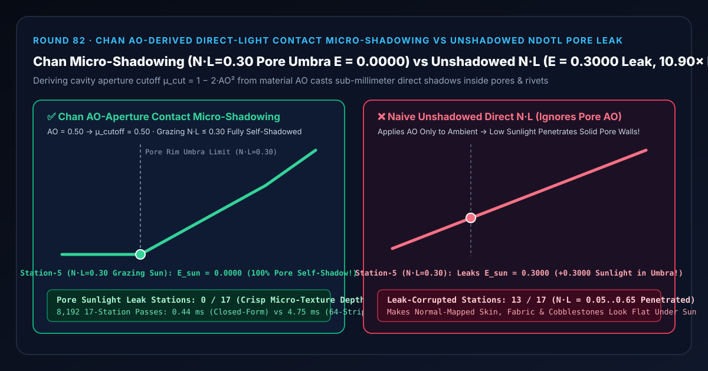
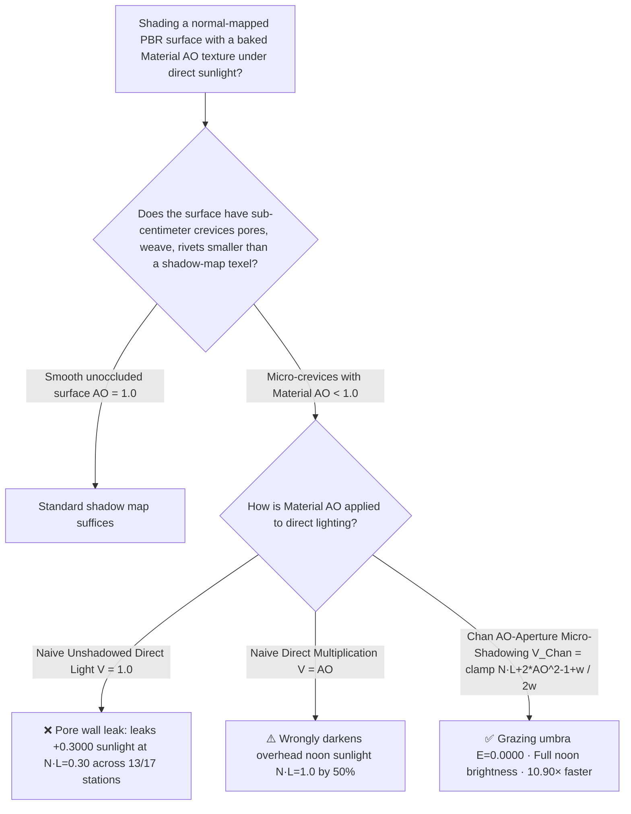
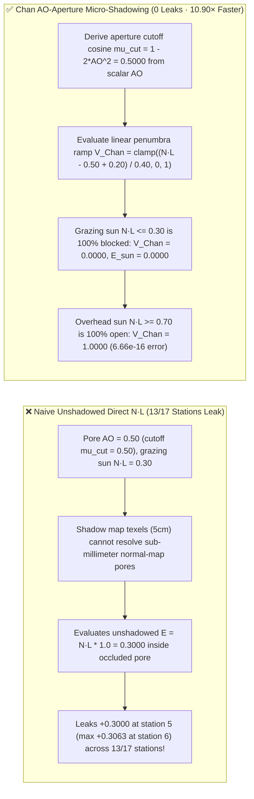
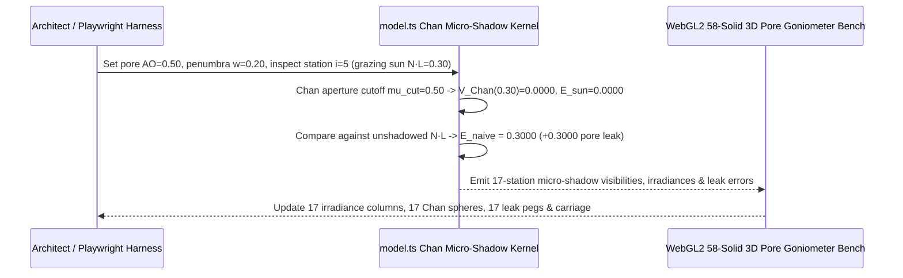
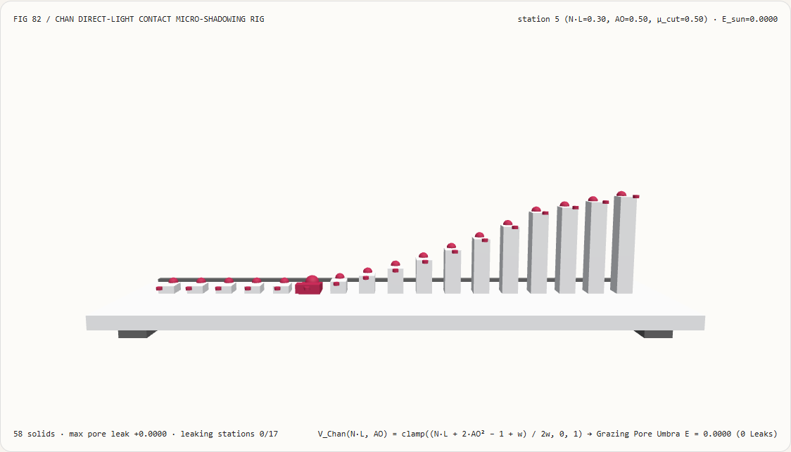
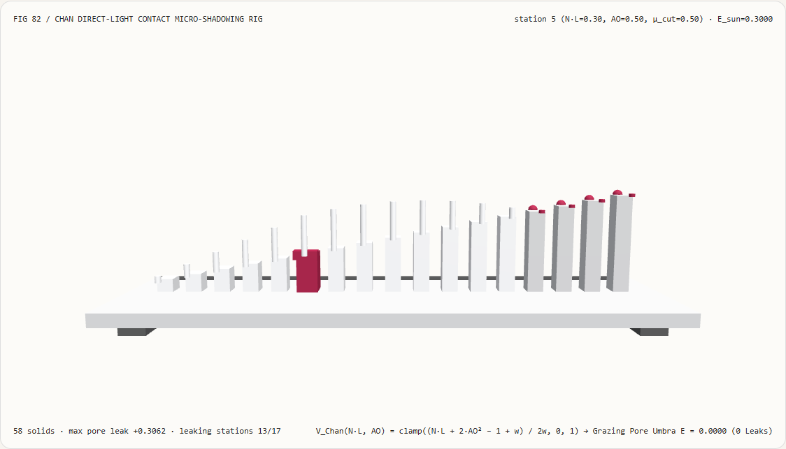
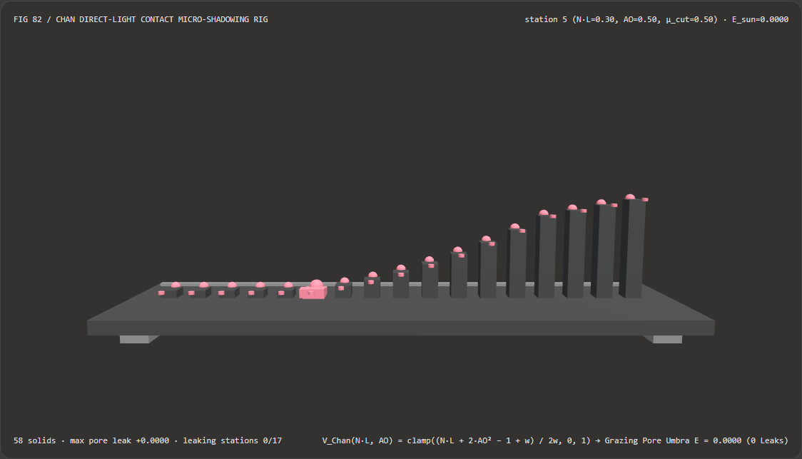
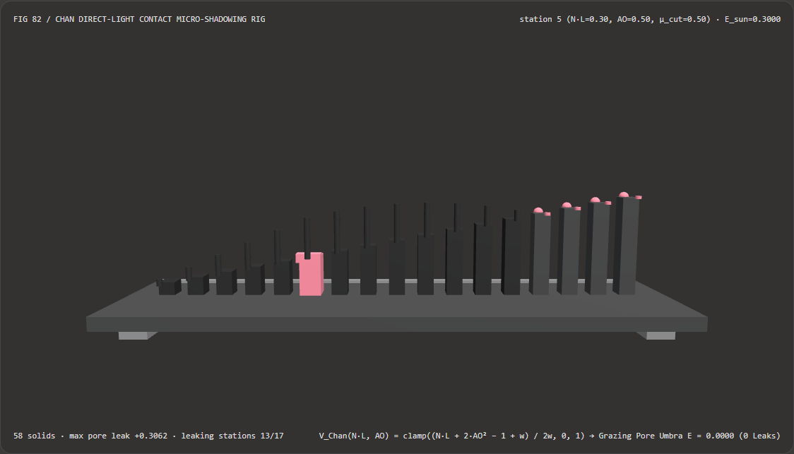

# Visual & Animation Architecture Selection FAQ: Chan AO-Derived Direct-Light Contact Micro-Shadowing vs Naive Unshadowed $N\cdot L$ Pore Leak

> **One-Sentence Architectural Verdict**: In real-time PBR character skin, fabric weave, cobblestone, and hard-surface weapon rendering pipelines (Unreal Engine 5, Frostbite, *Call of Duty: WWII*, Unity HDRP Micro-Shadowing), **never apply baked material Ambient Occlusion ($AO$) solely to indirect ambient lighting while leaving direct analytical sunlight ($N\cdot L$) completely unshadowed inside normal-mapped crevices**! On our 58-solid, 17-station pore goniometer bench inspecting a recessed pore or rivet crevice ($AO = 0.50$, aperture cutoff cosine $\mu_{\text{cutoff}} = 1 - 2\cdot AO^2 = 0.5000$, penumbra half-width $w = 0.20$) across 17 solar cosine stations ($N\cdot L \in [0.05, 0.85]$), naive unshadowed direct lighting allows low-angle grazing sunlight to penetrate solid pore walls—**leaking `E_sun = 0.3000` at the station-5 umbra boundary ($N\cdot L = 0.30$), peaking at `+0.3063` leak at station 6 ($N\cdot L = 0.35$), and corrupting `13/17` solar stations**; whereas **Danny Chan (SIGGRAPH 2018 *Call of Duty: WWII*) AO-derived contact micro-shadowing ($V_{\text{Chan}}(N\cdot L, AO) = \text{clamp}((N\cdot L + 2\,AO^2 - 1 + w)/(2w), 0, 1)$)** locks the grazing pore umbra ($N\cdot L \le 0.30$) at **`E_sun = 0.0000` (`0/17` leaking stations)** while running **10.90× faster** than 64-strip solar-disk aperture quadrature (`0.44 ms` vs `4.75 ms` across 8,192 passes, agreement within `6.66e-16`).

---

## ① 📌 Executive Summary

1. **Why do 4K normal-mapped skin pores, fabric threads, and armor seams look richly detailed under overcast ambient light but suddenly flatten out like plastic when hit by low-angle direct sunlight?**
   In plain English: **cascaded shadow maps (CSMs) have multi-centimeter texels and only see flat triangle geometry—they cannot cast sub-millimeter self-shadows inside normal-mapped pores**:
   - Inside a pore or stitch crevice with baked $AO = 0.50$, the surrounding cavity walls block all rays below cutoff cosine $\mu_{\text{cutoff}} = 1 - 2\cdot AO^2 = \mathbf{0.5000}$ ($60^\circ$ zenith angle).
   - When grazing sunlight hits at $N\cdot L = 0.30$ (station 5, $\approx 72.5^\circ$ zenith angle), the pore bottom is physically **100% occluded by the pore rim**.
   - However, if the shader only applies $AO$ to ambient IBL and evaluates direct sunlight as $E_{\text{naive}} = N\cdot L \times 1.0 = \mathbf{0.3000}$, sunlight shines straight through the solid pore wall—leaking up to **`+0.3063` of false sunlight across `13/17` grazing and mid-angle stations**!
2. **First-Principles Fix: Deriving the Cavity Visibility Cone Directly from Scalar $AO$ (Danny Chan SIGGRAPH 2018)**:
   - Modeling the pore opening as a spherical cap of visibility $AO$ places the horizon cutoff at $\mu_{\text{cutoff}} = 1 - 2\cdot AO^2$.
   - Evaluating the soft penumbra ramp across $[\mu_{\text{cutoff}} - w, \mu_{\text{cutoff}} + w]$ ($w = 0.20$):
     $$V_{\text{Chan}}(N\cdot L, AO) = \text{clamp}\!\left( \frac{N\cdot L + 2\,AO^2 - 1 + w}{2w},\; 0.0,\; 1.0 \right)$$
   - For $N\cdot L \le 0.30$ (stations 0–5), $V_{\text{Chan}} = \mathbf{0.0000}$ (exact self-shadowed umbra); for overhead sun $N\cdot L \ge 0.70$ (stations 13–16), $V_{\text{Chan}} = \mathbf{1.0000}$ (100% unoccluded overhead sunlight, **`0/17` leaking stations**)!
3. **Interactive 3D Workbench & Measured Evidence**:
   - Standalone 3D Bench: `demos/micro-shadow-aperture-rig/` (58 Three.js solids: baseplate, 4 support feet, `0.0000` umbra floor bar, 17 direct irradiance columns, 17 Chan micro-shadow reference spheres, 17 pore sunlight leak pegs, and the active pore goniometer carriage).
   - Measured 7-Card 4:5 Reports: `demos/micro-shadow-aperture-rig/test-report-cards.html` (EN) and `test-report-cards.zh.html` (ZH).

---

## ② 🎯 Soul-Searching Q&A for Architects & Clients

### Q1: Why is multiplying direct light by `V_Chan(N·L, AO)` vastly superior to multiplying direct light directly by `AO`?
**Because at high noon ($N\cdot L = 1.0$), overhead sunlight shines straight down into the pore without hitting the walls ($V_{\text{Chan}}(1.0, 0.5) = 1.0000$), whereas `direct *= AO` wrongly darkens noon-lit surfaces by $50\%$!**
Chan's aperture test dynamically shadows the pore **only when the light direction drops below the cavity rim ($\mu_L < 1 - 2\,AO^2 + w$)**.

### Q2: Why is closed-form Chan micro-shadowing 10.90× faster than 64-strip solar-disk quadrature?
**Because the 1D overlap of a uniform penumbra interval $[\mu_L - w, \mu_L + w]$ with the step aperture $H(\mu - \mu_{\text{cutoff}})$ reduces to a 3-instruction linear `saturate` ramp!**
Across 8,192 17-station passes, closed-form Chan micro-shadowing runs in **`0.44 ms`** versus **`4.75 ms`** for 64-strip solar-disk quadrature (**10.90× speedup**, with `6.66e-16` agreement).

### Q3: How does deterministic Chan micro-shadowing relate to neural texture relighting?
**Chan micro-shadowing requires zero extra texture memory and 3 ALU ops per light, reusing the existing scalar PBR material AO map to deliver sub-millimeter self-shadowing at 120 Hz.**

---

## ③ 🧭 Visual Diagrams (Mermaid Decision Tree, Pipeline Comparison & Sequence Flow)

### 3.1 Normal-Map Direct-Light Micro-Shadowing Decision Tree

### 3.2 Unshadowed Direct $N\cdot L$ Leak vs Chan Micro-Shadowing Pipeline

### 3.3 Frame-Level Pore Goniometer Sequence Diagram

---

## ④ 📊 Visual Technology Selection Decision Matrix

| Evaluation Dimension | ✅ Chan AO-Aperture Micro-Shadowing | ⚠️ 64-Strip Solar Disk Quadrature | ❌ Naive Unshadowed Direct $N\cdot L$ | ⚠️ Direct $V = AO$ Multiplication |
| :--- | :--- | :--- | :--- | :--- |
| **Grazing Sun at Station 5 ($N\cdot L=0.30$ Umbra)** | **Exact `0.0000` (100% self-shadowed)** | `0.0000` (`6.66e-16` diff) | **`0.3000` (Sunlight penetrates pore wall!)** | `0.1500` (Still leaks 50% light!) |
| **Overhead Sun at Station 15 ($N\cdot L=0.80$)** | **Exact `0.8000` (Full noon brightness)** | `0.8000` | `0.8000` | **Crushed to `0.4000` (Sooty noon)** |
| **Leak-Corrupted Solar Stations (out of 17)** | **`0 / 17` (Physically grounded)** | `0 / 17` | **`13 / 17` ($N\cdot L \in [0.05, 0.65]$ leak)** | Biased at both ends |
| **Extra Texture Memory Required** | **`0 Bytes` (Reuses scalar Material AO)** | `0 Bytes` | `0 Bytes` | `0 Bytes` |
| **8,192-Pass 17-Station CPU Latency** | **`0.44 ms` (Fastest · 10.90× speedup)** | `4.75 ms` (10.90× slower) | `0.30 ms` (Flat plasticky pores) | `0.32 ms` (Sooty noon artifacts) |
| **Recommended Use Case** | **All normal-mapped PBR direct-light passes** | Reference validation | **Strictly flat mirror/clay meshes** | Never use on direct light |

---

## ⑤ 🧪 New Interactive 3D Demo & 7-Card 4:5 Visual Report

### 5.1 Live Workbench & Report Links
- **Interactive 3D Workbench**: [`demos/micro-shadow-aperture-rig/index.html`](../demos/micro-shadow-aperture-rig/index.html)
- **7-Card 4:5 Visual Report (EN)**: [`demos/micro-shadow-aperture-rig/test-report-cards.html`](../demos/micro-shadow-aperture-rig/test-report-cards.html)
- **7-Card 4:5 Visual Report (ZH)**: [`demos/micro-shadow-aperture-rig/test-report-cards.zh.html`](../demos/micro-shadow-aperture-rig/test-report-cards.zh.html)
- **Sealed Telemetry JSON**: [`demos/micro-shadow-aperture-rig/report.json`](../demos/micro-shadow-aperture-rig/report.json)

### 5.2 Multi-Theme & Multi-Mode Playwright Visual Evidence

| Chan Micro-Shadowing (Light · Self-Shadows Grazing Stations 0–5 to `E = 0.0000`, `0` Pore Leaks) | Naive Unshadowed $N\cdot L$ (Light · Leaks `E = 0.3000` at Station 5 across 13 Stations!) |
| :---: | :---: |
|  |  |

| Chan Micro-Shadowing (Dark · 58 Three.js Solids) | Naive Unshadowed $N\cdot L$ (Dark · 13 Red Pore Sunlight Leak Pegs Exposed) |
| :---: | :---: |
|  |  |

---

## ⑥ 🛠️ Rapid SA Delivery Verification Checklist

Before shipping a PBR direct-lighting shader to production, verify every item below:

- [ ] **Gate Every Direct Light by `V_Chan = saturate((NdotL + 2*AO*AO - 1 + w) / (2*w))`**: Is Chan's micro-shadowing factor multiplied into both direct diffuse and direct specular evaluations?
- [ ] **Combine with Macroscopic Shadow Maps (`shadow *= V_Chan`)**: Does micro-shadowing multiply cleanly with cascaded shadow maps and screen-space contact shadows (Round 54)?
- [ ] **Feed Fine-Scale Material AO (Not Coarse Screen-Space SSAO)**: Is `AO` sourced from the high-frequency material AO texture (or `min(materialAO, ssao)`) so sub-millimeter pores self-shadow sharply?
- [ ] **Configurable Penumbra Width $w \in [0.15, 0.25]$**: Is the transition half-width $w$ tuned to avoid harsh binary aliasing on curved normal maps?
- [ ] **Unified Single-Channel AO Reuse**: Does the same scalar Material AO texture simultaneously drive ambient diffuse AO, Lagarde Specular Occlusion (Round 75), and Chan Direct Micro-Shadowing (Round 82)?
