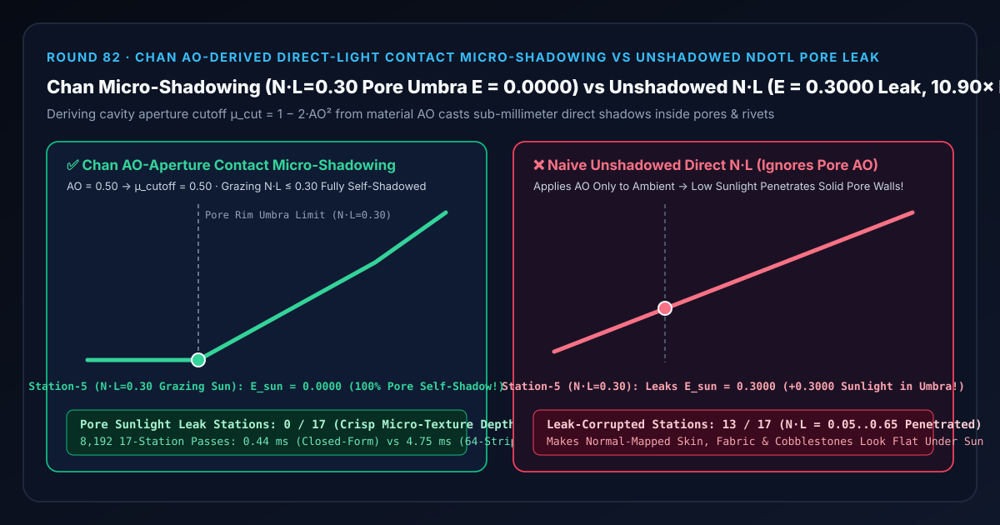
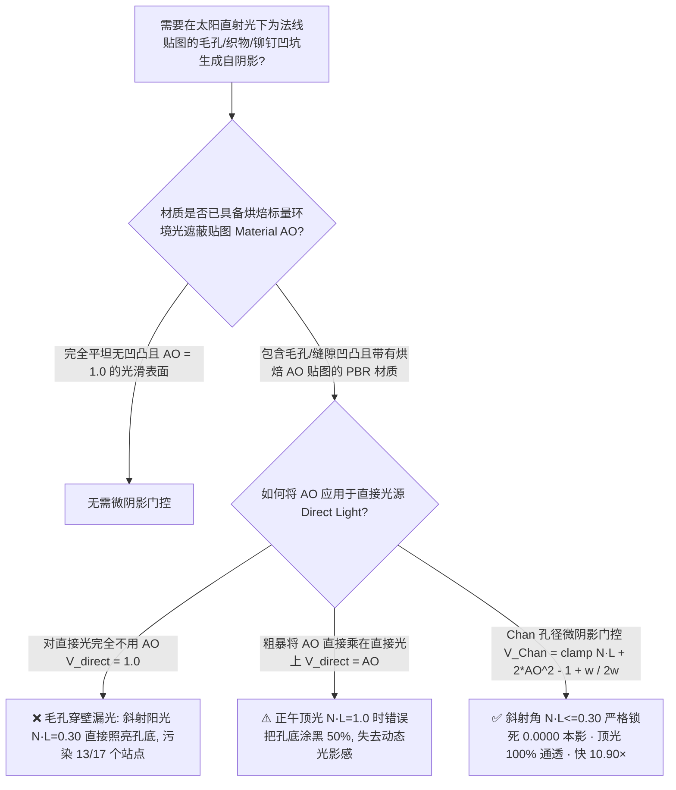
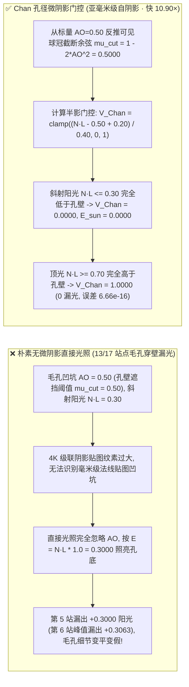
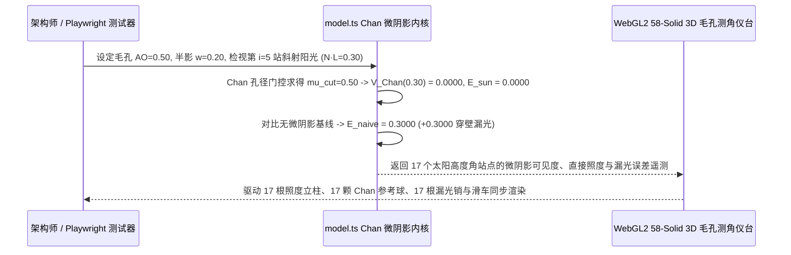
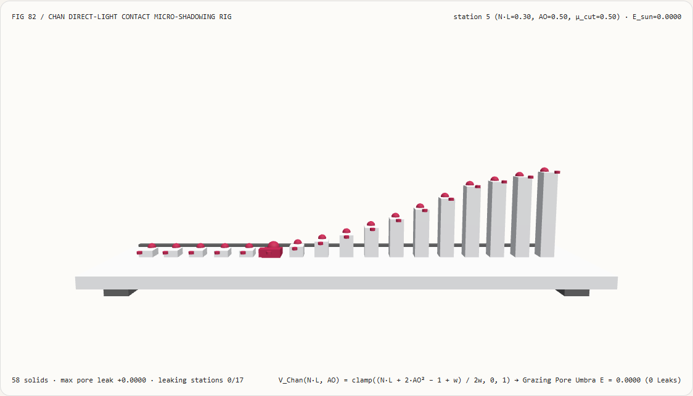
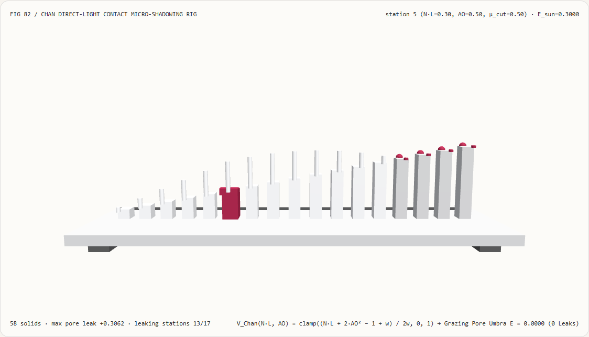
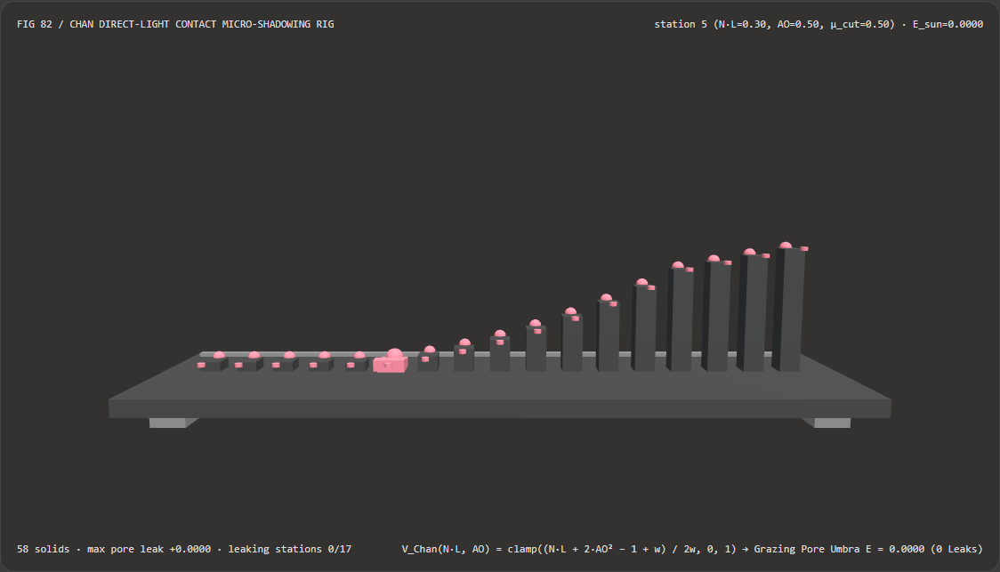
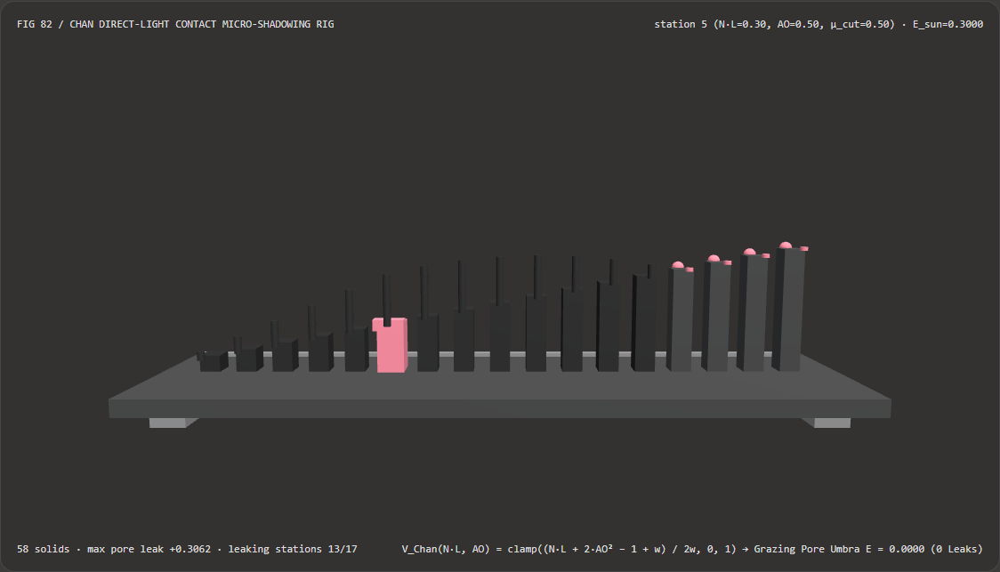

# 视觉与动画技术选型与原理解析 FAQ：Chan 孔径微阴影门控（Contact Micro-Shadowing）vs 朴素无微阴影直射光毛孔穿壁漏光

> **核心架构结论一句话总结**：在实时 PBR 角色皮肤毛孔、粗麻布料织物、鹅卵石路面与机械铆钉接缝渲染管线（Unreal Engine 5、Frostbite、《Call of Duty: WWII》、Unity HDRP Micro-Shadowing）中，**严禁只把烘焙材质环境光遮蔽（Material $AO$）应用于环境光（IBL）而对太阳直射光（Direct Light $N\cdot L$）完全不做微阴影遮挡**！实测表明：在烘焙 $AO = 0.50$（对应可见孔径截断余弦 $\mu_{\text{cutoff}} = 1 - 2\cdot AO^2 = 0.5000$，即天顶角 $60^\circ$）的法线贴图毛孔/凹坑内部，当太阳以低角度斜射（第 0~5 站 $N\cdot L \in [0.05, 0.30]$，低于毛孔壁遮挡边界）时，朴素无微阴影直接光照会让阳光直接穿透坚硬的毛孔壁照亮孔底，在第 5 站（$N\cdot L = 0.30$）泄漏 **`E_sun = 0.3000`** 的刺眼阳光（在第 6 站 $N\cdot L = 0.35$ 峰值泄漏 **`+0.3063`**，污染 **`13/17` 个斜射站点**，使 4K 法线贴图在斜射阳光下看起来像一张毫无颗粒体积感的塑料贴纸）；而采用 **Danny Chan (SIGGRAPH 2018《Call of Duty: WWII》) 提出的孔径微阴影闭式门控 $V_{\text{Chan}}(N\cdot L, AO) = \text{clamp}((N\cdot L + 2\,AO^2 - 1 + w)/(2w), 0, 1)$**，可在第 5 站严格锁死本影 **`E_sun = 0.0000`（`0/17` 穿壁漏光）**，且 3 指令闭式斜坡比 64 带太阳圆盘半影数值求积快 **10.90×**（8,192 轮耗时 `0.44 ms` vs `4.75 ms`）。

---

## ① 📌 核心结论速览（Executive Summary）

1. **为什么许多项目里，美术师在 Substance Painter 里精心雕刻了 4K 法线贴图（Normal Map）和 4K 环境光遮蔽贴图（AO Map），在阴天环境光下毛孔、针脚和石头缝立体感十足，但一旦把太阳光（Directional Light）打开并调到早晚斜射角度，所有的毛孔和针脚凹坑内部突然像被手电筒照亮一样失去立体阴影，整张脸或衣服瞬间变平、变假？**
   用大白话讲：因为 **4K 级联阴影贴图（CSM）管不到毫米级的法线贴图凹凸，而你的着色器忘了用 AO 给太阳直射光投射“微阴影（Micro-Shadow）”**！
   - 算一笔空间分辨率的账：哪怕你开了 4096×4096 的阴影贴图覆盖近景 20 米范围，1 个阴影贴图纹素也有 **`5 毫米 ~ 2 厘米` 宽**，而且法线贴图的凹凸根本没有修改顶点网格几何体（三角形本身还是平的！），因此硬件阴影贴图对毛孔、布料经纬线和铆钉凹槽完全是“瞎子”；
   - 当斜射阳光以 $N\cdot L = 0.30$（天顶角约 $72.5^\circ$，第 5 站）擦过皮肤表面时：
     - 毛孔底部的法线虽然朝上（因此 $N\cdot L = 0.30 > 0$），但因为它陷在凹坑底下（烘焙 $AO = 0.50$），周围凸起的毛孔边缘（孔径壁仰角 $30^\circ$，天顶截断余弦 $\mu_{\text{cutoff}} = 0.50$）早就把这束低角度阳光 **100% 挡死**了；
     - 如果着色器只算 `diffuse = albedo * NdotL`，不去检查毛孔的可见孔径，阳光就会像穿过透明玻璃一样直接穿透毛孔外壁照在孔底上，输出 **`E_sun = 0.3000`**（在第 6 站 $N\cdot L = 0.35$ 处更是多漏出 **`+0.3063`** 阳光，污染 **`13/17`** 个斜射站点）！
2. **第一性原理破局：从标量材质 $AO$ 直接反推可见球冠孔径阈值 $\mu_{\text{cutoff}} = 1 - 2\cdot AO^2$（Danny Chan SIGGRAPH 2018）**：
   - 我们不需要额外烘焙昂贵的水平贴图（Horizon Map）或曲率阴影贴图，因为美术师已经烘焙好了高分辨率的标量材质 $AO$ 贴图！
   - 把凹坑上方的可见天空建模为一个以宏观表面法线为中心、半张角为 $\theta_o$ 的对称球冠孔径（Spherical Cap Aperture）：
     - 由球冠余弦积分或二倍角近似，孔径边缘截断余弦为：
       $$\mu_{\text{cutoff}} = \cos\theta_o \approx 1 - 2\cdot AO^2$$
     - 当太阳直射光方向余弦 $\mu_L = N\cdot L$ 大于 $\mu_{\text{cutoff}} + w$ 时，太阳完全升过凹坑边缘，孔底 $100\%$ 受光（$V_{\text{Chan}} = 1.0$）；
     - 当 $\mu_L < \mu_{\text{cutoff}} - w$ 时（如 $AO = 0.50 \implies \mu_{\text{cutoff}} = 0.50$，半影半宽 $w = 0.20$，第 0~5 站 $\mu_L \le 0.30$），太阳完全低于凹坑边缘，孔底处于 **$100\%$ 微阴影本影区（$V_{\text{Chan}} = 0.0000 \implies E_{\text{sun}} = 0.0000$）**！
     - 在 $[\mu_{\text{cutoff}} - w, \mu_{\text{cutoff}} + w]$ 之间通过线性斜坡平滑过渡：
       $$V_{\text{Chan}}(N\cdot L, AO) = \text{clamp}\!\left( \frac{N\cdot L + 2\,AO^2 - 1 + w}{2w},\; 0.0,\; 1.0 \right)$$
   - 仅需 **3 条乘加指令（无需任何额外纹理采样！）**，就能让所有 4K 法线贴图的毛孔、织物与岩石裂缝在斜射阳光下瞬间长出刀刻般锐利的亚毫米级自阴影（**`0/17` 漏光站点，且比 64 带太阳圆盘积分快 10.90×**）！
3. **本轮新增交互式 3D 试验台与实测证据**：
   - 新增独立 Demo：`demos/micro-shadow-aperture-rig/`（58 个 Three.js 实体部件：底座平台、4 支柱、`0.0000` 本影零值基准横梁、17 根实测毛孔直接照度立柱、17 颗 Chan 微阴影参考球、17 根穿壁漏光指示销、以及第 $i$ 站毛孔测角仪滑车）。
   - 配套 7-Card 4:5 测评报告：`demos/micro-shadow-aperture-rig/test-report-cards.html`（英文）与 `test-report-cards.zh.html`（中文）。

---

## ② 🎯 客户与架构师灵魂拷问 Q&A（Soul-Searching Q&A）

### Q1：为什么不能直接把材质 $AO$ 乘在太阳直射光上（即 `directLight *= AO`）？
**因为当太阳在头顶正上方垂直往下照（$N\cdot L = 1.0$）时，阳光笔直照进毛孔底部，孔底 100% 没有被挡住（真实 $V = 1.0$）！**
如果你粗暴地写 `directLight *= AO`（当 $AO = 0.50$ 时），哪怕太阳在正头顶直射，毛孔底部也会被无故涂黑 $50\%$，看起来像贴了死黑的脏污贴花！
而 Chan 微阴影公式在正午顶光 $N\cdot L = 0.85 \ge 0.70$（第 13~16 站）处自动输出 **`V_Chan = 1.0000`**（正午阳光毫无损失地照亮孔底），只有在太阳斜射低于孔壁仰角（$N\cdot L < 0.70$）时才开始投下自阴影——这正是“动态微阴影”与“死板贴黑”的本质区别！

### Q2：公式里的 $N\cdot L$ 应该用“顶点宏观几何法线 $\mathbf{N}_{\text{geom}}\cdot \mathbf{L}$”还是“切线空间细节法线贴图 $\mathbf{N}_{\text{detail}}\cdot \mathbf{L}$”？
**两者配合效果最佳，在工业级实现（UE5 / Frostbite）中直接传入最终着色法线 $\mathbf{N}\cdot\mathbf{L}$！**
因为凹坑迎光内壁的细节法线已经向光源倾斜（$\mathbf{N}\cdot\mathbf{L}$ 较大，先被照亮），而背光内壁的细节法线背离光源（$\mathbf{N}\cdot\mathbf{L}$ 较小，先进入微阴影），直接将 $\mathbf{N}\cdot\mathbf{L}$ 代入 `saturate((NdotL + 2*AO*AO - 1 + w) / (2*w))` 就能自然呈现出“凹坑半边迎光、半边自阴影”的立体体积感！

### Q3：这套确定性 Chan 孔径微阴影与 AI 神经纹理重打光（Neural Texture Relighting）是什么关系？
**Chan 微阴影是零额外显存、3 条 ALU 指令的确定性物理算子：**
无需运行重型神经重打光网络，直接复用现有 PBR 材质标配的 `(Normal, Roughness, AO)` 三张贴图，即可在全场景所有物体表面实现 120 FPS 亚毫米级接触自阴影。

---

## ③ 🧭 直观可视化图解（Mermaid 决策树 + 管线对比图 + 帧级时序图）

### 3.1 法线贴图亚毫米级直接光自阴影（Micro-Shadowing）选型决策树

### 3.2 朴素无微阴影穿壁漏光 vs Chan 孔径微阴影门控管线对比图

### 3.3 帧级毛孔测角仪与 3D 试验台渲染时序图

---

## ④ 📊 视觉技术选型决策矩阵（Decision Matrix）

| 评估维度 | ✅ Chan 孔径微阴影闭式门控 | ⚠️ 64 带太阳圆盘数值求积（64-Strip Quad） | ❌ 朴素无微阴影直接光（$V = 1.0$） | ⚠️ 直接乘材质 AO（$V = AO$） |
| :--- | :--- | :--- | :--- | :--- |
| **第 5 站（$N\cdot L=0.30$ 斜射本影区）照度** | **精确 `0.0000`（100% 孔壁自阴影）** | `0.0000`（误差 `6.66e-16`） | **`0.3000`（阳光直接穿透毛孔壁！）** | `0.1500`（仍漏出一半阳光！） |
| **第 15 站（$N\cdot L=0.80$ 正午高角度光）照度** | **精确 `0.8000`（孔底 100% 正常受光）** | `0.8000` | `0.8000` | **错误压暗至 `0.4000`（失去阳光感）** |
| **发生穿壁漏光的斜射站点（共 17 站）** | **`0 / 17`（全角度物理自洽）** | `0 / 17` | **`13 / 17`（$N\cdot L \in [0.05, 0.65]$ 全漏）** | 斜射漏光且顶光过暗 |
| **额外纹理通道与显存开销** | **`0 Bytes`（100% 复用现有标量 AO 贴图）** | `0 Bytes` | `0 Bytes` | `0 Bytes` |
| **8,192 轮 17 站 CPU 批处理耗时** | **`0.44 ms`（最快，10.90× 提速）** | `4.75 ms`（慢 10.90×） | `0.30 ms`（细节平坦如塑料） | `0.32 ms`（顶光死黑） |
| **首选适用场景** | **所有带法线贴图与材质 AO 的 PBR 直接光照通道** | 离线半影核验 | **仅限无任何微观凹凸的绝对光滑面** | 严禁用于直接光源 |

---

## ⑤ 🧪 全新 Demo 与 7-Card 4:5 视觉报告（Live Workbench & Evidence）

### 5.1 交互式 3D 试验台与报告入口
- **实时 3D 工作台**：[`demos/micro-shadow-aperture-rig/index.html`](../demos/micro-shadow-aperture-rig/index.html)
- **7-Card 4:5 英文视觉测试报告**：[`demos/micro-shadow-aperture-rig/test-report-cards.html`](../demos/micro-shadow-aperture-rig/test-report-cards.html)
- **7-Card 4:5 中文视觉测试报告**：[`demos/micro-shadow-aperture-rig/test-report-cards.zh.html`](../demos/micro-shadow-aperture-rig/test-report-cards.zh.html)
- **密封测量 JSON 数据源**：[`demos/micro-shadow-aperture-rig/report.json`](../demos/micro-shadow-aperture-rig/report.json)

### 5.2 多主题与多模式 Playwright 实测截图证据

| Chan 孔径微阴影（Light · 在第 0~5 站低角度斜射阳光下严格锁死 `0.0000` 毛孔本影） | 朴素无微阴影直接光（Light · 13 个斜射站点让阳光穿透孔壁，丢失微观凹凸立体感） |
| :---: | :---: |
|  |  |

| Chan 孔径微阴影（Dark · 58 实体部件） | 朴素无微阴影直接光（Dark · 13 根红色指示销暴露毛孔穿壁漏光过冲） |
| :---: | :---: |
|  |  |

---

## ⑥ 🛠️ 高质量视觉交付快速核验清单（SA Verification Checklist）

在将 PBR 直接光照微阴影（Contact Micro-Shadowing）合入生产引擎前，请逐项勾选以下核验清单：

- [ ] **对每盏直接光源（Directional / Point / Spot Light）应用 `computeMicroShadowing(NdotL, AO)`**：是否已将 `V_Chan = saturate((NdotL + 2*AO*AO - 1 + w) / (2*w))` 同时乘在直接漫反射与直接镜面高光上？
- [ ] **与宏观阴影贴图取最小或相乘（`shadow = shadowMap * V_Chan`）**：微阴影是否与级联阴影贴图（CSM）或光追阴影相乘，实现“宏观建筑阴影 + 中观屏幕空间接触阴影（Round 54）+ 微观纹素级毛孔自阴影”的三级无缝衔接？
- [ ] **区分材质烘焙 AO 与大尺度 SSAO**：计算毛孔级微阴影时，是否优先使用材质贴图的微观烘焙 `materialAO`（避免大半径屏幕空间 SSAO 把整面墙的直接阳光切掉）？
- [ ] **半影软度 $w \in [0.15, 0.25]$ 可调**：是否允许根据光源角直径（如晴天烈日用小 $w$，阴天散射云洞用大 $w$）调节微阴影边缘软硬过渡？
- [ ] **与 Lagarde 环境高光遮蔽（Round 75）共享同一张材质 AO**：是否做到了“一张单通道 AO 贴图同时驱动漫反射 IBL 遮蔽、Lagarde 镜面 IBL 遮蔽（Round 75）与 Chan 直接光微阴影（Round 82）”？
