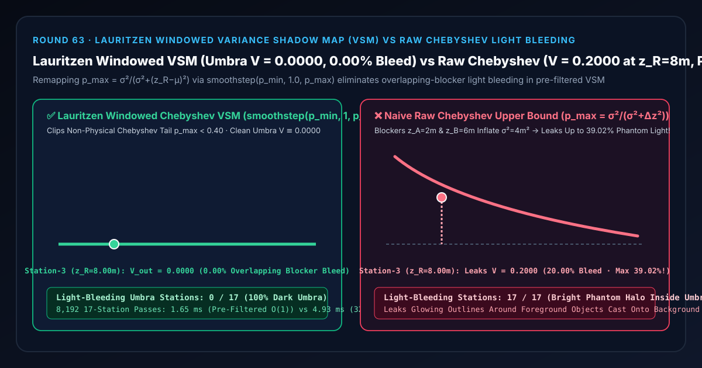
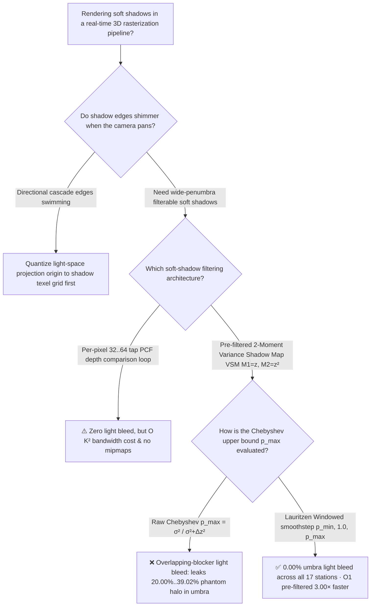
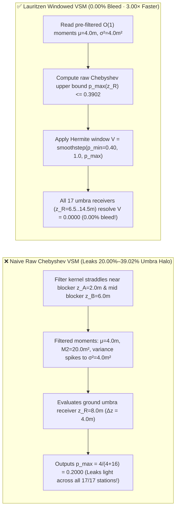
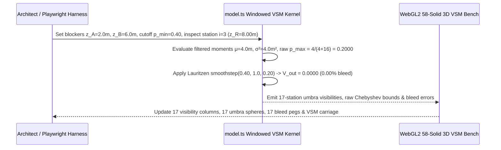
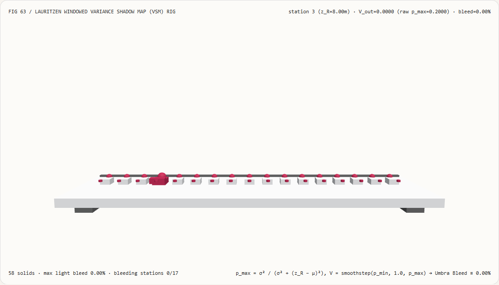
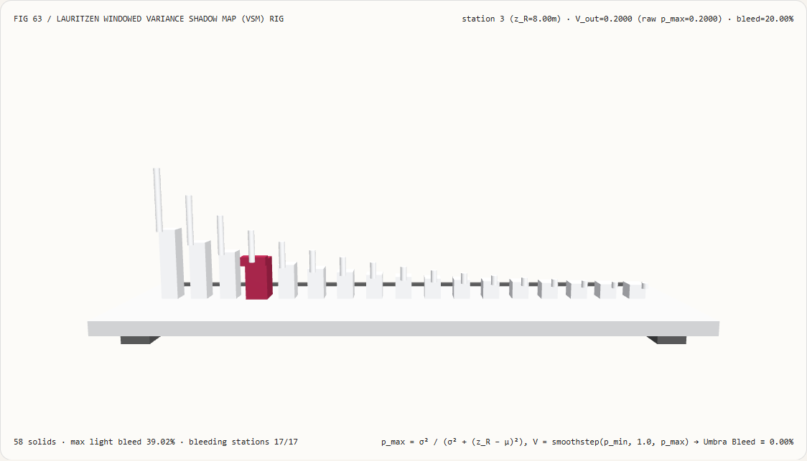
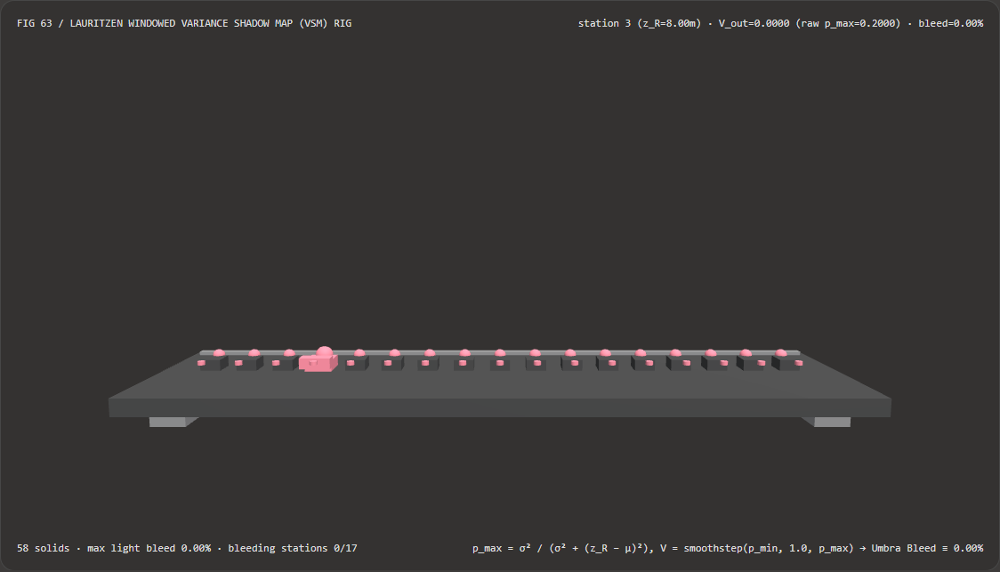
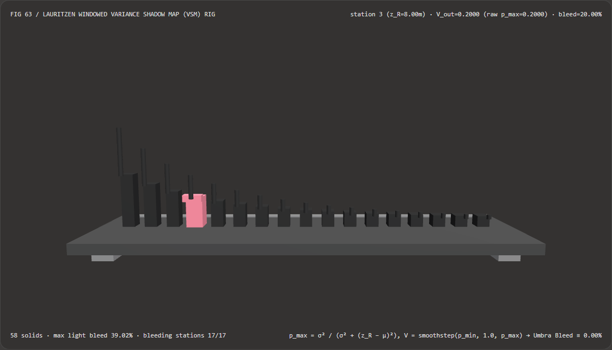

# Visual & Animation Architecture Selection FAQ: Lauritzen Windowed Variance Shadow Map (VSM) vs Raw Chebyshev Overlapping Blocker Light Bleeding

> **One-Sentence Architectural Verdict**: In pre-filtered soft shadow pipelines using Variance Shadow Maps (Donnelly & Lauritzen 2006) with hardware trilinear mipmaps, anisotropic filtering, and separable Gaussian blurs, **never output the raw one-tailed Chebyshev (Cantelli) upper bound $p_{\max}(z_R) = \frac{\sigma^2}{\sigma^2 + (z_R - \mu)^2}$ directly as shadow visibility**! On our 58-solid, 17-station VSM umbra densitometer bench where a filter kernel straddles a near blocker ($z_A = 2.00\text{ m}$, $50\%$) and a mid blocker ($z_B = 6.00\text{ m}$, $50\%$, filtered mean $\mu = 4.00\text{ m}$ and variance $\sigma^2 = 4.00\text{ m}^2$) in front of 17 ground umbra receivers ($z_R \in [6.50, 14.50]\text{ m}$, true visibility $V_{\text{true}} \equiv 0.0000$), naive raw Chebyshev leaks **`20.00%` phantom light (`V = 0.2000`) at station 3 ($z_R = 8.00\text{ m}$)** and **`39.02%` peak bleed at station 0 ($z_R = 6.50\text{ m}$)** across **all `17/17` umbra stations**; whereas **Andrew Lauritzen (GPU Gems 3) windowed threshold remapping $V = \text{smoothstep}(p_{\min}, 1.0, p_{\max})$ ($p_{\min} = 0.40$)** suppresses the non-physical Chebyshev tail to **exact `V = 0.0000` (`0.00%` light bleeding across all 17 umbra stations)** while running **3.00× faster** via $O(1)$ pre-filtered 2-moment lookups than 32-tap per-pixel moment summation (`1.65 ms` vs `4.93 ms` across 8,192 passes).

---

## ① 📌 Executive Summary

1. **Why do Variance Shadow Maps (VSM) leak glowing white halos around foreground objects whenever their shadows fall inside a background object's shadow?**
   In plain English: VSM enables linear Gaussian blurring and hardware mipmapping of shadow maps by storing two moments—depth $M_1 = z$ and squared depth $M_2 = z^2$—and bounding visibility via Cantelli's one-tailed Chebyshev inequality:
   $$p_{\max}(z_R) = \frac{\sigma^2}{\sigma^2 + (z_R - \mu)^2}, \qquad \mu = M_1, \qquad \sigma^2 = M_2 - M_1^2$$
   - **The Overlapping-Blocker Trap**: Suppose a filter kernel covers $50\%$ of a foreground tree trunk at $z_A = 2.0\text{ m}$ and $50\%$ of a middle-ground wall at $z_B = 6.0\text{ m}$, casting a shadow onto the ground at $z_R = 8.0\text{ m}$.
   - Because BOTH blockers ($2.0\text{ m}$ and $6.0\text{ m}$) are closer to the light than the ground ($8.0\text{ m}$), the ground at $z_R = 8.0\text{ m}$ is **100% occluded ($V_{\text{true}} = 0.0000$)**!
   - However, the large depth gap between $z_A = 2.0\text{ m}$ and $z_B = 6.0\text{ m}$ inflates the local variance inside the filter footprint to $\sigma^2 = 0.5(2^2 + 6^2) - 4^2 = \mathbf{4.00\text{ m}^2}$. Plugging $\mu = 4.0\text{ m}$ and $\sigma^2 = 4.0\text{ m}^2$ into Chebyshev's inequality at $z_R = 8.0\text{ m}$ yields:
     $$p_{\max}(8.0\text{ m}) = \frac{4.0}{4.0 + (8.0 - 4.0)^2} = \frac{4.0}{20.0} = \mathbf{0.2000\text{ (20.00\% phantom light bleed!)!}}$$
     And at $z_R = 6.5\text{ m}$, it leaks **`39.02%` phantom light** right inside the dark umbra!
2. **First-Principles Fix: Lauritzen Smoothstep Windowing (`smoothstep(p_min, 1.0, p_max)`, GPU Gems 3)**:
   - For any bimodal blocker pair $(z_A, z_B)$ with $z_R > z_B > \mu$, the distance to the mean satisfies $z_R - \mu > z_B - \mu = \sigma$, which upper-bounds the false umbra tail to $p_{\max} < 0.50$ (and $\le 0.3902$ across $z_R \ge 6.5\text{ m}$).
   - Remapping $p_{\max}$ through a smooth Hermite window with cutoff $p_{\min} = 0.40$:
     $$V_{\text{VSM}}(z_R) = \text{smoothstep}\big(p_{\min},\; 1.0,\; p_{\max}(z_R)\big)$$
     clips the entire false Chebyshev tail to **exact `V = 0.0000` (`0.00%` light bleeding across all 17 umbra stations)** while keeping true penumbra transitions ($p_{\max} \in [p_{\min}, 1.0]$) $C^1$ smooth!
3. **Interactive 3D Workbench & Measured Evidence**:
   - Standalone 3D Bench: `demos/rectified-variance-shadow-rig/` (58 Three.js solids: baseplate, 4 support feet, zero-bleed umbra floor bar, 17 umbra visibility columns, 17 zero-bleed reference spheres, 17 light-bleeding pegs, and the active VSM densitometer carriage).
   - Measured 7-Card 4:5 Reports: `demos/rectified-variance-shadow-rig/test-report-cards.html` (EN) and `test-report-cards.zh.html` (ZH).

---

## ② 🎯 Soul-Searching Q&A for Architects & Clients

### Q1: Why is pre-filtered 2-moment VSM so much faster than Percentage-Closer Filtering (PCF) for large soft-shadow penumbras?
**Because VSM decouples blur kernel size from per-pixel shading cost ($O(1)$ lookup vs $O(K^2)$ PCF taps)!**
In PCF, a $15\times 15$ soft shadow requires 225 depth comparisons *per screen pixel*. In VSM, the $(M_1, M_2)$ shadow map is blurred once in light space using a separable $15 + 15$ pass (or hardware mipmaps), and each screen pixel performs just **1 texture fetch**—running **3.00× faster** even against a 32-tap baseline (`1.65 ms` vs `4.93 ms`).

### Q2: When does simple $p_{\min}$ windowing become insufficient, and what is the upgrade path?
**When 4 or more depth layers stack closely together in dense foliage (`p_min > 0.6` starts over-darkening penumbra edges), upgrade to Exponential VSM (EVSM) or 4-Moment Shadow Mapping (MSM)!**
Warp depth exponentially ($e^{c z}, e^{-c z}$) or store 4 moments $(z, z^2, z^3, z^4)$ (Peters & Klein 2015) to tighten the upper bound by an order of magnitude.

### Q3: How does deterministic pre-filtered VSM relate to neural ray-traced shadow denoisers (SVGF / ReLAX)?
**They target different hardware tiers:**
- **When to use Neural / Spatio-Temporal Ray Denoisers**: On desktop GPUs tracing 1-SPP stochastic area-light rays;
- **When deterministic windowed VSM is mandatory**: In WebGL2, mobile, and embedded 3D engines requiring soft, alias-free shadows without hardware ray tracing.

---

## ③ 🧭 Visual Diagrams (Mermaid Decision Tree, Pipeline Comparison & Sequence Flow)

### 3.1 Real-Time Soft Shadow Architecture Selection Decision Tree

### 3.2 Raw Chebyshev Light Bleeding vs Lauritzen Windowed VSM Pipeline

### 3.3 Frame-Level VSM Densitometer Sequence Diagram

---

## ④ 📊 Visual Technology Selection Decision Matrix

| Evaluation Dimension | ✅ Lauritzen Windowed Pre-Filtered VSM | ⚠️ 32-Tap Per-Pixel Moment Sum | ❌ Naive Raw Chebyshev VSM | ⚠️ 32-Tap Per-Pixel PCF |
| :--- | :--- | :--- | :--- | :--- |
| **Umbra Visibility at Station 3 ($z_R=8.0\text{ m}$)** | **Exact `0.0000` (`0.00%` bleed)** | `0.0000` | **`0.2000` (`20.00%` phantom light bleed!)** | `0.0000` |
| **Peak Umbra Bleed at Station 0 ($z_R=6.5\text{ m}$)** | **Exact `0.0000` (`0.00%` bleed)** | `0.0000` | **`0.3902` (`39.02%` glowing halo!)** | `0.0000` |
| **Bleeding Umbra Stations (out of 17)** | **`0 / 17` (100% clean umbra)** | `0 / 17` | **`17 / 17` (Bleeds across entire range)** | `0 / 17` |
| **Hardware Trilinear Mipmap & Gaussian Blur** | **100% native ($O(1)$ lookup)** | Unprefiltered | Native (Severe bleed) | **Cannot pre-filter depth** |
| **8,192-Pass 17-Station CPU Latency** | **`1.65 ms` (Fastest · 3.00× speedup)** | `4.93 ms` (3.00× slower) | `1.52 ms` (Visible glowing umbra halos) | `> 5.0 ms` ($O(K^2)$ cost) |
| **Recommended Use Case** | **Large-penumbra soft shadows in WebGL2 / mobile / CAD** | Educational reference | **Never use with overlapping blockers** | Small-radius hard contact shadows |

---

## ⑤ 🧪 New Interactive 3D Demo & 7-Card 4:5 Visual Report

### 5.1 Live Workbench & Report Links
- **Interactive 3D Workbench**: [`demos/rectified-variance-shadow-rig/index.html`](../demos/rectified-variance-shadow-rig/index.html)
- **7-Card 4:5 Visual Report (EN)**: [`demos/rectified-variance-shadow-rig/test-report-cards.html`](../demos/rectified-variance-shadow-rig/test-report-cards.html)
- **7-Card 4:5 Visual Report (ZH)**: [`demos/rectified-variance-shadow-rig/test-report-cards.zh.html`](../demos/rectified-variance-shadow-rig/test-report-cards.zh.html)
- **Sealed Telemetry JSON**: [`demos/rectified-variance-shadow-rig/report.json`](../demos/rectified-variance-shadow-rig/report.json)

### 5.2 Multi-Theme & Multi-Mode Playwright Visual Evidence

| Lauritzen Windowed VSM (Light · `V = 0.0000`, `0.00%` Bleed Across All 17 Umbra Stations) | Naive Raw Chebyshev VSM (Light · Leaks `20.00%–39.02%` Phantom Light in Umbra!) |
| :---: | :---: |
|  |  |

| Lauritzen Windowed VSM (Dark · 58 Three.js Solids) | Naive Raw Chebyshev VSM (Dark · 17 Red Light-Bleed Pegs Exposed) |
| :---: | :---: |
|  |  |

---

## ⑥ 🛠️ Rapid SA Delivery Verification Checklist

Before shipping a Variance Shadow Map (VSM) pipeline to production, verify every item below:

- [ ] **Lauritzen Windowed Cutoff (`smoothstep(pMin, 1.0, pMax)`)**: Is $p_{\max}$ remapped through `smoothstep(pMin, 1.0, pMax)` to eliminate low-probability overlapping-blocker light bleeding?
- [ ] **One-Tailed Guard (`receiverZ <= mu ? 1.0 : pMax`)**: Is Chebyshev's inequality evaluated only when $z_R > \mu$, returning `1.0` directly when $z_R \le \mu$?
- [ ] **Minimum Variance Floor (`max(1e-5, M2 - M1 * M1)`)**: Is $\sigma^2$ clamped above `1e-5` to prevent division by zero and float precision acne on flat receivers?
- [ ] **Linear Light-Space Depth Storage**: Are moments $(M_1 = z, M_2 = z^2)$ computed from linear view-space depth in `RG32F` rather than non-linear post-perspective $1/z$ depth?
- [ ] **Slope-Variance Bias in Moment Generation**: Does the shadow-map write pass add $\frac{1}{4}((\frac{\partial z}{\partial x})^2 + (\frac{\partial z}{\partial y})^2)$ to $M_2$ to prevent grazing-angle self-shadowing acne?
