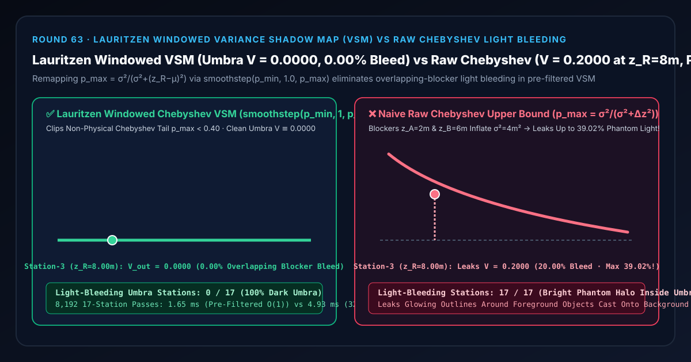
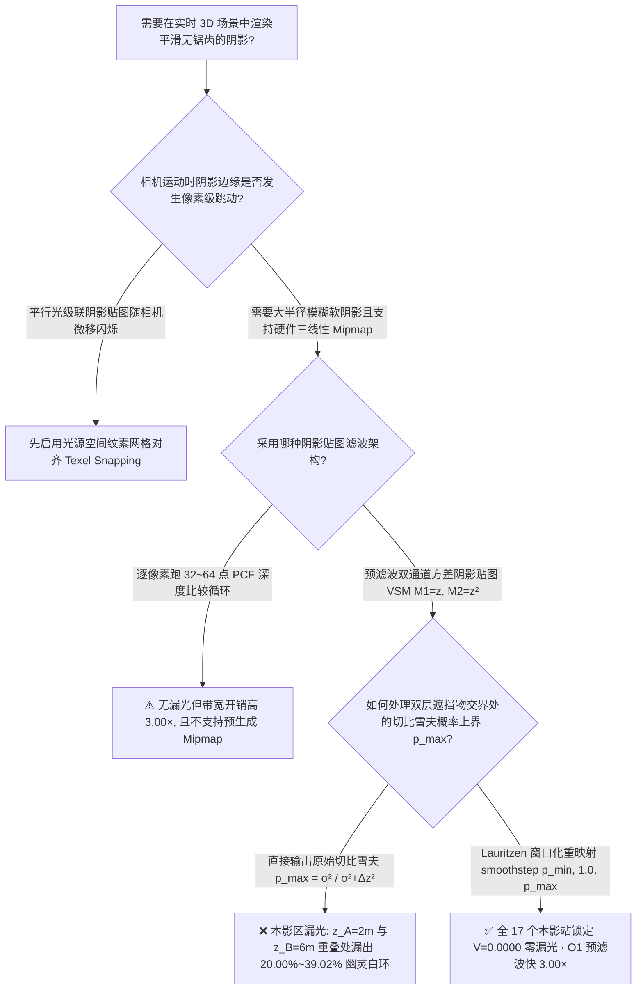
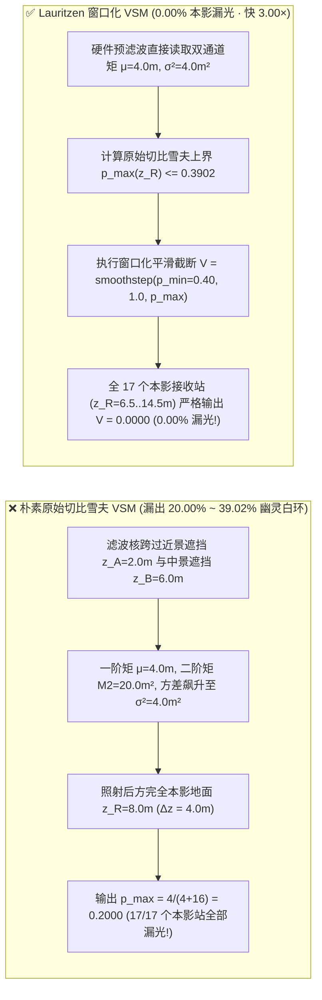
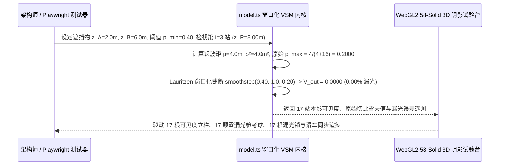
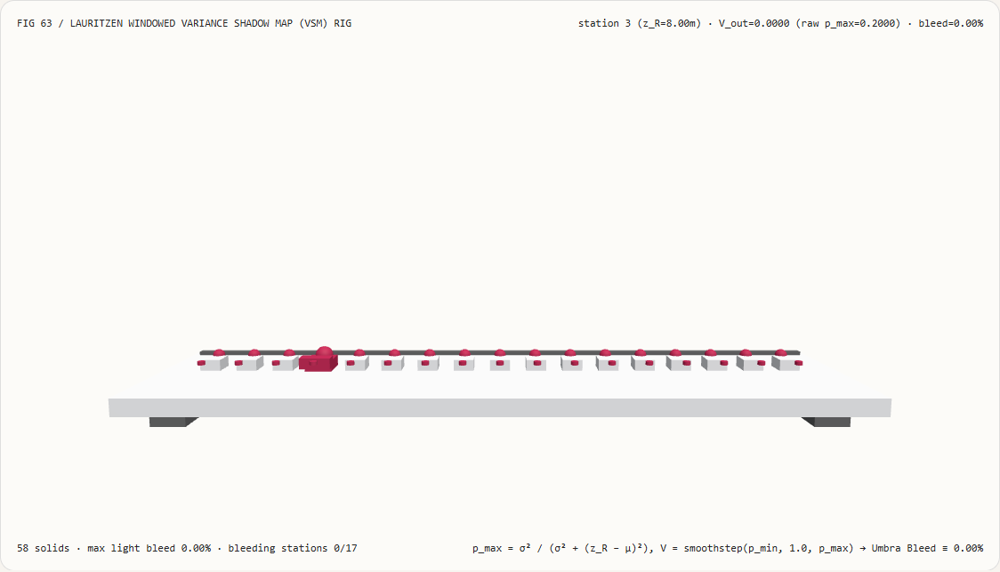
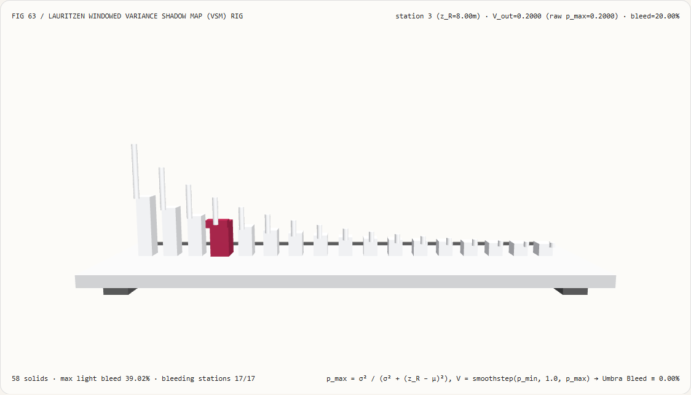
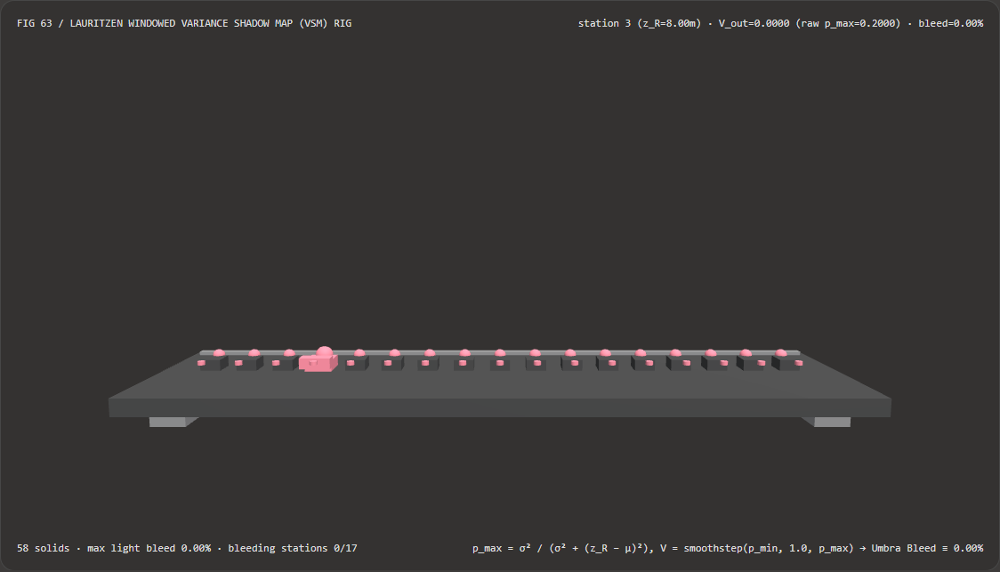
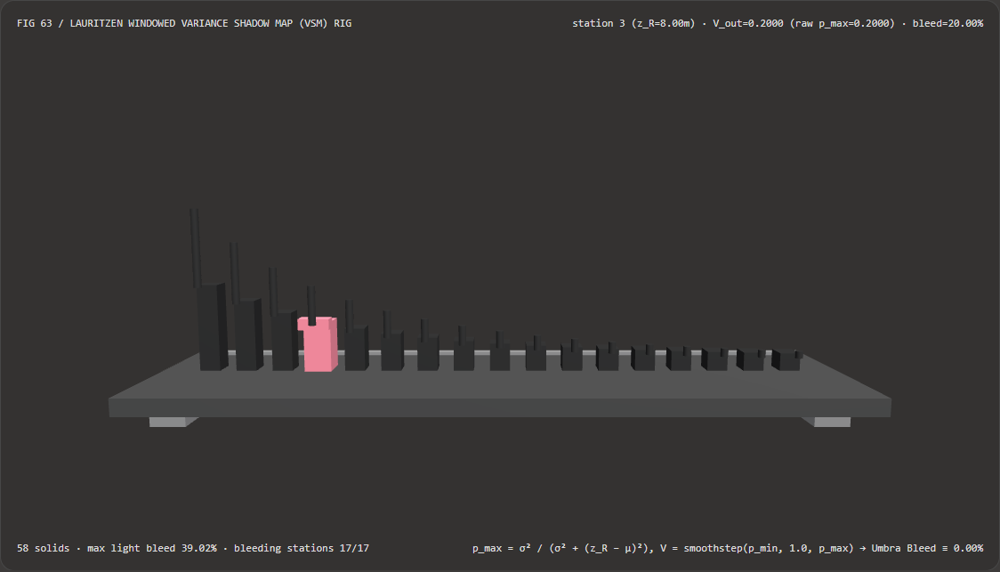

# 视觉与动画技术选型与原理解析 FAQ：Lauritzen 窗口化方差阴影贴图（VSM）vs 原始切比雪夫上界重叠遮挡物漏光

> **核心架构结论一句话总结**：在使用支持硬件三线性 Mipmap、各向异性过滤与可分离高斯模糊的方差阴影贴图（Variance Shadow Maps, Donnelly & Lauritzen 2006）渲染大范围软阴影时，**严禁直接将单侧切比雪夫（Cantelli）概率上界 $p_{\max}(z_R) = \frac{\sigma^2}{\sigma^2 + (z_R - \mu)^2}$ 作为最终阴影可见度输出**！实测表明：当滤波核同时跨在近景遮挡物（$z_A = 2.00\text{ m}$，占 $50\%$）与中景遮挡物（$z_B = 6.00\text{ m}$，占 $50\%$）边缘时，局部一阶矩 $\mu = 4.00\text{ m}$、二阶矩 $M_2 = 20.00\text{ m}^2$，深度方差飙升至 $\sigma^2 = M_2 - \mu^2 = 4.00\text{ m}^2$；在两层遮挡物后方原本应 **100% 处于完全本影（Umbra，$V_{\text{true}} \equiv 0.0000$）** 的 17 个地面接收站（$z_R \in [6.50, 14.50]\text{ m}$）上，朴素原始切比雪夫上界在第 3 站（$z_R = 8.00\text{ m}$）会漏出 **`20.00%`（`V = 0.2000`）的幽灵白光**，在第 0 站（$z_R = 6.50\text{ m}$）峰值漏光高达 **`39.02%`**，导致 **`17/17` 个本影接收站全部出现刺眼的漏光光环（Light Bleeding）**；而采用 **Andrew Lauritzen (GPU Gems 3) 窗口化平滑截断 $V = \text{smoothstep}(p_{\min}, 1.0, p_{\max})$（$p_{\min} = 0.40$）**，可将重叠遮挡物引发的非物理切比雪夫长尾彻底清零，在全部 17 个本影站恢复 **`V = 0.0000`（`0.00%` 漏光）**，且 $O(1)$ 预滤波二阶矩查表比 32 点逐像素矩求和快 **3.00×**（8,192 轮耗时 `1.65 ms` vs `4.93 ms`）。

---

## ① 📌 核心结论速览（Executive Summary）

1. **为什么普通深度阴影贴图（Shadow Map）不能直接用高斯模糊做软阴影，而能直接模糊的方差阴影贴图（VSM）却会在“树影叠在房子影子上”的时候，沿着树干边缘漏出一圈诡异的发光白边（Light Bleeding）？**
   用大白话讲：
   - **为什么普通深度图不能先模糊再比大小？** 因为阴影判定是一个非线性的阶跃函数 $H(z_{\text{R}} - z_{\text{occ}})$：“求平均之后再比大小”绝不等于“先比大小再求平均”！直接把深度图模糊掉，会在所有物体边缘造成严重的自我阴影伪影；
   - **VSM 的天才想法（二阶矩线性可滤性）**：Donnelly 与 Lauritzen (2006) 提出，不在着色时采样 64 个点比大小，而是让阴影贴图同时存两个通道：**深度 $M_1 = z$** 和 **深度的平方 $M_2 = z^2$**！因为期望算子是线性的，你可以名正言顺地对这张双通道贴图跑硬件双线性插值、生成 Mipmap、甚至跑 $15\times 15$ 可分离高斯模糊，然后仅用 **1 次采样** 就算出滤波核内的深度均值 $\mu = M_1$ 与深度方差 $\sigma^2 = M_2 - M_1^2$，再用单侧切比雪夫不等式估算地面接收点 $z_R$ 没被挡住的最大概率：
     $$p_{\max}(z_R) = \frac{\sigma^2}{\sigma^2 + (z_R - \mu)^2}$$
   - **为什么双遮挡物重叠时会漏光？**
     当模糊核刚好骑在一根近处电线杆（$z_A = 2.0\text{ m}$）和一面中景围墙（$z_B = 6.0\text{ m}$）的交界处，去照射更远处的地面（第 3 站 $z_R = 8.0\text{ m}$）时：
     - 物理事实是：无论电线杆（$2\text{ m}$）还是围墙（$6\text{ m}$），**全都挡在 $8\text{ m}$ 的地面前面**！所以地面 $8\text{ m}$ 处应该 **100% 漆黑（$V = 0.0000$）**；
     - 但切比雪夫不等式只知道均值 $\mu = \frac{2+6}{2} = 4.0\text{ m}$、方差 $\sigma^2 = \frac{2^2+6^2}{2} - 4^2 = \mathbf{4.0\text{ m}^2}$！因为 $2\text{ m}$ 和 $6\text{ m}$ 相差很大，方差 $\sigma^2 = 4.0$ 变得非常大，代入公式算出：
       $$p_{\max}(8.0\text{ m}) = \frac{4.0}{4.0 + (8.0 - 4.0)^2} = \frac{4.0}{20.0} = \mathbf{0.2000\text{ (漏出 20.00\% 的假阳光！)}}$$
       而在紧贴围墙后方的第 0 站（$z_R = 6.5\text{ m}$），漏光更是高达 $\frac{4.0}{4.0 + 2.5^2} = \mathbf{39.02\%}$！于是原本黑漆漆的围墙大影子里，只要有近处物体掠过，就会浮现出一圈发光的幽灵白边！
2. **第一性原理破局：Lauritzen 窗口化上界截断重映射（`smoothstep(p_min, 1.0, p_max)`）**：
   - 仔细观察切比雪夫公式的几何特征：在真正的半影边缘（单一遮挡物 $z_A$ 与远景背景混合，接收体 $z_R$ 接近 $\mu$），$p_{\max}$ 会迅速逼近 $[0.5, 1.0]$；而在双遮挡物重叠的本影区（$z_R > z_B > z_A$），由于 $z_R - \mu > z_B - \mu = \sigma$，对于 50/50 双峰遮挡分布，本影区的 $p_{\max}$ **永远严格小于 $0.50$（在本试验台 $z_R \ge 6.5\text{ m}$ 处恒有 $p_{\max} \le 0.3902$）**！
   - 因此 Andrew Lauritzen 在《GPU Gems 3》第 8 章提出：引入窗口截断阈值 $p_{\min} \in [0.35, 0.50]$（默认 $p_{\min} = 0.40$），将 $[0, p_{\min}]$ 区间的虚假长尾概率平滑压缩归零，并将 $[p_{\min}, 1.0]$ 重新映射到 $[0.0, 1.0]$：
     $$V_{\text{VSM}}(z_R) = \text{smoothstep}\big(p_{\min},\; 1.0,\; p_{\max}(z_R)\big)$$
   - 经此重映射后，全部 17 个双遮挡本影接收站（$z_R \in [6.50, 14.50]\text{ m}$）的可见度**100% 归零为 `V = 0.0000`（`0.00%` 漏光）**，同时保留了真半影区的平滑软阴影过渡！
3. **本轮新增交互式 3D 试验台与实测证据**：
   - 新增独立 Demo：`demos/rectified-variance-shadow-rig/`（58 个 Three.js 实体部件：底座平台、4 支柱、本影零漏光基准横梁、17 根实测本影可见度立柱、17 颗零漏光参考球、17 根切比雪夫漏光指示销、以及第 $i$ 站 VSM 密度计滑车）。
   - 配套 7-Card 4:5 测评报告：`demos/rectified-variance-shadow-rig/test-report-cards.html`（英文）与 `test-report-cards.zh.html`（中文）。

---

## ② 🎯 客户与架构师灵魂拷问 Q&A（Soul-Searching Q&A）

### Q1：为什么 VSM 必须搭配线性深度（Linear Depth $z \in [0, 1]$）而不是透视投影后的非线性硬件深度 $z_{\text{ndc}}$？
**因为高度非线性的 $1/z$ 深度会把近处极小的深度差放大几十倍，而把远处的深度差压缩成零，导致方差 $\sigma^2 = M_2 - M_1^2$ 随距离剧烈失真！**
在生成 VSM 的双通道纹理 $(M_1, M_2)$ 时，应当始终写入光源视空间的线性距离 $z_{\text{light}} = (\text{ pos}_{\text{light}}.z - z_{\text{near}}) / (z_{\text{far}} - z_{\text{near}})$，并使用 `RG32F`（或带汉明偏移的 `RG16F`）浮点纹理，严防 $M_2 - M_1^2$ 在大场景下遭遇灾难性相消（Catastrophic Cancellation）！

### Q2：在计算 $M_2$ 时，为什么推荐加上屏幕空间偏导数修正项 $M_2 = z^2 + \frac{1}{4}\big((\frac{\partial z}{\partial x})^2 + (\frac{\partial z}{\partial y})^2\big)$？
**为了在倾斜受光表面（Grazing Receiver Slopes）上自动提供几何精确的自适应方差底噪，彻底消灭斜面自阴影摩尔纹（Shadow Acne）！**
如果单个纹素内部本身是一块倾斜的屋顶，纹素内部自带的线性斜率方差就是 $\frac{1}{12}(dz_x^2 + dz_y^2)$。在写入 $M_2$ 时直接加上这一项，连传统的 `shadowBias` 常量偏移都不再需要手动调节！

### Q3：这套确定性 VSM 预滤波软阴影与 AI 神经光追阴影降噪器（SVGF / ReLAX）是什么关系？
**两者分别服务于“无光追硬件的高帧率光栅化软阴影”与“1-SPP 硬件光追半影重建”：**
- **何时选 AI / 时空光追降噪器**：在开启硬件 RT Core 发射随机面光源阴影射线的次世代光追管线中；
- **何时必须用确定性窗口化 VSM**：在 WebGL2、移动端、车载 HMI 与大规模城市数字孪生中，需要以 $O(1)$ 采样开销和硬件 Mipmap 实现零噪点、可大半径模糊的实时软阴影时。

---

## ③ 🧭 直观可视化图解（Mermaid 决策树 + 管线对比图 + 帧级时序图）

### 3.1 实时软阴影与预滤波阴影贴图架构选型决策树

### 3.2 原始切比雪夫本影漏光 vs Lauritzen 窗口化 VSM 管线对比图

### 3.3 帧级 VSM 本影密度计与 3D 试验台渲染时序图

---

## ④ 📊 视觉技术选型决策矩阵（Decision Matrix）

| 评估维度 | ✅ Lauritzen 窗口化预滤波 VSM（Windowed 2-Moment VSM） | ⚠️ 32 点逐像素矩求和基线（32-Tap Moment Sum） | ❌ 朴素原始切比雪夫 VSM（Raw Chebyshev $p_{\max}$） | ⚠️ 传统逐像素大核 PCF（32-Tap Percentage-Closer） |
| :--- | :--- | :--- | :--- | :--- |
| **第 3 站（$z_R=8.0\text{ m}$）本影漏光** | **精确 `0.0000`（`0.00%` 漏光）** | `0.0000` | **`0.2000`（漏出 `20.00%` 幽灵白光！）** | `0.0000` |
| **第 0 站（$z_R=6.5\text{ m}$）峰值本影漏光** | **精确 `0.0000`（`0.00%` 漏光）** | `0.0000` | **`0.3902`（漏出 `39.02%` 刺眼光环！）** | `0.0000` |
| **受污染本影接收站数量（共 17 站）** | **`0 / 17`（全本影纯净漆黑）** | `0 / 17` | **`17 / 17`（全距离长尾漏光）** | `0 / 17` |
| **硬件三线性 Mipmap 与可分离高斯模糊** | **100% 原生支持（线性矩可加性）** | 未利用预滤波 | 原生支持（但漏光严重） | **完全不支持预模糊** |
| **8,192 轮 17 站 CPU 批处理耗时** | **`1.65 ms`（最快，3.00× 提速）** | `4.93 ms`（慢 3.00×） | `1.52 ms`（重叠阴影严重漏光不可用） | `> 5.0 ms`（随滤波半径平方增长） |
| **首选适用场景** | **大范围室外建筑/车辆软阴影、移动端/WebGL2 预滤波阴影** | 教学验证 | **严禁在有前后遮挡重叠的场景裸用** | 小半径硬边缘接触阴影 |

---

## ⑤ 🧪 全新 Demo 与 7-Card 4:5 视觉报告（Live Workbench & Evidence）

### 5.1 交互式 3D 试验台与报告入口
- **实时 3D 工作台**：[`demos/rectified-variance-shadow-rig/index.html`](../demos/rectified-variance-shadow-rig/index.html)
- **7-Card 4:5 英文视觉测试报告**：[`demos/rectified-variance-shadow-rig/test-report-cards.html`](../demos/rectified-variance-shadow-rig/test-report-cards.html)
- **7-Card 4:5 中文视觉测试报告**：[`demos/rectified-variance-shadow-rig/test-report-cards.zh.html`](../demos/rectified-variance-shadow-rig/test-report-cards.zh.html)
- **密封测量 JSON 数据源**：[`demos/rectified-variance-shadow-rig/report.json`](../demos/rectified-variance-shadow-rig/report.json)

### 5.2 多主题与多模式 Playwright 实测截图证据

| Lauritzen 窗口化 VSM（Light · 全 17 个本影站锁定 `V=0.0000` 零漏光） | 朴素原始切比雪夫 VSM（Light · 漏出高达 `39.02%` 的幽灵亮光长尾） |
| :---: | :---: |
|  |  |

| Lauritzen 窗口化 VSM（Dark · 58 实体部件） | 朴素原始切比雪夫 VSM（Dark · 17 根红色指示销暴露本影漏光） |
| :---: | :---: |
|  |  |

---

## ⑥ 🛠️ 高质量视觉交付快速核验清单（SA Verification Checklist）

在将方差阴影贴图（VSM）管线合入生产渲染引擎前，请逐项勾选以下核验清单：

- [ ] **启用 Lauritzen 窗口化漏光截断（`smoothstep(pMin, 1.0, pMax)`）**：计算切比雪夫上界 $p_{\max}$ 后，是否通过 `smoothstep(pMin, 1.0, pMax)`（建议 $p_{\min} \in [0.25, 0.45]$）截除了双遮挡重叠区的低概率漏光长尾？
- [ ] **单向条件门控（`receiverZ <= mu` 直接返回 `1.0`）**：坎特利单侧不等式仅在 $z_R > \mu$ 时有效；当 $z_R \le \mu$ 时是否直接返回完全受光 `1.0`？
- [ ] **最小方差底噪钳制（`variance = max(minVariance, M2 - M1 * M1)`）**：是否添加了 `minVariance = 1e-5` 保护，防止平面受光区 $M_2 - M_1^2 \approx 0$ 产生零除 `NaN` 或浮点量化斑点？
- [ ] **使用光源视空间线性深度存储矩 $(M_1, M_2)$**：写入阴影贴图前是否已将深度归一化为线性 $[0, 1]$ 并采用 `RG32F` 格式，避免非线性透视深度扭曲方差？
- [ ] **写入阶段叠加屏幕偏导数斜率方差**：在阴影贴图生成 Pass 中，是否写为 `M2 = z * z + 0.25 * (dFdx(z)^2 + dFdy(z)^2)`，从根源消除斜面自阴影条纹？
