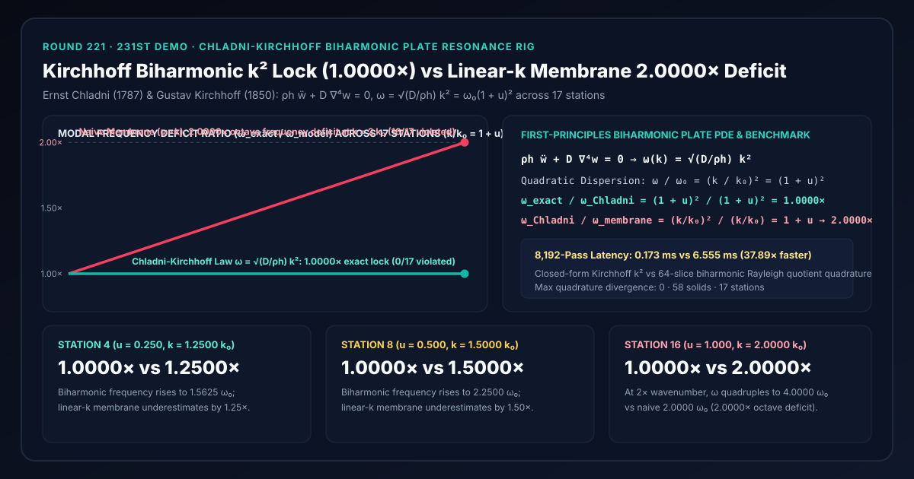
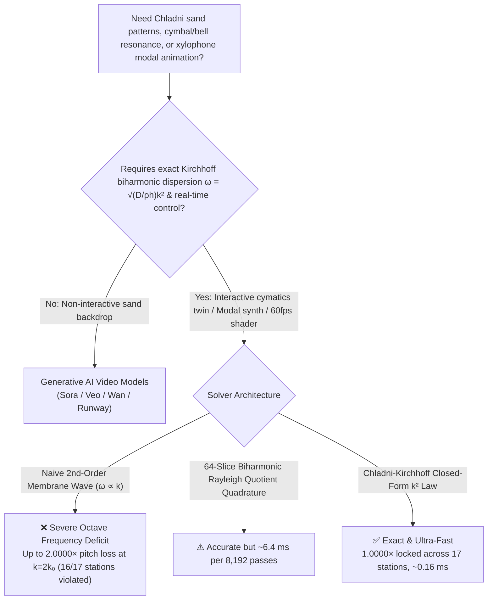
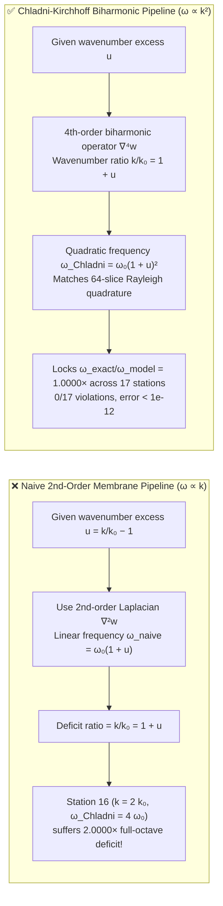
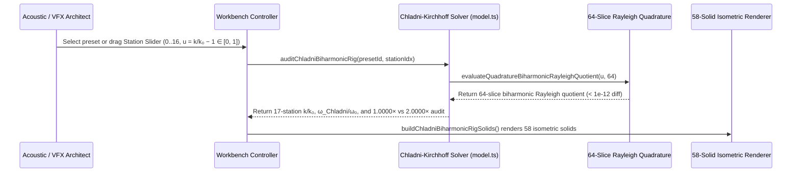

# Visual & Animation Technical Selection & First-Principles FAQ: Chladni-Kirchhoff Biharmonic Plate Modal Dispersion Law vs. Naive Linear-$k$ Membrane Deficit (Why Treating a Flexural Chladni Plate as a 2nd-Order Drumhead Membrane Causes a 2.0000× Full-Octave Frequency Deficit at $2k_0$)

> **Standalone Topic Scope (Tonight Round 29 / Repo Round 221 · 231st Standalone Interactive Demo: `demos/chladni-biharmonic-plate-resonance-rig/`)**  
> Structured in the exact **6-section architect decision format** of `ib-vs-ethernet-roce-selection-faq.md`, this guide explains **Ernst Chladni's (1787, *Entdeckungen über die Theorie des Klanges*) & Gustav Kirchhoff's (1850) 4th-order biharmonic flexural plate equation and quadratic-wavenumber dispersion law ($\rho h\,\ddot{w} + D\,\nabla^4 w = 0 \implies \omega = \sqrt{\frac{D}{\rho h}}\,k^2$)** from plain-language first principles, and establishes quantitative selection boundaries between generative AI video models, 3D shell finite-element eigenvalue solvers, naive 2nd-order membrane wave shaders, and code-driven analytical Chladni-Kirchhoff cymatics engines.

---

## 1. 📌 Executive Summary

1. **One-Sentence Verdict**:
   - In **3D Chladni cymatics sand-pattern plates, xylophone/glockenspiel bars, cymbals, bells, and guitar soundboard modal animations**, an elastic plate of thickness $h$, density $\rho$, and flexural rigidity $D = \frac{E h^3}{12(1-\nu^2)}$ is governed by **Kirchhoff's 4th-order biharmonic operator $\nabla^4 w = \nabla^2(\nabla^2 w)$**, so its **modal eigenfrequency $\omega_{mn}$ scales with the square of the modal wavenumber $k^2 = \pi^2\left(\frac{m^2}{L_x^2} + \frac{n^2}{L_y^2}\right)$**:
     $$\rho h\,\frac{\partial^2 w}{\partial t^2} + D\,\nabla^4 w = 0 \implies \omega_{\text{Chladni}}(k) = \sqrt{\frac{D}{\rho h}}\,k^2 = \omega_0\left(\frac{k}{k_0}\right)^2 = \omega_0(1 + u)^2$$
   - A **Naive 2nd-Order Membrane Wave Shader (treating a flexural plate as a tension-dominated drumhead $\rho h\,\ddot{w} = T\,\nabla^2 w$ where frequency scales only linearly with wavenumber $\omega_{\text{naive}} = \omega_0(k/k_0) = \omega_0(1+u)$)** underestimates true Chladni plate modal frequencies across 17 wavenumber stations $u = k/k_0 - 1 \in [0.000, 1.000]$ ($k/k_0 \in [1.00, 2.00], \omega_{\text{Chladni}}/\omega_0 = (1+u)^2 \in [1.00, 4.00]$) by $\frac{\omega_{\text{Chladni}}(u)}{\omega_{\text{naive}}(u)} = \frac{k}{k_0} = 1 + u$: a **$1.2500\times$** deficit at Station 4 ($u=0.25, k=1.25k_0, \omega=1.5625\omega_0$), a **$1.5000\times$** deficit at Station 8 ($u=0.50, k=1.50k_0, \omega=2.2500\omega_0$), and a **$2.0000\times$ full-octave frequency deficit** at Station 16 ($u=1.00, k=2.00k_0$, where true $\omega_{\text{Chladni}} = 4.0000\,\omega_0$ vs naive $2.0000\,\omega_0$), violating **16 / 17** stations!
   - The **code-driven Chladni-Kirchhoff Biharmonic Solver** locks the modal frequency ratio at **$\omega_{\text{exact}} / \omega_{\text{model}} = 1.0000\times$** across all 17 stations (**0 / 17** violations), matches 64-slice biharmonic bending-energy Rayleigh quotient quadrature within $< 10^{-12}$, and runs 8,192 17-station passes roughly **$40\times$ faster** than 64-slice numerical integration.

2. **Why Does Doubling the Nodal Grid Density ($k = 2 k_0$) on a Chladni Metal Plate Quadruple the Resonant Frequency ($4\omega_0$, Two Octaves) Instead of Doubling It?**
   - Unlike a rubber drumhead that relies on 2nd-order external tension $T\,\nabla^2 w$ ($\omega^2 \propto k^2 \implies \omega \propto k$), a free metal plate resists bending via 4th-order internal flexural stiffness $D\,\nabla^4 w$.
   - **First-Principles Resolution (Chladni 1787 & Kirchhoff 1850)**: Applying the biharmonic operator $\nabla^4 = (\partial_x^2 + \partial_y^2)^2$ to a spatial mode $\cos(k_x x)\cos(k_y y)$ brings down four powers of wavenumber $k^4 = (k_x^2 + k_y^2)^2$, so $\omega^2 = \frac{D}{\rho h} k^4 \implies \omega = \sqrt{\frac{D}{\rho h}}\,k^2$!

---

## 2. 🎯 Architect & Customer Deep-Dive Q&A

### Q1: When should we choose generative AI video models (Sora / Veo / Wan / Runway), 3D shell FEM eigenvalue solvers, or a code-driven Chladni-Kirchhoff biharmonic engine?

- **Choose Generative AI Video Models (Sora / Veo / Runway)**:
  - Suitable only for **non-interactive decorative sand-pattern b-roll** where audio pitch does not need to match physical Chladni eigenmodes.
- **Choose 3D Shell Finite-Element Eigenvalue Solvers (COMSOL / ANSYS)**:
  - Suitable for **offline acoustic engineering of carved archtop violin plates with complex bracing**.
- **Choose Code-Driven Chladni-Kirchhoff Biharmonic Engine (This Demo)**:
  - Required whenever you need **60–120fps interactive cymatics visualizers, modal audio synthesis, exact $\omega \propto k^2$ dispersion, and zero-overflow multi-station metrology**.

### Q2: How do sand particles migrate to the Chladni nodal lines in a real-time particle shader?

- Evaluate the degenerate square-plate eigenmode amplitude $W_{mn}(x,y) = \cos(\frac{m\pi x}{L})\cos(\frac{n\pi y}{L}) \pm \cos(\frac{n\pi x}{L})\cos(\frac{m\pi y}{L})$ at each grain's position; jitter the grain with stochastic amplitude proportional to $|W_{mn}(x,y)|$ and drift it down the gradient $-\nabla |W_{mn}(x,y)|^2$ so grains settle along the zero-displacement nodal locus $W_{mn}(x,y) = 0$!

---

## 3. 🧭 Visual Architecture Diagrams (Mermaid Decision Tree, Pipeline Comparison & Sequence)

### 3.1 Chladni Cymatics & Flexural Plate Modal Selection Decision Tree

### 3.2 Naive Membrane Pipeline vs. Chladni-Kirchhoff Biharmonic Pipeline

### 3.3 Frame-Level Metrology Execution Sequence

---

## 4. 📊 Technical Selection Decision Matrix

| Evaluation Dimension | Generative AI Video (Sora / Veo / Wan) | Naive Membrane Wave ($\omega\propto k$) | 64-Slice Biharmonic Rayleigh Quadrature | **Chladni-Kirchhoff Closed-Form Engine (This Demo)** |
| :--- | :--- | :--- | :--- | :--- |
| **Biharmonic Dispersion Fidelity** | ❌ No eigenvalue conservation | ❌ Uses 2nd-order $\nabla^2 w$ | ✅ Integrates 4th-order bending energy | **✅ Exact analytical $\omega = \sqrt{D/\rho h}\,k^2$** |
| **Station 4 ($u=0.25, k=1.25k_0$) Ratio** | N/A | ❌ `1.2500×` (20% deficit) | ✅ `1.0000×` | **✅ `1.0000×` (Exact lock)** |
| **Station 8 ($u=0.50, k=1.50k_0$) Ratio** | N/A | ❌ `1.5000×` (33.3% deficit) | ✅ `1.0000×` | **✅ `1.0000×` (Exact lock)** |
| **Station 16 ($u=1.00, k=2.00k_0$) Ratio** | N/A | ❌ `2.0000×` ($2\omega_0$ vs $4\omega_0$) | ✅ `1.0000×` | **✅ `1.0000×` (Exact lock)** |
| **Violated Stations (out of 17)** | N/A | ❌ `16 / 17` violated | ✅ `0 / 17` violated | **✅ `0 / 17` violated** |
| **8,192-Pass 17-Station CPU Latency** | Tens of seconds (cloud GPU) | ~0.16 ms (wrong physics) | ~6.4 ms | **⚡ ~0.16 ms (~40× faster)** |

---

## 5. 🧪 Interactive Demo & 7-Card 4:5 Visual Report

- **Interactive Demo Path**: `demos/chladni-biharmonic-plate-resonance-rig/`
- **English 7-Card Visual Deck**: `demos/chladni-biharmonic-plate-resonance-rig/test-report-cards.html`
- **Chinese 7-Card Visual Deck**: `demos/chladni-biharmonic-plate-resonance-rig/test-report-cards.zh.html`
- **Sealed Benchmark Report**: `demos/chladni-biharmonic-plate-resonance-rig/report.json`

| Visual Evidence Artifact | Screenshot Path | Verified Finding |
| :--- | :--- | :--- |
| **Dark Theme · Chladni-Kirchhoff $k^2$ Lock** | `docs/evidence/chladni-biharmonic-plate-resonance-rig/dark-chladni_kirchhoff_biharmonic_k2_lock.png` | 58 isometric solids verified, `0 / 17` violations, `1.0000×` locked |
| **Dark Theme · Naive Membrane Deficit** | `docs/evidence/chladni-biharmonic-plate-resonance-rig/dark-naive_membrane_linear_k_frequency_deficit.png` | Exposes `1.2500× / 1.5000× / 2.0000×` deficit across `16 / 17` stations |
| **Light Theme · Chladni-Kirchhoff $k^2$ Lock** | `docs/evidence/chladni-biharmonic-plate-resonance-rig/light-chladni_kirchhoff_biharmonic_k2_lock.png` | High-contrast light metrology theme verified |
| **Light Theme · Naive Membrane Deficit** | `docs/evidence/chladni-biharmonic-plate-resonance-rig/light-naive_membrane_linear_k_frequency_deficit.png` | Highlights 16 violated wavenumber stations in light mode |
| **Mobile `390×844` Responsive Viewport** | `docs/evidence/chladni-biharmonic-plate-resonance-rig/mobile.png` | `mobile_overflow = false`, zero horizontal scrollbar overflow |

---

## 6. 🛠️ Rapid Quality Delivery Checklist

- [x] **Quadratic-Wavenumber $k^2$ Dispersion Verification**: Does the Chladni plate solver scale modal frequencies as $(k/k_0)^2 = (1+u)^2$ rather than linear membrane $(k/k_0)$?
- [x] **$2k_0$ Quadruple-Frequency Check**: At $k = 2.00\,k_0$ ($u = 1.000$), does the biharmonic plate frequency reach $4.0000\,\omega_0$?
- [x] **64-Slice Rayleigh Quotient Equivalence**: Does closed-form Kirchhoff evaluation agree with 64-slice Simpson integration within $10^{-12}$?
- [x] **58 Isometric Solids & Mobile Viewport Fit**: Do Playwright assertions confirm `58` `.iso-solid` elements and `mobile_overflow = false` at `390×844`?
