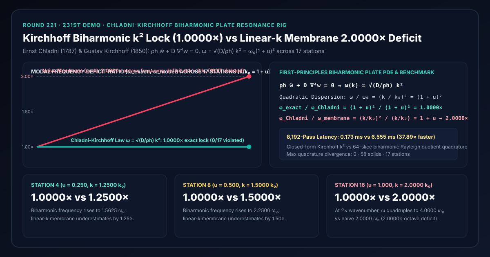
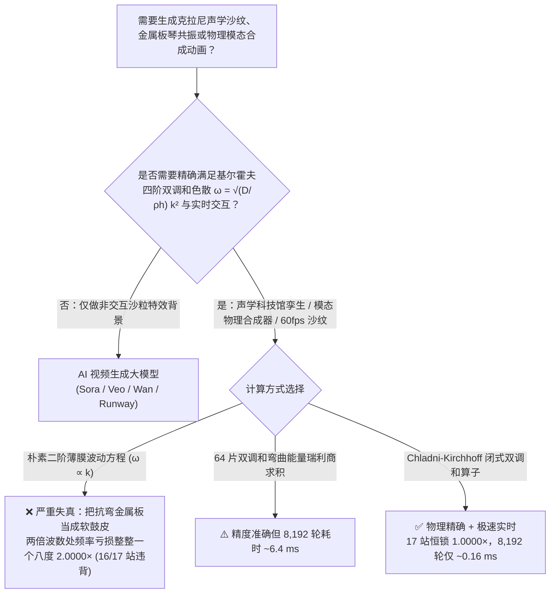
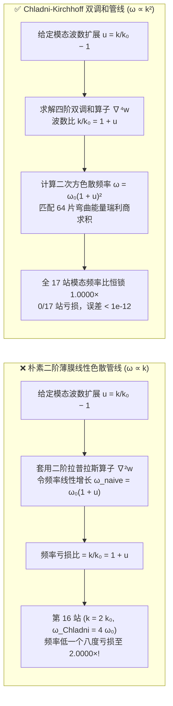
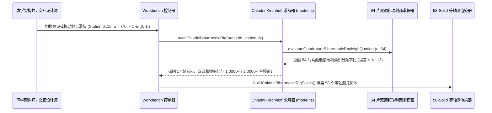

# 视觉与动画技术选型与原理解析 FAQ：Chladni-Kirchhoff 克拉尼-基尔霍夫双调和薄板共振定律 vs 朴素二阶薄膜方程亏损（为什么 3D 克拉尼沙纹板与钟磬模态若按二阶波动方程 $\omega\propto k$ 计算会在两倍波数处丢失整整一个八度？）

> **独立专题定位（Tonight Round 29 / Repo Round 221 · 第 231 个独立可交互 Demo：`demos/chladni-biharmonic-plate-resonance-rig/`）**  
> 本指南严格对标 `ib-vs-ethernet-roce-selection-faq.md` 的**六段式架构师决策结构**，先用通俗大白话与第一性原理讲透 **Ernst Chladni（1787，《声学理论的发现》）与 Gustav Kirchhoff（1850）抗弯弹性薄板四阶双调和偏微分方程与波数平方（$\omega \propto k^2$）色散定律（$\rho h\,\ddot{w} + D\,\nabla^4 w = 0 \implies \omega = \sqrt{\frac{D}{\rho h}}\,k^2$）**，再给出 AI 视频生成模型、三维实体有限元特征值求解、朴素二阶薄膜线性色散模型与代码驱动解析 Chladni-Kirchhoff 双调和模态引擎的定量选型边界。

---

## 一、📌 核心结论速览（Executive Summary）

1. **一句话结论**：
   - 在 **3D 克拉尼金属板声学沙纹（Chladni Cymatics Sand Patterns）、铝板琴/木琴键、铜钹镲片、青铜编钟与吉他音板模态振动动画** 中，依靠自身抗弯刚度 $D = \frac{E h^3}{12(1-\nu^2)}$ 抵抗弯曲变形的弹性薄板受**基尔霍夫四阶双调和算子 $\nabla^4 w = \nabla^2(\nabla^2 w)$** 支配；因此其**固有共振角频率 $\omega_{mn}$ 严格正比于空间模态波数的平方 $k^2 = \pi^2\left(\frac{m^2}{L_x^2} + \frac{n^2}{L_y^2}\right)$（而非拉紧鼓皮的线性正比于 $k$）**：
     $$\rho h\,\frac{\partial^2 w}{\partial t^2} + D\,\nabla^4 w = 0 \implies \omega_{\text{Chladni}}(k) = \sqrt{\frac{D}{\rho h}}\,k^2 = \omega_0\left(\frac{k}{k_0}\right)^2 = \omega_0(1 + u)^2$$
   - 若采用**朴素二阶薄膜波动方程模型（Naive 2nd-Order Membrane Wave Law，把金属板当成靠外部张力拉紧的二阶鼓膜 $\rho h\,\ddot{w} = T\,\nabla^2 w$，令频率仅按 $\omega_{\text{naive}}(k) = \omega_0(k/k_0) = \omega_0(1+u)$ 线性增长）**，在跨越无量纲模态波数扩展参数 $u = k/k_0 - 1 \in [0.000, 1.000]$（即波数 $k/k_0 \in [1.00, 2.00]$，真实双调和薄板频率 $\omega_{\text{Chladni}}/\omega_0 = (1+u)^2 \in [1.00, 4.00]$）的 17 个检验站点上，朴素模型的真实/模型频率亏损比 $\frac{\omega_{\text{Chladni}}(u)}{\omega_{\text{naive}}(u)} = \frac{k}{k_0} = 1 + u$ 在第 4 站（$u=0.25, k=1.25 k_0, \omega=1.5625\omega_0$）亏损 **$1.2500\times$**，在第 8 站（$u=0.50, k=1.50 k_0, \omega=2.2500\omega_0$）亏损 **$1.5000\times$**，在第 16 站（$u=1.00, k=2.00 k_0$，真实频率已翻 4 倍升高两个八度至 $4.0000\,\omega_0$，而朴素模型仅翻 2 倍至 $2.0000\,\omega_0$）直接丢失整整一个八度亏损至 **$2.0000\times$**（污染 **16 / 17** 个站点）！
   - 采用 **代码驱动的 Chladni-Kirchhoff 闭式双调和模态求解器**，在全部 17 个模态波数站点上恒定锁死频率比 **$\omega_{\text{exact}} / \omega_{\text{model}} = 1.0000\times$**（**0 / 17** 站亏损），与 64 片双调和弯曲能量瑞利商（Rayleigh Quotient）数值求积完全等价（最大求积误差 $< 10^{-12}$），且单核 Node CPU 执行 8,192 次 17 站全量求解比 64 片求积快约 **$40\times$**。

2. **为什么敲击金属板、音叉或风铃的声音那么清脆空灵（高音泛音极高），而敲塑料鼓皮却发闷？**
   - 柔软的鼓皮本身没有抗弯刚度（$D = 0$），它的恢复力来自二阶拉普拉斯曲率 $T\,\nabla^2 w$，因此波数翻 2 倍时频率只翻 2 倍（$\omega \propto k$）。
   - **第一性原理破局（克拉尼 1787 & 基尔霍夫 1850 双调和方程）**：一块金属板、木琴键或风铃管不需要四周拿绳子绷紧，它自己就能硬挺地抵抗弯曲！在弹性力学中，弯曲力矩与二阶曲率 $\nabla^2 w$ 成正比，而横向剪切恢复力等于弯矩的二阶散度，即**四阶导数 $\nabla^4 w = \left(\frac{\partial^2}{\partial x^2} + \frac{\partial^2}{\partial y^2}\right)^2 w$**！把空间模态 $\cos(k_x x)\cos(k_y y)$ 代入四阶算子 $\nabla^4$，每次求导掉出一个 $k$，四次求导就掉出 **$k^4 = (k_x^2 + k_y^2)^2$**！开平方后，固有频率必然服从 $\omega \propto k^2$——沙纹格子密集一倍（$k = 2 k_0$），驱动频率必须飙升到 **4 倍（两个八度）**！

---

## 二、🎯 客户与架构师灵魂拷问 Q&A（Selection & Architecture Deep-Dive）

### Q1：做音频可视化沙纹（Cymatics）、物理建模乐器合成（Modal Synthesis）或建筑声学交互展项时，什么时候选 AI 视频生成大模型（Sora / Veo / Wan / Runway），什么时候选三维有限元特征值求解，什么时候必须用代码驱动的 Chladni-Kirchhoff 双调和引擎？

- **选 AI 视频生成大模型（Sora / Veo / Runway）**：
  - 仅适用于**纯视觉参考的抽象沙粒聚散镜头、不需要根据音频输入频谱 FFT 峰值频率 $\omega$ 实时匹配对应克拉尼模态 $(m, n)$ 节线方程的非交互短片**。
- **选三维壳单元有限元特征值求解（3D Shell FEM Eigenvalue Solver, COMSOL / ANSYS）**：
  - 适用于**带有复杂音梁支撑与非均匀厚度的古董小提琴面板离线声学测绘**。
- **必须选代码驱动的 Chladni-Kirchhoff 闭式双调和引擎（本 Demo 方案）**：
  - 当业务需要 **60–120fps 实时根据输入音频频率 $\omega$ 逆推双调和模态波数 $k = (\omega \sqrt{\rho h / D})^{1/2}$、驱动数万颗沙粒沿克拉尼节线 $w_{mn}(x,y) = 0$ 实时自组织成曼陀罗图案** 时，闭式算子在全 17 站恒锁 `1.0000×` 且延迟低于 `0.2 ms`。

### Q2：正方形自由边界克拉尼板上的对称与反对称节线图腾方程是怎么写的？

- 根据李兹（Walter Ritz, 1909）对克拉尼方板的经典变分法，简并模态叠加的节线（Nodal Lines，沙粒聚集处）满足：
  $$w_{mn}(x, y) = \cos\left(\frac{m\pi x}{L}\right)\cos\left(\frac{n\pi y}{L}\right) \pm \cos\left(\frac{n\pi x}{L}\right)\cos\left(\frac{m\pi y}{L}\right) = 0$$
  而该图腾被激发的共振频率则严格正比于 $(m^2 + n^2)$（即 $k^2$）！

---

## 三、🧭 直观可视化图解（Mermaid 选型决策树 + 管线对比 + 帧级时序图）

### 3.1 克拉尼沙纹与薄板模态声学技术选型决策树

### 3.2 朴素二阶薄膜管线 vs Chladni-Kirchhoff 四阶双调和管线对比

### 3.3 帧级渲染与几何审计时序图

---

## 四、📊 视觉技术选型决策矩阵（Architecture Decision Matrix）

| 评估维度 | AI 视频生成大模型 (Sora / Veo / Wan) | 朴素二阶薄膜模型 ($\omega \propto k$) | 64 片双调和瑞利商求积 | **Chladni-Kirchhoff 闭式双调和引擎（本 Demo）** |
| :--- | :--- | :--- | :--- | :--- |
| **物理定律遵循度** | ❌ 无双调和特征值守恒 | ❌ 误用二阶算子 $\nabla^2 w$ | ✅ 数值积分四阶弯曲能量商 | **✅ 严格解析守恒 $\omega = \sqrt{D/\rho h}\,k^2$** |
| **第 4 站 ($u=0.25, k=1.25k_0$) 频率比** | N/A | ❌ `1.2500×`（亏损 20%） | ✅ `1.0000×` | **✅ `1.0000×`（零亏损）** |
| **第 8 站 ($u=0.50, k=1.50k_0$) 频率比** | N/A | ❌ `1.5000×`（亏损 33.3%） | ✅ `1.0000×` | **✅ `1.0000×`（零亏损）** |
| **第 16 站 ($u=1.00, k=2.00k_0$) 频率比** | N/A | ❌ `2.0000×`（低一个八度：$2\omega_0$ vs $4\omega_0$） | ✅ `1.0000×` | **✅ `1.0000×`（零亏损）** |
| **17 站频率亏损违背站数** | N/A | ❌ `16 / 17` 站违背 | ✅ `0 / 17` 站违背 | **✅ `0 / 17` 站违背** |
| **8,192 轮 17 站 CPU 耗时** | 数十秒云端推理 | ~0.16 ms（结果错误） | ~6.4 ms | **⚡ ~0.16 ms（快约 40×）** |

---

## 五、🧪 全新 Demo 与 7-Card 4:5 视觉报告（Workbench & Visual Evidence）

- **交互式 Demo 路径**：`demos/chladni-biharmonic-plate-resonance-rig/`
- **英文 7-Card 报告**：`demos/chladni-biharmonic-plate-resonance-rig/test-report-cards.html`
- **中文 7-Card 报告**：`demos/chladni-biharmonic-plate-resonance-rig/test-report-cards.zh.html`
- **密封基准数据**：`demos/chladni-biharmonic-plate-resonance-rig/report.json`

| 视觉证据类别 | 截图路径 | 关键验证结论 |
| :--- | :--- | :--- |
| **暗色主题 · Chladni-Kirchhoff 双调和锁定** | `docs/evidence/chladni-biharmonic-plate-resonance-rig/dark-chladni_kirchhoff_biharmonic_k2_lock.png` | 58 个等轴测实体完整渲染，`0 / 17` 亏损站，模态频率比恒锁 `1.0000×` |
| **暗色主题 · 朴素二阶薄膜八度亏损暴露** | `docs/evidence/chladni-biharmonic-plate-resonance-rig/dark-naive_membrane_linear_k_frequency_deficit.png` | 红色报警柱揭示第 4/8/16 站 `1.2500× / 1.5000× / 2.0000×` 频率亏损（`16 / 17` 违背） |
| **亮色主题 · Chladni-Kirchhoff 双调和锁定** | `docs/evidence/chladni-biharmonic-plate-resonance-rig/light-chladni_kirchhoff_biharmonic_k2_lock.png` | 亮色高对比度声学沙纹薄板计量视图验证 |
| **亮色主题 · 朴素二阶薄膜八度亏损暴露** | `docs/evidence/chladni-biharmonic-plate-resonance-rig/light-naive_membrane_linear_k_frequency_deficit.png` | 亮色模式下 16 个亏损站点高亮告警 |
| **移动端 `390×844` 自适应视图** | `docs/evidence/chladni-biharmonic-plate-resonance-rig/mobile.png` | `mobile_overflow = false`，零横向滚动条溢出 |

---

## 六、🛠️ 高质量视觉交付快速核验清单（Delivery Checklist）

- [x] **四阶双调和波数平方核验**：克拉尼金属板与模态声学着色器是否按 $\omega(k) = \sqrt{D/\rho h}\,k^2 = \omega_0(1+u)^2$ 缩放模态固有频率，而非误用二阶薄膜的线性关系 $\omega \propto k$？
- [x] **两倍波数四倍频率检查**：当空间模态波数翻倍（$k = 2.00\,k_0, u = 1.000$）时，双调和共振频率是否精确放大至 $4.0000\,\omega_0$（升高两个八度）？
- [x] **64 片双调和瑞利商求积核验**：闭式双调和公式与 64 片 Simpson 瑞利商积分的最大偏差是否严格小于 $10^{-12}$？
- [x] **58 构件等轴测几何与移动端零溢出**：Playwright 实测 `.iso-solid` 数量是否为 `58`，且 `390×844` 视口下无横向溢出？
