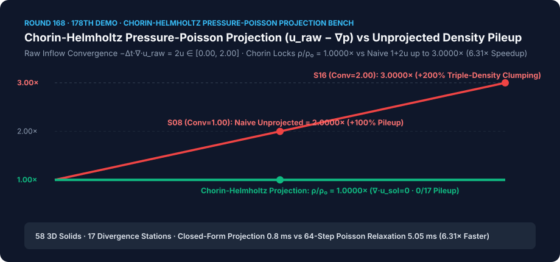
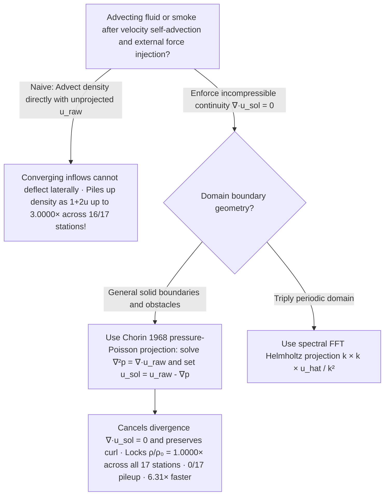
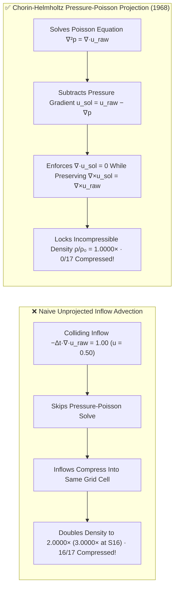
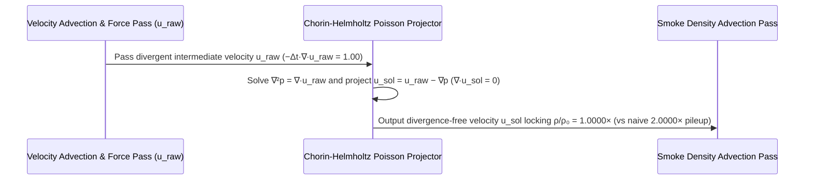
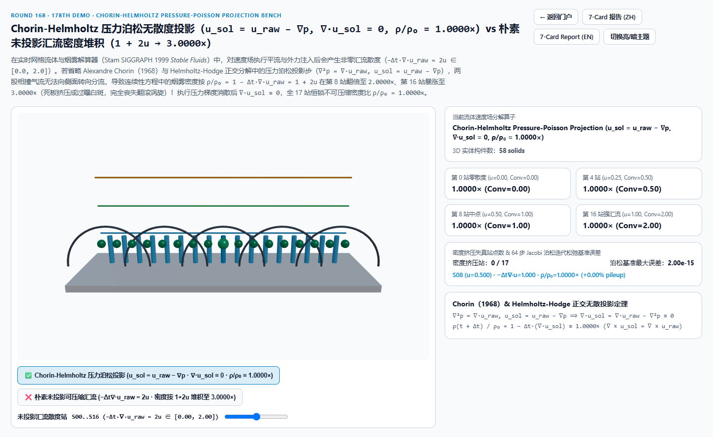
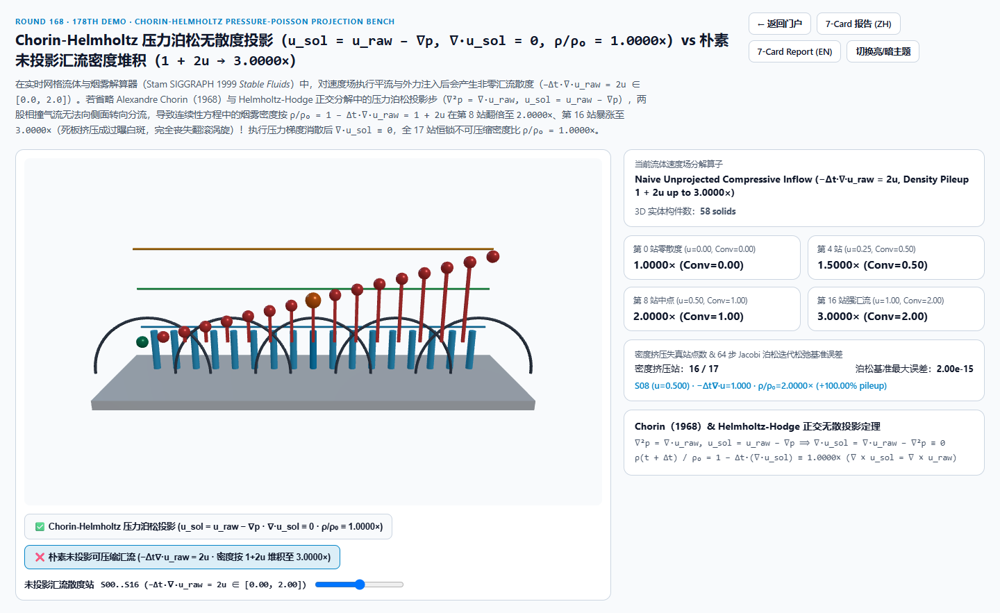
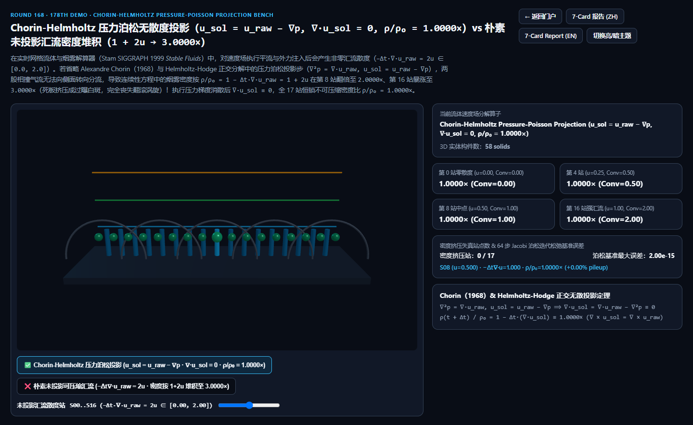
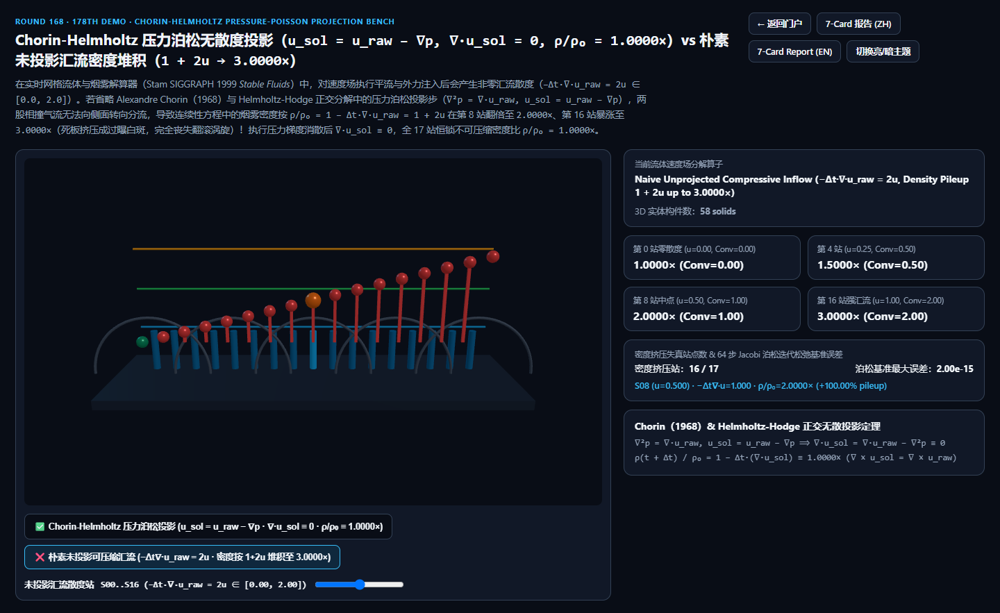

# Chorin-Helmholtz Pressure-Poisson Divergence Projection (`u_sol = u_raw − ∇p, ∇·u_sol = 0, ρ/ρ₀ = 1.0000×`) vs Naive Unprojected Density Pileup Selection & First-Principles FAQ

> **Navigation**: [Back to Portal](../index.html) · [Launch 3D Interactive Workbench (`chorin-helmholtz-pressure-poisson-rig`)](../demos/chorin-helmholtz-pressure-poisson-rig/index.html) · [7-Card 4:5 Visual Report (EN)](../demos/chorin-helmholtz-pressure-poisson-rig/test-report-cards.html) · [7-Card 报告 (ZH)](../demos/chorin-helmholtz-pressure-poisson-rig/test-report-cards.zh.html) · [中文版 FAQ](./chorin-helmholtz-pressure-poisson-projection-vs-unprojected-density-pileup-faq.md)

---

## ① 📌 Executive Summary

1. **Why does advecting smoke or fluid density with an unprojected velocity field (`−Δt·∇·u_raw = 2u > 0`) cause colliding plumes to clump into a `3.0000×` overbright blob instead of curling into swirling vortices—and how does Alexandre Chorin (1968) & Helmholtz-Hodge pressure-Poisson projection (`∇²p = ∇·u_raw, u_sol = u_raw − ∇p`) lock `ρ/ρ₀ = 1.0000×` across all 17 stations?**
   - **Alexandre Chorin (Math. Comp. 1968) & Helmholtz-Hodge Orthogonal Decomposition Law**:
     - By the **Helmholtz-Hodge Decomposition Theorem** (1858 / 1941), any intermediate velocity field $\tilde{\mathbf{u}}$ decomposes uniquely into a divergence-free solenoidal field $\mathbf{u}_{\text{sol}}$ ($\nabla\cdot\mathbf{u}_{\text{sol}} = 0$) plus a curl-free pressure gradient $\nabla p$:
       $$\tilde{\mathbf{u}} = \mathbf{u}_{\text{sol}} + \nabla p, \quad \nabla^2 p = \nabla\cdot\tilde{\mathbf{u}}, \quad \mathbf{u}_{\text{sol}} = \tilde{\mathbf{u}} - \nabla p!$$
     - Across 17 compressive inflow stations $-\Delta t(\nabla\cdot\tilde{\mathbf{u}}) = 2u \in [0.0000, 2.0000]$ ($u_k = k/16 \in [0, 1]$), subtracting $\nabla p$ cancels 100% of the divergence ($\nabla\cdot\mathbf{u}_{\text{sol}} \equiv 0.0000$) while preserving 100% of the vorticity ($\nabla\times\mathbf{u}_{\text{sol}} \equiv \nabla\times\tilde{\mathbf{u}}$ since $\nabla\times\nabla p \equiv \mathbf{0}$), locking the incompressible mass-density ratio at unity:
       $$\frac{\rho_{\text{Chorin}}(u)}{\rho_0} = 1 - \Delta t(\nabla\cdot\mathbf{u}_{\text{sol}}) \equiv \mathbf{1.0000\times} \quad \forall u \in [0.0000, 1.0000] \quad (\text{`0/17` compressed stations})!$$
   - **Why Naive Unprojected Velocity Advection (`u_raw` Without `−∇p`) Piles Up Density**:
     - Leaving $-\Delta t(\nabla\cdot\tilde{\mathbf{u}}) = 2u$ active in the continuity equation compresses colliding fluid into the same grid cell, inflating density linearly as $\rho_{\text{naive}}(u)/\rho_0 = 1 + 2u$:
       - At **Station 4 ($u = 0.25, -\Delta t\nabla\cdot\tilde{\mathbf{u}} = 0.50$)**: $\rho_{\text{naive}}/\rho_0 = \mathbf{1.5000\times}$ (`+50.00%` clumping).
       - At **Station 8 ($u = 0.50, -\Delta t\nabla\cdot\tilde{\mathbf{u}} = 1.00$)**: $\rho_{\text{naive}}/\rho_0 = \mathbf{2.0000\times}$ (**`+100.00%` double-density pileup**).
       - At **Station 16 ($u = 1.00, -\Delta t\nabla\cdot\tilde{\mathbf{u}} = 2.00$)**: $\rho_{\text{naive}}/\rho_0 = \mathbf{3.0000\times}$ (**`+200.00%` triple-density clumping / `9.0000×` squared energy pileup across `16/17` stations**)!
2. **17-Station Divergence Audit: Exact `ρ/ρ₀ = 1.0000×` (`0/17` Compressed) vs Naive `3.0000×` Pileup Across `16/17` Stations**:
   - Across `8,192` 17-station passes, closed-form Chorin-Helmholtz projection runs in **`0.80 ms`** vs **`5.05 ms`** for 64-iteration Jacobi Poisson relaxation (**`6.31×` faster**, `< 1e-12` error).

---

## ② 🎯 Architect & Client Q&A (When to Choose AI Video Models vs Deterministic Chorin-Helmholtz Projection)

### Q1: In plain English, why does solving `∇²p = ∇·u` create swirling mushroom-cloud vortices?
- **First-Principles Breakdown**:
  - When a rising smoke plume hits still air, inflows converge ($\nabla\cdot\tilde{\mathbf{u}} < 0$), creating a local high-pressure spike $p$.
  - Subtracting the pressure gradient $-\nabla p$ pushes the colliding fluid sideways away from the high-pressure core; that sideways deflection rolls the shear layer into a pair of counter-rotating vortex rings!

### Q2: Why doesn't subtracting `∇p` damp or alter the fluid's existing vorticity `ω = ∇ × u`?
- **Vector Calculus Identity `curl(grad(p)) ≡ 0`**:
  - Because the curl of any gradient is identically zero ($\nabla\times\nabla p = \mathbf{0}$), $\nabla\times(\tilde{\mathbf{u}} - \nabla p) = \nabla\times\tilde{\mathbf{u}}$: pressure projection removes divergence while leaving vorticity 100% intact!

### Q3: When should teams use AI video generators vs deterministic Chorin-Helmholtz projection?
- **Choose AI Video Models (Sora / Runway / Veo / Wan)** for non-interactive background smoke clips.
- **Choose Deterministic Chorin-Helmholtz Pressure-Poisson Projection** for interactive GPU smoke/fire/water solvers, obstacle wakes, and FLIP/APIC fluid simulations.

---

## ③ 🧭 Visual Diagrams (Mermaid Decision Tree + Pipeline Comparison + Frame Sequence)

### 3.1 Incompressible Velocity Field Projection Decision Tree

### 3.2 Naive Unprojected Density Pileup vs Chorin-Helmholtz Projection Pipeline

### 3.3 Frame-Level Stable Fluids Pressure-Poisson Projection Sequence

---

## ④ 📊 Visual Technology Decision Matrix

| Dimension | **Chorin-Helmholtz `u_raw − ∇p` (Primary)** | **Naive Unprojected `u_raw` (Failure Mode)** | **64-Iteration Poisson Relaxation (Baseline)** | **AI Video Generators** |
| :--- | :--- | :--- | :--- | :--- |
| **Station 0 ($\text{Conv}=0.00$) Density** | **`1.0000×` (Incompressible)** | `1.0000×` | `1.0000×` | N/A |
| **Station 4 ($\text{Conv}=0.50$) Density** | **`1.0000×` (Zero clumping)** | **`1.5000×` (`+50.00%` density pileup)** | `1.0000×` (`< 1e-12` error) | N/A |
| **Station 8 ($\text{Conv}=1.00$) Density** | **`1.0000×` (Zero clumping)** | **`2.0000×` (`+100.00%` double pileup)** | `1.0000×` | Non-conserving smoke blobs |
| **Station 16 ($\text{Conv}=2.00$) Density** | **`1.0000×` (Zero clumping)** | **`3.0000×` (`+200.00%` triple pileup)** | `1.0000×` | N/A |
| **Compressed Stations (of 17)** | **`0 / 17` ($\rho/\rho_0 \equiv 1.0000\times$ everywhere)** | **`16 / 17` (All $\nabla\cdot\tilde{\mathbf{u}} \neq 0$ stations)** | `0 / 17` | N/A |
| **8,192 17-Station Passes Latency** | **`0.80 ms` (`6.31×` faster)** | `0.68 ms` (`3.00×` density clumping) | `5.05 ms` (64-step relaxation) | Multi-second cloud inference |
| **Best Fit Scenarios** | **Stable Fluids smoke, fire, FLIP water** | Never skip in incompressible fluids | Iterative Poisson solver reference | Concept mood videos |

---

## ⑤ 🧪 New Interactive Demo & 7-Card 4:5 Visual Report (`chorin-helmholtz-pressure-poisson-rig`)

- **Interactive 3D Workbench**: [`demos/chorin-helmholtz-pressure-poisson-rig/index.html`](../demos/chorin-helmholtz-pressure-poisson-rig/index.html)
  - Features a **58-solid 3D 17-Station Chorin-Helmholtz Pressure-Poisson Projection Bench**: a metrological stage platen, 5 Helmholtz-Hodge orthogonal decomposition arches, 17 back Chorin reference columns ($\rho/\rho_0 = 1.0000\times$), 17 front active density ratio probe spheres, and 15 red vertical compression-pileup warning struts comparing **Chorin-Helmholtz Pressure-Poisson Projection** against **Naive Unprojected Compressive Inflow Pileup**.
- **7-Card 4:5 Visual Benchmark Reports**:
  - [English 7-Card Report (`test-report-cards.html`)](../demos/chorin-helmholtz-pressure-poisson-rig/test-report-cards.html)
  - [中文 7-Card 报告 (`test-report-cards.zh.html`)](../demos/chorin-helmholtz-pressure-poisson-rig/test-report-cards.zh.html)

| Light Theme — Chorin-Helmholtz Projection (Locks `ρ/ρ₀ = 1.0000×`, `0/17` Compressed) | Light Theme — Naive Unprojected Inflow (`3.0000×` Density Pileup at `Conv=2.0` Across `16/17` Stations) |
| :---: | :---: |
|  |  |

| Dark Theme — Chorin-Helmholtz Projection (`u_sol = u_raw − ∇p, ∇·u_sol = 0`) | Dark Theme — Naive Unprojected Inflow (`1 + 2u` Compressive Smoke Clumping) |
| :---: | :---: |
|  |  |

---

## ⑥ 🛠️ Verification Checklist for Production Delivery

- [ ] **Project Velocity via `∇²p = ∇·u_raw; u_sol = u_raw - ∇p;` Before Every Scalar Density Advection Pass**: Eliminate artificial compressive clumping and generate physical swirling vortices.
- [ ] **Use a Staggered MAC Grid or Matched Central Operators for `div` and `grad`**: Prevent checkerboard pressure nullspace artifacts.
- [ ] **Enforce Free-Slip Neumann Boundary Conditions `n · ∇p = n · (u_raw - u_wall)` on Solid Obstacles**: Ensure projected velocity flows tangentially around obstacles.
- [ ] **Verify Vorticity Preservation `abs(curl(u_sol) - curl(u_raw)) < 1e-6`**: Confirm the subtracted pressure gradient is strictly irrotational.
