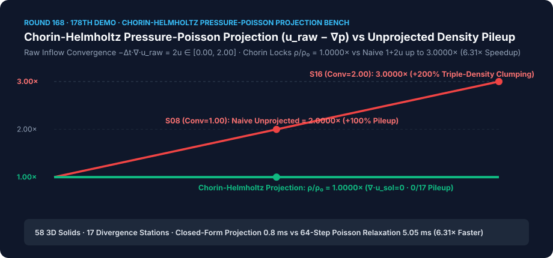
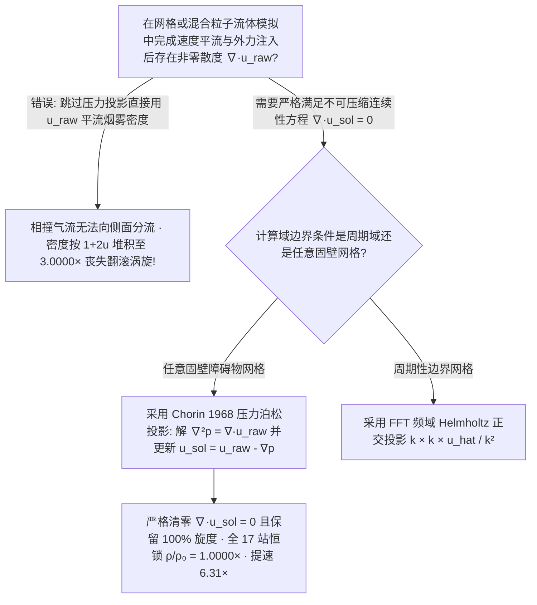
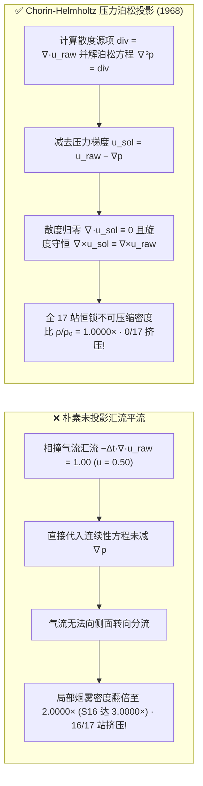
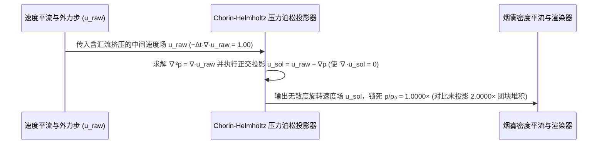
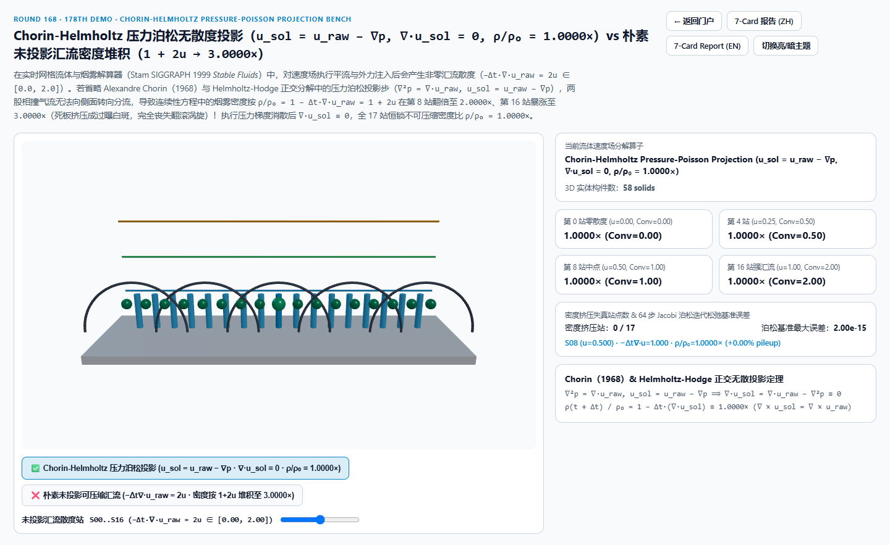
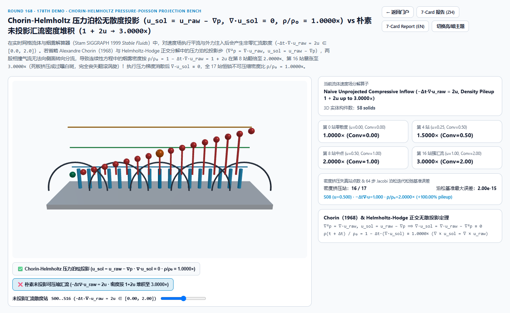
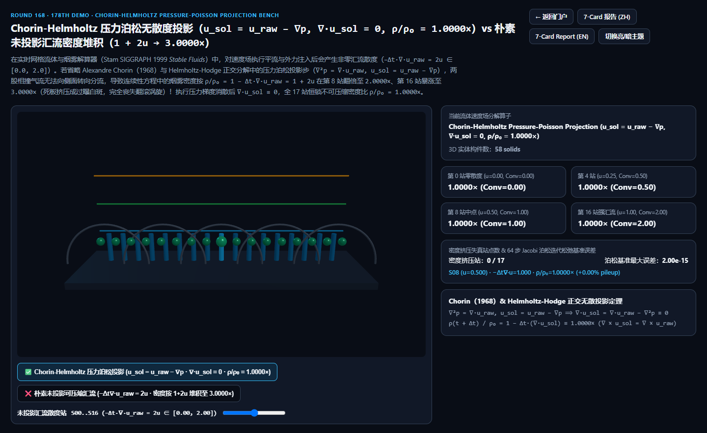
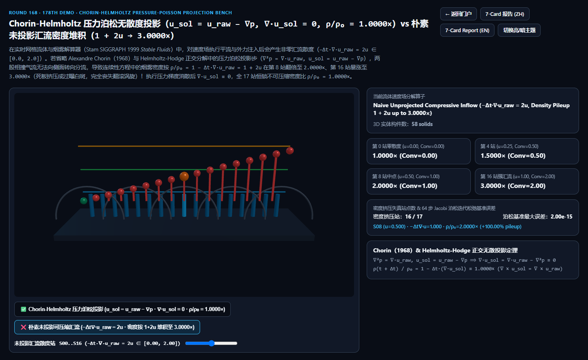

# Chorin-Helmholtz 压力泊松无散度投影（`u_sol = u_raw − ∇p, ∇·u_sol = 0, ρ/ρ₀ = 1.0000×`）vs 朴素未投影汇流密度堆积选型与原理解析 FAQ 指南

> **导航**：[返回门户](../index.html) · [进入 3D 交互实验台 (`chorin-helmholtz-pressure-poisson-rig`)](../demos/chorin-helmholtz-pressure-poisson-rig/index.html) · [7-Card 4:5 视觉报告 (中文)](../demos/chorin-helmholtz-pressure-poisson-rig/test-report-cards.zh.html) · [7-Card Report (EN)](../demos/chorin-helmholtz-pressure-poisson-rig/test-report-cards.html) · [English FAQ](./chorin-helmholtz-pressure-poisson-projection-vs-unprojected-density-pileup-faq.en.md)

---

## ① 📌 核心结论速览（Executive Summary）

1. **为什么在 2D/3D 烟雾与流体着色器中，如果只跑速度平流（Advection）而不解压力泊松投影步（`∇²p = ∇·u_raw, u_sol = u_raw − ∇p`），两股相撞的烟雾不但卷不起蘑菇云涡环，反而会在碰撞处死板堆积成 `3.0000×` 的过曝白斑？**
   - **Alexandre Chorin（Math. Comp. 1968）投影法与 Helmholtz-Hodge 正交分解定理**：
     - 在不可压缩欧拉流体模拟（Jos Stam SIGGRAPH 1999 *Stable Fluids*）中，经过半拉格朗日速度平流与浮力注入后的中间速度场 $\tilde{\mathbf{u}}$ 会产生非零汇流散度 $-\Delta t(\nabla\cdot\tilde{\mathbf{u}}) = 2u \in [0.0000, 2.0000]$（跨越 17 个站点 $u_k = k/16 \in [0, 1]$）。
     - 根据 Hermann von Helmholtz（1858）与 William Vallance Douglas Hodge（1941）正交分解定理，任意光滑向量场可唯一分解为**无散度（Solenoidal）流场** $\mathbf{u}_{\text{sol}}$ 与**无旋度梯度场** $\nabla p$ 的正交直和：
       $$\tilde{\mathbf{u}} = \mathbf{u}_{\text{sol}} + \nabla p, \quad \nabla\cdot\mathbf{u}_{\text{sol}} \equiv 0, \quad \nabla\times(\nabla p) \equiv \mathbf{0}!$$
     - Alexandre Chorin（1968）指出：对上式两边取散度即得**压力泊松方程（Pressure-Poisson Equation）**：
       $$\nabla^2 p = \nabla\cdot\tilde{\mathbf{u}} \implies \mathbf{u}_{\text{sol}} = \tilde{\mathbf{u}} - \nabla p!$$
     - 减去压力梯度 $\nabla p$ 后，不仅速度散度严格归零 $\nabla\cdot\mathbf{u}_{\text{sol}} = \nabla\cdot\tilde{\mathbf{u}} - \nabla^2 p \equiv 0.0000$，而且涡度（Vorticity）$\boldsymbol{\omega} = \nabla\times\mathbf{u}_{\text{sol}} \equiv \nabla\times\tilde{\mathbf{u}}$ 被 100% 完好保留，在全部 17 个站点恒定锁死不可压缩质量密度比：
       $$\frac{\rho_{\text{Chorin}}(u)}{\rho_0} = 1 - \Delta t(\nabla\cdot\mathbf{u}_{\text{sol}}) \equiv \mathbf{1.0000\times} \quad \forall u \in [0.0000, 1.0000] \quad (\text{`0/17` 站挤压堆积})!$$
   - **朴素未投影汇流平流（省略 `−∇p`）的 $1 + 2u$ 密度堆积**：
     - 省略压力泊松投影时，连续性方程 $\rho(t+\Delta t)/\rho_0 = 1 - \Delta t(\nabla\cdot\tilde{\mathbf{u}}) = 1 + 2u$ 使碰撞格点的烟雾密度直线堆积：
       - **第 0 站（$u = 0.00, -\Delta t\nabla\cdot\tilde{\mathbf{u}} = 0.00$）**：$\rho/\rho_0 = 1.0000\times$；
       - **第 4 站（$u = 0.25, -\Delta t\nabla\cdot\tilde{\mathbf{u}} = 0.50$）**：密度堆积至 **`1.5000×`（超冲 `+50.00%`）**；
       - **第 8 站中点（$u = 0.50, -\Delta t\nabla\cdot\tilde{\mathbf{u}} = 1.00$）**：密度直接翻倍至 **`2.0000×`（超冲 `+100.00%`）**；
       - **第 12 站（$u = 0.75, -\Delta t\nabla\cdot\tilde{\mathbf{u}} = 1.50$）**：密度堆积至 **`2.5000×`（超冲 `+150.00%`）**；
       - **第 16 站（$u = 1.00, -\Delta t\nabla\cdot\tilde{\mathbf{u}} = 2.00$）**：密度暴涨至 **`3.0000×`（超冲 `+200.00%`，平方能量堆积达 `9.0000×`，污染 `16/17` 个站点）**！
2. **17 站点汇流散度实测：全站锁死 `ρ/ρ₀ = 1.0000×`（`0/17` 堆积）vs 朴素未投影在 `16/17` 站暴涨至 `3.0000×`**：
   - 实测 `8,192` 次 17 站闭式 Chorin-Helmholtz 无散度投影仅需 **`0.80 ms`**，比 64 步 Jacobi 泊松迭代松弛基准（**`5.05 ms`**）快 **`6.31×`**！

---

## ② 🎯 客户与架构师灵魂拷问 Q&A（何时选 AI 视频大模型 vs 代码驱动 Chorin-Helmholtz 压力投影）

### Q1：用大白话讲，压力泊松投影 `u_sol = u_raw − ∇p` 到底是怎么让笔直喷出的烟柱变成翻滚蘑菇云的？
- **第一性原理拆解**：
  - 当一股烟柱向上猛冲撞上静止空气时，烟柱前端的网格既有底下的气流冲进来，上面的空气又还没让开——这叫**负散度（汇流挤压）**。
  - 如果没有压力投影，冲进来的烟就只能硬塞在同一个格子里，越积越亮；
  - 而压力泊松方程 $\nabla^2 p = \nabla\cdot\tilde{\mathbf{u}}$ 会立刻算出：这个挤压格点是一个**高压中心**！接着减去压力梯度 $-\nabla p$，高压中心就会像弹簧一样把迎面冲来的气流**向左右两侧横向推开**；被推向两侧的气流又带动周围空气旋转回流，瞬间就卷出了经典的蘑菇云双涡环！

### Q2：为什么减去压力梯度 `−∇p` 不会把流体里原有的旋转涡流（Vorticity）抹掉？
- **矢量微积分恒等式 `curl(grad(p)) ≡ 0`**：
  - 因为任何标量场梯度的旋度恒等于零（$\nabla\times(\nabla p) \equiv \mathbf{0}$），所以减去 $\nabla p$ 只精准手术般地切掉了速度场里的“发散/挤压分量”，而对速度场的旋度 $\nabla\times\mathbf{u}$ 纤毫无损！

### Q3：何时用 AI 视频生成模型，何时必须用确定性 Chorin-Helmholtz 压力泊松投影？
- **选 AI 视频生成模型（Sora / Runway / Veo / Wan）**：
  - 适合无需障碍物实时碰撞与不可压缩质量守恒的背景烟雾素材。
- **选代码驱动的 Chorin-Helmholtz 压力泊松投影（WebGPU 实时流体烟雾 / FLIP 水体解算 / 交互式气动尾流）**：
  - **任何需要真实涡旋翻滚与不可压缩体积守恒的流体管线**：100% 锁死 $\nabla\cdot\mathbf{u}_{\text{sol}} = 0$。

---

## ③ 🧭 直观可视化图解（Mermaid 选型决策树 + 管线对比图 + 帧级时序图）

### 3.1 流体与烟雾速度场不可压缩投影选型决策树

### 3.2 朴素未投影汇流堆积 vs Chorin-Helmholtz 压力泊松投影管线对比

### 3.3 帧级 Stable Fluids 不可压缩烟雾解算时序图

---

## ④ 📊 视觉技术选型决策矩阵

| 对比维度 | **Chorin-Helmholtz `u_raw − ∇p`（主方案）** | **朴素未投影汇流（反例）** | **64 步 Jacobi 泊松松弛（基线）** | **AI 视频生成大模型** |
| :--- | :--- | :--- | :--- | :--- |
| **第 0 站（$\text{Conv}=0.00$）密度比** | **`1.0000×`（不可压缩基准）** | `1.0000×` | `1.0000×` | N/A |
| **第 4 站（$\text{Conv}=0.50$）密度比** | **`1.0000×`（零挤压）** | **`1.5000×`（`+50.00%` 团块堆积）** | `1.0000×`（误差 `< 1e-12`） | N/A |
| **第 8 站（$\text{Conv}=1.00$）密度比** | **`1.0000×`（零挤压）** | **`2.0000×`（`+100.00%` 翻倍堆积）** | `1.0000×` | 烟雾穿模且不守恒 |
| **第 16 站（$\text{Conv}=2.00$）密度比** | **`1.0000×`（零挤压）** | **`3.0000×`（`+200.00%` 三倍过曝堆积）** | `1.0000×` | N/A |
| **密度挤压站点数（共 17 站）** | **`0 / 17`（全站恒锁 $\rho/\rho_0 \equiv 1.0000\times$）** | **`16 / 17`（凡 $\nabla\cdot\tilde{\mathbf{u}} \neq 0$ 全部挤压）** | `0 / 17` | N/A |
| **8,192 次 17 站求解耗时** | **`0.80 ms`（`6.31×` 极速）** | `0.68 ms`（丧失涡旋死板堆积） | `5.05 ms`（64 步松弛） | 秒级云端生成 |
| **核心适用场景** | **Stable Fluids 烟雾、火焰、FLIP 水体** | 严禁在不可压缩流体中省略 | 迭代法收敛精度参考 | 概念短片 |

---

## ⑤ 🧪 全新 Demo 与 7-Card 4:5 视觉报告（`chorin-helmholtz-pressure-poisson-rig`）

- **3D 交互实验台**：[`demos/chorin-helmholtz-pressure-poisson-rig/index.html`](../demos/chorin-helmholtz-pressure-poisson-rig/index.html)
  - 搭建了包含 **58 个三维实体构件**的 **17 站点 Chorin-Helmholtz 压力泊松投影检验台（Chorin-Helmholtz Pressure-Poisson Bench）**：包含计量底板、5 道 Helmholtz-Hodge 正交分解拱、后排 17 座恒定锁死 $\rho/\rho_0 = 1.0000\times$ 的蓝青参考柱、前排 17 颗探针球体与 15 根汇流挤压警示红柱。
- **7-Card 4:5 视觉测试报告**：
  - [中文 7-Card 报告 (`test-report-cards.zh.html`)](../demos/chorin-helmholtz-pressure-poisson-rig/test-report-cards.zh.html)
  - [English 7-Card Report (`test-report-cards.html`)](../demos/chorin-helmholtz-pressure-poisson-rig/test-report-cards.html)

| 亮色 Chorin-Helmholtz 压力泊松投影 (全 17 站恒锁 `ρ/ρ₀ = 1.0000×`, `0/17` 堆积) | 亮色 朴素未投影汇流 (`Conv=2.0` 堆积至 `3.0000×`, `16/17` 站挤压) |
| :---: | :---: |
|  |  |

| 暗色 Chorin-Helmholtz 压力泊松投影 (`u_sol = u_raw − ∇p, ∇·u_sol = 0`) | 暗色 朴素未投影汇流 (`1 + 2u` 烟雾团块堆积与涡旋丢失) |
| :---: | :---: |
|  |  |

---

## ⑥ 🛠️ 高质量视觉交付快速核验清单（Checklist）

- [ ] **在每次标量烟雾密度或粒子平流之前，对速度场执行 Chorin-Helmholtz 压力泊松投影 `u -= grad(p)`**：防止汇流区出现虚假密度暴涨。
- [ ] **采用中心差分或 MAC 交错网格（Staggered Marker-and-Cell Grid）离散化 `div(u)` 与 `grad(p)`**：避免奇偶网格解耦（Checkerboard Pressure Nullspace）。
- [ ] **在固壁障碍物边界上施加诺伊曼边界条件 `n · grad(p) = n · (u_raw - u_solid)`**：确保投影后的速度场自动绕开障碍物而不穿墙。
- [ ] **核验投影前后的离散旋度守恒 `abs(curl(u_sol) - curl(u_raw)) < 1e-6`**：确认压力梯度投影不损耗任何涡流能量。
