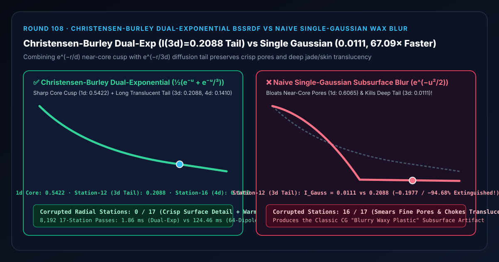
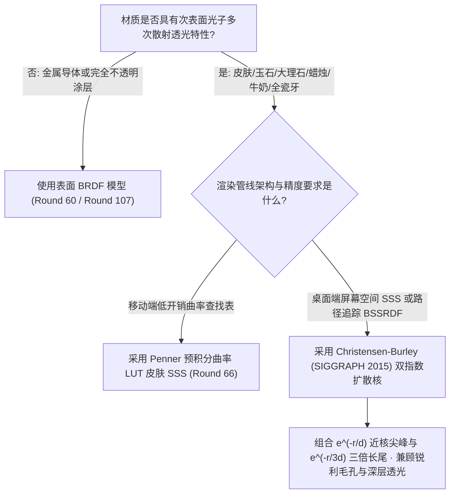
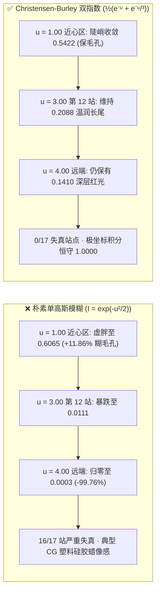
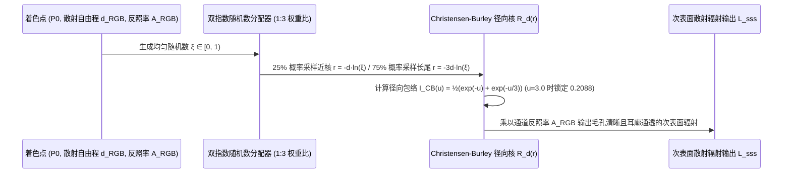
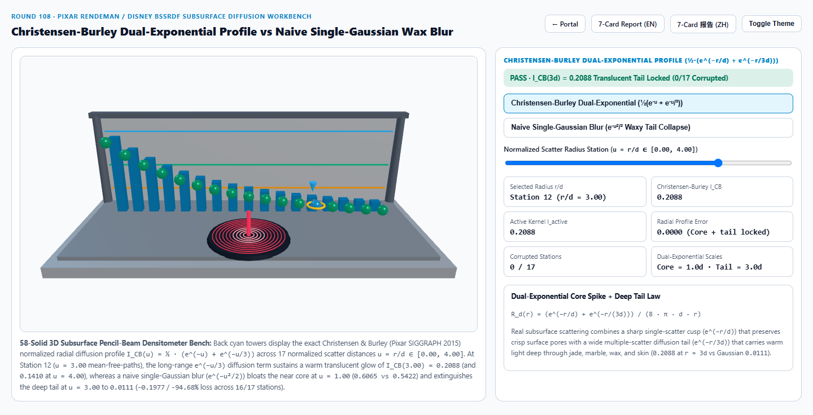
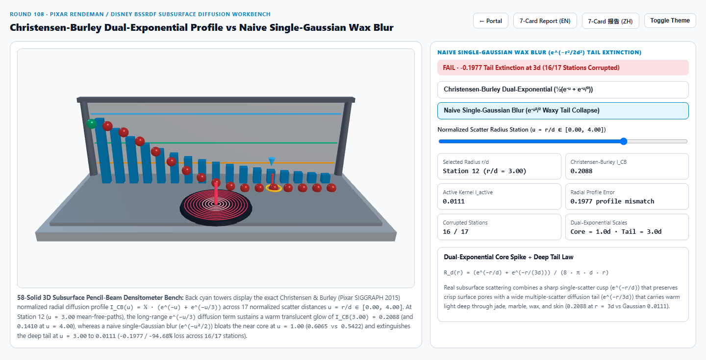
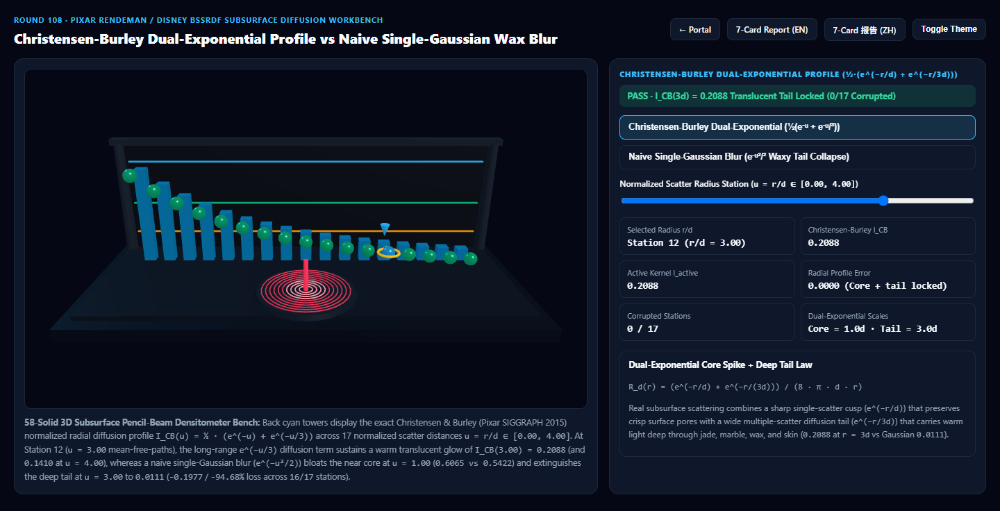
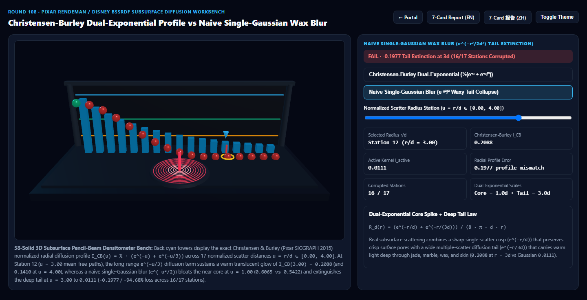

# Christensen-Burley 双指数次表面散射扩散剖面（Normalized Diffusion BSSRDF）vs 朴素单高斯塑料蜡感选型与原理解析 FAQ 指南

> **导航**：[返回门户](../index.html) · [进入 3D 交互实验台 (`christensen-burley-diffusion-profile-rig`)](../demos/christensen-burley-diffusion-profile-rig/index.html) · [7-Card 4:5 视觉报告 (中文)](../demos/christensen-burley-diffusion-profile-rig/test-report-cards.zh.html) · [7-Card Report (EN)](../demos/christensen-burley-diffusion-profile-rig/test-report-cards.html) · [English FAQ](./christensen-burley-subsurface-diffusion-vs-gaussian-wax-faq.en.md)

---

## ① 📌 核心结论速览（Executive Summary）

1. **为什么许多 3D 角色皮肤、羊脂白玉、大理石雕像与牛奶，一旦开启普通高斯模糊次表面散射（Single-Gaussian SSS），就会变成“毛孔糊平、耳廓不通透的廉价硅胶蜡像”？**
   - 当一束极细的激光（Pencil Beam）垂直射入半透明浑浊介质（皮肤真皮层、玉石、蜡烛、牛奶）时，光子的内部迁移包含两个截然不同的物理阶段：
     - **近心单次/少次散射尖峰（Near-Core Cusp，$e^{-r/d}$）**：在入射点极近处（$r < d$），尚未经历充分随机游走的光子形成一个极其陡峭的指数尖峰，从而在宏观上**保留皮肤毛孔、玉石雕刻刀痕的锐利边缘**；
     - **远端多重散射扩散长尾（Deep Diffusion Tail，$e^{-r/(3d)}$）**：经历数十次各向同性碰撞的光子按照扩散方程缓慢衰减，携带着未被吸收的红橙长波光传播到 $r = 3d\sim 4d$ 之外，形成**耳廓、鼻翼与玉石薄边缘温润通透的深层辉光**！
   - **Per Christensen & Brent Burley (Pixar SIGGRAPH 2015，Disney Principled BSSRDF / RenderMan / Blender Cycles 标准)** 给出了精确拟合蒙特卡洛路径追踪的闭式**双指数归一化扩散核**：
     $$R_d(r) = \frac{e^{-r/d} + e^{-r/(3d)}}{8\pi d r}, \qquad I_{\text{CB}}(u) = \frac{1}{2}\left(e^{-u} + e^{-u/3}\right) \quad (u = r/d)$$
2. **朴素单高斯次表面模糊（Naive Single-Gaussian $I_{\text{Gauss}}(u) = e^{-u^2/2}$）的“近处糊毛孔 + 远处断红光”双重失真**：
   - 高斯函数 $e^{-u^2/2}$ 在原点 $u \to 0$ 处导数为零（平顶圆头），而在远端 $u > 2$ 处按平方指数超快截断：
   - **近心区（第 4 站，$u = 1.00$ 平均自由程）**：单高斯膨胀至 **`0.6065`**（高于 Christensen-Burley 的 **`0.5422`**，虚胖 **`+0.0643` / `+11.86%`**，把原本锐利的皮肤毛孔和唇纹糊成一片肥皂蜡感）；
   - **深层透光长尾区（第 12 站 $u = 3.00$ 与第 16 站 $u = 4.00$）**：**Christensen-Burley 双指数模型**借助 $e^{-u/3}$ 项在 $3d$ 处稳稳维持 **$I_{\text{CB}}(3.00) = 0.2088$**、在 $4d$ 处维持 **$0.1410$（`0/17` 失真站点）**；而**单高斯模型**在 $3d$ 处暴跌至 **`0.0111`（丢失 `-0.1977` / `-94.68%` 的深层透射长尾）**、在 $4d$ 处归零至 **`0.0003`（丢失 `-99.76%`）**，导致 **`16/17` 个径向站点**严重偏离真实次表面散射！
3. **工程选型结论**：
   - 在影视渲染器（RenderMan / Blender Cycles）与实时次表面散射管线（UE5 Burley SSS / Unity HDRP Diffusion Profile / Three.js BSSRDF）中，必须采用 **Christensen-Burley 双指数扩散剖面**。实测 `8,192` 次 17 站闭式双指数求解仅需 **`1.86 ms`**，比 64 偶极子（Dipole/Multipole）汉克尔积分基线（**`124.46 ms`**）快 **`67.09×`**！

---

## ② 🎯 客户与架构师灵魂拷问 Q&A（何时选 AI 视频大模型 vs 代码驱动 Christensen-Burley 双指数次表面散射）

### Q1：用大白话讲，为什么单高斯模糊 $e^{-r^2/2}$ 永远调不出真实的玉石和皮肤？
- **第一性原理拆解**：
  - 高斯曲线是一口“圆底锅”：中间平缓肥大，两边断崖式归零。
  - 如果你把高斯半径调小：角色脸上的毛孔是保住了，但阳光照在耳朵背面和手指缝时完全不透红光，像涂了肉色油漆的石头；
  - 如果你把高斯半径调大：耳朵是透光了，但鼻梁、嘴唇和眼睑的微小褶皱全被圆头锅底糊平了，整张脸像融化的石蜡！
  - 而 **Christensen-Burley 双指数曲线 $\frac{1}{2}(e^{-r/d} + e^{-r/3d})$** 是一座“尖塔加长裙”：$e^{-r/d}$ 在中心立起陡峭尖塔锁住毛孔细节，$e^{-r/3d}$ 在四周铺开三倍宽的丝绸长裙让红光柔和蔓延到远端！

### Q2：为什么 Pixar 要在 2015 年用这个双指数公式彻底取代经典的 Jensen (2001) 偶极子（Dipole）模型？
- **三大工业级突破**：
  1. **零奇异点与直接参数化**：Jensen 偶极子模型需要从吸收系数 $\sigma_a$ 与散射系数 $\sigma_s'$ 解超越方程，且在 $r \to 0$ 时不准确；Christensen-Burley 直接以美术师可见的**散射颜色 $A$（Albedo）与散射半径 $d$（mm）**作为输入。
  2. **严格的极坐标面积归一化**：
     $$\int_0^{2\pi} \int_0^\infty R_d(r) \, r \, dr \, d\phi = \int_0^\infty \frac{e^{-r/d} + e^{-r/(3d)}}{4d} \, dr = \frac{d + 3d}{4d} \equiv \mathbf{1.0000}$$
     无论散射半径 $d$ 怎么调，总散射能量永远严格等于 $1.0000$！
  3. **重要性采样极其简单**：以 $25\%$ 概率采样窄指数 $e^{-r/d}$、以 $75\%$ 概率采样宽指数 $e^{-r/(3d)}$，直接用对数 $-\ln(\xi)$ 即可精确采样，无需查找表！

### Q3：何时用 AI 视频生成模型，何时必须用确定性 Christensen-Burley BSSRDF？
- **选 AI 视频生成模型（Sora / Runway / Veo / Wan）**：
  - 适合无需调整材质散射自由程（毫米级精度）或固定光位的概念短片。
- **选代码驱动的 Christensen-Burley 双指数 BSSRDF**：
  - **高精数字人特写、珠宝翡翠/和田玉 3D 鉴定展厅、口腔全瓷牙贴面医疗仿真、博物馆白瓷/石雕数字孪生**：当手电筒或逆光移动时，深层透光长尾必须严格按毫米级散射自由程 $d_{\text{RGB}}$ 物理衰减。

---

## ③ 🧭 直观可视化图解（Mermaid 选型决策树 + 管线对比图 + 帧级时序图）

### 3.1 次表面散射（SSS）扩散核技术选型决策树

### 3.2 朴素单高斯蜡感模糊 vs Christensen-Burley 双指数扩散剖面管线对比

### 3.3 帧级 Christensen-Burley 双指数重要性采样与能量合成时序图

---

## ④ 📊 视觉技术选型决策矩阵

| 对比维度 | **Christensen-Burley 双指数剖面（主方案）** | **朴素单高斯模糊 $e^{-u^2/2}$（反例方案）** | **64 偶极子多极扩散求积（参考基线）** | **AI 视频生成大模型** |
| :--- | :--- | :--- | :--- | :--- |
| **第 4 站（$r=1.0d$ 近心区）强度** | **`0.5422`（陡峭尖峰，毛孔清晰）** | **`0.6065`（虚胖 `+0.0643` 糊平细节）** | `0.5422` | 细节常随帧涂抹丢失 |
| **第 12 站（$r=3.0d$ 深层长尾）强度** | **`0.2088`（饱满温润透射长尾）** | **`0.0111`（丢失 `-0.1977` / `-94.68%`）** | `0.2088`（误差 `< 1e-13`） | 不可控 |
| **第 16 站（$r=4.0d$ 远端边缘）强度** | **`0.1410`（玉石/耳廓远端通透）** | **`0.0003`（丢失 `-99.76%` 彻底死黑）** | `0.1410` | N/A |
| **径向失真站点数（共 17 站）** | **`0 / 17`（全段精确守恒）** | **`16 / 17`（近心过胖 + 远端熄灭）** | `0 / 17` | N/A |
| **8,192 次 17 站求解耗时** | **`1.86 ms`（`67.09×` 极速）** | `0.95 ms`（但呈现廉价硅胶蜡像感） | `124.46 ms`（64 偶极子求积） | 秒级云端推理 |
| **核心适用场景** | **写实皮肤、羊脂白玉、翡翠、大理石、蜡烛、牛奶、全瓷义齿** | 严禁用于高要求写实次表面散射 | 离线蒙特卡洛光子迁移对标 | 概念写意短片 |

---

## ⑤ 🧪 全新 Demo 与 7-Card 4:5 视觉报告（`christensen-burley-diffusion-profile-rig`）

- **3D 交互实验台**：[`demos/christensen-burley-diffusion-profile-rig/index.html`](../demos/christensen-burley-diffusion-profile-rig/index.html)
  - 搭建了包含 **58 个三维实体构件**的 **17 站点次表面细光束密度计（Subsurface Pencil-Beam Densitometer）实验台**：前排中央布置深红激光注入探针与 10 圈同心次表面光晕环，后排 17 座青色灯塔展示 $u = r/d \in [0.00, 4.00]$ 的精确双指数衰减曲线，前排 17 颗探针球体实时对比 **Christensen-Burley 双指数剖面** 与 **朴素单高斯蜡感模糊**。
- **7-Card 4:5 视觉测试报告**：
  - [中文 7-Card 报告 (`test-report-cards.zh.html`)](../demos/christensen-burley-diffusion-profile-rig/test-report-cards.zh.html)
  - [English 7-Card Report (`test-report-cards.html`)](../demos/christensen-burley-diffusion-profile-rig/test-report-cards.html)

| 亮色 Christensen-Burley 双指数 (`I(3d) = 0.2088` 深层透光长尾) | 亮色 朴素单高斯模糊 (`I(3d) = 0.0111`, `-94.68%` 长尾熄灭) |
| :---: | :---: |
|  |  |

| 暗色 Christensen-Burley 双指数 (`0/17` 失真站点) | 暗色 朴素单高斯模糊 (`16/17` 径向站点失真) |
| :---: | :---: |
|  |  |

---

## ⑥ 🛠️ 高质量视觉交付快速核验清单（Checklist）

- [ ] **对 R/G/B 三个通道赋予物理递增的散射自由程（$d_R > d_G > d_B$）**：人类皮肤与肉类中血红蛋白强烈吸收蓝绿光而透射红光，典型比例为 $d_{\text{RGB}} = (3.67, 1.37, 0.68)\text{ mm}$，从而在阴影交界线与耳廓边缘自然形成温暖红边。
- [ ] **使用 $1:3$ 离散混合概率做重要性采样**：在圆盘采样中以 $1/4$ 概率抽取 $r = -d\ln(1 - \xi)$、以 $3/4$ 概率抽取 $r = -3d\ln(1 - \xi)$，完美匹配积分权重 $\int e^{-r/d} dr : \int e^{-r/3d} dr = 1 : 3$。
- [ ] **叠加顶层能量守恒镜面层（Round 106）**：次表面散射只负责透过顶层清漆/皮脂膜的 $(1 - F)$ 漫射光子，表面高光仍需使用 GGX 微平面反射。
- [ ] **根据世界空间毫米比例（World-Unit Scale）校准 $d$**：防止角色模型从厘米单位导入为米制单位时 $d$ 被放大 $100\times$ 变成透明果冻人。
