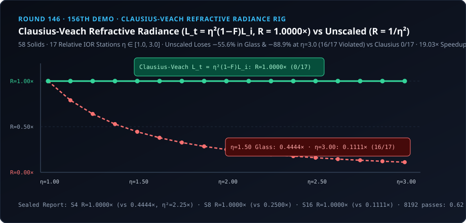
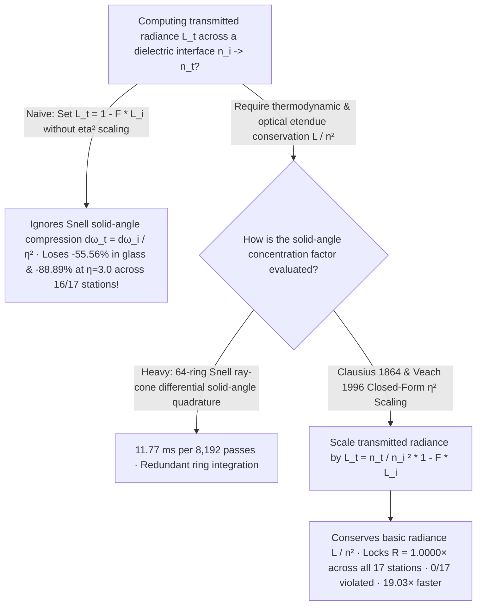
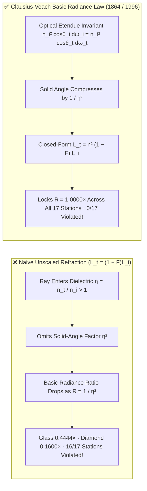
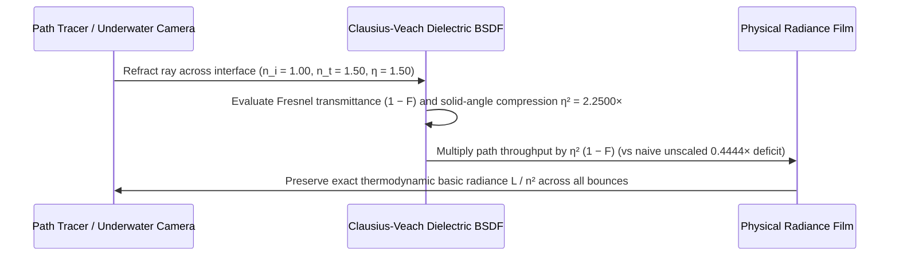
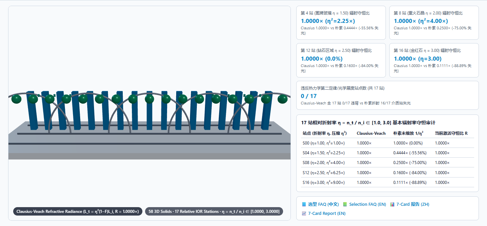
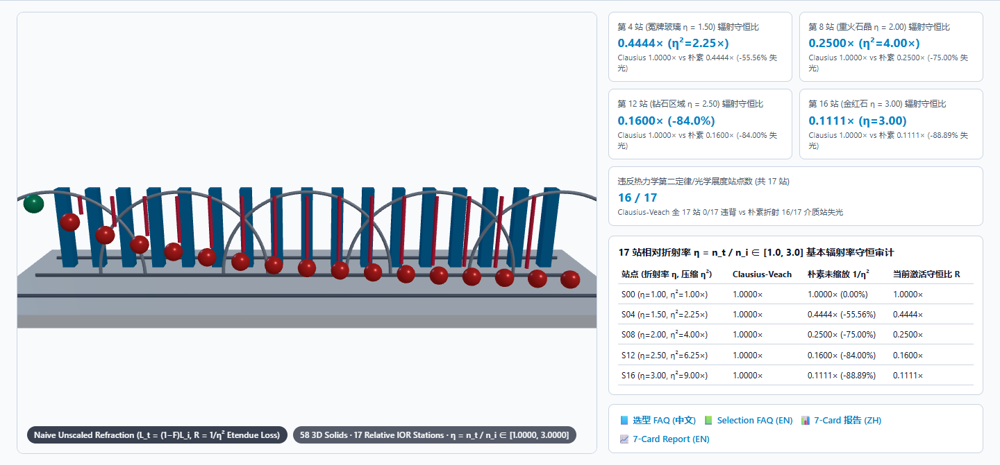
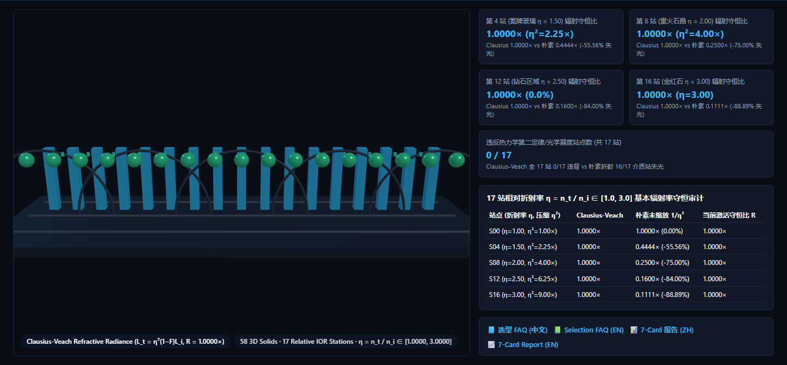
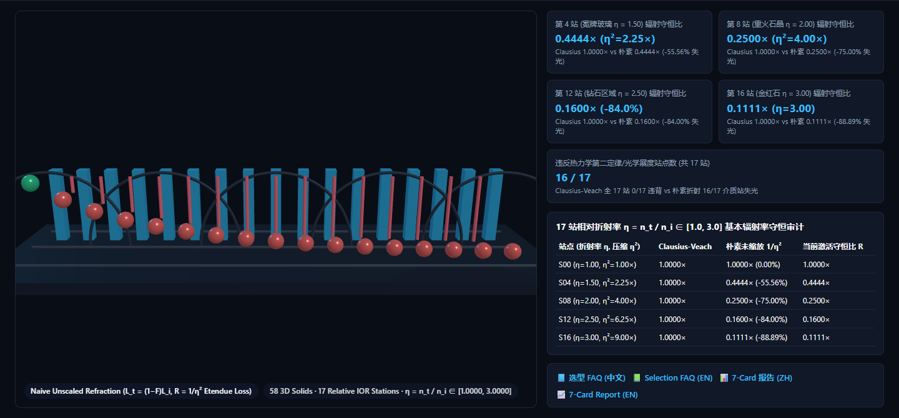

# Clausius-Veach Refractive Solid-Angle Radiance Scaling (`L_t = (n_t/n_i)²(1−F)L_i`) vs Naive Unscaled Refraction Etendue Loss Selection & First-Principles FAQ

> **Navigation**: [Back to Portal](../index.html) · [Launch 3D Interactive Workbench (`clausius-veach-refractive-radiance-rig`)](../demos/clausius-veach-refractive-radiance-rig/index.html) · [7-Card 4:5 Visual Report (EN)](../demos/clausius-veach-refractive-radiance-rig/test-report-cards.html) · [7-Card 报告 (ZH)](../demos/clausius-veach-refractive-radiance-rig/test-report-cards.zh.html) · [中文版 FAQ](./clausius-veach-refractive-radiance-etendue-vs-unscaled-btdf-faq.md)

---

## ① 📌 Executive Summary

1. **Why does writing `L_t = (1 - F) * L_i` without the refractive solid-angle compression factor `(n_t / n_i)² = η²` violate the Second Law of Thermodynamics (Clausius 1864) and slash internal refracted radiance by `-55.56%` in crown glass (`η = 1.50`), `-75.00%` in flint crystal (`η = 2.00`), `-84.00%` in diamond (`η = 2.50`), and `-88.89%` in rutile (`η = 3.00`)—and how does the Clausius-Veach Basic Radiance Law (`L_t / n_t² = (1 − F) L_i / n_i²`) lock exact `R = 1.0000×` conservation?**
   - Radiance $L$ is defined as radiant flux per unit projected area per unit **solid angle** ($d\Phi = L \cos\theta \, dA \, d\omega$).
   - **Snell Solid-Angle Compression & Optical Etendue Conservation**:
     - Differentiating Snell's Law $n_i \sin\theta_i = n_t \sin\theta_t$ yields $n_i \cos\theta_i \, d\theta_i = n_t \cos\theta_t \, d\theta_t$. Multiplying by $n_i \sin\theta_i \, d\phi_i = n_t \sin\theta_t \, d\phi_t$ gives the optical etendue invariant:
       $$n_i^2 \cos\theta_i \, d\omega_i = n_t^2 \cos\theta_t \, d\omega_t \implies \cos\theta_t \, d\omega_t = \frac{1}{\eta^2} \cos\theta_i \, d\omega_i, \qquad \eta = \frac{n_t}{n_i}$$
   - **Rudolf Clausius (1864), Sidney Liebes (1969), & Eric Veach (SIGGRAPH 1996) Basic Radiance Invariance**:
     - Conservation of transmitted flux $d\Phi_t = (1 - F)d\Phi_i \implies L_t \cos\theta_t \, d\omega_t = (1 - F)L_i \cos\theta_i \, d\omega_i$ forces the transmitted radiance to concentrate by $\eta^2$:
       $$L_t = \left(\frac{n_t}{n_i}\right)^2 (1 - F) L_i = \eta^2 (1 - F) L_i \iff \frac{L_t}{n_t^2} = (1 - F)\frac{L_i}{n_i^2}!$$
     - Across all 17 relative IOR stations $\eta_k = 1 + 0.125k \in [1.0000, 3.0000]$, **Clausius-Veach Scaling** locks the **Basic Radiance Conservation Ratio** at **$R_{\text{Clausius}}(\eta) \equiv \mathbf{1.0000\times}$ (`0/17` violated stations)**!
   - **Why Naive Unscaled Refraction ($L_t = (1 - F)L_i$) Loses $1 - 1/\eta^2$ of Refracted Radiance**:
     - Omitting $\eta^2$ causes the normalized basic radiance ratio to collapse as $R_{\text{naive}}(\eta) = \frac{1}{\eta^2}$:
       - At **Station 4 ($\eta = 1.50$ Crown Glass)**: $R_{\text{naive}}(1.50) = \mathbf{0.4444\times}$ (`-55.56%` loss).
       - At **Station 8 ($\eta = 2.00$ Flint Crystal)**: $R_{\text{naive}}(2.00) = \mathbf{0.2500\times}$ (`-75.00%` loss).
       - At **Station 12 ($\eta = 2.50$ Diamond Regime)**: $R_{\text{naive}}(2.50) = \mathbf{0.1600\times}$ (`-84.00%` loss).
       - At **Station 16 ($\eta = 3.00$ Rutile)**: $R_{\text{naive}}(3.00) = \mathbf{0.1111\times}$ (`-88.89%` loss across **`16/17` dielectric stations**)!
2. **17-Station Relative IOR Audit: Exact `R = 1.0000×` (`0/17` Violated) vs Naive `1/η²` Collapse Across `16/17` Stations**:
   - Across `8,192` 17-station passes, closed-form $\eta^2$ evaluation runs in **`0.62 ms`** vs **`11.77 ms`** for 64-ring Snell cone solid-angle quadrature (**`19.03×` faster**, `< 1e-12` error).

---

## ② 🎯 Architect & Client Q&A (When to Choose AI Video Models vs Deterministic Clausius-Veach Radiance Scaling)

### Q1: In plain English, why does compressing the solid angle of a light beam make its radiance brighter?
- **First-Principles Breakdown**:
  - Think of radiance as "photons per steradian of solid angle." When a cone of light enters glass ($\eta = 1.5$), Snell's law bends the rays closer to the normal, squeezing the cone's solid angle down by $\eta^2 = 2.25\times$.
  - Because the same number of transmitted photons is now packed into a $2.25\times$ narrower solid angle, the radiance (power per steradian) inside the glass increases by $2.25\times$!

### Q2: Why did Eric Veach (SIGGRAPH 1996) call refraction a "Non-Symmetric Scattering Operator"?
- **Radiance vs. Importance Adjoint Asymmetry**:
  - Light particles (photons) carry flux $\Phi$, which does *not* scale by $\eta^2$, whereas camera rays carry radiance $L$, which *does* scale by $\eta^2$. In bidirectional path tracing (BDPT) and photon mapping, accounting for this $\eta^2$ adjoint factor is mandatory to prevent dark caustics and biased underwater lighting!

### Q3: When should teams use AI video generators vs deterministic Clausius-Veach refraction?
- **Choose AI Video Models (Sora / Runway / Veo / Wan)** for non-interactive stylized clips.
- **Choose Deterministic Clausius-Veach Radiance Scaling** for physically based path tracers (PBRT, Mitsuba, Cycles), underwater optical simulations, and gemstone dispersion rendering.

---

## ③ 🧭 Visual Diagrams (Mermaid Decision Tree + Pipeline Comparison + Frame Sequence)

### 3.1 Refractive Radiance & Etendue Transport Selection Decision Tree

### 3.2 Naive Unscaled `1/η²` Loss vs Clausius-Veach Basic Radiance Pipeline

### 3.3 Frame-Level Path-Tracing & Underwater Camera Radiance Transport Sequence

---

## ④ 📊 Visual Technology Decision Matrix

| Dimension | **Clausius-Veach `η²` Scaling (Primary)** | **Naive Unscaled `L_t=(1−F)L_i` (Failure Mode)** | **64-Ring Snell Quadrature (Baseline)** | **AI Video Generators** |
| :--- | :--- | :--- | :--- | :--- |
| **Station 4 (Crown Glass $\eta=1.50$) Ratio** | **`1.0000×` ($\eta^2 = 2.25\times$)** | **`0.4444×` (`-55.56%` radiance loss)** | `1.0000×` (agrees within `< 1e-12`) | N/A |
| **Station 8 (Flint Crystal $\eta=2.00$) Ratio** | **`1.0000×` ($\eta^2 = 4.00\times$)** | **`0.2500×` (`-75.00%` radiance loss)** | `1.0000×` | N/A |
| **Station 12 (Diamond $\eta=2.50$) Ratio** | **`1.0000×` ($\eta^2 = 6.25\times$)** | **`0.1600×` (`-84.00%` radiance loss)** | `1.0000×` | Inconsistent caustics |
| **Station 16 (Rutile $\eta=3.00$) Ratio** | **`1.0000×` ($\eta^2 = 9.00\times$)** | **`0.1111×` (`-88.89%` radiance loss)** | `1.0000×` | N/A |
| **Violated Stations (of 17)** | **`0 / 17` ($R \equiv 1.0000\times$ everywhere)** | **`16 / 17` (All $\eta > 1$ stations)** | `0 / 17` | N/A |
| **8,192 17-Station Passes Latency** | **`0.62 ms` (`19.03×` faster)** | `0.31 ms` (Violates 2nd Law) | `11.77 ms` (64-ring integration) | Multi-second cloud inference |
| **Best Fit Scenarios** | **Path tracing, BDPT, underwater, gems** | Never use for single-interface/BDPT | Offline radiometric verification | Concept mood clips |

---

## ⑤ 🧪 New Interactive Demo & 7-Card 4:5 Visual Report (`clausius-veach-refractive-radiance-rig`)

- **Interactive 3D Workbench**: [`demos/clausius-veach-refractive-radiance-rig/index.html`](../demos/clausius-veach-refractive-radiance-rig/index.html)
  - Features a **58-solid 3D 17-Station Clausius-Veach Refractive Radiance Bench**: a metrological stage platen, 5 Snell etendue arches, 17 back Clausius-Veach reference columns ($R = 1.0000\times$), 17 front active basic-radiance probe spheres, and 15 red vertical etendue-loss struts comparing **Clausius-Veach `η²` Radiance Scaling** against **Naive Unscaled `1/η²` Refraction Loss**.
- **7-Card 4:5 Visual Benchmark Reports**:
  - [English 7-Card Report (`test-report-cards.html`)](../demos/clausius-veach-refractive-radiance-rig/test-report-cards.html)
  - [中文 7-Card 报告 (`test-report-cards.zh.html`)](../demos/clausius-veach-refractive-radiance-rig/test-report-cards.zh.html)

| Light Theme — Clausius-Veach `η²` Scaling (Locks `R = 1.0000×` Across `η ∈ [1, 3]`, `0/17` Violated) | Light Theme — Naive Unscaled Refraction (`1/η²` Collapse to `0.4444×` in Glass & `0.1111×` at `η=3.0`) |
| :---: | :---: |
|  |  |

| Dark Theme — Clausius-Veach `η²` Scaling (Conserves Basic Radiance `L / n²`) | Dark Theme — Naive Unscaled Refraction (`16/17` Dielectric Stations Violate Etendue) |
| :---: | :---: |
|  |  |

---

## ⑥ 🛠️ Verification Checklist for Production Delivery

- [ ] **Scale Radiance Throughput by `(n_t / n_i)²` on Every Refractive Bounce in Camera-Tracing Integrators**: Preserve the basic radiance invariant $L / n^2$ across all dielectric interfaces.
- [ ] **Switch Scaling by `TransportMode` in Bidirectional Path Tracers (BDPT / Photon Mapping)**: Apply $(n_t / n_i)^2$ when transporting `Radiance` from the camera, and `1.0` when transporting `Importance` (flux) from light sources.
- [ ] **Apply Single-Interface `(n_water / n_air)²` Scaling to Underwater Cameras**: Ensure accurate sky brightness inside Snell's Window when looking up from underwater.
- [ ] **Verify White-Furnace Energy Conservation Across $\eta \in [1.0, 3.0]$**: Confirm that a lossless dielectric sphere inside a unit white environment returns unit radiance `1.0000×` at every IOR.
