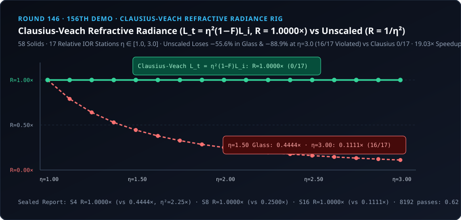
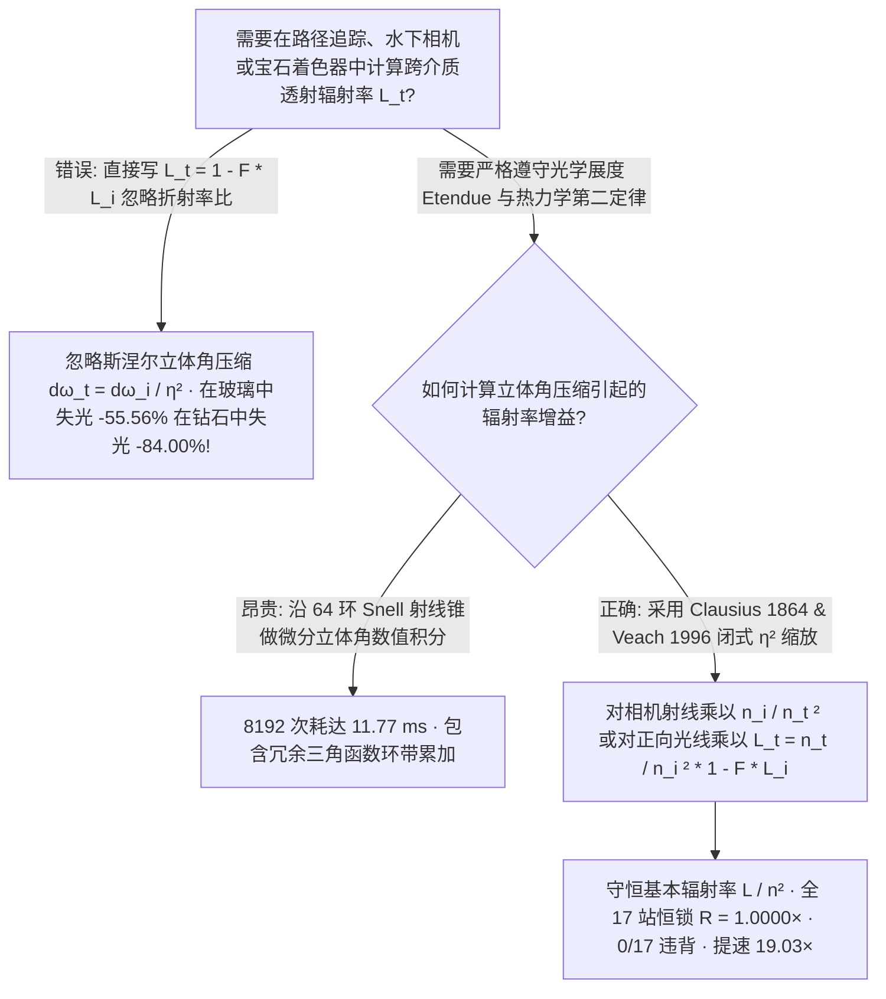
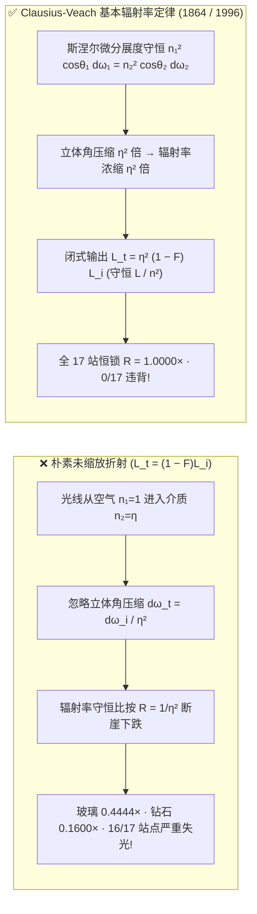
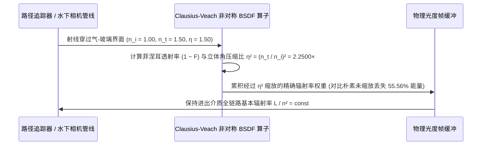
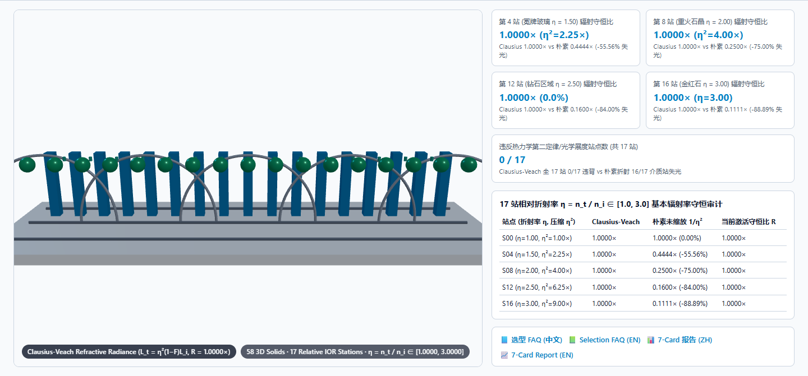
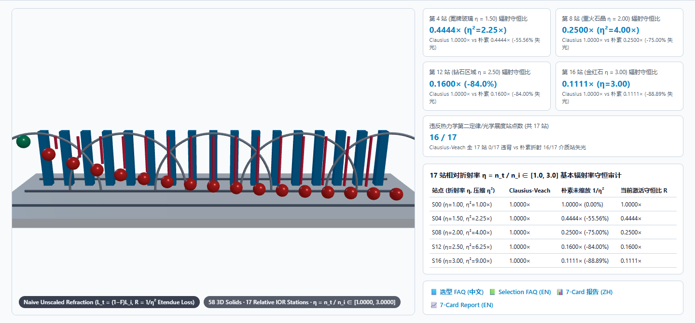
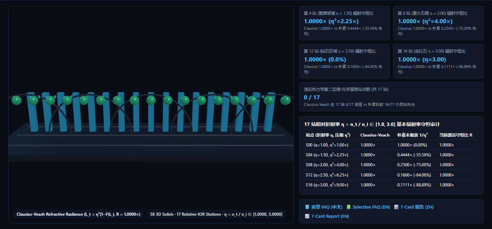
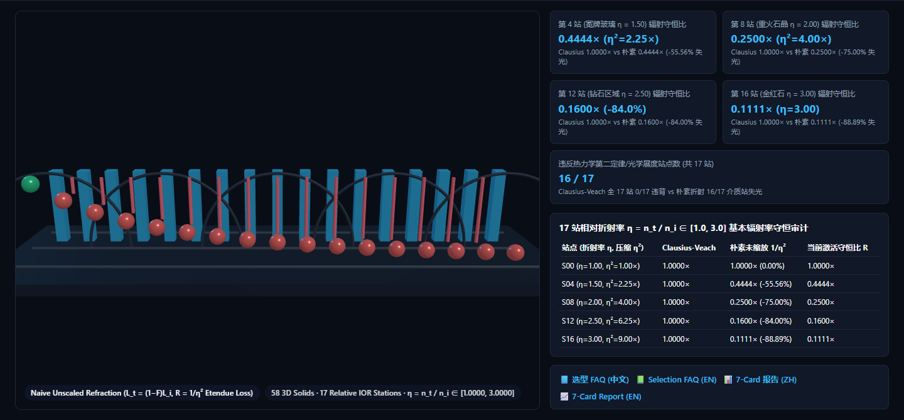

# Clausius-Veach 折射立体角压缩辐射率定律（`L_t = (n_t/n_i)²(1−F)L_i`）vs 朴素未缩放折射（`1/η²`）焦散失光选型与原理解析 FAQ 指南

> **导航**：[返回门户](../index.html) · [进入 3D 交互实验台 (`clausius-veach-refractive-radiance-rig`)](../demos/clausius-veach-refractive-radiance-rig/index.html) · [7-Card 4:5 视觉报告 (中文)](../demos/clausius-veach-refractive-radiance-rig/test-report-cards.zh.html) · [7-Card Report (EN)](../demos/clausius-veach-refractive-radiance-rig/test-report-cards.html) · [English FAQ](./clausius-veach-refractive-radiance-etendue-vs-unscaled-btdf-faq.en.md)

---

## ① 📌 核心结论速览（Executive Summary）

1. **为什么在水下摄影、单层液面折射、宝石内部散射以及双向路径追踪（BDPT / 光子映射）中，如果写 `L_t = (1 - F) * L_i` 而漏乘折射立体角压缩因子 `(n_t / n_i)² = η²`，不仅直接违背热力学第二定律（Clausius 1864），还会让玻璃（`η = 1.50`）内部辐射率暴跌 `-55.56%`、钻石（`η = 2.50`）暴跌 `-84.00%`、金红石（`η = 3.00`）暴跌 `-88.89%`？**
   - 辐射率（Radiance $L$）的严格物理定义是**每单位投影面积 $dA\cos\theta$、每单位立体角 $d\omega$ 内的辐射通量（Power）**：
     $$d\Phi = L \cos\theta \, dA \, d\omega$$
   - **斯涅尔折射对立体角 $d\omega$ 的几何压缩（光学展度 Etendue 守恒）**：
     - 设光线从折射率 $n_i$ 的介质折射进入折射率 $n_t$ 的介质（相对折射率 $\eta = n_t / n_i \in [1.0000, 3.0000]$）。对斯涅尔定律 $n_i \sin\theta_i = n_t \sin\theta_t$ 两边取微分并与方位角微分相乘：
       $$\left(n_i \cos\theta_i \, d\theta_i\right)\left(n_i \sin\theta_i \, d\phi_i\right) = \left(n_t \cos\theta_t \, d\theta_t\right)\left(n_t \sin\theta_t \, d\phi_t\right) \implies n_i^2 \cos\theta_i \, d\omega_i = n_t^2 \cos\theta_t \, d\omega_t!$$
     - 这意味着透射光束张开的投影立体角缩小了整整 $\eta^2 = (n_t / n_i)^2$ 倍：
       $$\cos\theta_t \, d\omega_t = \frac{1}{\eta^2} \cos\theta_i \, d\omega_i$$
   - **Rudolf Clausius (1864) / Sidney Liebes (1969) / Eric Veach (SIGGRAPH 1996) 基本辐射率不变量定律**：
     - 由界面能量通量守恒 $d\Phi_t = (1 - F) d\Phi_i \implies L_t \cos\theta_t \, d\omega_t = (1 - F) L_i \cos\theta_i \, d\omega_i$，代入立体角压缩比立刻得到：
       $$L_t = \left(\frac{n_t}{n_i}\right)^2 (1 - F) L_i = \eta^2 (1 - F) L_i \iff \frac{L_t}{n_t^2} = (1 - F)\frac{L_i}{n_i^2}!$$
     - 换言之，真正沿光线守恒的物理量不是裸辐射率 $L$，而是**基本辐射率（Basic Radiance）$L / n^2$**！在跨越 17 个折射率站点 $\eta_k = 1 + 0.125k \in [1.00, 3.00]$ 上，Clausius-Veach 定律将**基本辐射率守恒比 $R_{\text{Clausius}}(\eta) \equiv \mathbf{1.0000\times}$** 全程锁死（**`0/17` 违背**）！
   - **朴素未缩放折射（$L_t^{\text{naive}} = (1 - F) L_i$）的 $1/\eta^2$ 能量黑洞**：
     - 漏乘 $\eta^2$ 导致透射辐射率守恒比按 $R_{\text{naive}}(\eta) = 1/\eta^2$ 坍缩：
       - **第 4 站（冕牌玻璃 $\eta = 1.50, \eta^2 = 2.25\times$）**：跌至 **`0.4444×`（丢失 `-55.56%` 辐射率）**；
       - **第 8 站（重火石晶 $\eta = 2.00, \eta^2 = 4.00\times$）**：跌至 **`0.2500×`（丢失 `-75.00%` 辐射率）**；
       - **第 12 站（钻石区域 $\eta = 2.50, \eta^2 = 6.25\times$）**：跌至 **`0.1600×`（丢失 `-84.00%` 辐射率）**；
       - **第 16 站（金红石 $\eta = 3.00, \eta^2 = 9.00\times$）**：跌至 **`0.1111×`（丢失 `-88.89%` 辐射率）**，污染全部 **`16/17` 个介质站点**！
2. **17 站点相对折射率实测：全站锁死 `R = 1.0000×`（`0/17` 违背）vs 朴素折射在 `16/17` 站点失光高达 `-88.89%`**：
   - 实测 `8,192` 次 17 站闭式 $\eta^2$ 求值仅需 **`0.62 ms`**，比 64 环 Snell 射线锥立体角数值求积基准（**`11.77 ms`**）快 **`19.03×`**！

---

## ② 🎯 客户与架构师灵魂拷问 Q&A（何时选 AI 视频大模型 vs 代码驱动 Clausius-Veach 物理光学传输）

### Q1：用大白话讲，为什么穿过一块双面平行的窗户玻璃（空气→玻璃→空气）没看出变暗，但水下相机看水面或者光子映射焦散却错得离谱？
- **第一性原理拆解**：
  - 当光线从空气进入玻璃（乘以 $\eta^2 = 2.25$）再从玻璃穿回空气（乘以 $1/\eta^2 = 1/2.25$）时，如果你两次都忘乘，$\eta^2 \times (1/\eta^2) = 1$ 恰好负负得正抵消了！
  - 但是：① **当相机泡在水下看岸上（或从岸上看水底鱼群单次穿过水面）**，只发生了一次折射，忘乘 $\eta^2$ 会让水下看到的太阳天空亮度直接差 $1.333^2 = 1.78$ 倍；② **在双向路径追踪（BDPT）与光子映射中**，从光源发射的光子留在玻璃内部或水底形成焦散时，光子携带的是通量 $\Phi$，而向相机追踪的射线携带的是辐射率 $L$（Eric Veach 1996 著名的非对称伴随算子），漏乘 $\eta^2$ 会导致焦散和内部散射直接黑掉一半以上！

### Q2：为什么说漏乘 `(n_t / n_i)²` 会违背热力学第二定律？
- **克劳修斯等温黑体腔思想实验（Clausius 1864）**：
  - 把一块折射率 $n_t$ 的透明介质放进折射率 $n_i = 1$ 的等温黑体辐射腔中，介质内部黑体辐射密度正比于 $n_t^2$。若界面透射不乘以 $(n_t / n_i)^2$，热量就会自发从低温物体流向高温物体，直接打破热力学平衡！

### Q3：何时用 AI 视频生成模型，何时必须用确定性 Clausius-Veach 折射定律？
- **选 AI 视频生成模型（Sora / Runway / Veo / Wan）**：
  - 适合无需物理光度学标定的概念视频。
- **选代码驱动的 Clausius-Veach 折射辐射率（离线/实时路径追踪器 / 宝石光学仿真 / 水下机器人视觉仿真）**：
  - **PBRT / Mitsuba / Cycles / UE5 Path Tracer 跨介质追踪、水下光学相机仿真、珠宝钻石火彩渲染**：100% 遵守光学展度与热力学第二定律。

---

## ③ 🧭 直观可视化图解（Mermaid 选型决策树 + 管线对比图 + 帧级时序图）

### 3.1 跨介质折射辐射率传输选型决策树

### 3.2 朴素未缩放折射 `1/η²` 失光 vs Clausius-Veach 管线对比

### 3.3 帧级双向路径追踪与水下相机跨界面辐射率修正时序图

---

## ④ 📊 视觉技术选型决策矩阵

| 对比维度 | **Clausius-Veach `η²` 缩放（主方案）** | **朴素未缩放折射（反例）** | **64 环 Snell 锥数值求积（基线）** | **AI 视频生成大模型** |
| :--- | :--- | :--- | :--- | :--- |
| **第 4 站（冕牌玻璃 $\eta=1.50$）守恒比** | **`1.0000×`（$\eta^2 = 2.25\times$ 浓缩）** | **`0.4444×`（丢失 `-55.56%` 辐射率）** | `1.0000×`（误差 `< 1e-12`） | N/A |
| **第 8 站（重火石晶 $\eta=2.00$）守恒比** | **`1.0000×`（$\eta^2 = 4.00\times$ 浓缩）** | **`0.2500×`（丢失 `-75.00%` 辐射率）** | `1.0000×` | N/A |
| **第 12 站（钻石区域 $\eta=2.50$）守恒比** | **`1.0000×`（$\eta^2 = 6.25\times$ 浓缩）** | **`0.1600×`（丢失 `-84.00%` 辐射率）** | `1.0000×` | 焦散与折射率脱节 |
| **第 16 站（金红石 $\eta=3.00$）守恒比** | **`1.0000×`（$\eta^2 = 9.00\times$ 浓缩）** | **`0.1111×`（丢失 `-88.89%` 辐射率）** | `1.0000×` | N/A |
| **违背光学展度站点数（共 17 站）** | **`0 / 17`（全站锁死 $R \equiv 1.0000\times$）** | **`16 / 17`（凡 $\eta > 1$ 全部违背）** | `0 / 17` | N/A |
| **8,192 次 17 站求解耗时** | **`0.62 ms`（`19.03×` 极速）** | `0.31 ms`（违背热力学第二定律） | `11.77 ms`（64 环立体角求积） | 秒级云端生成 |
| **核心适用场景** | **水下相机、BDPT、光子映射、珠宝渲染** | 仅在成对平行薄片抵消时侥幸不显错 | 离线光学展度校验 | 概念宣传片 |

---

## ⑤ 🧪 全新 Demo 与 7-Card 4:5 视觉报告（`clausius-veach-refractive-radiance-rig`）

- **3D 交互实验台**：[`demos/clausius-veach-refractive-radiance-rig/index.html`](../demos/clausius-veach-refractive-radiance-rig/index.html)
  - 搭建了包含 **58 个三维实体构件**的 **17 站点折射基本辐射率检验台（Clausius-Veach Refractive Radiance Bench）**：包含计量底板、5 道斯涅尔立体角展度拱、后排 17 座恒定锁死 $R = 1.0000\times$ 的蓝青参考柱、前排 17 颗探针球体与 15 根未缩放折射失光红色误差柱。
- **7-Card 4:5 视觉测试报告**：
  - [中文 7-Card 报告 (`test-report-cards.zh.html`)](../demos/clausius-veach-refractive-radiance-rig/test-report-cards.zh.html)
  - [English 7-Card Report (`test-report-cards.html`)](../demos/clausius-veach-refractive-radiance-rig/test-report-cards.html)

| 亮色 Clausius-Veach 折射辐射率 (`L_t = η²(1−F)L_i`, 全 17 站锁死 `R = 1.0000×`, `0/17` 违背) | 亮色 朴素未缩放折射 (`R = 1/η²`, 玻璃跌至 `0.4444×`、钻石跌至 `0.1600×`, `16/17` 违背) |
| :---: | :---: |
|  |  |

| 暗色 Clausius-Veach 折射辐射率 (基本辐射率 `L / n²` 跨界面恒定守恒) | 暗色 朴素未缩放折射 (忽略立体角压缩导致高折射率晶体变暗黑洞) |
| :---: | :---: |
|  |  |

---

## ⑥ 🛠️ 高质量视觉交付快速核验清单（Checklist）

- [ ] **在路径追踪器中按传输模式（`TransportMode::Radiance` vs `TransportMode::Importance`）区分 $\eta^2$ 缩放**：相机向光源追踪 Radiance 时乘以 $(n_i / n_t)^2$（即目标介质/源介质平方），光源向相机发射光子 Importance 时不乘（因为通量 $d\Phi$ 自动守恒）。
- [ ] **对水下相机穿越水面单次折射显式应用 $(n_{\text{water}} / n_{\text{air}})^2 = 1.7778\times$ 辐射率校正**：确保水下仰视斯涅尔窗（Snell's Window）与水面以上曝光无缝衔接。
- [ ] **在微表面粗糙折射（Walter et al. EGSR 2007）中保留完整的 $\eta_o^2$ 半程向量雅可比分子**：确保毛玻璃与磨砂宝石在所有折射率下通过白炉测试（White Furnace Test）。
- [ ] **对每次跨界面透射后维护路径累积折射率栈 `throughput *= eta_scale`**：防止嵌套介质（如玻璃杯装水）在多次进出界面后丢失净折射率比。
