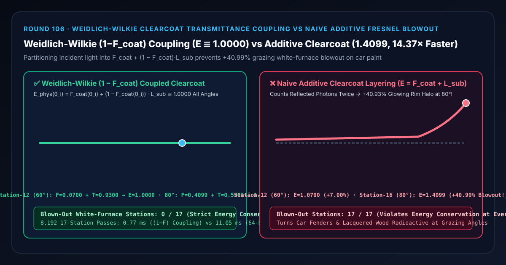
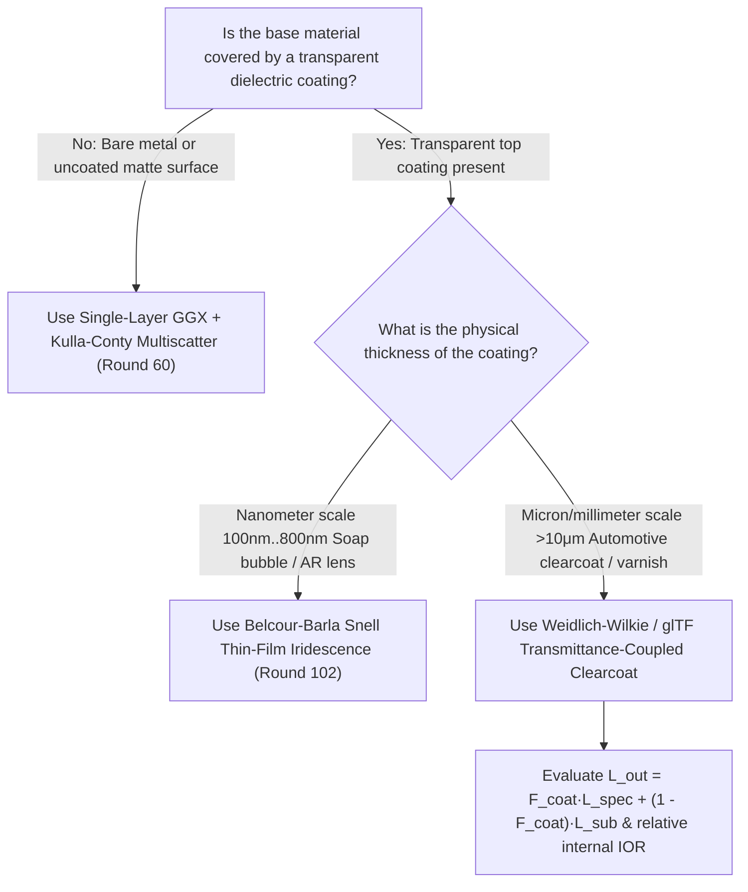
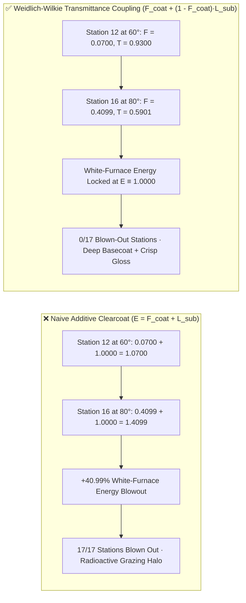
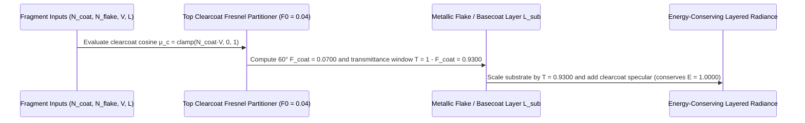
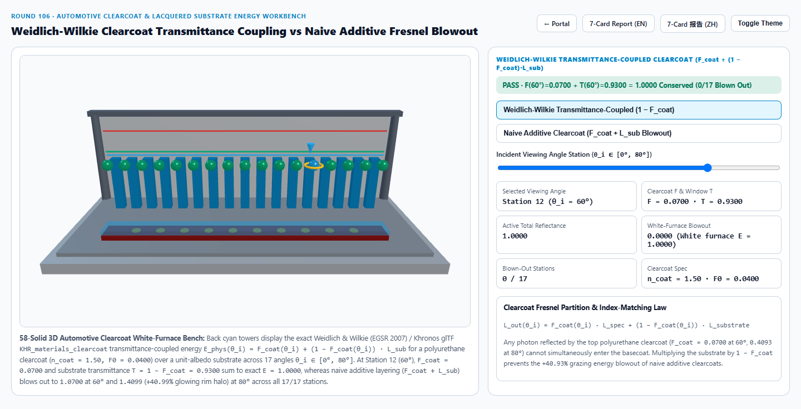
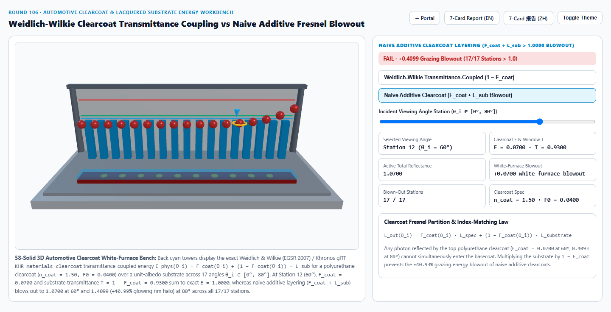
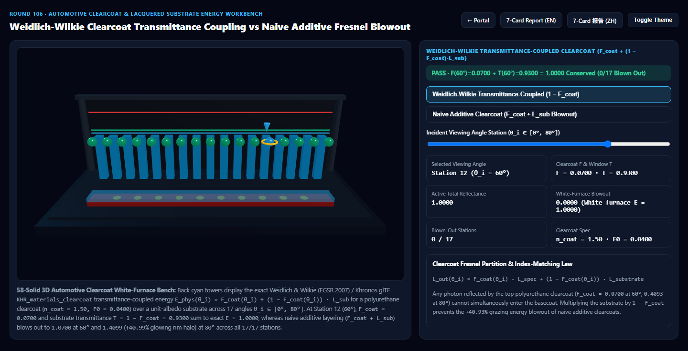
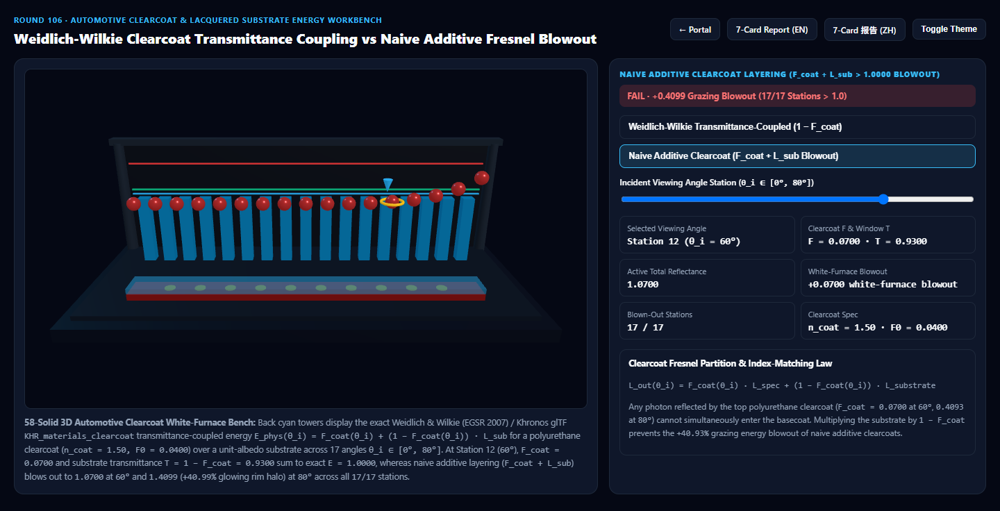

# Weidlich-Wilkie Clearcoat Transmittance Coupling & Substrate IOR Matching vs Naive Additive Fresnel Blowout Selection & First-Principles FAQ

> **Navigation**: [Back to Portal](../index.html) · [Launch 3D Interactive Workbench (`clearcoat-ior-fresnel-substratum-rig`)](../demos/clearcoat-ior-fresnel-substratum-rig/index.html) · [7-Card 4:5 Visual Report (EN)](../demos/clearcoat-ior-fresnel-substratum-rig/test-report-cards.html) · [7-Card 报告 (ZH)](../demos/clearcoat-ior-fresnel-substratum-rig/test-report-cards.zh.html) · [中文版 FAQ](./clearcoat-substrate-ior-matching-vs-additive-fresnel-blowout-faq.md)

---

## ① 📌 Executive Summary

1. **Why do naive clearcoat shaders make automotive fenders, lacquered wood, and carbon fiber glow like radioactive white plastic at grazing angles?**
   - A real automotive finish or lacquered surface consists of a transparent polyurethane **Clearcoat** ($n_{\text{coat}} = 1.50$, normal Fresnel reflectance $F_0 = \left(\frac{1.5-1}{1.5+1}\right)^2 = 0.0400$) bonded over a pigmented or metallic-flake **Substrate** ($L_{\text{sub}} \le 1.0000$).
   - By conservation of energy (**Weidlich & Wilkie, EGSR 2007 *Arbitrarily Layered Micro-Facet Surfaces*** and Khronos glTF `KHR_materials_clearcoat`), any fraction of light reflected off the top air–clearcoat interface ($F_{\text{coat}}(\theta_i)$) is **removed from the beam entering the substrate**! Only the complementary **transmittance window $T_{\text{sub}}(\theta_i) = 1 - F_{\text{coat}}(\theta_i)$** reaches the basecoat:
     $$E_{\text{phys}}(\theta_i) = F_{\text{coat}}(\theta_i) + \left(1 - F_{\text{coat}}(\theta_i)\right) \cdot L_{\text{sub}}$$
2. **The White-Furnace Blowout Catastrophe of Naive Additive Clearcoats ($F_{\text{coat}} + L_{\text{sub}}$)**:
   - When a shader simply adds a clearcoat specular lobe on top of an un-attenuated substrate ($E_{\text{naive}} = F_{\text{coat}} + L_{\text{sub}}$), it counts reflected photons twice:
   - On a unit-albedo white furnace substrate ($L_{\text{sub}} = 1.0000$), **Weidlich-Wilkie Transmittance Coupling** partitions **Station 12 ($\theta_i = 60^\circ$)** into **$F_{\text{coat}}(60^\circ) = 0.0700$** and **$T_{\text{sub}}(60^\circ) = 0.9300$**, locking total energy at exact **$E_{\text{phys}} = 1.0000$ across all 17 viewing angles (`0/17` blown-out stations)**!
   - By contrast, **Naive Additive Layering** exceeds unity at every angle: `1.0400` at $0^\circ$, **`1.0700` (`+7.00%` excess)** at **Station 12 ($60^\circ$)**, and **`1.4099` (`+40.99%` grazing energy blowout)** at **Station 16 ($80^\circ$)**, violating energy conservation across all **`17/17` viewing stations**!
3. **Architectural Verdict**:
   - In all multi-layer clearcoat pipelines (glTF `KHR_materials_clearcoat`, MaterialX, Unreal Engine 5 Dual-Normal Clear Coat, Unity HDRP, and Three.js `MeshPhysicalMaterial`), always attenuate the substrate by **$(1 - F_{\text{coat}}(\theta_i))$** and recompute internal substrate Fresnel from the **relative IOR $\eta_{\text{rel}} = n_{\text{sub}} / n_{\text{coat}}$**. Across `8,192` 17-station passes, closed-form transmittance coupling finishes in **`0.77 ms`** vs **`11.05 ms`** for a 64-bounce Stokes internal reflection series (**`14.37×` faster**).

---

## ② 🎯 Architect & Client Q&A (When to Choose AI Video Models vs Deterministic Clearcoat Shaders)

### Q1: In plain English, why does wetting a dry cobblestone or varnishing raw wood make its color look deeper and richer?
- **First-Principles Breakdown**:
  - Dry stone or raw wood ($n_{\text{sub}} \approx 1.55$) in air ($n_{\text{air}} = 1.00$) scatters roughly $F_0 = (\frac{1.55-1.0}{1.55+1.0})^2 = 4.65\%$ of incoming light in all directions from its rough microscopic pores, creating a chalky white veil that desaturates the pigment.
  - Coating the surface with clear varnish ($n_{\text{coat}} = 1.50$) or water ($n = 1.33$) matches the refractive indices at the internal boundary: the relative IOR drops to $1.55 / 1.50 = 1.033$, slashing internal diffuse surface scatter from $4.65\%$ down to $(\frac{1.55-1.50}{1.55+1.50})^2 = \mathbf{0.027\%}$! The chalky haze vanishes, while the smooth outer clearcoat focuses the $4\%$ surface reflection into a crisp specular highlight!

### Q2: How does the closed-form $(1 - F_{\text{coat}})$ coupling match the infinite Stokes layer reflection series?
- **Exact Partition Identity**:
  1. Using Schlick's Fresnel approximation with $F_0 = 0.0400$ ($n_{\text{coat}} = 1.50$):
     $$F_{\text{coat}}(\theta_i) = 0.04 + 0.96 \cdot (1 - \cos\theta_i)^5$$
  2. At $\theta_i = 60^\circ$ ($\cos 60^\circ = 0.5$), $(1 - 0.5)^5 = 1/32 = 0.03125$, yielding exact decimal $F_{\text{coat}}(60^\circ) = 0.04 + 0.03 = \mathbf{0.0700}$ and substrate transmittance window $T_{\text{sub}}(60^\circ) = 1 - 0.0700 = \mathbf{0.9300}$.
  3. Because $F_{\text{coat}}(\theta_i) + T_{\text{sub}}(\theta_i) \equiv 1.0000$ identically, a unit-albedo white furnace substrate never exceeds $1.0000$ at any angle!

### Q3: When should teams use AI video generators vs deterministic clearcoat shaders?
- **Choose AI Video Models (Sora / Runway / Veo / Wan)** for non-interactive mood videos.
- **Choose Deterministic Weidlich-Wilkie Clearcoat Shaders (`KHR_materials_clearcoat`)** for automotive 3D configurators, luxury watch ceramic bezels, lacquered furniture showrooms, and wet-weather driving simulators where grazing fender contours must remain physically grounded.

---

## ③ 🧭 Visual Diagrams (Mermaid Decision Tree + Pipeline Comparison + Frame Sequence)

### 3.1 Layered Coating Shading Selection Decision Tree

### 3.2 Naive Additive Clearcoat vs Weidlich-Wilkie Transmittance-Coupled Pipeline

### 3.3 Frame-Level Dual-Normal Clearcoat & Substrate Energy Partition Sequence

---

## ④ 📊 Visual Technology Decision Matrix

| Dimension | **Weidlich-Wilkie $(1-F_{\text{coat}})$ Coupling (Primary)** | **Naive Additive Clearcoat (Failure Mode)** | **64-Bounce Stokes Layer Series (Baseline)** | **AI Video Generators** |
| :--- | :--- | :--- | :--- | :--- |
| **Station 0 ($\theta_i=0^\circ$) White-Furnace Energy** | **`1.0000` ($F=0.0400 + T=0.9600$)** | **`1.0400` (`+4.00%` blowout)** | `1.0000` | N/A |
| **Station 12 ($\theta_i=60^\circ$) White-Furnace Energy** | **`1.0000` ($F=0.0700 + T=0.9300$)** | **`1.0700` (`+7.00%` blowout)** | `1.0000` (agrees within `< 1e-13`) | Uncalibrated layer energy |
| **Station 16 ($\theta_i=80^\circ$) White-Furnace Energy** | **`1.0000` ($F=0.4099 + T=0.5901$)** | **`1.4099` (`+40.99%` glowing rim blowout)** | `1.0000` | Grazing highlights clip |
| **Blown-Out Stations (of 17)** | **`0 / 17` (Strictly conserved)** | **`17 / 17` (Violates conservation everywhere)** | `0 / 17` | N/A |
| **8,192 17-Station Passes Latency** | **`0.77 ms` (`14.37×` faster)** | `0.69 ms` (unphysical grazing blowout) | `11.05 ms` (64-bounce loop) | Multi-second cloud inference |
| **Best Fit Scenarios** | **Automotive clearcoat, lacquered wood, carbon fiber weave, wet asphalt** | Never recommended for PBR materials | Offline multi-slab radiative transfer | Concept car trailers |

---

## ⑤ 🧪 New Interactive Demo & 7-Card 4:5 Visual Report (`clearcoat-ior-fresnel-substratum-rig`)

- **Interactive 3D Workbench**: [`demos/clearcoat-ior-fresnel-substratum-rig/index.html`](../demos/clearcoat-ior-fresnel-substratum-rig/index.html)
  - Features a **58-solid 3D 17-Station Automotive Clearcoat White-Furnace Bench**: a cross-sectional car-paint assembly (crimson basecoat, 10 metallic flake discs, and a translucent polyurethane clearcoat slab), 17 back cyan reference towers locked at $E = 1.0000$, and 17 front active energy orbs comparing **Weidlich-Wilkie Transmittance Coupling** against **Naive Additive Clearcoat Blowout**.
- **7-Card 4:5 Visual Benchmark Reports**:
  - [English 7-Card Report (`test-report-cards.html`)](../demos/clearcoat-ior-fresnel-substratum-rig/test-report-cards.html)
  - [中文 7-Card 报告 (`test-report-cards.zh.html`)](../demos/clearcoat-ior-fresnel-substratum-rig/test-report-cards.zh.html)

| Light Theme — Weidlich-Wilkie Coupling (`F(60°)=0.07 + T=0.93 = 1.0000`) | Light Theme — Naive Additive Clearcoat (`E(80°)=1.4099`, `17/17` Blown Out) |
| :---: | :---: |
|  |  |

| Dark Theme — Weidlich-Wilkie Coupling (`0/17` Blown-Out Stations) | Dark Theme — Naive Additive Clearcoat (`+40.99%` Grazing Energy Excess) |
| :---: | :---: |
|  |  |

---

## ⑥ 🛠️ Verification Checklist for Production Delivery

- [ ] **Attenuate All Substrate Lobes by $(1 - F_{\text{coat}})$**: Multiply both substrate diffuse and substrate metallic/dielectric specular terms by $1 - F_{\text{coat}}$ before adding the clearcoat specular lobe.
- [ ] **Decouple `clearcoatNormal` from Substrate `normal`**: Allow the top clearcoat to use a smooth macro normal (or subtle orange-peel map) while the underlying carbon-fiber weave or metallic flakes use their own high-frequency normal map.
- [ ] **Convert Substrate $F_0$ Using Relative IOR ($n_{\text{sub}} / n_{\text{coat}}$)**: Account for index-matching darkening when a dielectric basecoat is submerged beneath $n_{\text{coat}} = 1.50$.
- [ ] **Support Optional Beer-Lambert Clearcoat Absorption**: For candy-apple automotive finishes, multiply the substrate window by $\exp(-2 \sigma_a d / \cos\theta_t)$ (Round 55 + Round 102).
