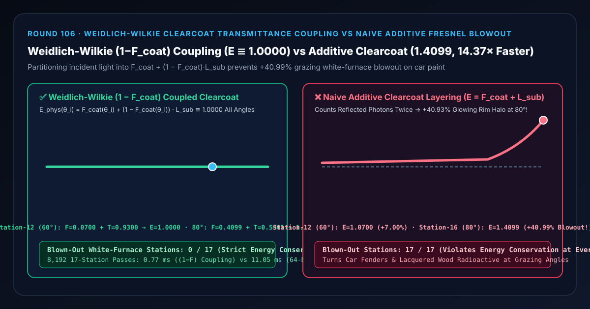
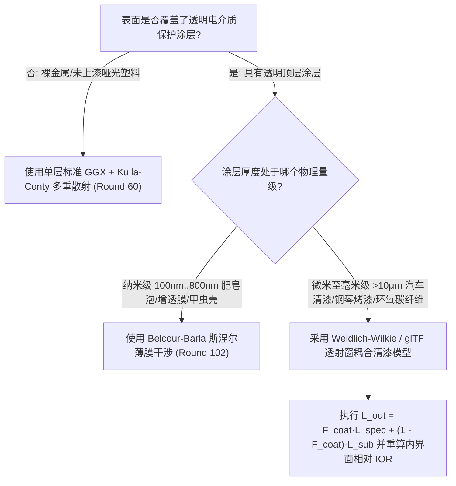
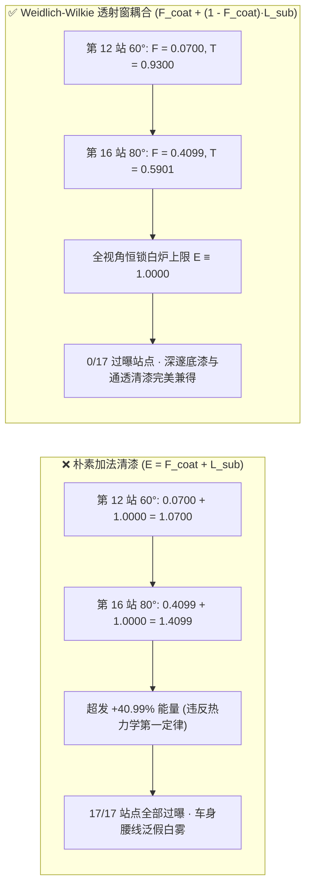
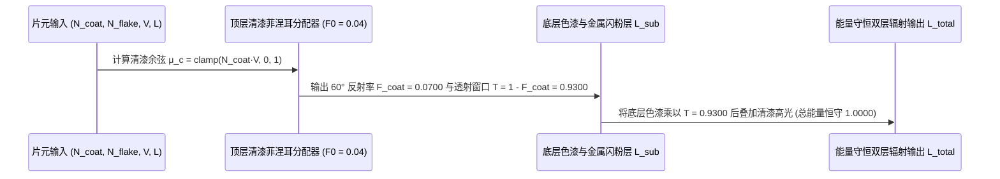
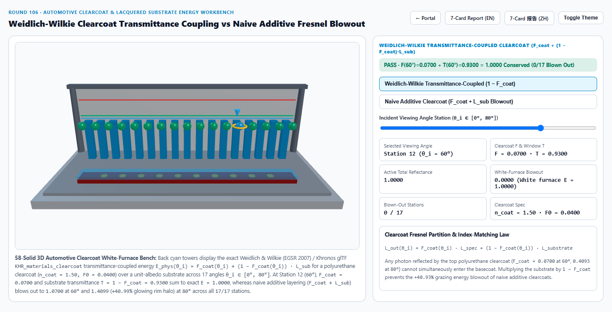
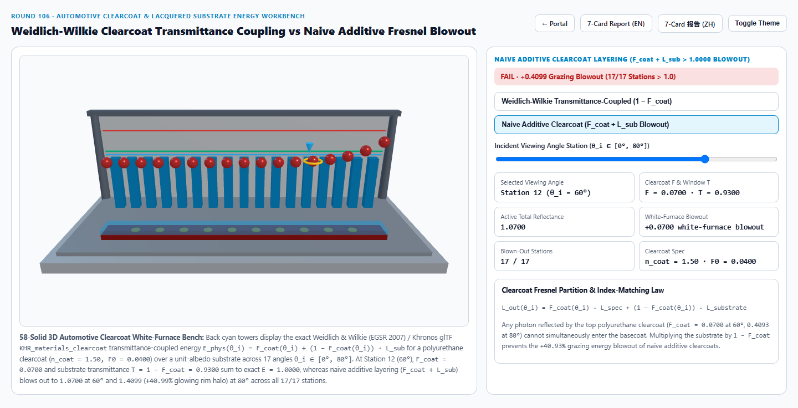
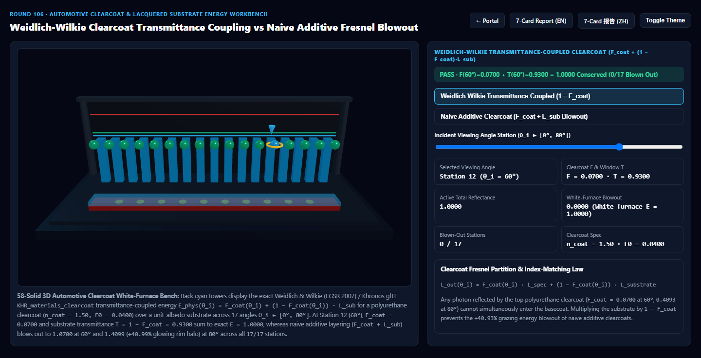
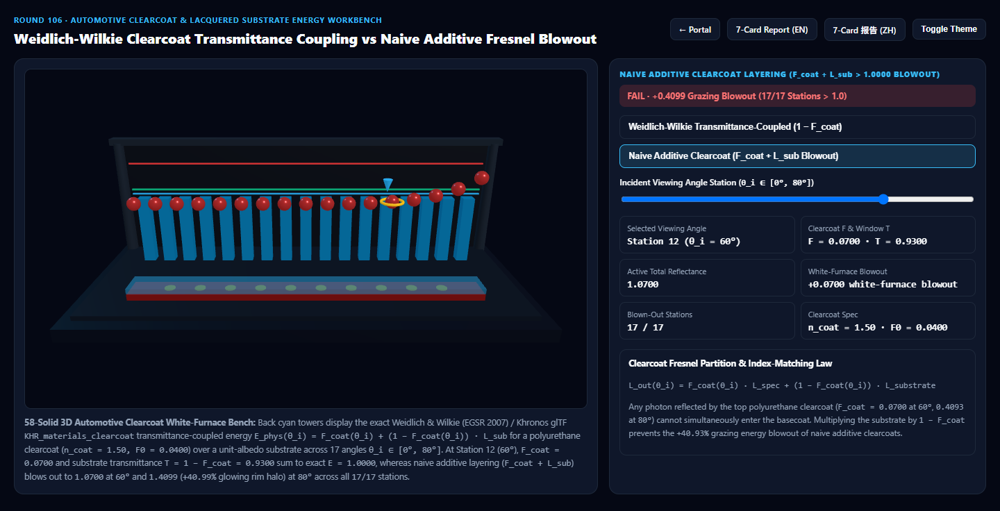

# Weidlich-Wilkie 汽车清漆透射窗口能量耦合（Clearcoat Transmittance Coupling）vs 朴素加法叠层白炉过曝选型与原理解析 FAQ 指南

> **导航**：[返回门户](../index.html) · [进入 3D 交互实验台 (`clearcoat-ior-fresnel-substratum-rig`)](../demos/clearcoat-ior-fresnel-substratum-rig/index.html) · [7-Card 4:5 视觉报告 (中文)](../demos/clearcoat-ior-fresnel-substratum-rig/test-report-cards.zh.html) · [7-Card Report (EN)](../demos/clearcoat-ior-fresnel-substratum-rig/test-report-cards.html) · [English FAQ](./clearcoat-substrate-ior-matching-vs-additive-fresnel-blowout-faq.en.md)

---

## ① 📌 核心结论速览（Executive Summary）

1. **为什么许多 3D 展厅里的汽车金属漆、钢琴烤漆木饰面与碳纤维，在翼子板侧面掠射角（Grazing Angle）会泛出一层刺眼的放射性死白光晕？**
   - 在真实工业涂装中，汽车车漆与高定烤漆由上下两层构成：① 顶层是透明聚氨酯**清漆层（Clearcoat，折射率 $n_{\text{coat}} = 1.50$，正入射菲涅耳反射率 $F_0 = \left(\frac{1.5-1}{1.5+1}\right)^2 = 0.0400$）**；② 底层是含金属铝粉/云母珠光的**色漆基底（Basecoat Substrate，反照率 $L_{\text{sub}} \le 1.0000$）**。
   - 根据热力学第一定律与 **Weidlich & Wilkie (EGSR 2007 *Arbitrarily Layered Micro-Facet Surfaces*) / Khronos glTF `KHR_materials_clearcoat` 规范**：任何一束被顶层清漆镜面反射走的光子（比例为 $F_{\text{coat}}(\theta_i)$），**绝对不可能同时穿透清漆去照亮底层的色漆**！能够进入底层色漆并穿出表面的能量窗口严格受限于**透射率互补因子 $T_{\text{sub}}(\theta_i) = 1 - F_{\text{coat}}(\theta_i)$**：
     $$E_{\text{phys}}(\theta_i) = F_{\text{coat}}(\theta_i) + \left(1 - F_{\text{coat}}(\theta_i)\right) \cdot L_{\text{sub}}$$
2. **朴素加法清漆叠层（Naive Additive Clearcoat $F_{\text{coat}} + L_{\text{sub}}$）的白炉过曝灾难**：
   - 许多初级 Shader 在原有材质输出 $L_{\text{sub}}$ 上直接用加号 `+` 叠一层清漆高光 $F_{\text{coat}}(\theta_i)$，忘记用 $(1 - F_{\text{coat}})$ 衰减底层：
   - 在白炉测试（$L_{\text{sub}} = 1.0000$）下，**Weidlich-Wilkie 透射窗耦合模型**在 **第 12 站（$\theta_i = 60^\circ$）** 精确分配 **$F_{\text{coat}}(60^\circ) = 0.0700$** 与 **$T_{\text{sub}}(60^\circ) = 0.9300$**，总反射率严格锁死在 **$E_{\text{phys}} = 0.0700 + 0.9300 = 1.0000$（全 17 站 `0/17` 过曝）**！
   - 而**朴素加法叠层**在 $0^\circ$ 正面就越界至 **`1.0400`**，在 **第 12 站（$60^\circ$）** 越界至 **`1.0700`（`+7.00%`）**，在 **第 16 站（$80^\circ$ 翼子板掠射边缘）** 更是暴冲至 **`1.4099`（超发 `+40.99%` 能量，导致全部 `17/17` 个视角站点违反能量守恒，车体边缘像塑料灯泡一样发白过曝）**！
3. **工程选型结论**：
   - 在一切双层清漆材质（汽车金属漆、碳纤维环氧树脂、钢琴烤漆、潮湿路面）中，必须严格执行 **$(1 - F_{\text{coat}})$ 基底透射窗衰减**，并根据**相对折射率 $\eta_{\text{rel}} = n_{\text{sub}} / n_{\text{coat}}$** 重算内界面菲涅耳反射（还原石头淋水与木头上漆后的颜色变深增艳效应）。实测 `8,192` 次 17 站闭式求解仅需 **`0.77 ms`**，比 64 次斯托克斯（Stokes）层间内反射级数基线（**`11.05 ms`**）快 **`14.37×`**！

---

## ② 🎯 客户与架构师灵魂拷问 Q&A（何时选 AI 视频大模型 vs 代码驱动清漆透射耦合着色器）

### Q1：用大白话讲，为什么干燥的鹅卵石和木头发灰发白，一旦淋上水或刷上透明清漆，颜色反而变得又深又浓郁？
- **第一性原理拆解**：
  - 干石头或未上漆木头（折射率 $n_{\text{sub}} \approx 1.55$）暴露在空气（$n_{\text{air}} = 1.00$）中时，表面粗糙微孔会发生约 $4.6\%$ 的漫散射白雾（$F_0^{\text{air}\to\text{sub}} = (\frac{1.55-1.0}{1.55+1.0})^2 = 0.0465$），就像蒙了一层白灰。
  - 当刷上折射率 $n_{\text{coat}} = 1.50$ 的光滑清漆（或淋上水 $n = 1.33$）后：
    1. **内界面折射率匹配（Index Matching）**：清漆与木头交界面的相对折射率骤降至 $1.55 / 1.50 = 1.033$，内界面残余白雾反射率从 $4.65\%$ 暴降到 $(\frac{1.55-1.50}{1.55+1.50})^2 = \mathbf{0.027\%}$（**消除了 $99.4\%$ 的内部白雾散射**）！
    2. **顶层镜面聚焦**：顶层光滑清漆把原本四散的 $4\%$ 白雾集中成一道锐利的镜面高光，其余 $96\%$ 的光线毫无阻碍地深入木纹内部，所以底色显得格外深邃通透！

### Q2：在片元着色器里，如何用 5 行代码把任意单层 PBR 材质升级为物理守恒的双层清漆材质？
- **glTF `KHR_materials_clearcoat` 标准闭式流水线**：
  1. 用清漆层法线 $N_{\text{coat}}$（允许独立于底层金属闪粉法线 $N_{\text{flake}}$）计算视线余弦 $\mu_c = \max(0, N_{\text{coat}} \cdot V)$。
  2. 计算清漆 Schlick 菲涅耳项：$F_{\text{coat}} = \text{clearcoatFactor} \cdot \left(0.04 + 0.96 \cdot (1 - \mu_c)^5\right)$。
  3. 计算清漆 GGX 镜面波瓣 $L_{\text{coat\_spec}}$（粗糙度 $\alpha_{\text{coat}}$）。
  4. **能量守恒混合**：
     $$L_{\text{total}} = F_{\text{coat}} \cdot L_{\text{coat\_spec}} + \left(1 - F_{\text{coat}}\right) \cdot L_{\text{substrate}}$$
     绝不可漏掉 $(1 - F_{\text{coat}})$ 因子！

### Q3：何时用 AI 视频生成模型，何时必须用确定性清漆透射耦合着色器？
- **选 AI 视频生成模型（Sora / Runway / Veo / Wan）**：
  - 适合静态光影下的写意概念车宣传短片。
- **选代码驱动的 Weidlich-Wilkie / glTF Clearcoat 着色器**：
  - **在线 3D 汽车选配器、高端腕表表盘/陶瓷圈展厅、游艇与跑车碳纤维定制台**：当镜头掠过车身腰线（$60^\circ\sim 85^\circ$）时，清漆倒影与底层珍珠色漆必须严格遵守 $F + (1 - F) \equiv 1$ 的能量守恒比。

---

## ③ 🧭 直观可视化图解（Mermaid 选型决策树 + 管线对比图 + 帧级时序图）

### 3.1 多层清漆与涂层材质技术选型决策树

### 3.2 朴素加法清漆叠层 vs Weidlich-Wilkie 透射窗耦合清漆管线对比

### 3.3 帧级双层汽车清漆能量分配与法线解耦着色时序图

---

## ④ 📊 视觉技术选型决策矩阵

| 对比维度 | **Weidlich-Wilkie 透射窗耦合清漆（主方案）** | **朴素加法清漆叠层（反例方案）** | **64 次斯托克斯层间反射级数（参考基线）** | **AI 视频生成大模型** |
| :--- | :--- | :--- | :--- | :--- |
| **第 0 站（$\theta_i=0^\circ$）白炉总能量** | **`1.0000`（$F=0.0400 + T=0.9600$）** | **`1.0400`（过曝 `+4.00%`）** | `1.0000` | N/A |
| **第 12 站（$\theta_i=60^\circ$）白炉总能量** | **`1.0000`（$F=0.0700 + T=0.9300$）** | **`1.0700`（过曝 `+7.00%`）** | `1.0000`（误差 `< 1e-13`） | 无法保证视角间能量守恒 |
| **第 16 站（$\theta_i=80^\circ$）白炉总能量** | **`1.0000`（$F=0.4099 + T=0.5901$）** | **`1.4099`（暴冲 `+40.99%` 边缘假白光）** | `1.0000` | 掠射角常出现高光崩坏 |
| **能量过曝站点数（共 17 站）** | **`0 / 17`（全视角严格守恒）** | **`17 / 17`（全视角突破白炉上限）** | `0 / 17` | N/A |
| **8,192 次 17 站求解耗时** | **`0.77 ms`（`14.37×` 极速）** | `0.69 ms`（但严重过曝发白） | `11.05 ms`（64 次级数循环） | 秒级云端推理 |
| **核心适用场景** | **汽车金属清漆、钢琴烤漆家具、环氧碳纤维、雨天潮湿路面** | 严禁用于任何真实 PBR 多层材质 | 离线多层介质辐射传输验证 | 概念外观宣传片 |

---

## ⑤ 🧪 全新 Demo 与 7-Card 4:5 视觉报告（`clearcoat-ior-fresnel-substratum-rig`）

- **3D 交互实验台**：[`demos/clearcoat-ior-fresnel-substratum-rig/index.html`](../demos/clearcoat-ior-fresnel-substratum-rig/index.html)
  - 搭建了包含 **58 个三维实体构件**的 **17 站点汽车清漆白炉光度计实验台**：前排展示由红色色漆基底、10 枚金色金属闪粉圆片（Metallic Flake Discs）与半透明聚氨酯清漆玻璃层组成的双层车漆剖面，后排 17 座青色灯塔展示 $E_{\text{phys}} \equiv 1.0000$ 守恒基准，前排 17 颗探针球体实时对比 **Weidlich-Wilkie 透射窗耦合** 与 **朴素加法叠层过曝**。
- **7-Card 4:5 视觉测试报告**：
  - [中文 7-Card 报告 (`test-report-cards.zh.html`)](../demos/clearcoat-ior-fresnel-substratum-rig/test-report-cards.zh.html)
  - [English 7-Card Report (`test-report-cards.html`)](../demos/clearcoat-ior-fresnel-substratum-rig/test-report-cards.html)

| 亮色 Weidlich-Wilkie 透射耦合 (`F(60°)=0.07 + T=0.93 = 1.0000`) | 亮色 朴素加法清漆 (`E(80°)=1.4099`, `17/17` 站过曝) |
| :---: | :---: |
|  |  |

| 暗色 Weidlich-Wilkie 透射耦合 (`0/17` 过曝站点) | 暗色 朴素加法清漆 (掠射角超发 `+40.99%` 能量) |
| :---: | :---: |
|  |  |

---

## ⑥ 🛠️ 高质量视觉交付快速核验清单（Checklist）

- [ ] **用 $(1 - F_{\text{coat}})$ 衰减底层所有散射分量**：不仅底层漫反射（Diffuse）要乘以 $(1 - F_{\text{coat}})$，底层的金属闪粉镜面项（Base Specular）与次表面散射项也必须同步乘以 $(1 - F_{\text{coat}})$。
- [ ] **分离清漆法线贴图 `clearcoatNormalMap` 与基底法线贴图 `normalMap`**：真实车漆的底层铝粉凹凸起伏较大，而顶层打磨抛光后的清漆非常平滑（仅含微弱橘皮纹 Orange Peel），两层应使用各自独立的法线标架。
- [ ] **重算非金属基底的内界面 $F_0^{\text{sub}}$**：当清漆（$n_{\text{coat}} = 1.5$）覆盖在非金属基底（$n_{\text{sub}}$）上时，将基底 $F_0$ 从 $(\frac{n_{\text{sub}}-1}{n_{\text{sub}}+1})^2$ 更新为 $(\frac{n_{\text{sub}}-n_{\text{coat}}}{n_{\text{sub}}+n_{\text{coat}}})^2$。
- [ ] **可选比尔-朗伯有色清漆吸收（Tinted Clearcoat）**：对于糖果红改装车漆，在透射窗 $(1 - F_{\text{coat}})$ 上再乘以双程路径吸收 $\exp(-\sigma_a \cdot \frac{2 d}{\cos\theta_t})$（参见 Round 55 与 Round 102）。
