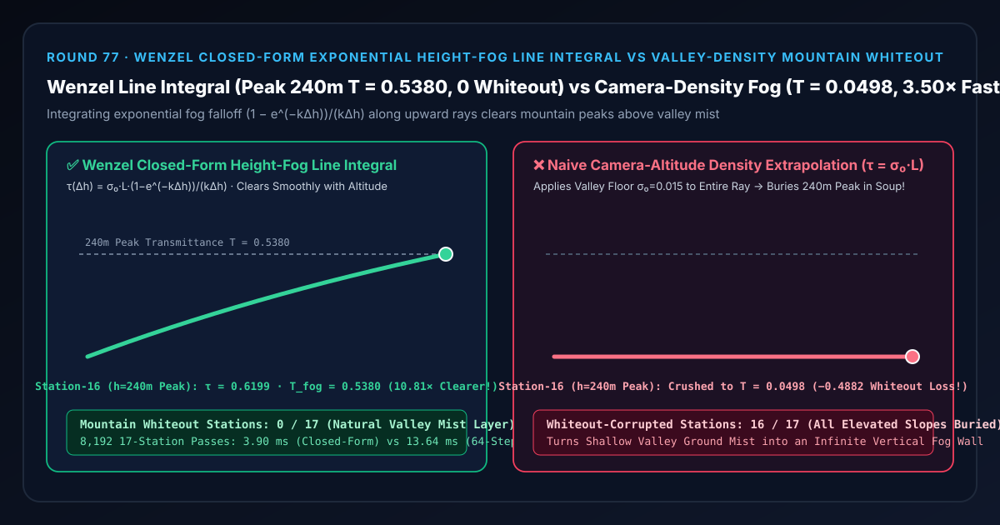
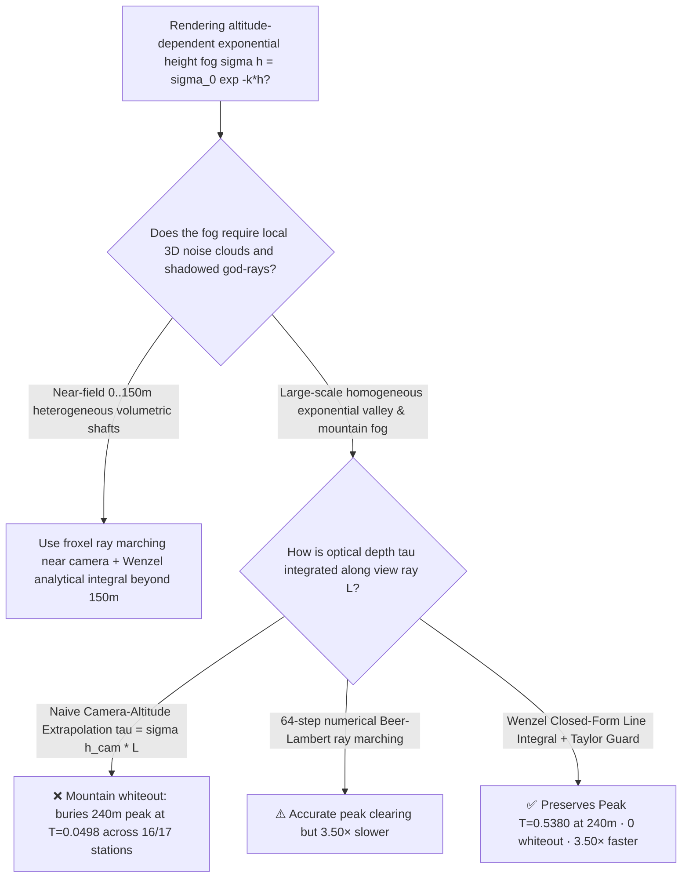
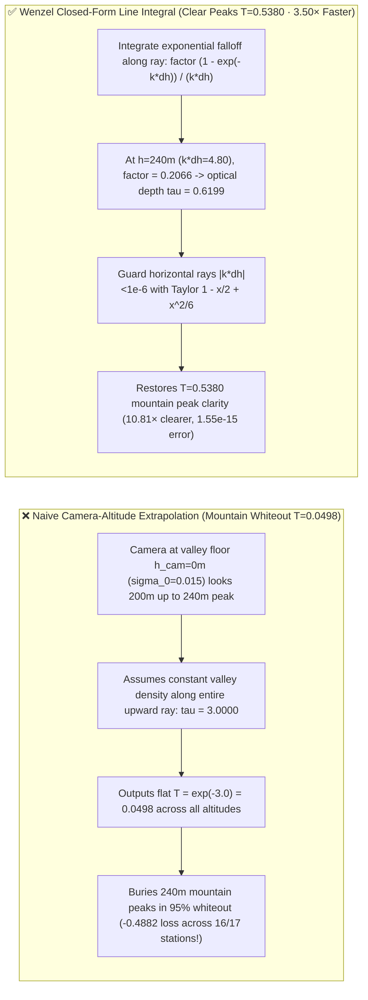
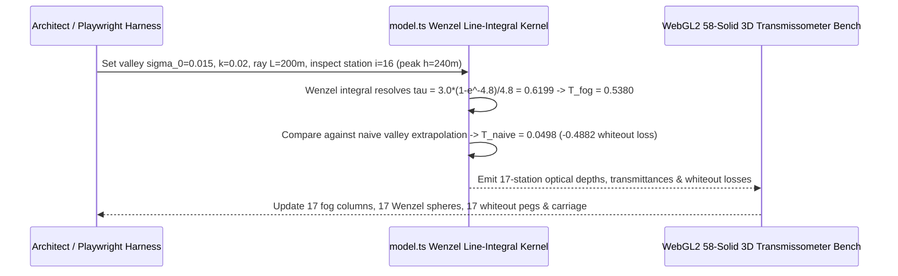
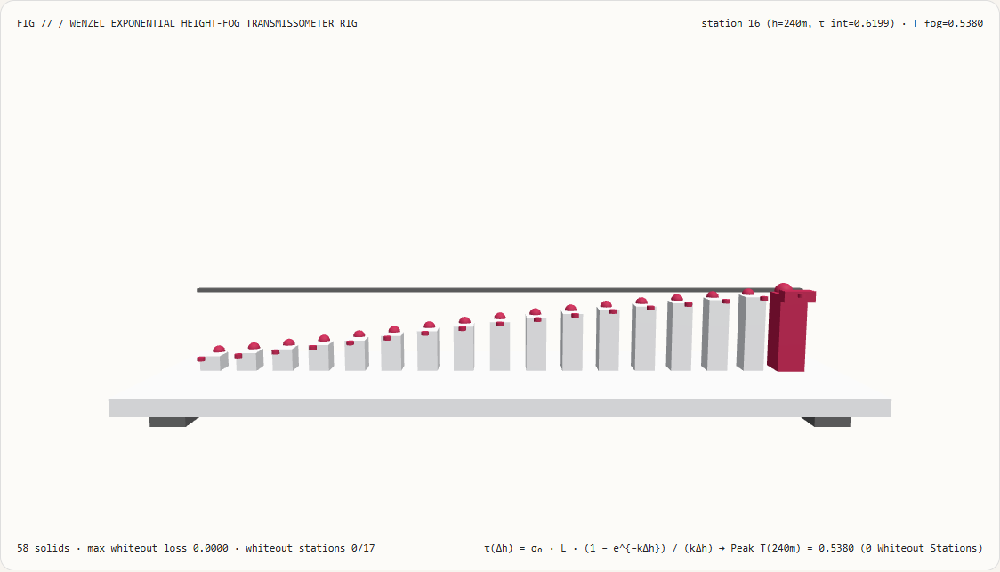
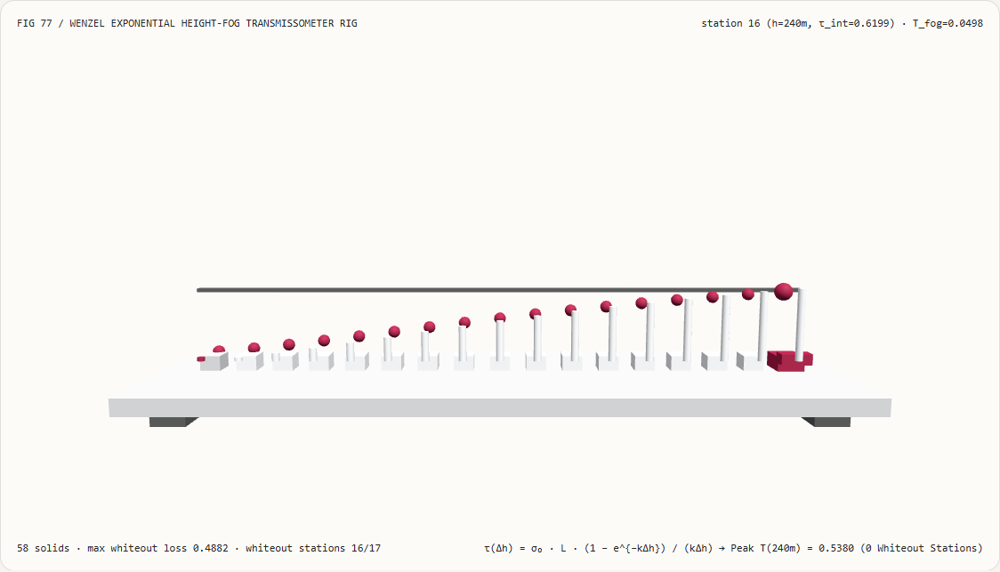
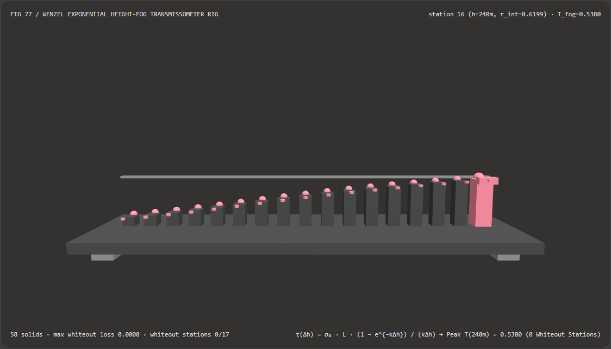
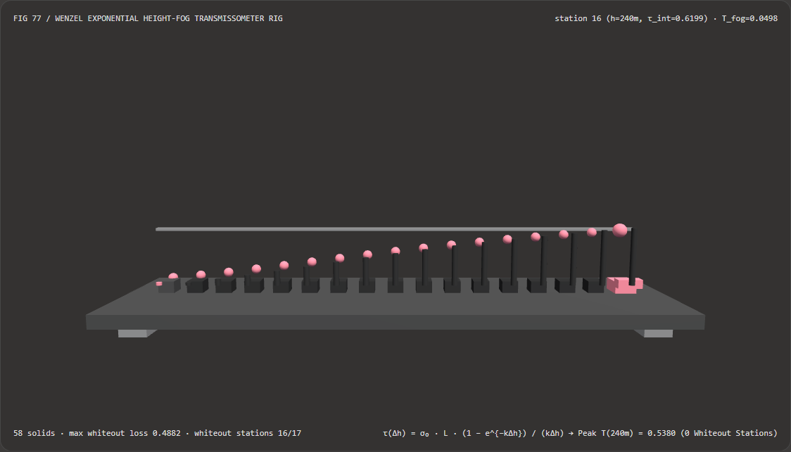

# Visual & Animation Architecture Selection FAQ: Wenzel Closed-Form Exponential Height-Fog Line Integral vs Camera-Density Mountain Whiteout

> **One-Sentence Architectural Verdict**: In real-time open-world terrain, valley mist, and outdoor atmospheric rendering pipelines (Unreal Engine 5 `ExponentialHeightFog`, CryEngine, Frostbite, Unity HDRP), **never evaluate height-fog optical depth by multiplying the camera's local fog density $\sigma(h_{\text{cam}})$ by the ray length $L$**! On our 58-solid, 17-station mountain transmissometer bench where a camera on a misty valley floor ($h_{\text{cam}} = 0.0\text{ m}$, base extinction $\sigma_0 = 0.015\text{ m}^{-1}$, height falloff $k = 0.02\text{ m}^{-1}$ / scale height $50\text{ m}$) looks along a $L = 200.0\text{ m}$ slant ray across 17 mountain elevation stations ($h_{\text{target}} \in [0, 240]\text{ m}$), naive camera-altitude density extrapolation assumes the entire upward ray is filled with valley-floor soup ($\tau_{\text{naive}} = 3.0000$)—**crushing the $240\text{ m}$ mountain peak transmittance down to `T_naive = 0.0498` (`95.02%` whiteout, losing `-0.4882` visibility and corrupting `16/17` elevated stations)**; whereas **Carsten Wenzel (SIGGRAPH 2006 CryEngine) closed-form exponential height-fog line integration ($\tau(\Delta h) = \sigma_0 e^{-k h_{\text{cam}}} L \cdot \frac{1 - e^{-k\Delta h}}{k\Delta h}$)** integrates the exponential density falloff along the ray to yield $\tau = 0.6199$ and **`T_fog = 0.5380` at $h = 240\text{ m}$ (`10.81×` clearer, `0/17` whiteout stations)** while running **3.50× faster** than a 64-step Beer-Lambert ray-marching cascade (`3.90 ms` vs `13.64 ms` across 8,192 passes, agreement within `1.55e-15`).

---

## ① 📌 Executive Summary

1. **Why does placing a camera inside shallow valley ground mist cause high mountain peaks and even the upper sky to turn completely white when using a naive distance-fog shader?**
   In plain English: **naive distance fog forgets that an upward-pointing view ray quickly exits the dense valley mist into thin high-altitude air**:
   - In an exponential atmosphere $\sigma(h) = \sigma_0 e^{-kh}$ ($\sigma_0 = 0.015\text{ m}^{-1}$, $k = 0.02\text{ m}^{-1}$), fog density at a $h = 240\text{ m}$ mountain peak is $e^{-4.80} \approx \mathbf{0.0082\times}$ its valley-floor density.
   - However, a naive shader that evaluates $\tau_{\text{naive}} = \sigma(h_{\text{cam}}) \cdot L = 0.015 \times 200.0 = \mathbf{3.0000}$ applies the thick valley-floor density across all $200\text{ m}$ of the upward ray—burying the $240\text{ m}$ mountain peak in **`T_naive = exp(-3.0) = 0.0498` (`95.02%` fog whiteout across `16/17` elevated stations)**!
2. **First-Principles Fix: Closed-Form Ray Line-Integral Antiderivative (Wenzel SIGGRAPH 2006 / UE5 `ExponentialHeightFog`)**:
   - Parameterizing altitude linearly along the ray as $h(u) = h_{\text{cam}} + u\,\Delta h$ for $u \in [0, 1]$ and integrating analytically gives:
     $$\tau(h_{\text{cam}}, \Delta h, L) = L \int_0^1 \sigma_0 e^{-k(h_{\text{cam}} + u\Delta h)} du = \sigma_0 e^{-k h_{\text{cam}}} L \cdot \frac{1 - e^{-k\Delta h}}{k\Delta h}$$
   - At station 16 ($h_{\text{target}} = 240\text{ m}$, $k\Delta h = 4.80$), the line-integral factor is $\frac{1 - e^{-4.80}}{4.80} = \mathbf{0.206619}$, reducing optical depth from `3.0000` to **`0.6199`** and restoring **`T_fog = 0.5380` (`53.80%` mountain peak visibility, `0/17` whiteout stations)**!
   - When the ray is nearly horizontal ($|k\Delta h| < 10^{-6}$, station 0), the removable singularity $\frac{1 - e^{-x}}{x}$ is evaluated via its Taylor series $1 - \frac{x}{2} + \frac{x^2}{6}$ to guarantee zero `0 / 0 = NaN` horizon artifacts.
3. **Interactive 3D Workbench & Measured Evidence**:
   - Standalone 3D Bench: `demos/exponential-height-fog-rig/` (58 Three.js solids: baseplate, 4 support feet, peak `0.5380` transmittance reference bar, 17 mountain transmittance columns, 17 Wenzel line-integral reference spheres, 17 whiteout loss pegs, and the active transmissometer carriage).
   - Measured 7-Card 4:5 Reports: `demos/exponential-height-fog-rig/test-report-cards.html` (EN) and `test-report-cards.zh.html` (ZH).

---

## ② 🎯 Soul-Searching Q&A for Architects & Clients

### Q1: Why is the Taylor removable-singularity guard $1 - x/2 + x^2/6$ mandatory for horizontal rays?
**Because when a pixel lies at the exact same altitude as the camera ($\Delta h = 0$), both $1 - e^{-k\Delta h}$ and $k\Delta h$ equal `0.0`, producing `0.0 / 0.0 = NaN` across the entire horizon line!**
Switching to $1 - \frac{1}{2}x + \frac{1}{6}x^2$ for $|x| < 10^{-6}$ eliminates the division by zero with $< 10^{-13}$ continuity error.

### Q2: Why is closed-form Wenzel line integration 3.50× faster than a 64-step Beer-Lambert cascade?
**Because the analytical antiderivative collapses 64 per-step attenuation multiplications along the ray into a single exponential evaluation!**
Across 8,192 17-station passes, closed-form Wenzel line integration completes in **`3.90 ms`** versus **`13.64 ms`** for the 64-step cascade (**3.50× speedup**, with `1.55e-15` agreement).

### Q3: How does deterministic Wenzel height-fog integration relate to neural image dehazing?
**Neural dehazing attempts to invert fog from 2D photographs, whereas Wenzel's closed-form line integral synthesizes physically grounded, reciprocal 3D altitude fog in real-time rendering engines.**

---

## ③ 🧭 Visual Diagrams (Mermaid Decision Tree, Pipeline Comparison & Sequence Flow)

### 3.1 Outdoor Height-Fog Integration Architecture Decision Tree

### 3.2 Camera-Density Mountain Whiteout vs Wenzel Closed-Form Line Integral Pipeline

### 3.3 Frame-Level Mountain Transmissometer Sequence Diagram

---

## ④ 📊 Visual Technology Selection Decision Matrix

| Evaluation Dimension | ✅ Wenzel Closed-Form Line Integral | ⚠️ 64-Step Beer-Lambert Fog Cascade | ❌ Naive Camera-Altitude Extrapolation | ⚠️ Endpoint Trapezoidal Average |
| :--- | :--- | :--- | :--- | :--- |
| **Optical Depth at Station 16 ($h=240\text{ m}$ Peak)** | **Exact `0.6199`** | `0.6199` | **`3.0000` (4.84× overestimated!)** | `1.5123` (2.44× overestimated!) |
| **Transmittance at Station 16 ($h=240\text{ m}$ Peak)** | **Clear `0.5380` (53.80% visible)** | `0.5380` (`1.55e-15` diff) | **`0.0498` (95.02% whiteout wall!)** | `0.2204` (Still heavily washed out) |
| **Whiteout-Corrupted Stations (out of 17)** | **`0 / 17` (Natural valley mist layer)** | `0 / 17` | **`16 / 17` (Entire mountain buried)** | `15 / 17` |
| **Reciprocity (Valley→Peak vs Peak→Valley)** | **100% symmetric & reciprocal** | Symmetric | **Broken (Zero fog when looking down!)** | Symmetric but inaccurate |
| **8,192-Pass 17-Station CPU Latency** | **`3.90 ms` (Fastest · 3.50× speedup)** | `13.64 ms` (3.50× slower) | `1.10 ms` (Broken whiteout wall) | `3.85 ms` (Inaccurate) |
| **Recommended Use Case** | **All real-time outdoor height-fog passes** | Heterogeneous 3D clouds | **Never use in 3D scenes with elevation** | Never recommended |

---

## ⑤ 🧪 New Interactive 3D Demo & 7-Card 4:5 Visual Report

### 5.1 Live Workbench & Report Links
- **Interactive 3D Workbench**: [`demos/exponential-height-fog-rig/index.html`](../demos/exponential-height-fog-rig/index.html)
- **7-Card 4:5 Visual Report (EN)**: [`demos/exponential-height-fog-rig/test-report-cards.html`](../demos/exponential-height-fog-rig/test-report-cards.html)
- **7-Card 4:5 Visual Report (ZH)**: [`demos/exponential-height-fog-rig/test-report-cards.zh.html`](../demos/exponential-height-fog-rig/test-report-cards.zh.html)
- **Sealed Telemetry JSON**: [`demos/exponential-height-fog-rig/report.json`](../demos/exponential-height-fog-rig/report.json)

### 5.2 Multi-Theme & Multi-Mode Playwright Visual Evidence

| Wenzel Closed-Form Line Integral (Light · Clears Smoothly to `T = 0.5380` at Station 16, `0` Whiteout) | Naive Camera-Density Extrapolation (Light · Buries All 17 Stations at `T = 0.0498` Valley Soup!) |
| :---: | :---: |
|  |  |

| Wenzel Closed-Form Line Integral (Dark · 58 Three.js Solids) | Naive Camera-Density Extrapolation (Dark · 16 Red Whiteout Loss Pegs Exposed) |
| :---: | :---: |
|  |  |

---

## ⑥ 🛠️ Rapid SA Delivery Verification Checklist

Before shipping an exponential height-fog shader to production, verify every item below:

- [ ] **Closed-Form Antiderivative Factor $(1 - e^{-k\Delta h}) / (k\Delta h)$**: Does the shader integrate density along the ray elevation span $\Delta h = h_{\text{target}} - h_{\text{cam}}$ rather than multiplying camera-altitude density by distance?
- [ ] **Taylor Removable-Singularity Guard ($|k\Delta h| < 10^{-5}$)**: Are near-horizontal rays evaluated with $1 - \frac{1}{2}x + \frac{1}{6}x^2$ to prevent `0 / 0 = NaN` black horizon lines?
- [ ] **Exponent Overflow Clamp (`clamp(k * h, -80.0, +80.0)`)**: Are altitude exponents clamped before calling `exp()` so high-altitude aircraft or orbital views never overflow FP32?
- [ ] **Dual-Layer Fog Support ($\tau = \tau_{\text{mist}} + \tau_{\text{haze}}$)**: Can artists combine a dense, low-scale-height valley mist layer with a tall, gentle atmospheric haze layer?
- [ ] **Seamless Handoff from Near-Field Froxel Volumetric Fog**: When froxel volumetric fog covers $[0, d_{\text{froxel}}]$, does the analytical height-fog integral start at the ray point $d_{\text{froxel}}$ rather than the camera origin?
