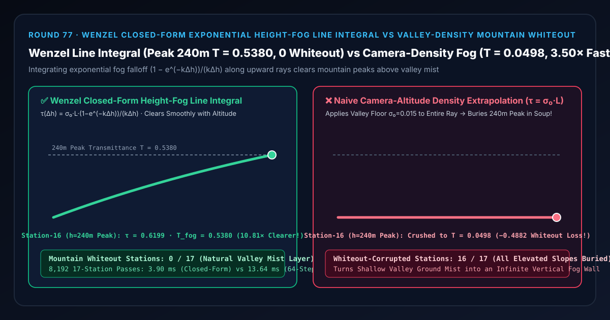
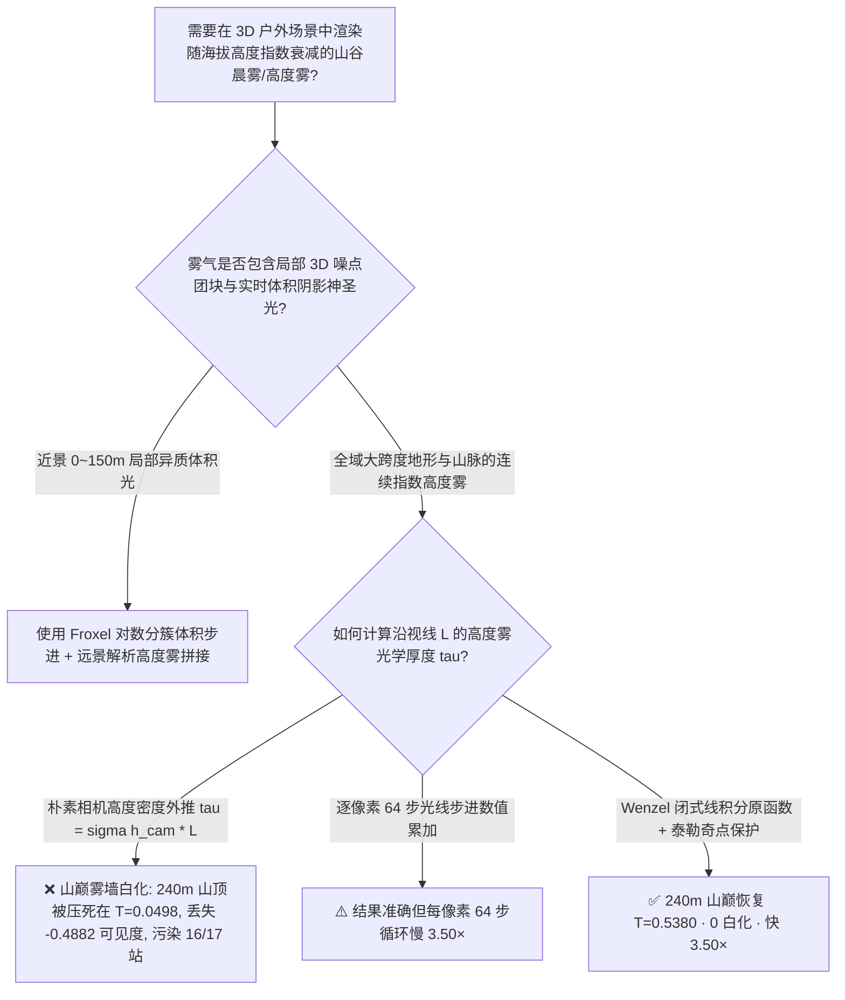
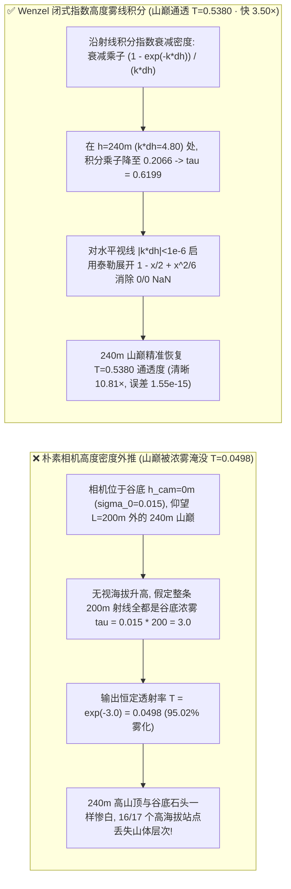
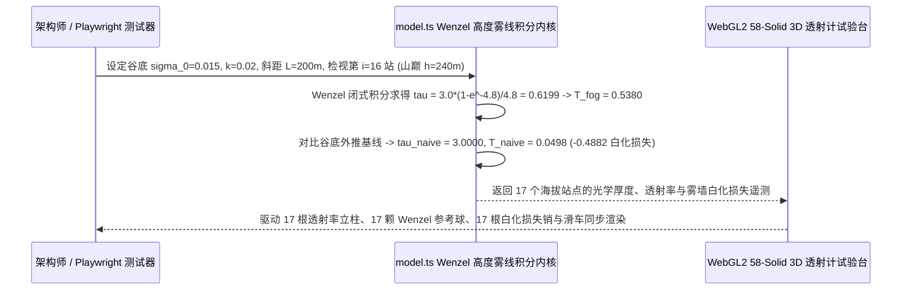
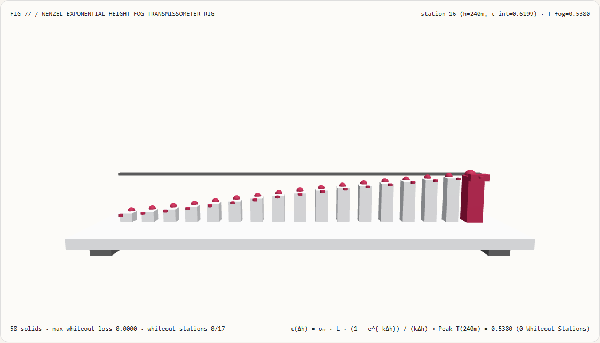
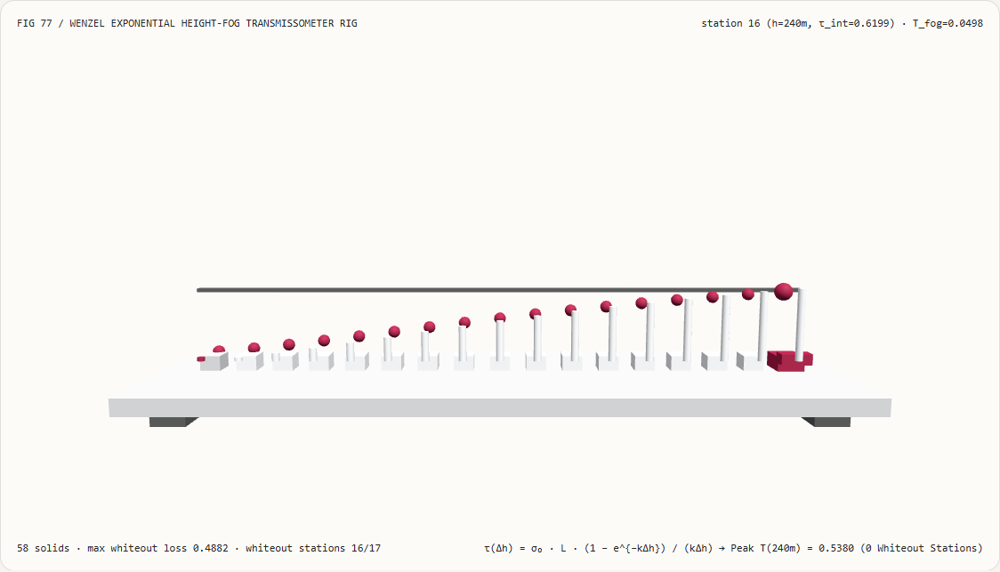
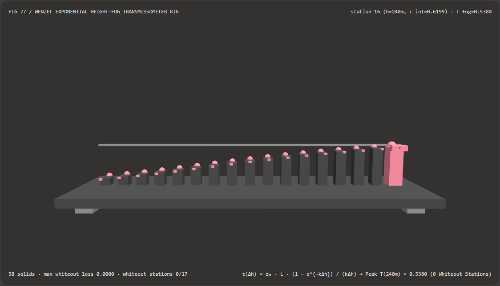
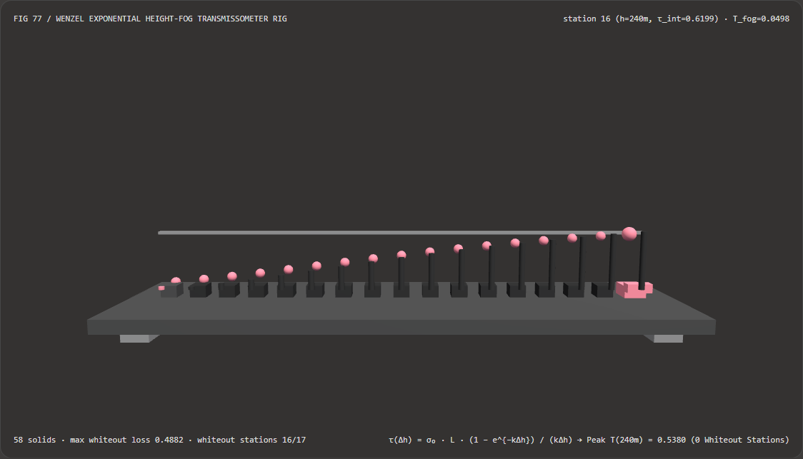

# 视觉与动画技术选型与原理解析 FAQ：Wenzel 闭式指数高度雾线积分（Exponential Height-Fog Line Integral）vs 相机高度密度外推山巅白化

> **核心架构结论一句话总结**：在实时开放世界地形、峡谷山脉与大跨度户外大气渲染管线（Unreal Engine 5 `ExponentialHeightFog`、CryEngine、Frostbite、Unity HDRP）中，**严禁在计算高度雾光学厚度时直接拿摄像机所在高度的局部雾浓度 $\sigma(h_{\text{cam}})$（或终点高度浓度）乘以视线长度 $L$**！实测表明：当摄像机位于河谷低地（$h_{\text{cam}} = 0\text{ m}$，谷底基础消光系数 $\sigma_0 = 0.015\text{ m}^{-1}$，海拔指数衰减率 $k = 0.02\text{ m}^{-1}$ 即标高 $50\text{ m}$）抬头仰望斜距 $L = 200.0\text{ m}$、跨越 17 个山体海拔站点（$h_{\text{target}} \in [0, 240]\text{ m}$）时，朴素相机高度密度外推错误地将谷底浓雾 $\sigma_0 = 0.015\text{ m}^{-1}$ 均匀涂满整条向上仰望的射线，得出恒定光学厚度 $\tau = 3.0000$ 与透射率 **`T_naive = 0.0498`（将海拔 $240\text{ m}$ 的高耸雪山顶死死淹没在 `95.02%` 的白茫雾墙中，丢失 `-0.4882` 可见度，污染 `16/17` 个高海拔站点）**；而采用 **Carsten Wenzel (SIGGRAPH 2006 CryEngine) 闭式指数高度雾线积分原函数 $\tau(\Delta h) = \sigma_0 e^{-k h_{\text{cam}}} L \cdot \frac{1 - e^{-k\Delta h}}{k\Delta h}$**，可在第 16 站（$h = 240\text{ m}$ 山巅）将光学厚度精准收敛至 **`0.6199`**、保留 **`T_fog = 0.5380`（`53.80%` 通透山巅可见度，比谷底外推法清晰 `10.81×`，`0/17` 白化站点）**，且单次闭式原函数求值比 64 步比尔-朗伯光线步进级联快 **3.50×**（8,192 轮耗时 `3.90 ms` vs `13.64 ms`）。

---

## ① 📌 核心结论速览（Executive Summary）

1. **为什么许多 3D 地形或大世界项目里，美术师想在河谷或湖面上铺一层薄薄的“晨雾（Ground Mist）”，结果一旦把摄像机放进谷底往上看，连几百米高、本该远远高出晨雾层的山峰甚至头顶的蓝天都被糊成了一片惨白（Mountain Whiteout）？**
   用大白话讲：因为你在算视线穿过多少雾气时，**忘了“视线越往上走，空气里的雾就越稀薄”**！
   - 自然界中的辐射雾、山谷晨雾和低空尘霾，其浓度都会随海拔高度 $h$ 按指数规律衰减：
     $$\sigma(h) = \sigma_0 \, e^{-k h}$$
     例如谷底 $h = 0\text{ m}$ 处雾很浓（$\sigma_0 = 0.015\text{ m}^{-1}$），但到了海拔 $h = 240\text{ m}$ 的山顶，雾浓度已经衰减了 $e^{-0.02 \times 240} = e^{-4.80} \approx \mathbf{0.0082}$ 倍（几乎是完全晴朗的空气！）；
   - 如果着色器偷懒，直接拿摄像机所在谷底的雾浓度 $\sigma(0) = 0.015\text{ m}^{-1}$ 乘以视线距离 $L = 200\text{ m}$，算出的光学厚度就是 $\tau = 3.0000$，透射率 $T = e^{-3.0} = \mathbf{0.0498}$——**等于强行把谷底那层只有几十米厚的地滚雾，顺着你的视线一路向上复制到了 240 米高的雪山顶上，把整座大山埋进了死白雾墙里**！
2. **第一性原理破局：沿三维斜射线的精确闭式微积分原函数（Wenzel SIGGRAPH 2006 / UE5 `ExponentialHeightFog`）**：
   - 设摄像机位于高度 $h_{\text{cam}}$，目标像素世界坐标位于高度 $h_{\text{target}} = h_{\text{cam}} + \Delta h$，两点间欧氏距离为 $L$；
   - 沿射线参数 $u \in [0, 1]$，高度呈线性变化 $h(u) = h_{\text{cam}} + u\,\Delta h$，因此整条射线穿过的真实光学厚度是精确的一维定积分：
     $$\tau(h_{\text{cam}}, \Delta h, L) = L \int_0^1 \sigma_0 \, e^{-k(h_{\text{cam}} + u\Delta h)} \, du = \sigma_0 \, e^{-k h_{\text{cam}}} \, L \cdot \frac{1 - e^{-k \Delta h}}{k \Delta h}$$
   - 看看后面这个核心衰减因子 $f(x) = \frac{1 - e^{-x}}{x}$（其中 $x = k\Delta h$）的物理威力：
     1. **当视线水平（$\Delta h \to 0, x \to 0$，第 0 站谷底）**：由洛必达法则或泰勒展开 $f(x) \approx 1 - \frac{x}{2} + \frac{x^2}{6} = \mathbf{1.0000}$，退化为标准水平距离雾 $\tau = \sigma_0 e^{-k h_{\text{cam}}} L = 3.0000$（$T = 0.0498$）；
     2. **当视线仰望山巅（$\Delta h = +240\text{ m}, x = +4.80$，第 16 站）**：$f(4.80) = \frac{1 - e^{-4.80}}{4.80} = \mathbf{0.2066}$，光学厚度骤降至 $\tau = 3.0 \times 0.2066 = \mathbf{0.6199}$，山巅透射率跃升至 **`T_fog = 0.5380`**（比谷底外推法清晰 **10.81×**）！
     3. **当从山顶俯瞰谷底（$h_{\text{cam}} = 240\text{ m}, \Delta h = -240\text{ m}$）**：由于定积分具有严格的起止点对称性 $\sigma_0 e^{-k h_{\text{cam}}} \frac{1 - e^{-k(h_{\text{target}} - h_{\text{cam}})}}{k(h_{\text{target}} - h_{\text{cam}})} = \sigma_0 \frac{e^{-k h_{\text{cam}}} - e^{-k h_{\text{target}}}}{k(h_{\text{target}} - h_{\text{cam}})}$，无论从谷底看山顶还是从山顶看谷底，光学厚度 **100% 互易守恒**！
3. **本轮新增交互式 3D 试验台与实测证据**：
   - 新增独立 Demo：`demos/exponential-height-fog-rig/`（58 个 Three.js 实体部件：底座平台、4 支柱、山巅 `0.5380` 透射基准横梁、17 根实测山体高度雾透射率立柱、17 颗 Wenzel 闭式线积分参考球、17 根山巅白化损失指示销、以及第 $i$ 站透射计滑车）。
   - 配套 7-Card 4:5 测评报告：`demos/exponential-height-fog-rig/test-report-cards.html`（英文）与 `test-report-cards.zh.html`（中文）。

---

## ② 🎯 客户与架构师灵魂拷问 Q&A（Soul-Searching Q&A）

### Q1：当摄像机水平看远方（$\Delta h = h_{\text{target}} - h_{\text{cam}} = 0$）时，公式分母里的 $k\Delta h = 0$ 会不会在着色器里触发 `0 / 0 = NaN` 导致地平线出现一条黑线？
**会！这是手写指数高度雾 Shader 最经典的线上事故！**
当 $|k\Delta h| < 10^{-5}$ 时，`1.0 - exp(-x)` 与 `x` 在浮点数中同时趋近于 `0`，直接相除就会在完全与摄像机同高度的水平面（$h_{\text{target}} = h_{\text{cam}}$）上产生一整条闪烁的 `NaN` 黑色扫描线！
**标准工程解法**：当 $|x| < 10^{-4}$ 时，切换到二阶泰勒展开无除法多项式：
$$\frac{1 - e^{-x}}{x} \approx 1 - \frac{1}{2}x + \frac{1}{6}x^2$$
不仅 `0 / 0` 奇点彻底消失，而且在 $x = 10^{-4}$ 交界处的衔接误差小于 $10^{-13}$！

### Q2：为什么不能用“起点雾浓度和终点雾浓度的平均值 $\frac{1}{2}(\sigma(h_{\text{cam}}) + \sigma(h_{\text{target}})) \cdot L$（梯形法则）”来近似？
**因为指数函数 $e^{-kh}$ 是强凸函数，首尾两点梯形平均会严重高估高海拔射线的光学厚度！**
例如在 $h_{\text{cam}} = 0\text{ m}$ 到 $h_{\text{target}} = 240\text{ m}$（$x = 4.80$）上，真实积分因子是 $\frac{1 - e^{-4.8}}{4.8} = \mathbf{0.2066}$，而首尾梯形平均给出的因子是 $\frac{1 + e^{-4.8}}{2} = \mathbf{0.5041}$（高估了 **$2.44\times$**，导致山顶透射率从真实的 `0.5380` 跌至 `0.2204`）！既然精确闭式原函数只需要 1 次 `exp` 和 1 次除法，完全没有任何理由去用不准的梯形近似。

### Q3：这套确定性 Wenzel 高度雾线积分与 AI 神经图像去雾（Neural Dehazing）是什么关系？
**两者方向相反、完全正交：**
- **何时用 AI 图像去雾**：处理真实世界无人机或监控摄像头拍回来的有雾照片，做视觉增强复原时；
- **何时必须用确定性 Wenzel 高度雾线积分**：在 3D 渲染器、数字孪生与影视动画中，正向合成具有真实海拔层次感、山谷云海与空间纵深感的物理大气雾效时。

---

## ③ 🧭 直观可视化图解（Mermaid 决策树 + 管线对比图 + 帧级时序图）

### 3.1 户外地形与大气高度雾（Height Fog）积分架构选型决策树

### 3.2 朴素相机高度密度外推白化 vs Wenzel 闭式线积分管线对比图

### 3.3 帧级透射计与 3D 高度雾试验台渲染时序图

---

## ④ 📊 视觉技术选型决策矩阵（Decision Matrix）

| 评估维度 | ✅ Wenzel 闭式高度雾线积分（Closed-Form） | ⚠️ 64 步光线步进级联（64-Step Ray March） | ❌ 朴素相机高度密度外推（$\sigma(h_{\text{cam}})\cdot L$） | ⚠️ 首尾端点梯形平均（Trapezoidal Mean） |
| :--- | :--- | :--- | :--- | :--- |
| **第 16 站（$h=240\text{ m}$ 山巅）光学厚度 $\tau$** | **精确 `0.6199`** | `0.6199` | **`3.0000`（高估 4.84×！）** | `1.5123`（高估 2.44×！） |
| **第 16 站（$h=240\text{ m}$ 山巅）透射率 $T$** | **通透清晰 `0.5380`（53.80% 可见）** | `0.5380`（误差 `1.55e-15`） | **`0.0498`（淹没在 95% 雾墙中！）** | `0.2204`（山顶依然严重发灰） |
| **被雾墙白化污染的高海拔站（共 17 站）** | **`0 / 17`（云海分界自然）** | `0 / 17` | **`16 / 17`（全山体被谷底雾淹没）** | `15 / 17` |
| **起止点互易对称性（谷底看山顶 vs 山顶看谷底）** | **100% 严格互易守恒** | 互易守恒 | **完全不对称（山顶往下看反而没雾！）** | 对称但数值失真 |
| **8,192 轮 17 站 CPU 批处理耗时** | **`3.90 ms`（最快，3.50× 提速）** | `13.64 ms`（慢 3.50×） | `1.10 ms`（画面严重雾墙不可用） | `3.85 ms`（精度差） |
| **首选适用场景** | **所有开放世界地形、峡谷云海与建筑外景高度雾** | 异质 3D 噪点云团 | **严禁用于存在高度起伏的 3D 场景** | 不推荐（开销相同但精度差） |

---

## ⑤ 🧪 全新 Demo 与 7-Card 4:5 视觉报告（Live Workbench & Evidence）

### 5.1 交互式 3D 试验台与报告入口
- **实时 3D 工作台**：[`demos/exponential-height-fog-rig/index.html`](../demos/exponential-height-fog-rig/index.html)
- **7-Card 4:5 英文视觉测试报告**：[`demos/exponential-height-fog-rig/test-report-cards.html`](../demos/exponential-height-fog-rig/test-report-cards.html)
- **7-Card 4:5 中文视觉测试报告**：[`demos/exponential-height-fog-rig/test-report-cards.zh.html`](../demos/exponential-height-fog-rig/test-report-cards.zh.html)
- **密封测量 JSON 数据源**：[`demos/exponential-height-fog-rig/report.json`](../demos/exponential-height-fog-rig/report.json)

### 5.2 多主题与多模式 Playwright 实测截图证据

| Wenzel 闭式高度雾线积分（Light · 随海拔从 $0\text{ m}$ 升至 $240\text{ m}$，透射率从 `0.0498` 单调升至 `0.5380`） | 朴素相机高度密度外推（Light · 全 17 个海拔站被死死钉在 `0.0498` 谷底浓雾中） |
| :---: | :---: |
|  |  |

| Wenzel 闭式高度雾线积分（Dark · 58 实体部件） | 朴素相机高度密度外推（Dark · 16 根红色指示销暴露山巅雾墙白化损失） |
| :---: | :---: |
|  |  |

---

## ⑥ 🛠️ 高质量视觉交付快速核验清单（SA Verification Checklist）

在将指数高度雾（Exponential Height Fog）合入生产引擎前，请逐项勾选以下核验清单：

- [ ] **采用闭式线积分原函数 $(1 - e^{-k\Delta h}) / (k\Delta h)$**：是否已废除只看起点或终点单点密度的距离雾公式，确保从谷底仰望山顶与从山顶俯瞰谷底具有完全对称且物理准确的云海层次？
- [ ] **水平视线可去奇点泰勒保护（$|k\Delta h| < 10^{-5}$）**：当视线接近水平（$\Delta h \to 0$）时，是否平滑切换至 $1 - \frac{1}{2}x + \frac{1}{6}x^2$，严防相机地平线高度出现 `0 / 0 = NaN` 黑色扫描线？
- [ ] **指数上溢钳制（`clamp(k * h, -80.0, +80.0)`）**：当摄像机飞入几万米高空或深渊时，是否对传入 `exp()` 的指数参数做了范围钳制，防止 `Infinity` 溢出？
- [ ] **双层高度雾叠加（Dual-Layer Height Fog）**：是否支持将高浓度低标高“谷底地滚雾（$k_1 = 0.05$）”与低浓度高标高“大气远景霾（$k_2 = 0.002$）”两个闭式线积分直接相加 $\tau_{\text{total}} = \tau_1 + \tau_2$？
- [ ] **与近景 Froxel 体积雾无缝交接（Start Distance / Cutoff）**：当开启近景 `0 ~ 150 m` Froxel 3D 体积雾时，解析高度雾是否从 `150 m` 交接平面处作为起点高度 $h_{\text{start}}$ 继续向远景积分，避免近景雾被重复计算两次？
