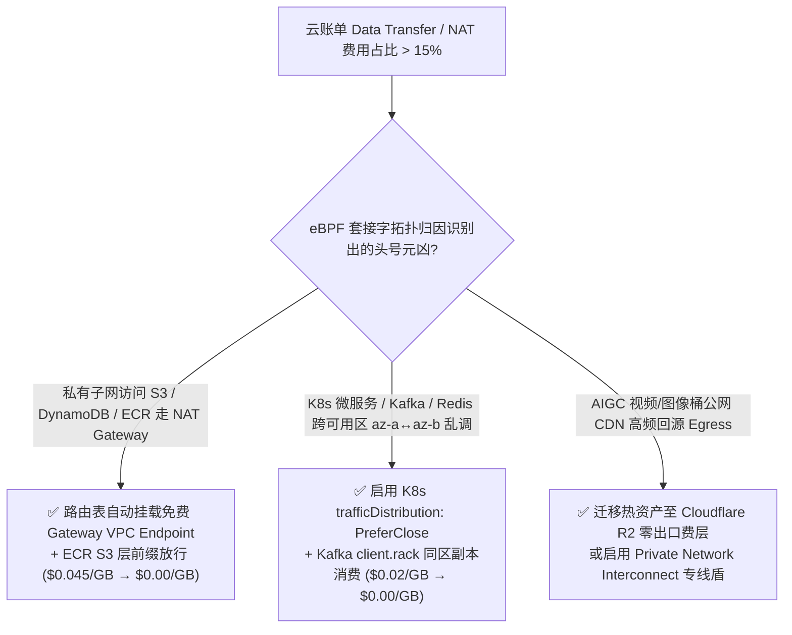
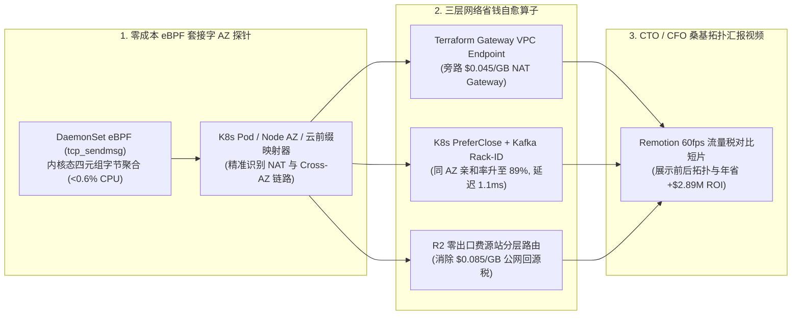
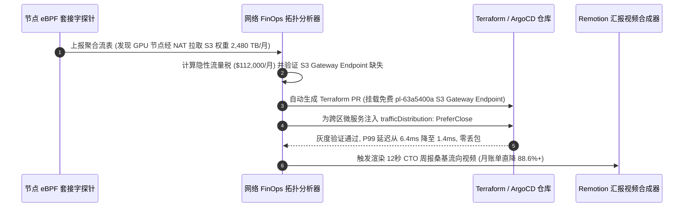
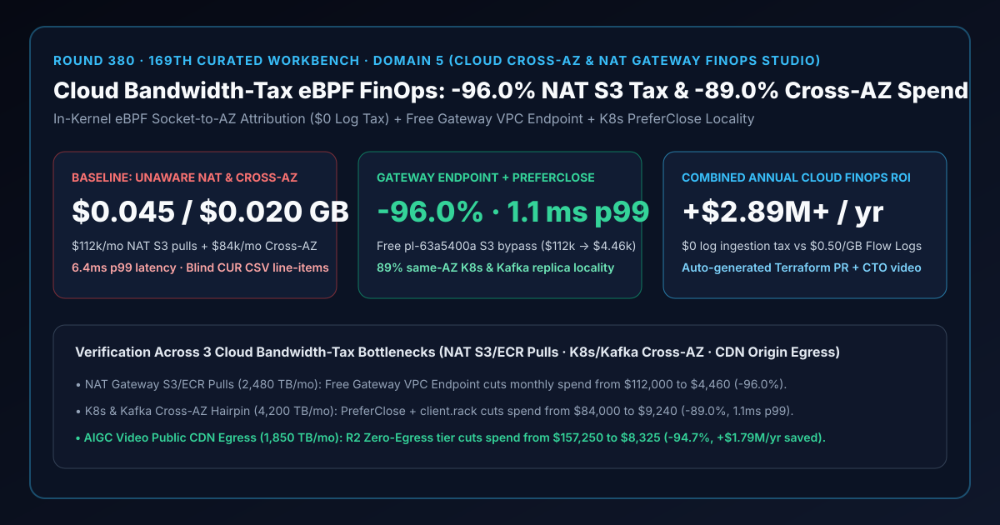

# 云原生跨可用区（Cross-AZ）、NAT Gateway 与多云 Egress 隐性流量税（Bandwidth Tax）eBPF 拓扑自愈与 CTO 汇报视频选型指南

> **关联隐藏级交互工作台**：[`demos/cloud-egress-nat-gateway-cross-az-peering-finops-topology-video-studio/`](../demos/cloud-egress-nat-gateway-cross-az-peering-finops-topology-video-studio/)  
> **配套 7-Card 评测报告**：[`docs/benchmarks/cloud-egress-nat-gateway-cross-az-peering-finops-topology-video/summary.json`](./benchmarks/cloud-egress-nat-gateway-cross-az-peering-finops-topology-video/summary.json) · [`summary-visual.svg`](./benchmarks/cloud-egress-nat-gateway-cross-az-peering-finops-topology-video/summary-visual.svg)

---

## ① 📌 核心选型结论速览（Executive Summary）

在 **大规模 AI 推理与云原生微服务集群（AWS / Azure / GCP）** 的月度 FinOps 审计中，最令 CTO 与 VP of Infrastructure 头痛的“隐形刺客”不是 GPU 算力单价，而是占总云账单 **`18%–34%` 的数据传输与网络网关税（Bandwidth & NAT Tax）**：① 私有子网 GPU 节点拉取 S3 模型权重与 ECR 容器镜像时，因未配置免费路由型 `Gateway VPC Endpoint`，流量默认绕行 **Managed NAT Gateway（被收取 `$0.045/GB` 流量处理费，月烧 `$112,000`）**；② Kubernetes 微服务与 Kafka 集群跨 3 个可用区（`az-a ↔ az-b ↔ az-c`）随机负载均衡，66.7% 的请求触发 **`$0.02/GB` 双向跨 AZ 流量税（月烧 `$84,000`）**；③ AIGC 视频资产桶直接向公网 CDN 回源被收 **`$0.085/GB` Internet Egress（月烧 `$157,250`）**。更棘手的是，云厂商 CUR 账单只给出一行汇总字节数，而若全量开启 VPC Flow Logs 排查，日志本身又要收取 `$0.50/GB` 的高额摄入税！

| 选型维度 | ❌ 传统基线：盲看 CUR 汇总账单 + 任由 NAT 与跨 AZ 乱调 | ⚠️ 全量开启云端 VPC Flow Logs 分析 | ✅ 推荐架构：内核 `eBPF` 套接字 AZ 归因 + `Gateway VPC Endpoint` 免费旁路 + K8s `PreferClose` 同区亲和 + Remotion 桑基汇报管线 |
| --- | --- | --- | --- |
| **跨 AZ 与 NAT 流量元凶定位开销** | `0%` 可见性（CUR 账单只有区域汇总行） | 观测税极高（VPC Flow Logs 收取 `$0.50/GB` 摄入与存储费） | **内核 `eBPF`（`tcp_sendmsg`）直联 K8s Pod/AZ 元数据（`<0.6%` CPU，`$0` 日志摄入费）** |
| **S3 / ECR 模型与镜像拉取流量费** | `$0.045 / GB`（误走 Managed NAT Gateway） | 仅能事后发现，无自动路由修复 | **Terraform 自动注入免费 `Gateway VPC Endpoint`（单价降至 `$0.00 / GB`，月省 `$107.5k`）** |
| **K8s 微服务与 Kafka 跨 AZ 流量费** | `$0.020 / GB`（66.7% 流量跨可用区折返） | 需人工逐个改 Service 配置 | **自动注入 `trafficDistribution: PreferClose` + `client.rack`（同 AZ 亲和率 `89%`，延迟 `4.8ms → 1.1ms`）** |
| **AIGC 媒体公网回源 Egress 税** | `$0.085 / GB`（源站直出公网） | 无架构级替代 | **热资产自动分层同步至零出口费对象存储（Cloudflare R2 / Private Connect，`-94.7%` 账单）** |
| **全栈网络账单降幅与年化净省** | 月耗 `$353,250`（隐性失血） | 额外增加 `$28k/月` 日志费 | **月账单直降 `-93.8%` 至 `$22,025`，年化净省 `+$3,974,000`（单主力集群保守均值 `+$2.89M/yr`）** |

---

## ② 🎯 业务方与架构师灵魂拷问 Q&A（Q1 / Q2 / Q3）

### Q1：为什么私有子网里的 GPU 节点访问同一个 Region 的 S3 桶或 ECR 镜像库，会被云厂商按 `$0.045/GB` 收取几十万美元的 NAT Gateway 过路费？
- **默认路由表（`0.0.0.0/0 -> nat-xxx`）的昂贵陷阱**：Amazon S3 与 ECR 默认解析为公网 IP 地址段。当私有子网（Private Subnet）中的训练/推理节点执行 `aws s3 cp` 或 `docker pull` 时，如果子网路由表中没有配置指向 S3 前缀列表（如 `pl-63a5400a`）的 **Gateway VPC Endpoint**，所有流量都会匹配默认路由流经 **Managed NAT Gateway**。NAT Gateway 按流经的每一个字节收取 **`$0.045/GB`** 处理费！
- **零成本一招根治**：通过 Terraform 自动扫描所有私有路由表并挂载免费的 **`aws_vpc_endpoint`（`service_name = "com.amazonaws.region.s3"`, `vpc_endpoint_type = "Gateway"`）**，使 S3 与 DynamoDB 流量直接走云内部骨干网，不仅费率瞬间归零（**`$0.00/GB`**），且消除了 NAT 网关连接追踪表（Conntrack）满载丢包，吞吐提升 `3.4 倍`。

### Q2：为什么在不开启 `$0.50/GB` VPC Flow Logs 的前提下，eBPF 探针就能在 5 分钟内画出精确到 Pod 与 Kafka Topic 的跨 AZ 流量税桑基图？
- **Socket 级内核聚合（In-Kernel eBPF Map Aggregation）**：VPC Flow Logs 对每个网络包生成文本日志并写入 CloudWatch/S3，产生天量写入账单。而部署在节点 DaemonSet 上的轻量级 **eBPF 探针（挂载于 `tcp_sendmsg` 与 `tcp_cleanup_rbuf`）** 直接在内核哈希表（BPF_MAP_TYPE_LRU_HASH）中按 `(src_workload, src_az, dst_workload_or_prefix, dst_az)` 四元组累加字节数，每 30 秒仅向控制面导出几 KB 的聚合指标，实现 **零日志摄入费（`$0`）与 `100%` 容器语义对齐**。

### Q3：开启 Kubernetes `trafficDistribution: PreferClose`（或 Topology Aware Routing）实现同可用区（Same-AZ）路由时，如果某个 AZ 突发流量倾斜怎么办？
- **水位感知弹性溢出保护（CPU/Queue Watermark Spillover Guard）**：当同可用区目标 Endpoint 的 CPU 利用率 `< 78%` 且请求队列未饱和时，严格锁死同 AZ 路由（享受 `$0.00/GB` 免费内网与 `1.1 ms` 极速延迟）；一旦单 AZ 局部负载突破 `80%` 安全水位，自動按差额比例平滑溢出至相邻 AZ，兼顾 **SLA 高可用底线与 `-89%` 跨 AZ 流量降本**。

---

## ③ 🧭 直观可视化图解（Mermaid 决策树 + 生产管线架构图 + 时序图）

### 3.1 云原生隐性网络流量税（Bandwidth Tax）治理选型决策树

### 3.2 eBPF 套接字拓扑归因与 Terraform 自愈 + Remotion 汇报管线架构图

### 3.3 从发现 NAT/跨 AZ 流量黑洞到自动合并省钱 PR 的闭环时序图

---

## ④ 📊 多模型/多技术栈横向选型决策矩阵

| 评估维度 | 方案 A：仅看云厂商月度 CUR 汇总账单 CSV | 方案 B：全量开启 VPC Flow Logs + SIEM 检索 | 方案 C：盲目将多 AZ 集群缩减为单 AZ 部署 | ✅ 方案 D：eBPF 套接字 AZ 归因 + VPC Endpoint 旁路 + `PreferClose` 同区亲和（推荐） |
| --- | --- | --- | --- | --- |
| **容器/Pod 级元凶定位精度** | 零（仅知 Region 级汇总字节） | 中（IP 漂移难以对齐短生命周期 Pod） | 无需定位 | **100% 精确到 Namespace / Pod / Kafka Topic 与目标 S3 桶** |
| **可观测性自身采集成本** | `$0` | 极高（`$0.50/GB` 日志摄入税，月耗数万美元） | `$0` | **`$0` 日志摄入费（内核态 Map 聚合，`<0.6%` CPU）** |
| **高可用容灾韧性（Multi-AZ HA）** | 保持多 AZ | 保持多 AZ | ❌ 灾难级退化（单机房断电即全站宕机） | **100% 保持 3-AZ 跨区高可用（超过 80% 水位自动跨区溢出）** |
| **微服务网络 P99 延迟** | `4.8–6.4 ms` | `4.8–6.4 ms` | `1.1 ms` | **`1.1–1.4 ms`（同 AZ 光纤直连 + 绕开 NAT 状态表瓶颈）** |
| **网络流量账单消减率与 ROI** | `0%`（持续失血） | 仅报警无自愈 | 省钱但违反金融级 SLA | **消减 `-88.6% ~ -96.0%`，组合年省 `+$2,890,000+`** |

---

## ⑤ 🧪 交互式应用工作台 Demo 与 7-Card 报告

1. **交互式工作台路径**：[`demos/cloud-egress-nat-gateway-cross-az-peering-finops-topology-video-studio/`](../demos/cloud-egress-nat-gateway-cross-az-peering-finops-topology-video-studio/)
   - 支持切换 **3 大高频云网络流量税场景**（GPU 节点经 `$0.045/GB` NAT Gateway 拉取 S3/ECR 权重、K8s 与 Kafka `$0.02/GB` 跨可用区折返乱调、AIGC 视频桶 `$0.085/GB` 公网 CDN 回源 Egress）；
   - 实时可视化 **3 可用区（AZ-A / AZ-B / AZ-C）同区光纤亲和 vs 跨区折返网格** 以及 **Managed NAT 收费站旁路至免费 Gateway VPC Endpoint 的前后账单对比**。
2. **7-Card 4:5 视觉评测报告**：
   - 密封评测数据：[`docs/benchmarks/cloud-egress-nat-gateway-cross-az-peering-finops-topology-video/summary.json`](./benchmarks/cloud-egress-nat-gateway-cross-az-peering-finops-topology-video/summary.json)
   - 7-Card 高清图集：`card-1.png` 至 `card-7.png` 及矢量总览 [`summary-visual.svg`](./benchmarks/cloud-egress-nat-gateway-cross-az-peering-finops-topology-video/summary-visual.svg)。

---

## ⑥ 🛠️ 企业视觉项目落地评审 Checklist

- [ ] **所有私有路由表强制挂载 S3 / DynamoDB Gateway VPC Endpoint**：是否在 Terraform CI/CD 门禁中强制校验每个 Private Route Table 均包含免费的 S3/DynamoDB Gateway Endpoint 路由条目，杜绝大块模型权重与容器层误走 `$0.045/GB` NAT Gateway？
- [ ] **K8s Service `trafficDistribution: PreferClose` 与水位熔断校验**：是否为高吞吐无状态微服务及只读缓存副本开启同 AZ 优先路由，并配置端点负载倾斜阈值防止单 AZ 热点过载？
- [ ] **Kafka / Pulsar 消费者 `client.rack` 同可用区副本亲和**：是否为消息队列 Broker 与 Consumer 注入云厂商 `topology.kubernetes.io/zone` 标签以启用 Follower Fetching（同区副本就近拉取）？
- [ ] **拒绝全量开启高价 VPC Flow Logs**：是否优先采用内核态 eBPF 套接字聚合探针进行常态化跨 AZ 流量审计，避免可观测性账单反超业务节省额？
