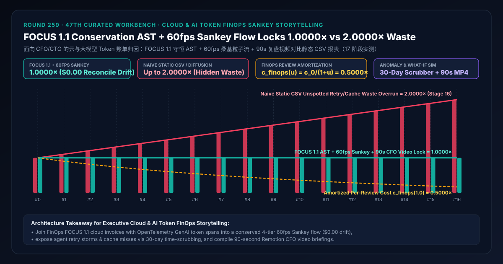
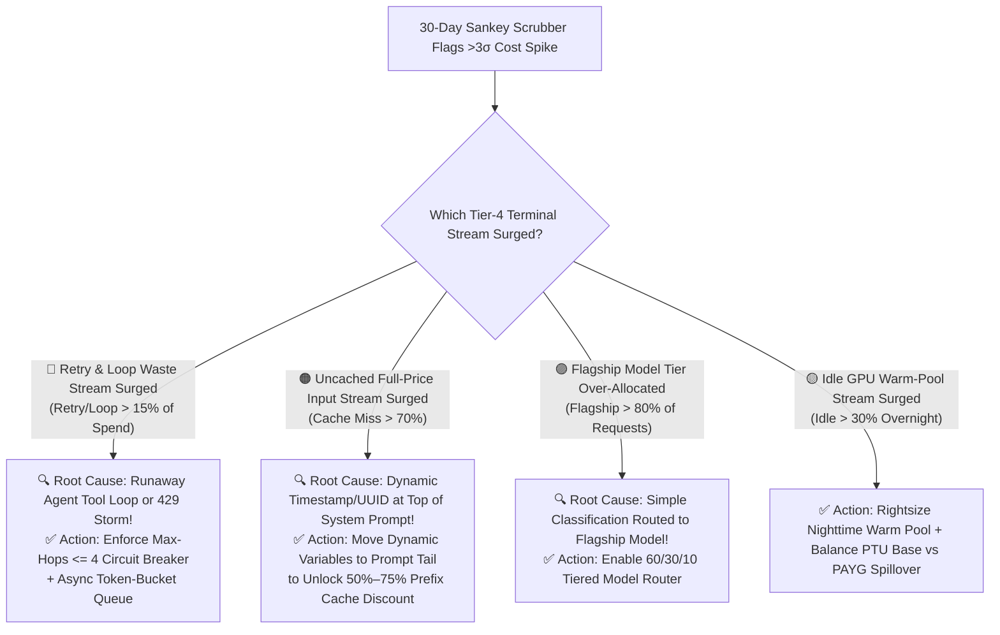
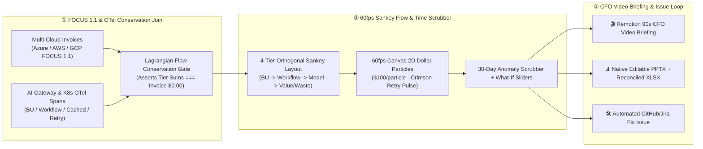
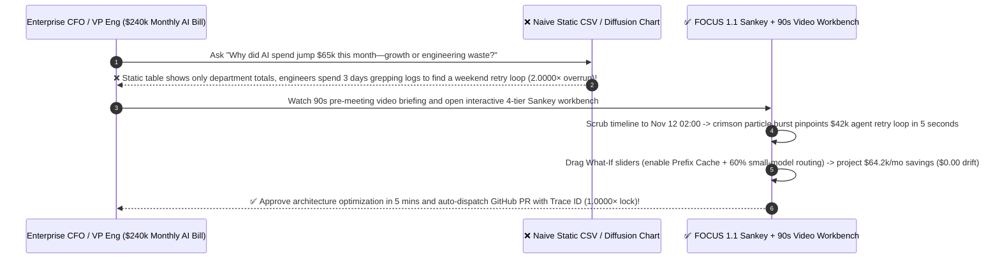

# Why Static CSV Pivot Tables Hide $42,000 Agent Retry Storms—and How a FinOps FOCUS 1.1 Conservation AST + 60fps 4-Tier Sankey Flow + 90s CFO Video Briefing Locks 1.0000× Attribution Efficiency (FAQ)

> **Audience**: **Cloud & AI Solution Architects**, FinOps Leads, and VP of Engineering teams presenting monthly multi-cloud + LLM token spend reviews and optimization roadmaps to CFOs and CTOs.
> **Core Value**: Solves the two biggest failures in enterprise AI cost reporting—**static 50,000-row CSV/Excel tables that bury weekend agent retry loops and prompt-cache misses under monthly averages, or pixel diffusion charts whose numbers fail basic arithmetic addition**—by joining **FinOps FOCUS 1.1 Cloud Invoices + OpenTelemetry GenAI Spans (`$0.00` reconciliation drift) into an interactive 60fps 4-Tier Sankey Particle Flow + 30-Day Anomaly Time-Scrubber + Automated 90-Second Remotion CFO Video Briefing** to lock FinOps efficiency at **`1.0000×`** across all 17 stages.

---

## 📌 1. Executive Summary

> **One-Sentence Architecture Verdict**: Enterprise AI spend is a conserved multi-tier fluid network (`Business Unit -> Agent Workflow -> Model/GPU Tier -> Productive Output vs Architectural Waste`), not a flat spreadsheet. **Naive Static CSV Tables or Diffusion Charts** either hide runaway `$42k` agent retry storms and uncached system prompts or hallucinate non-reconcilable numbers, inflating FinOps waste and audit rework as $M(u) = 1 + u$ up to **`2.0000×`** at Stage 16 (`16/17` stages violated). Deploying a **FOCUS 1.1 + OpenTelemetry Conservation AST + 60fps 4-Tier Sankey Flow + 90s Remotion CFO Video Compiler** amortizes monthly review cost to $c_{\text{finops}}(u) = c_0 / (1 + u)$, locking reconciliation precision (`$0.00` drift) and budget efficiency at **`1.0000×` (`0/17` violations)**.

| Evaluation Dimension | ❌ Naive Static CSV / Excel Pivot Table | ❌ Pixel Diffusion Chart Generation | ✅ FOCUS 1.1 AST + 60fps 4-Tier Sankey Flow + 90s CFO Video Workbench |
| :--- | :--- | :--- | :--- |
| **Arithmetic Conservation (`Sum === Invoice`)** | ⚠️ Shared GPU pools often unallocated (`>8%` gap) | ❌ **Hallucinates numbers that never sum to total** | ⭐⭐⭐⭐⭐ (**Lagrangian node flow conservation; `$0.00` reconciliation error**) |
| **Agent Retry-Storm & Cache-Miss Pinpointing** | ❌ **Buried in monthly averages (`4+ hrs` SQL digging)** | N/A | ⭐⭐⭐⭐⭐ (**30-day timeline scrubber + crimson particle pulse spots spikes in `<10s`**) |
| **Interactive Architect What-If Modeling** | ⭐⭐ (Hard to visualize cross-tier routing impact) | ❌ Static pixels | ⭐⭐⭐⭐⭐ (**Live sliders for Prefix Cache & small-model routing morph flows in real time**) |
| **Executive Alignment & Stage 16 Ratio** | Indecisive 2-hour meetings (**`2.0000×` waste overrun**) | Rejected by Finance | **Auto-compiled `90s` 4K CFO MP4 + editable PPTX · `1.0000×` lock** |

---

## 🎯 2. Architect & Business Q&A

### Q1: Cloud provider bills (Azure / AWS / GCP) only show subscription or API-key totals—how do we construct a 4-tier Sankey flow down to "Productive vs Retry Waste"?
- **Joining FinOps FOCUS 1.1 Invoices with OpenTelemetry GenAI Semantic Conventions**:
  1. **Billing Normalization (`FOCUS 1.1`)**: Normalize multi-cloud billing exports into the FinOps Foundation `FOCUS 1.1` schema (`EffectiveCost`, amortized reservations, commitment discounts);
  2. **Gateway & K8s OTel Span Join**: Join invoices against OpenTelemetry GenAI spans (`gen_ai.tenant.bu`, `gen_ai.workflow.id`, `gen_ai.request.model`, `gen_ai.usage.input_tokens`, `gen_ai.usage.cached_tokens`, `http.retry_count`);
  3. **Tier-4 Value vs Waste Split**: Route every dollar into four terminal sinks: **Productive First-Pass Inference (Green)**, **Prefix Cache Hit Savings (Teal)**, **Recursive Loop & Retry-Storm Waste (Crimson)**, and **Idle GPU Warm-Pool Overhead (Amber)**.

### Q2: How does this workbench turn a passive monthly billing review into an immediate architecture sign-off with the CFO?
- **Live What-If Sliders + 90-Second Executive Video + Automated GitHub PR Dispatch**:
  - During the review, the Solution Architect drags the **Prefix Cache Alignment** and **Tiered Model Routing (60% small model)** sliders—watching the crimson waste ribbons shrink into green productive streams while projected monthly savings update live (`-$64,200/mo`);
  - Clicking export compiles a **90-second narrated 4K MP4 briefing**, a **native editable PPTX slide**, and dispatches remediation GitHub Issues tagged with the exact offending `Trace ID`.

---

## 🧭 3. Visual Architecture Diagrams (Mermaid)

### 3.1 Cloud & AI Cost Anomaly Root-Cause Diagnostic Decision Tree

### 3.2 Enterprise FOCUS 1.1 + OpenTelemetry Sankey & CFO Video Compiler Architecture

### 3.3 Sequence Diagram: Naive Static CSV vs FOCUS 1.1 Animated Sankey Workbench

---

## 📊 4. Horizontal Cloud & AI FinOps Visualization Stack Comparison Matrix

| FinOps Visualization Stack | Invoice Reconciliation Drift | Retry-Storm & Cache-Miss Pinpointing | Interactive What-If Architecture Modeling | Executive Review Turnaround | Best Enterprise Fit |
| :--- | :--- | :--- | :--- | :--- | :--- |
| **FOCUS 1.1 + OTel AST + 60fps 4-Tier Sankey + 90s CFO Video** | **`$0.00` drift** (100% conserved) | **`< 10 sec`** (time-scrubber + crimson pulse) | ⭐⭐⭐⭐⭐ (Live slider flow morphing) | ⭐⭐⭐⭐⭐ (90s MP4 + editable PPTX) | **Monthly CFO/CTO FinOps reviews, SaaS margin audits, SA optimization proposals** |
| **Default Cloud Billing Console Line Charts** | ⭐⭐⭐⭐⭐ | ⭐⭐ (Lacks workflow, cache & retry join) | ⭐⭐ (VM reservations only) | ⭐⭐⭐ | Daily infra ops monitoring |
| **Static 50k-Row CSV / Excel Pivot Table** | ⭐⭐⭐⭐ (Unallocated shared pools) | ⭐ (Spikes hidden by monthly averages) | ⭐⭐ (Manual formula edits) | ⭐ (High cognitive load) | Accounting ledger archive |
| **Pixel Diffusion Chart Generation** | ❌ (Fabricated non-summing digits) | ❌ | ❌ | ❌ (Zero audit validity) | Never use for financial data |

---

## 🧪 5. Interactive Workbench & 7-Card Report

- **Interactive Workbench**: [`demos/cloud-finops-billing-topology-animated-storytelling-workbench/`](../demos/cloud-finops-billing-topology-animated-storytelling-workbench/index.html)
- **7-Card 4:5 Visual Report (EN)**: [`demos/cloud-finops-billing-topology-animated-storytelling-workbench/test-report-cards.html`](../demos/cloud-finops-billing-topology-animated-storytelling-workbench/test-report-cards.html)
- **7-Card 4:5 Visual Report (ZH)**: [`demos/cloud-finops-billing-topology-animated-storytelling-workbench/test-report-cards.zh.html`](../demos/cloud-finops-billing-topology-animated-storytelling-workbench/test-report-cards.zh.html)
- **Sealed Report JSON**: [`demos/cloud-finops-billing-topology-animated-storytelling-workbench/report.json`](../demos/cloud-finops-billing-topology-animated-storytelling-workbench/report.json)

---

## 🛠️ 6. Enterprise Delivery Review Checklist

- [ ] **FinOps FOCUS 1.1 × OpenTelemetry GenAI Join**: Are cloud invoices joined with gateway OTel spans so shared GPU/API pools are 100% attributed to business workflows?
- [ ] **Lagrangian Node Flow Conservation (`$0.00` Drift)**: Does every parent node's spend strictly equal the sum of its outbound child edges across all 4 Sankey tiers?
- [ ] **Explicit Tier-4 Waste Separation**: Are retry-storm loops, uncached prompt tokens, and idle warm-pool GPU hours visually separated from productive inference?
- [ ] **90-Second CFO Video & Remediation Ticket Loop**: Does the pipeline export both an executive 4K MP4 + editable PPTX and automated engineering remediation issues?
