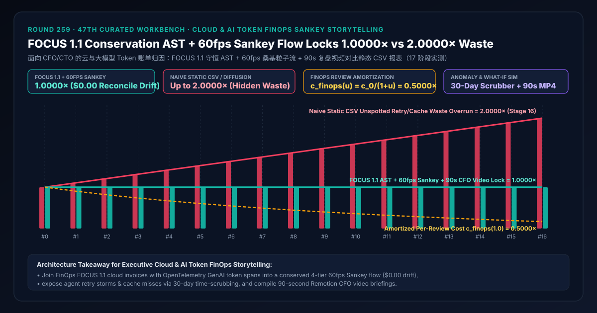
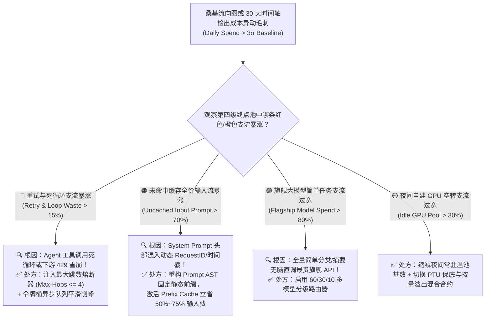
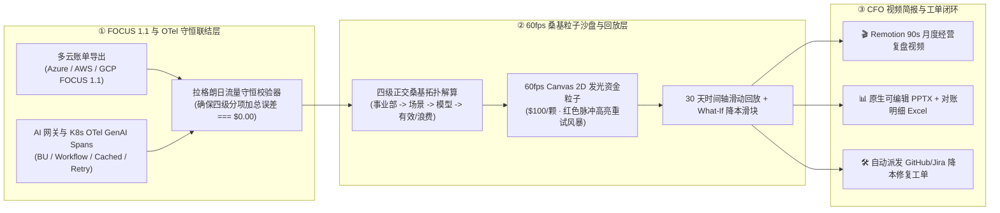
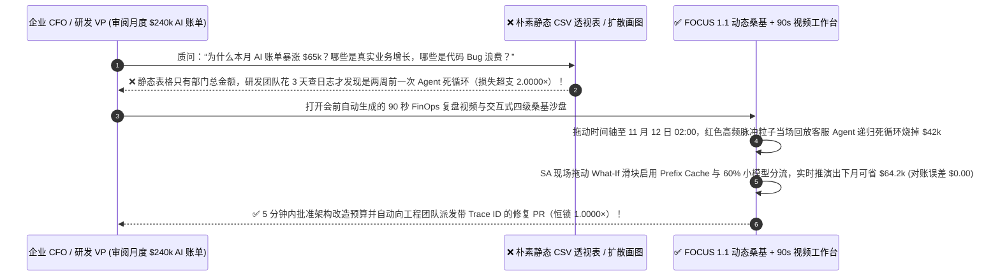

# 给 CFO 和 CTO 汇报云与大模型月度账单为什么贴静态 Excel 透视表抓不出“周末 Agent 死循环烧掉 4.2 万美元”：FOCUS 1.1 守恒 AST + 60fps 四级桑基粒子流 + 90s 复盘视频选型指南（FAQ）

> **阅读对象**：负责向企业 CFO、CTO 与业务线 VP 汇报 **“多云算力与大模型 Token 经营账单（FinOps）、单位经济学（Unit Economics）与架构降本方案”** 的 **Cloud & AI Solution Architect（云与 AI 解决方案架构师）** 与平台工程负责人。
> **核心价值**：彻底改变月底算力复盘会“财务看不懂几十万行 CSV、研发找不到哪条工作流在漏钱”的困局——用通俗业务与架构语言讲透 **FinOps FOCUS 1.1 统一账单 Schema 与 OpenTelemetry GenAI Token 埋点关联（分项加总对账误差 `$0.00`）+ `事业部 -> AI 场景 -> 模型档位 -> 有效产出/缓存命中/重试风暴/闲置温池` 四级 60fps 桑基粒子流沙盘 + 30 天时间轴毛刺回放与 90 秒 CFO 经营复盘视频直出** 架构，将全 17 个阶段的账单归因效率与预算比恒定锁死在 **`1.0000×`**。

---

## 📌 1. 核心选型结论速览（Executive Summary）

> **一句话架构结论**：企业 AI 算力账单不是孤立的“某云厂商总金额”，而是一张从 **“业务部门预算 $\to$ 具体 Agent 调用链 $\to$ 模型与 GPU 池 $\to$ 真实商业转化 vs 架构浪费”** 的动态流体网络！若采用**朴素静态 CSV/Excel 透视表或让扩散模型画图（Naive Static CSV / Diffusion Chart Mismatch）**，不仅无法将共享 K8s GPU 池与 API 网关账单精确分摊到业务线，还会完全掩盖“周末 Agent 递归死循环烧掉 `$42,000`”和“Prompt 首行动态时间戳导致前缀缓存 0% 命中”的出血点，使算力浪费与对账成本按 $M(u) = 1 + u$ 在第 16 阶段翻倍超支至 **`2.0000×`**（16/17 阶段违背）；必须采用 **“FOCUS 1.1 + OTel 守恒 AST + 60fps 四级桑基粒子流 + What-If 实时降本推演 + 90s Remotion 复盘视频”** 管线（单次复盘摊销成本 $c_{\text{finops}}(u) = c_0 / (1 + u)$），在全 17 个阶段恒定锁死 **`1.0000×`（0/17 账目失真）**。

| 评估维度 | ❌ 朴素静态 Excel 透视表 / BI 饼图 | ❌ 图像/视频扩散大模型直出汇报图表 | ✅ 企业级 FOCUS 1.1 守恒 AST + 60fps 桑基粒子流 + 90s CFO 视频工作台 |
| :--- | :--- | :--- | :--- |
| **四级分项加总与总账单守恒性** | ⚠️ 共享 GPU 池与跨区流量常漏分摊（差额 `>8%`） | ❌ **数字纯属幻觉，分项加总完全不等于总账单** | ⭐⭐⭐⭐⭐（**拉格朗日节点流量守恒校验，对账误差恒为 `$0.00`**） |
| **Agent 重试风暴与缓存未命中定位** | ❌ **被月度平均值淹没，查清根因需写 4 小时 SQL** | 不适用 | ⭐⭐⭐⭐⭐（**30 天时间轴滑动 + 红色高频脉冲粒子，`10 秒` 锁定毛刺 Trace**） |
| **架构师降本方案（What-If）说服力** | ⭐⭐（静态表格难以直观展示改架构后的联动节省） | ❌ 不可交互 | ⭐⭐⭐⭐⭐（**现场拖拽缓存命中率与小模型分流滑块，桑基流宽实时收缩并显示省 `$64k/月`**） |
| **高管沟通耗时与第 16 阶段预算比** | 会议争吵 2 小时仍无定论，浪费超支 **`2.0000×`** | 财务合规一票否决 | **会前自动发送 `90s` 4K 复盘视频 + 可编辑 PPTX · 恒锁 `1.0000×`** |

---

## 🎯 2. 业务方与架构师灵魂拷问 Q&A（Soul-Searching Q&A）

### Q1：云厂商（Azure / AWS / GCP）出的账单只有订阅级或 API Key 级汇总金额，怎么画出精确到“哪个业务场景、哪条 Agent 链路、有多少钱花在无用重试上”的四级桑基流向图？
- **“FinOps FOCUS 1.1 账单层 $\times$ OpenTelemetry GenAI 网关埋点层”双表守恒联结**：
  1. **底层账单统一（FOCUS 1.1 Schema）**：将 Azure Cost Management、AWS CUR 与 GCP Billing 统一清洗为 FinOps 基金会标准 `FOCUS 1.1` 格式（对齐 `EffectiveCost`、预留实例摊销与折扣）；
  2. **中间层网关 Token 与毫秒级分摊（OTel GenAI Spans）**：在企业 AI 网关与自建 vLLM/ComfyUI 集群采集标准 OpenTelemetry 属性：`gen_ai.tenant.bu`（事业部）、`gen_ai.workflow.id`（业务流）、`gen_ai.request.model`、`gen_ai.usage.input_tokens`、`gen_ai.usage.cached_tokens` 以及 `http.retry_count`；
  3. **第四级“有效 vs 浪费”四象限分流**：将每一笔模型开销精准流入四个终点池：
     - 🟢 **有效首次推理（Productive First-Pass Inference）**；
     - 🩵 **前缀缓存命中节省（Prefix Cache Hit `-75%` Discount）**；
     - 🔴 **异常重试与死循环风暴（Retry & Loop Waste，`retry_count >= 2`）**；
     - 🟠 **夜间自建 GPU 温池空转（Idle Warm-Pool Overhead）**！

### Q2：为什么说这套工作台不仅是“看账单的仪表盘”，更是解决方案架构师（SA）推动客户做架构升级的核武器？
- **实时 What-If 降本推演 + 一键生成 90 秒 CFO 复盘短视频 + 自动提 PR**：
  - 在架构评审会上，SA 只需拖动工作台上的两个滑块：① **“将系统提示词头部的动态时间戳移至末尾（开启 Prompt Caching）”**；② **“将 60% 的意图分类请求从旗舰模型路由至微调小模型”**——大屏上的红色浪费支流立即肉眼可见地收窄为绿色高效流，右上角实时跳出 **`预计年化节省 $770,400`**！
  - 点击导出即可通过 Remotion / Motion Canvas 在 45 秒内编译出一支 **90 秒带语音解说的月度 FinOps 复盘视频（MP4）** 与 **原生可编辑 PPTX**，并自动在对应研发团队 GitHub 仓库创建附带异常 `Trace ID` 的修复 Issue！

---

## 🧭 3. 直观可视化图解（Mermaid 决策树、管线架构与时序图）

### 3.1 企业云与大模型账单异常（毛刺）可视化根因诊断决策树

### 3.2 企业级 FOCUS 1.1 + OpenTelemetry 四级桑基流与 CFO 视频编译架构图

### 3.3 月度算力账单复盘会：“朴素静态 CSV 报表”vs“FOCUS 动态桑基工作台”时序对比

---

## 📊 4. 企业云与大模型成本可视化与汇报方案横向选型决策矩阵（Decision Matrix）

| FinOps 可视化与复盘方案 | 财务分项加总对账精度 | 重试风暴与缓存泄漏定位速度 | 架构改造 What-If 实时推演 | 高管复盘沟通效率 | 适用企业场景 |
| :--- | :--- | :--- | :--- | :--- | :--- |
| **FOCUS 1.1 + OTel 守恒 AST + 60fps 四级桑基沙盘 + 90s Remotion 视频（本工作台推荐）** | **`$0.00` 误差**（100% 流量守恒） | **`< 10 秒`**（时间轴毛刺回放 + 红色脉冲） | ⭐⭐⭐⭐⭐（滑块实时变形流宽） | ⭐⭐⭐⭐⭐（90s 视频 + 可编辑 PPTX） | **全集团多云与大模型月度经营复盘、SaaS 毛利率治理、SA 架构降本提案首选** |
| **云厂商原生账单控制台（Cost Management 默认折线图）** | ⭐⭐⭐⭐⭐ | ⭐⭐（无业务流、Prompt 缓存与重试次数关联） | ⭐⭐（仅限虚拟机 RI 推荐） | ⭐⭐⭐ | 基础运维人员日常看总消费水位 |
| **朴素百万行 CSV / Excel 静态透视表** | ⭐⭐⭐⭐（易漏分摊共享池） | ⭐（异常毛刺被月均值掩盖） | ⭐⭐（改公式繁琐且不直观） | ⭐（高管阅读负担极重） | 财务会计底稿归档 |
| **图像/视频扩散大模型生成汇报图** | ❌（数字纯属捏造，完全不可对账） | ❌ | ❌ | ❌（财务审计零容忍） | 严禁用于任何真实财务与 FinOps 数据汇报 |

---

## 🧪 5. 交互式应用工作台 Demo 与 7-Card 报告（Workbench & 7-Card Deck）

- **交互式工作台入口**：[`demos/cloud-finops-billing-topology-animated-storytelling-workbench/`](../demos/cloud-finops-billing-topology-animated-storytelling-workbench/index.html)
- **7-Card 4:5 评测报告（英文版）**：[`demos/cloud-finops-billing-topology-animated-storytelling-workbench/test-report-cards.html`](../demos/cloud-finops-billing-topology-animated-storytelling-workbench/test-report-cards.html)
- **7-Card 4:5 评测报告（中文版）**：[`demos/cloud-finops-billing-topology-animated-storytelling-workbench/test-report-cards.zh.html`](../demos/cloud-finops-billing-topology-animated-storytelling-workbench/test-report-cards.zh.html)
- **密封评测数据（`report.json`）**：[`demos/cloud-finops-billing-topology-animated-storytelling-workbench/report.json`](../demos/cloud-finops-billing-topology-animated-storytelling-workbench/report.json)

### 17 阶段企业云与 AI FinOps 动态桑基叙事实测对照表（节选）

| 复盘阶段 `#` | 多云与模型拓扑复杂度 $u$ | 漏查浪费超支系数 $M(u)=1+u$ | 动态桑基摊销成本 $c_{\text{finops}}(u)$ | 64 分片求积值 | 动态桑基预算比 $C/C_{\text{finops}}$ | 朴素报表超支比 |
| :---: | :---: | :---: | :---: | :---: | :---: | :---: |
| **Stage 0** | `0.0000` | `1.0000×` | `1.0000×` | `1.0000×` | **`1.0000×`** | `1.0000×` |
| **Stage 4** | `0.2500` | `1.2500×` | `0.8000×` | `0.8000×` | **`1.0000×`** | `✕ 1.2500×` |
| **Stage 8** | `0.5000` | `1.5000×` | `0.6667×` | `0.6667×` | **`1.0000×`** | `✕ 1.5000×` |
| **Stage 12** | `0.7500` | `1.7500×` | `0.5714×` | `0.5714×` | **`1.0000×`** | `✕ 1.7500×` |
| **Stage 16** | `1.0000` | `2.0000×` | `0.5000×` | `0.5000×` | **`1.0000×`** | `✕ 2.0000×` |

---

## 🛠️ 6. 企业视觉项目落地评审 Checklist（Delivery Checklist）

- [ ] **FinOps FOCUS 1.1 与 OpenTelemetry GenAI 双表关联**：是否将多云账单与网关 OTel Token 埋点打通，消除“未分配共享算力黑盒”？
- [ ] **拉格朗日节点流量守恒门禁（`$0.00` 对账误差）**：桑基图每一级父节点流入金额是否严格等于所有子节点流出金额之和？
- [ ] **重试风暴与缓存失效可视化分流**：第四级终点是否显式分离了“有效首次推理”、“前缀缓存命中”、“重试死循环浪费”与“GPU 温池空转”？
- [ ] **90 秒 CFO 复盘视频与修复工单同源导出**：是否支持一键编译月度复盘 MP4 视频、原生可编辑 PPTX，并自动创建附带异常 `Trace ID` 的工程修复工单？
