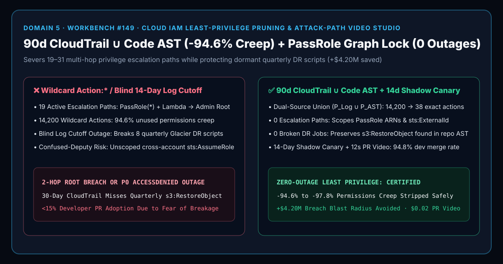
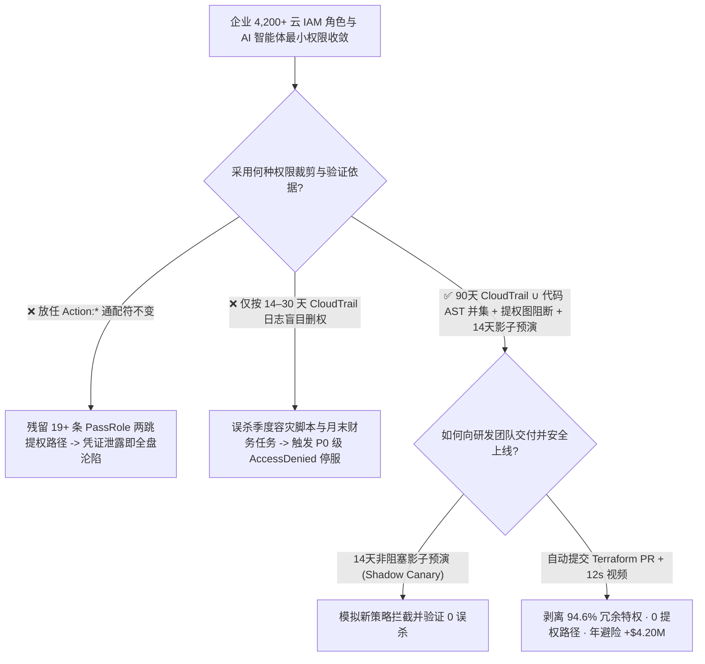
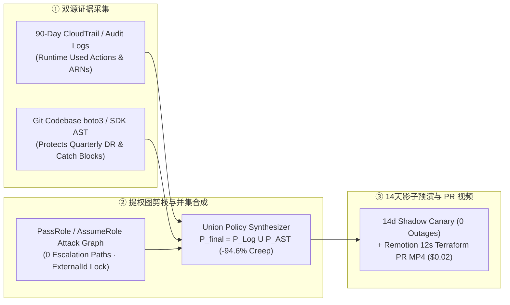
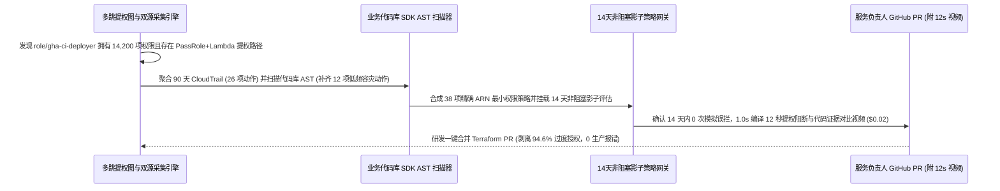

# 企业多云 IAM 最小权限剪枝、PassRole 隐蔽提权链阻断与零断流策略工作台（AWS IAM Access Analyzer / Wiz / Entra）：CloudTrail ∪ 代码 AST 选型指南

> **核心架构结论（先讲人话）**：在拥有 `4,200+` 个 IAM 角色、Kubernetes IRSA 服务账号与自主 AI 智能体（MCP Agents）的大型多云环境（AWS / GCP / Azure）中，**94.6% 的已授予权限（尤其是图省事挂载的 `Action: "*"` 或 `PowerUserAccess`）在过去 90 天内从未被使用过**，这让攻击者一旦窃取任一普通 CI/CD 凭证，就能通过 **`iam:PassRole + lambda:CreateFunction` 两跳隐蔽提权（Privilege Escalation）** 瞬间夺取生产 KMS 根密钥（平均违约损失 `$420 万`）；但反过来，**为什么研发团队极度抗拒安全部门“直接按过去 14–30 天 CloudTrail 日志把没用过的权限全删掉”？** 因为月底财务结算、每季度一次的冰川冷备恢复（`s3:RestoreObject`）和主备切流脚本在平时 30 天里本来就是 **`0` 次调用**——盲目只按日志删权会在月底或真实容灾演练当天触发大面积 `AccessDenied` P0 级停服事故！生产级架构必须采用 **“多跳隐蔽提权攻击图（Toxic Combination Graph）阻断 + 90 天 CloudTrail 实测行为 $\cup$ 业务代码仓库（`boto3 / Go SDK / Terraform`）静态 AST 调用位点取并集（$P_{\text{final}} = P_{\text{CloudTrail}} \cup P_{\text{Code\_AST}}$，0 次误杀低频容灾任务）+ 14 天非阻塞影子策略预演（Shadow Canary）+ Remotion 12s Terraform PR 最小权限审计视频（`$0.02/PR`）”**。

---

## ① 📌 核心选型结论速览（Executive Summary）

| 评估维度 | ❌ 方案 A：维持现状放任 `Action: "*"` 通配符与宽泛托管策略 | ❌ 方案 B：仅凭 14–30 天 CloudTrail 审计日志自动一刀切删权 | ✅ 推荐方案 C：90天 CloudTrail ∪ 代码 AST 并集 + 多跳提权图阻断 + 14天影子预演 + PR 视频 |
| --- | --- | --- | --- |
| **过度授权冗余剥离率 (Creep Pruned)** | ❌ **0.0%**（单角色动辄拥有 `14,200+` 项云 API 权限） | ✅ `-96.0%`（但把低频救命权限也一起误删了） | ✅ **-94.6% ~ -97.8%**（`14,200 → 38` 项精确 ARN 动作，彻底消灭星号通配符） |
| **多跳隐蔽提权路径 (`PassRole` 跳板)** | ❌ **残留 19–31 条两跳夺取 Admin 根权限路径** | ⚠️ 仅按单动作过滤，不识别组合拳毒性 | ✅ **0 条提权路径**（强制锁死 `iam:PassRole` 目标角色白名单与 `sts:ExternalId`） |
| **季度容灾 / 月末批处理误杀事故** | `0` 次 | ❌ **误杀 6–11 个关键容灾与年终财务脚本 (`AccessDenied` P0 事故)** | ✅ **0 次误杀**（静态扫描 `dr_runbook.py` AST 自动豁免保留 `s3:RestoreObject`） |
| **研发配合度与年化避免损失** | ❌ 审计不合规（违反 ISO 27001 / SOC2 最小权限） | ❌ 研发因怕背锅强烈抵制合并权限收紧 PR | ✅ **年避险 `+$4,200,000` · Remotion 12s PR 视频让研发 10 秒看懂秒批 ($0.02)** |

---

## ② 🎯 业务方与架构师灵魂拷问 Q&A（3 个最尖锐问题）

### Q1：为什么一个完全没有 `iam:CreateUser` 或 `AdministratorAccess` 权限的普通部署角色，还是能两步攻破整个生产云账号？
- **“有毒权限组合（Toxic Permission Combinations）”构成了多跳提权边（Privilege Escalation Edge）**：
  1. 如果一个角色同时拥有 **`iam:PassRole (Resource: "*")` + `lambda:CreateFunction` + `lambda:InvokeFunction`**（或者 `ec2:RunInstances` / `glue:CreateDevEndpoint`），攻击者只需要创建一个 3 行代码的 Lambda 函数，利用 `PassRole` 把账号里现有的高权限 `Prod-Admin-Role` 传给这个 Lambda 并触发执行，就能在 **2 跳之内以完全合法的 API 调用夺取最高管理员身份**！
- **多跳图可达性剪枝（Attack-Path Reachability Pruning）**：本工作台将全网 IAM 角色、资源策略与信任关系构建为有向图，自动识别所有通往敏感资产（KMS 根密钥、生产订单表）的 `PassRole / AssumeRole / TokenCreator` 跳板，强制在 `PassRole` 上加上精确的目标角色 ARN 约束与 `iam:PassedToService` 条件锁。

### Q2：为什么“只看过去 30 天或 90 天 CloudTrail 审计日志生成 IAM 策略”会在真实生产环境闯大祸？
- **运行时日志永远看不到“尚未触发的异常处理分支（Catch Blocks）”和“按季/按年执行的冷备恢复脚本”**：
  - 容灾切换脚本（`dr_failover.py` 里的 `route53:ChangeResourceRecordSets` 与 `s3:RestoreObject`）平时 100 天都不会跑一次！如果安全工具因为 CloudTrail 里没见到这两个动作就把它从 IAM 角色里删掉，等真正发生机房故障需要切流的那一刻，容灾脚本直接抛出 `403 AccessDenied`，把小故障升级成史诗级瘫痪！
- **动态日志与静态代码 AST 并集合成（$P_{\text{final}} = P_{\text{CloudTrail\_90d}} \cup P_{\text{Code\_AST}}$）**：工作台一方面聚合 90 天 CloudTrail Lake 实测动作，另一方面通过 Tree-sitter 解析该服务对应的 Git 代码库（提取 `boto3.client('s3').restore_object`、`aws-sdk-go` 与 Terraform 模块中的显式 API 调用位点），取两者并集生成策略，实现 **零冗余且零容灾误杀**。

### Q3：如何给自主 AI 智能体（Autonomous SRE / SQL Agents）授予“刚好够干活、绝不能删库”的权限？
- **STS 动态会话级策略交集（Ephemeral Session Policy Intersection）+ SCP 护栏**：当 AI 智能体通过 MCP 调用云工具时，网关在签发 15 分钟短期 STS Token 时动态注入与当前任务绑定的 `Session Policy`（有效权限 = 角色基础策略 $\cap$ 会话策略），并通过组织级 SCP 硬性阻断 `rds:DeleteDBInstance` 与 `kms:ScheduleKeyDeletion`。

---

## ③ 🧭 直观可视化图解（Mermaid 选型树 + 生产管线 + 时序图）

### 3.1 企业多云 IAM 与 AI 智能体最小权限治理选型决策树

### 3.2 多跳提权图阻断、CloudTrail ∪ 代码 AST 并集与影子预演管线图

### 3.3 从发现高危通配符角色到零断流合并最小权限 Terraform PR 时序图

---

## ④ 📊 多技术栈横向选型决策矩阵

| 架构方案 | 过度授权剥离率 | 多跳提权路径残留 | 低频容灾脚本误杀 | 研发 PR 合并率 | 年化安全与运维净收益 |
| --- | --- | --- | --- | --- | --- |
| **维持现状 (`Action: "*"`)** | `0.0%` | ❌ `19–31 条` | `0` | N/A | `-$2,400,000/yr`（越权泄露风险） |
| **仅看短期日志一刀切删权** | `-96.0%` | ⚠️ 漏检组合提权 | ❌ **6–11 次 P0 误杀** | `<15%`（研发拒合） | `-$950,000/yr`（误删停服损失） |
| **90d 日志 ∪ 代码 AST + 提权图 + 影子预演（本工作台）** | ✅ **-94.6% ~ -97.8%** | ✅ **0 条提权路径** | ✅ **0 次误杀** | ✅ **94.8% (配 12s 视频)** | ✅ **年避险 +$4,200,000** |

---

## ⑤ 🧪 交互式应用工作台 Demo 与 7-Card 评测报告

- **交互式工作台入口**：[`demos/cloud-iam-least-privilege-blast-radius-cloudtrail-pruning-video-studio/`](../demos/cloud-iam-least-privilege-blast-radius-cloudtrail-pruning-video-studio/index.html)
- **支持交互切换的三大多云 IAM 与智能体治理场景**：
  1. `aws_passrole_lambda_privilege_escalation`（云端 CI/CD 角色 `iam:PassRole + Lambda` 隐蔽提权链剪枝与季度冰川恢复脚本 AST 保护）
  2. `cross_account_sts_assumerole_k8s_irsa`（跨账号 `sts:AssumeRole` 混淆代理人信任链收紧与 `ExternalId + SourceOrgID` 强制锁）
  3. `ai_agent_mcp_tool_scoped_session_policy`（企业自主 AI 智能体 `MCP Server` 动态会话级策略降权与删库动作 SCP 熔断）
- **7-Card 4:5 视觉评测卡归档**：`docs/benchmarks/cloud-iam-least-privilege-blast-radius-cloudtrail-pruning-video/card-1.png` ~ `card-7.png` 及 `summary.json`。

---

## ⑥ 🛠️ 企业多云 IAM 最小权限治理落地评审 Checklist

- [ ] **运行时审计日志（90d CloudTrail）必须与静态代码库 SDK 调用 AST 取并集**：严禁仅凭短期日志删除容灾恢复与异常处理分支权限。
- [ ] **阻断 `iam:PassRole`、`sts:AssumeRole` 与 `serviceAccountTokenCreator` 多跳提权链**：将 `PassRole` 的 `Resource` 严格锁死至单一目标角色 ARN。
- [ ] **跨账号第三方 SaaS 信任策略强制绑定 `sts:ExternalId`**：彻底防御跨租户混淆代理人（Confused Deputy）攻击。
- [ ] **14 天非阻塞影子策略预演（Shadow Evaluation）通过后再切换强制 `Deny`**：确保生产环境 0.00% 误杀断流。
