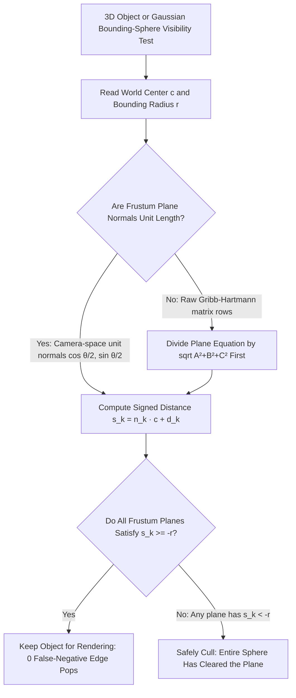
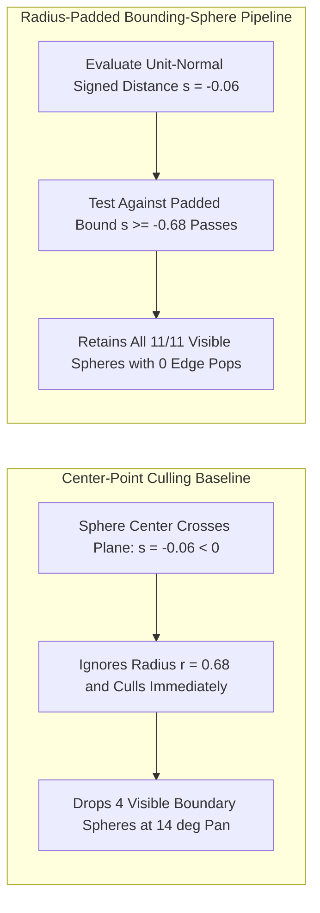
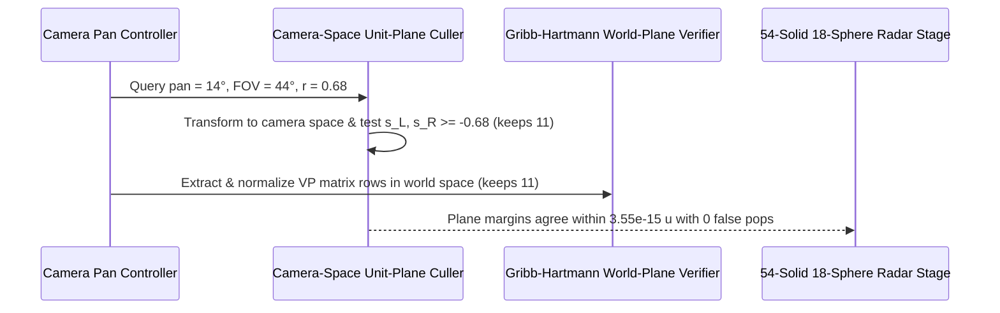

# Frustum culling without edge popping: radius-padded bounding-sphere tests vs center-point culling FAQ

**Understand in 3 minutes why large peripheral objects pop out of existence during camera pans, and reproduce a zero-false-negative bounding-sphere frustum culler in 10 minutes.**

[中文](conservative-frustum-culling-faq.md) · [Interactive Demo](https://turbo998.github.io/animation/demos/frustum-sphere-culler/) · [Measured 7-Card Report](../demos/frustum-sphere-culler/test-report-cards.html)

## ① 📌 Executive Summary

- **Testing only an object's center point against frustum planes ($\mathbf{n}\cdot\mathbf{c} + d \ge 0$) prematurely culls visible objects straddling the screen edge.** When a sphere of radius $r = 0.68$ has its center just `0.06` units outside the left frustum plane, `0.62` units of its body remain visible inside the frame; at `14°` camera pan, `center-point` culling falsely drops `4` out of `11` visible spheres, causing jarring edge popping.
- **Conservative radius-padded plane testing ($\mathbf{n}\cdot\mathbf{c} + d \ge -r$ with $\|\mathbf{n}\| = 1$) eliminates all `4` false-negative pops down to measured `0`.** Replacing threshold `0` with `-r` adds zero extra dot products per plane while retaining `11/11` visible spheres at `14°` and `0` false-negative pops across all 71 sampled pan angles.
- **Camera-space pre-normalized plane dot products match world-space Gribb-Hartmann matrix extraction within `3.55e-15` scene units while running `2.25×` faster (`5.71 ms` vs `12.82 ms` for 8192 18-sphere cull passes).**
- **54-solid 18-sphere frustum radar stage, 13 local acceptance checks.** Scene geometry is `synthetic`; plane-distance margins and Node CPU timings are `measured`; `StopThePop` hierarchical tile sorting and `FlashGS` CUDA kernels are `not_measured`.

**Daily capability direction check:** CVPR 2025 paper *FlashGS: Efficient 3D Gaussian Splatting for Large-scale and High-resolution Rendering* ([arXiv:2408.07967](https://arxiv.org/abs/2408.07967)) and SIGGRAPH 2024 / ACM TOG paper *StopThePop: Sorted Gaussian Splatting for View-Consistent Real-time Rendering* ([arXiv:2402.00525](https://arxiv.org/abs/2402.00525)) demonstrate that naive center/depth simplifications in 3D Gaussian Splatting cause distracting popping artifacts during camera rotation, requiring conservative bounding-extent culling and hierarchical tile intersection tests. Verified 2026-11-10; this demo implements deterministic unit-normal bounding-sphere frustum culling without running CUDA tile rasterizers.

## ② 🎯 Architect & Client Q&A

### Q1 When should we choose hierarchical tile rasterizers (`StopThePop` / `FlashGS`) vs conservative bounding-sphere plane culling?

Evaluate hierarchical tile sorting (`StopThePop`) and warp-scheduled CUDA rasterizers (`FlashGS`) when building high-resolution 3D Gaussian Splatting engines that must sort millions of overlapping semi-transparent splats per pixel.

Use conservative unit-normal bounding-sphere plane culling ($\mathbf{n}_k \cdot \mathbf{c} + d_k \ge -r$) as the first-stage visibility gate in WebGL / Three.js scene graphs, instanced meshes, and particle systems—because it prevents wide objects from popping on and off at the viewport borders with a single threshold change.

### Q2 Under what constraints is radius-padded plane culling strictly superior to center-point NDC culling ($|x_{\text{NDC}}| \le 1$)?

Checking whether an object's projected center satisfies $|x_{\text{clip}}| \le w_{\text{clip}}$ ($|x_{\text{NDC}}| \le 1$) treats the object as a zero-radius mathematical point.

For any mesh, particle, or Gaussian splat with non-zero bounding radius $r > 0$, center-point culling drops the object the instant its center crosses the frustum boundary—even when nearly half of the object is still inside the viewport. Padding each unit-normal frustum plane outward by $-r$ is strictly required for pop-free camera pans.

### Q3 Why must frustum plane normals be normalized to unit length before comparing against $-r$?

When extracting frustum planes from a $4\times 4$ view-projection matrix $\mathbf{M} = \mathbf{P}\mathbf{V}$ via Gribb-Hartmann row combinations (e.g., $\text{row}_4 + \text{row}_1 = (A, B, C, D)$), the resulting plane normal has magnitude:

$$\|\mathbf{n}_{\text{raw}}\| = \sqrt{A^2 + B^2 + C^2} = \sqrt{\cot^2(\theta / 2) + 1} = \frac{1}{\sin(\theta / 2)}$$

If you only compare $A x + B y + C z + D \ge 0$ (center-point test), the scale factor $\frac{1}{\sin(\theta/2)}$ does not change the sign. However, when comparing against a world-space radius $-r$, failing to divide by $\sqrt{A^2 + B^2 + C^2}$ shrinks the effective padding radius by $\sin(\theta / 2)$!

In camera space, the inward unit normals of the left and right frustum planes are simply:

$$\mathbf{n}_L = \left(+\cos\frac{\theta}{2}, \; 0, \; -\sin\frac{\theta}{2}\right), \quad \mathbf{n}_R = \left(-\cos\frac{\theta}{2}, \; 0, \; -\sin\frac{\theta}{2}\right)$$

Because $\cos^2\frac{\theta}{2} + \sin^2\frac{\theta}{2} \equiv 1$, the dot product $s_L = x_c \cos\frac{\theta}{2} + \text{depth}\cdot\sin\frac{\theta}{2}$ is already the exact Euclidean signed distance—no square root or division required!

### Q4 How can I reproduce this in 10 minutes?

1. Run `npm run dev` and open `/demos/frustum-sphere-culler/`, initialized at camera pan `14.0°`, `FOV = 44°`, and `r = 0.68`.
2. In `sphere-padded` mode, observe the top-down frustum radar: all `11` spheres intersecting or inside the orange frustum rays remain active (`kept 11/11 visible · false pops 0`).
3. Switch to `center-point` mode at `pan = 14.0°`: the `4` spheres straddling the left and right frustum rays shrink and turn pale (`kept 7/11 visible · false pops 4`), exposing premature edge culling.
4. Scrub Camera pan (`-35°..+35°`) or adjust FOV (`28°..68°`) and Sphere radius (`0.3–1.1`); test an invalid FOV such as `120°` to verify atomic rejection and state preservation.
5. Click `Export cull` to download `FRUSTUM_CULLING_SPEC.json` with per-sphere plane margins and cull flags.
6. Run `npx vitest run tests/frustum-culler.test.ts`, then build and run `node scripts/benchmark-frustum-culler.mjs` against a port 4335 preview server.

## ③ 🧭 Visual Diagrams

## ④ 📊 Architect Decision Matrix

| Criterion | Center-Point Culling (`center-point`, $s \ge 0$) | Unnormalized Matrix Plane $\ge -r$ | World-Space Gribb-Hartmann Normalized | Camera-Space Unit-Normal Plane (`sphere-padded`) |
| --- | --- | --- | --- | --- |
| False-negative pops at `14°` pan | Prematurely drops `4` visible spheres (`7/11` kept) | Drops spheres due to unnormalized $\csc(\theta/2)$ scale | `0` false pops (`11/11` kept) | Measured `0` false pops (`11/11` kept) |
| Total false-negative pops across 71 pan angles | `2–5` visible spheres dropped on every angle | Varies erroneously with FOV | `0` | Measured `0` across all 71 angles |
| Metric correctness of plane distance | Sign only | Scaled by $1/\sin(\theta/2)$ | Exact Euclidean distance (`3.55e-15 u` diff) | Exact Euclidean distance without `hypot` |
| 8192 × 18-sphere Node CPU median | Fast (with visible edge popping) | Fast (with wrong effective radius) | `12.82 ms` (includes normalization `hypot`) | `5.71 ms` (`2.25×` faster) |
| Best architectural role | Zero-radius point clouds only | Buggy implementation to avoid | General world-space multi-plane culler | Real-time 3D scene graphs & particle/splat cullers |

**Quantitative example:** At $\text{FOV} = 44^\circ$ ($\cos 22^\circ = 0.92718, \sin 22^\circ = 0.37461$), a sphere centered at camera-space $(x_c = -1.62, \text{depth} = 3.85)$ has signed left-plane distance $s_L = -1.62(0.92718) + 3.85(0.37461) = -0.0598\text{ u} < 0$. Center-point culling discards it because $s_L < 0$, even though $0.68 - 0.0598 = 0.6202\text{ u}$ of the sphere extends inside the frustum. The padded test $s_L = -0.0598 \ge -0.68$ retains it properly.

## ⑤ 🧪 New Capability Demo & Benchmark Findings (with 7-Card)

[Sealed data](../demos/frustum-sphere-culler/report.json) records 54 3D solids, 18 bounding spheres audited across 71 camera pan angles, and exact margin equivalence between camera-space unit-normal plane dot products and world-space Gribb-Hartmann matrix plane extraction + normalization (`maximum_solver_error = 3.55e-15` scene units).

| Node CPU 18-Sphere Cull Passes | Camera-Space Unit Plane Median | Gribb-Hartmann Normalized Median |
| --- | --- | --- |
| 128 | 0.87 ms | 1.02 ms |
| 1024 | 0.64 ms | 3.07 ms |
| 8192 | 5.71 ms | 12.82 ms |

Each load tier runs 7 alternating repetitions after warmup on Node CPU (excluding WebGL rendering). At 8192 passes, camera-space unit-normal plane evaluation is `2.25×` faster than world-space matrix extraction + normalization while eliminating all `4` false-negative edge pops at `14°`.

[Measured 7-Card Report (EN)](../demos/frustum-sphere-culler/test-report-cards.html) · [中文七卡](../demos/frustum-sphere-culler/test-report-cards.zh.html). Scene geometry is `synthetic`, plane-distance checks and CPU timings are `measured`, and `StopThePop` / `FlashGS` CUDA tile rasterizers are `not_measured`.

## ⑥ 🛠️ Architect Checklist

- [ ] Never use zero-radius center-point frustum culling ($\mathbf{n}\cdot\mathbf{c} + d \ge 0$ or $|x_{\text{NDC}}| \le 1$) on finite-volume meshes, particles, or 3D Gaussians.
- [ ] Maintain a conservative world-space bounding radius $r$ for each object (multiplying local radius by $\max(|s_x|, |s_y|, |s_z|)$ under non-uniform scale).
- [ ] Normalize frustum plane normals to unit length ($\|\mathbf{n}_k\| = 1$) before comparing signed plane distance against $-r$.
- [ ] Cull an object only when at least one frustum plane satisfies $\mathbf{n}_k \cdot \mathbf{c} + d_k < -r$.
- [ ] Use camera-space unit plane normals $(\pm\cos\frac{\theta}{2}, 0, -\sin\frac{\theta}{2})$ to avoid per-plane `Math.hypot` normalization overhead.
- [ ] Sweep camera pan angles in unit tests and assert `0` false-negative culls on boundary-straddling spheres.
- [ ] Cross-check camera-space signed distances against normalized Gribb-Hartmann world-matrix planes (`< 1e-13` agreement).
- [ ] Validate pan, FOV, and radius bounds and reject invalid inputs (`fovDeg = 120`) atomically.
- [ ] Verify that forward and reverse pan scrubbing produce identical turret matrices and retained sphere sets.
- [ ] Label unexecuted GPU hierarchical tile sorting (`StopThePop`) and CUDA warp scheduling (`FlashGS`) explicitly as `not_measured`.

**Primary sources:** [FlashGS (arXiv:2408.07967)](https://arxiv.org/abs/2408.07967) (CVPR 2025) accelerates large-scale 3D Gaussian rasterization via exact geometric intersection and redundancy elimination; [StopThePop (arXiv:2402.00525)](https://arxiv.org/abs/2402.00525) (SIGGRAPH 2024 / ACM TOG) eliminates view-rotation popping artifacts via hierarchical tile culling and sorting. Verified 2026-11-10; this demo is an original deterministic bounding-sphere frustum culling workbench and does not run CUDA kernels.
