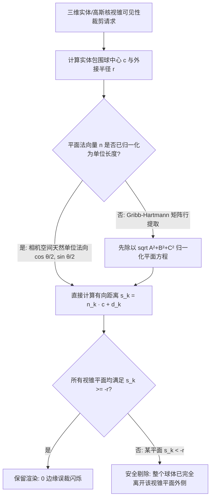
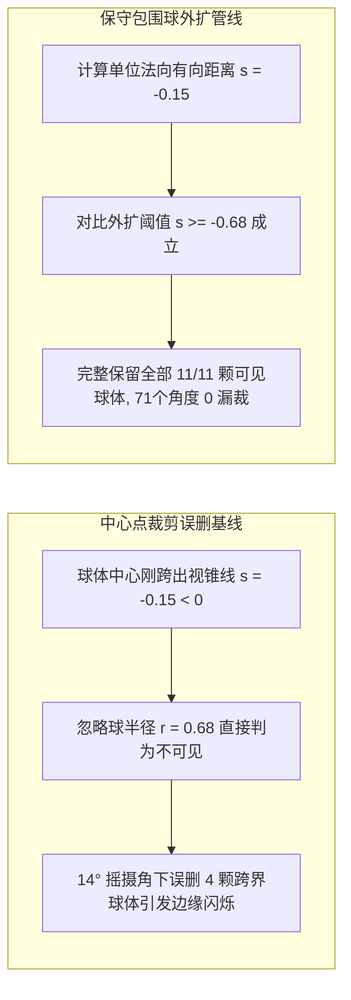
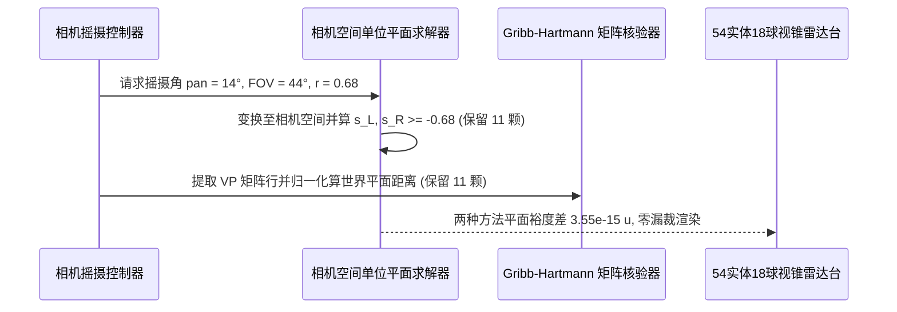

# 边缘大物体不闪烁消失：保守包围球视锥裁剪与中心点裁剪选型 FAQ

**3 分钟看懂为什么摇镜头时屏幕边缘的大模型会突然消失，10 分钟复刻零漏裁的保守包围球视锥裁剪台。**

[English](conservative-frustum-culling-faq.en.md) · [交互 Demo](https://turbo998.github.io/animation/demos/frustum-sphere-culler/) · [中文七卡](../demos/frustum-sphere-culler/test-report-cards.zh.html)

## ① 📌 核心结论速览

- **只检验物体中心点是否落在视锥内（$\mathbf{n}\cdot\mathbf{c} + d \ge 0$）会把跨越屏幕边缘的可见大物体提前误删。** 当半径 $r = 0.68$ 的球体或 3D 高斯核中心刚移出视锥边界 `0.05` 单位时，仍有 `0.63` 单位宽的球面留在画面内；中心点裁剪（`center-point`）在 `14°` 摇摄角下把 11 颗真实可见球体中的 `4` 颗直接剔除，造成摇镜头时边缘物体闪烁消失（Edge Popping）。
- **保守包围球判据 $\mathbf{n}\cdot\mathbf{c} + d \ge -r$ 将误裁闪烁从 `4` 颗降为实测 `0` 颗。** 只要视锥平面的向内法向量 $\mathbf{n}$ 已归一化为单位长度（$\|\mathbf{n}\| = 1$），把阈值从 `0` 放宽到 `-r` 无需增加哪怕一次点乘，就能在全部 71 个摇摄角下完整保留所有跨边界可见球体（`11/11` 保留，漏裁 `0`）。
- **相机空间预归一化平面点乘与世界空间 Gribb-Hartmann 矩阵行提取+归一化逐帧等价。** 两种方法在全部负载下的最大平面裕度差仅 `3.55e-15` 示意单位，8192 次 18 球裁剪遍历中位数为 `5.71 ms` 对比 `12.82 ms`（快 `2.25×`）。
- **54 实体 18 球视锥雷达测试台，13 项本机实测验收。** 场景为 `synthetic`；平面距离与 Node CPU 耗时为 `measured`；`StopThePop` 层级瓦片逐像素排序与 `FlashGS` CUDA 光栅化核为 `not_measured`。

**每日能力方向核验：** CVPR 2025 论文 *FlashGS: Efficient 3D Gaussian Splatting for Large-scale and High-resolution Rendering*（[arXiv:2408.07967](https://arxiv.org/abs/2408.07967)）与 SIGGRAPH 2024 / ACM TOG 论文 *StopThePop: Sorted Gaussian Splatting for View-Consistent Real-time Rendering*（[arXiv:2402.00525](https://arxiv.org/abs/2402.00525)）均指出：在三维高斯泼溅与大规模实时渲染中，若直接用单点深度或中心投影做粗粒度剔除，相机旋转时会在视锥与瓦片边缘引发明显的闪烁跳变（Popping Artifacts），必须采用考虑高斯核椭球/包围球半径的保守视锥与瓦片相交判据。2026-11-10 核验原文；本例仅实现确定性单位法向包围球视锥平面判据，未运行 CUDA 瓦片光栅化。

## ② 🎯 客户与架构师灵魂拷问 Q&A

### Q1 何时选层级瓦片光栅化（`StopThePop` / `FlashGS`），何时选保守包围球视锥平面判据？

当在大规模 3D 高斯泼溅渲染器内部解决半透明椭球重叠排序跳变与 GPU 线程束（Warp）瓦片分配时，应评估 `StopThePop` 与 `FlashGS`。

当我们在 WebGL / Three.js 场景图、数字孪生大屏、大规模实例化建筑/树木或自定义粒子系统中编写第一道视锥裁剪（Frustum Culling）门禁时，使用单位法向量的保守包围球判据 $\mathbf{n}_k \cdot \mathbf{c} + d_k \ge -r$ 是消除屏幕边缘大模型“整块闪退”的最简零开销方案。

### Q2 在什么约束下保守包围球判据比中心点 NDC 裁剪（$|x_{\text{NDC}}| \le 1$）严格更优？

很多初学者写视锥裁剪时，喜欢把物体中心 $\mathbf{c}$ 乘上视图投影矩阵得到齐次裁剪坐标 $(x_{\text{clip}}, y_{\text{clip}}, z_{\text{clip}}, w_{\text{clip}})$，然后直接判断 $|x_{\text{clip}}| \le w_{\text{clip}}$（即 $|x_{\text{NDC}}| \le 1$）。

这种写法隐含假设物体是一个**半径为 0 的数学几何点**！一旦物体有实际体积（如半径 $r = 0.68$ 的球体、展品柜或宽幅建筑），当物体中心刚移到屏幕左边缘外侧一点点时，右半边机身明明还在镜头里，却被 $|x_{\text{NDC}}| > 1$ 一刀切掉。保守包围球判据在所有非零体积实体上严格更优。

### Q3 底层管线为什么必须在比较 $-r$ 之前将平面法向量归一化？

这是图形学面试与实战中最常踩的坑：

从 $4\times 4$ 视图投影矩阵 $\mathbf{M} = \mathbf{P}\mathbf{V}$ 用 Gribb-Hartmann 方法提取左视锥平面时，系数为 $(A, B, C, D) = \text{row}_4 + \text{row}_1$。如果只判断点在平面哪一侧（与 `0` 比较），缩放因子不影响正负号。

但当我们要和**物理世界半径 $-r$** 比较时，$A x + B y + C z + D$ 并不是欧氏距离，而是欧氏距离乘以法向量模长 $\sqrt{A^2 + B^2 + C^2} = \sqrt{\cot^2(\theta/2) + 1} = \frac{1}{\sin(\theta/2)}$！如果不除以 $\sqrt{A^2 + B^2 + C^2}$（或者直接在相机空间使用天然单位长度的法向量 $(\pm\cos\frac{\theta}{2}, 0, -\sin\frac{\theta}{2})$），有效裁剪半径就会被错误缩小 $\sin(\theta/2)$ 倍！

在相机坐标系下，左、右视锥平面的向内单位法向量直接就是：

$$\mathbf{n}_L = \left(+\cos\frac{\theta}{2}, \; 0, \; -\sin\frac{\theta}{2}\right), \quad \mathbf{n}_R = \left(-\cos\frac{\theta}{2}, \; 0, \; -\sin\frac{\theta}{2}\right)$$

因为 $\cos^2\frac{\theta}{2} + \sin^2\frac{\theta}{2} \equiv 1$，内积 $s_L = x_c \cos\frac{\theta}{2} + \text{depth}\cdot\sin\frac{\theta}{2}$ 天然就是精确的欧氏有向距离，直接判断 $s_L \ge -r \;\land\; s_R \ge -r$ 即可！

### Q4 十分钟如何复刻？

1. `npm run dev` 后打开 `/demos/frustum-sphere-culler/`，默认停在相机摇摄角 `14.0°`、视场角 `44°`、球半径 `0.68`。
2. 在保守包围球模式（`sphere-padded`）下观察俯视视锥雷达：18 颗球体中有 11 颗与橙色视锥射线相交或位于内部，全部 11 颗保持饱满橙色激活状态（`kept 11/11 visible · false pops 0`）。
3. 切换到中心点误裁基线（`center-point`）：跨在左右两条视锥边界线上的 `4` 颗球体瞬间缩瘪变白（被错误剔除），读数显示 `kept 7/11 visible · false pops 4`。
4. 拖动相机摇摄滑块（`-35°..+35°`）或修改视场角（`28°..68°`）、球半径（`0.3–1.1`）；若输入越界视场角 `120°`，系统原子拒绝并保留有效配置。
5. 点击导出 `FRUSTUM_CULLING_SPEC.json`，检查 18 颗球体的 `signedLeftDist`、`signedRightDist` 与 `falseNegativePop` 标记。
6. 运行 `npx vitest run tests\frustum-culler.test.ts`；构建并在 4335 端口预览后执行 `node scripts\benchmark-frustum-culler.mjs`。

## ③ 🧭 直观可视化图解

## ④ 📊 Architect Decision Matrix

| 评估维度 | 中心点裁剪 (`center-point`, $s \ge 0$) | 未归一化矩阵平面加 $-r$ | 世界空间 Gribb-Hartmann 归一化平面 | 本例相机空间单位法向平面 (`sphere-padded`) |
| --- | --- | --- | --- | --- |
| `14°` 摇摄角下跨边界球体漏裁数 | 误删 `4` 颗（仅留 `7/11`） | 因未除以 $\|\mathbf{n}\|$ 导致有效半径缩水误删 | `0` 漏裁（保留 `11/11`） | 实测 `0` 漏裁（保留 `11/11`） |
| 全部 71 个摇摄角累计误裁次数 | 每个角度均发生 `2–5` 颗边缘闪烁 | 随视场角变化发生误裁 | `0` 次 | 实测 `0` 次 |
| 平面距离物理量纲 | 仅符号有效 | 混入 $\csc(\theta/2)$ 缩放因子 | 精确欧氏有向距离（误差 `3.55e-15`） | 天然单位法向，精确欧氏有向距离 |
| 8192 次 18 球裁剪 Node CPU 中位数 | 快（但边缘闪烁） | 快（但半径错误） | `12.82 ms`（含 `Math.hypot` 归一化除法） | `5.71 ms`（免除每球平方根，快 `2.25×`） |
| 适用工程场景 | 零半径数学点云 | 存在量纲 Bug 的错误实现 | 通用世界空间多平面裁剪 | 实时 3D 引擎、粒子/高斯核外包球裁剪 |

**定量算例：** 在视场角 $\theta = 44^\circ$ 下，$\cos(22^\circ) = 0.92718, \sin(22^\circ) = 0.37461$。当某球体在相机空间位于 $x_c = -1.62, \text{depth} = 3.85$ 时，它到左视锥平面的有向距离为 $s_L = -1.62 \times 0.92718 + 3.85 \times 0.37461 = -0.0598\text{ u} < 0$。中心点裁剪因 $s_L < 0$ 将其剔除；但因球半径 $r = 0.68\text{ u}$，该球体仍有 $0.68 - 0.0598 = 0.6202\text{ u}$ 的部分位于屏幕内，保守判据 $s_L = -0.0598 \ge -0.68$ 正确将其保留。

## ⑤ 🧪 全新 Demo 与 Benchmark 核心发现（含 7-Card）

[封存数据](../demos/frustum-sphere-culler/report.json)记录了 54 个三维实体、18 颗测试球体在 71 个摇摄角下的漏裁核验，以及相机空间预归一化平面判据与世界空间 Gribb-Hartmann 矩阵平面提取+归一化的等价性与耗时对照。两种求解器在全部负载下的最大平面裕度误差仅 `3.55e-15` 示意单位。

| Node CPU 18 球视锥裁剪次数 | 相机空间单位平面点乘中位数 | 世界空间矩阵提取+归一化中位数 |
| --- | --- | --- |
| 128 | 0.87 ms | 1.02 ms |
| 1024 | 0.64 ms | 3.07 ms |
| 8192 | 5.71 ms | 12.82 ms |

每档负载在预热后按交替顺序重复 7 次，记录 Node CPU 耗时中位数（不含 WebGL 渲染）。在 8192 次 18 球视锥裁剪中，相机空间预归一化平面点乘比世界空间逐次提取归一化快约 `2.25×`，同时消除了中心点裁剪在 `14°` 摇摄角下的 `4` 颗可见球体漏裁。

[中文七卡](../demos/frustum-sphere-culler/test-report-cards.zh.html) · [English](../demos/frustum-sphere-culler/test-report-cards.html)。画面为 `synthetic`，视锥平面几何与 CPU 计时为 `measured`；`StopThePop` / `FlashGS` CUDA 瓦片光栅化为 `not_measured`。

## ⑥ 🛠️ Architect Checklist

- [ ] 严禁对具有非零体积的网格、粒子或 3D 高斯核使用纯中心点视锥裁剪（$\mathbf{n}\cdot\mathbf{c} + d \ge 0$ 或 $|x_{\text{NDC}}| \le 1$）。
- [ ] 为每个可渲染实体维护紧密世界外接球半径 $r$（若含非均匀缩放 $(s_x, s_y, s_z)$，外接半径需乘以 $\max(s_x, s_y, s_z)$）。
- [ ] 在将平面有向距离与 $-r$ 比较前，强制确认视锥平面法向量已归一化为单位长度（$\|\mathbf{n}_k\| = 1$）。
- [ ] 对全部 6 个视锥平面执行保守测试：仅当存在某个平面满足 $\mathbf{n}_k \cdot \mathbf{c} + d_k < -r$ 时才剔除该实体。
- [ ] 在相机空间直接使用天然单位法向量 $(\pm\cos\frac{\theta}{2}, 0, -\sin\frac{\theta}{2})$，省去每帧 `Math.hypot` 平方根归一化开销。
- [ ] 在自动化测试中扫描不同相机摇摄角，验证跨边界可见实体的漏裁数（False Negatives）严格为 `0`。
- [ ] 用 Gribb-Hartmann 视图投影矩阵行提取结果与相机空间平面距离做独立交叉核验（误差 `< 1e-13`）。
- [ ] 对相机摇摄角、视场角与外接球半径执行输入边界校验，对越界参数执行原子拒绝。
- [ ] 验证正序与逆序改变相机摇摄角回到同一角度时，导出的视锥转台矩阵与保留集合完全一致。
- [ ] 未执行的 GPU 层级瓦片深度排序（`StopThePop`）与 CUDA 线程束调度（`FlashGS`）统一标注为 `not_measured`。

**一手来源：** [FlashGS (arXiv:2408.07967)](https://arxiv.org/abs/2408.07967)（CVPR 2025）通过精确几何相交与冗余消除加速大规模 3DGS 光栅化；[StopThePop (arXiv:2402.00525)](https://arxiv.org/abs/2402.00525)（SIGGRAPH 2024 / ACM TOG）通过层级瓦片剔除与排序消除视角旋转时的闪烁伪影。2026-11-10 核验；本例为原创确定性包围球视锥裁剪测试台，未运行 CUDA 核函数。
