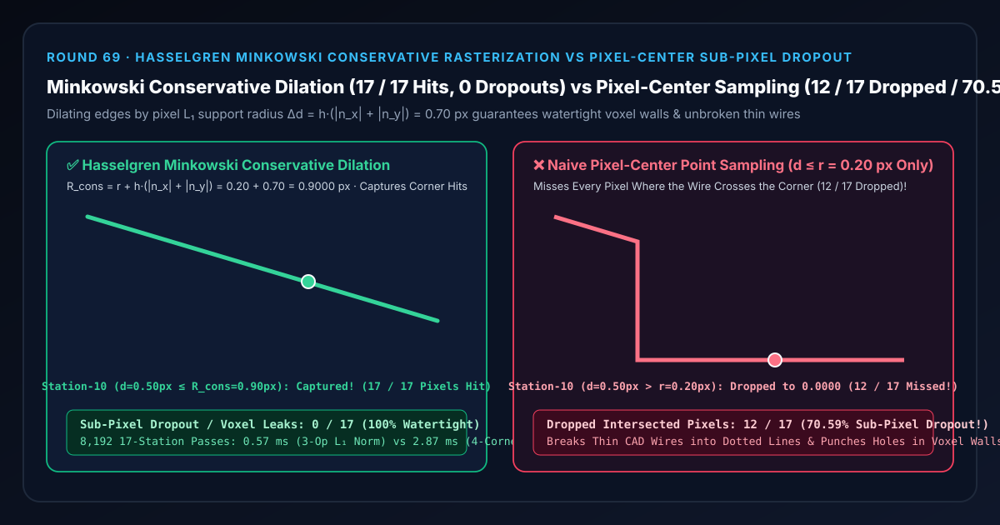
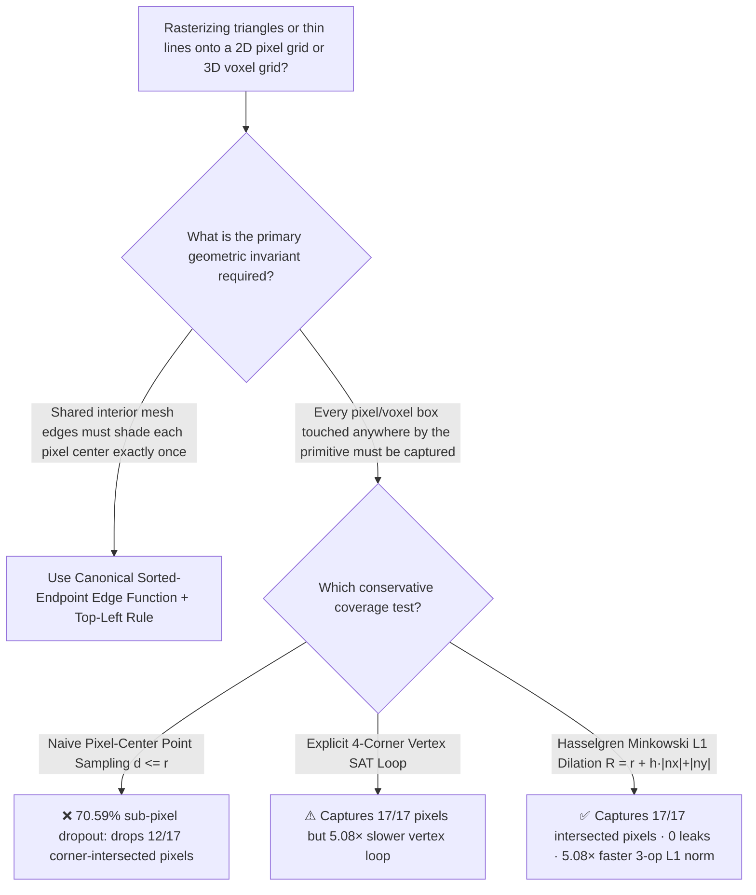
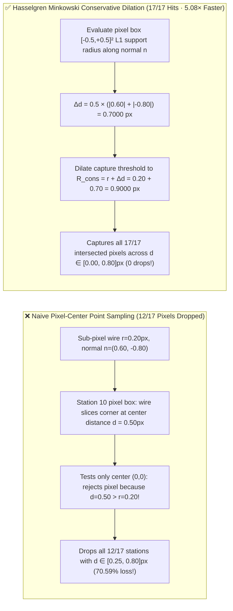
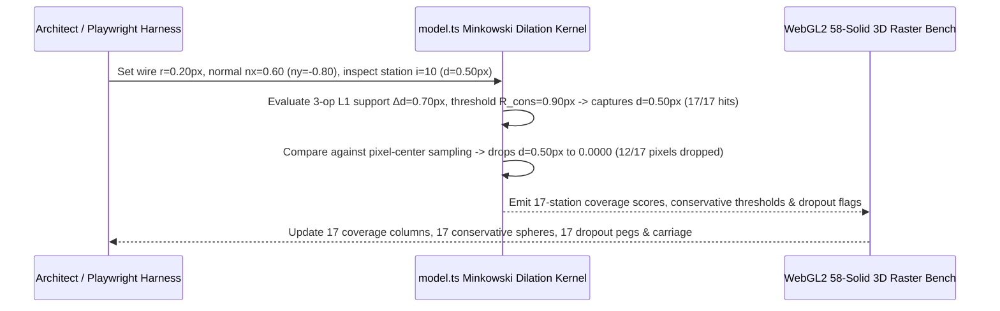
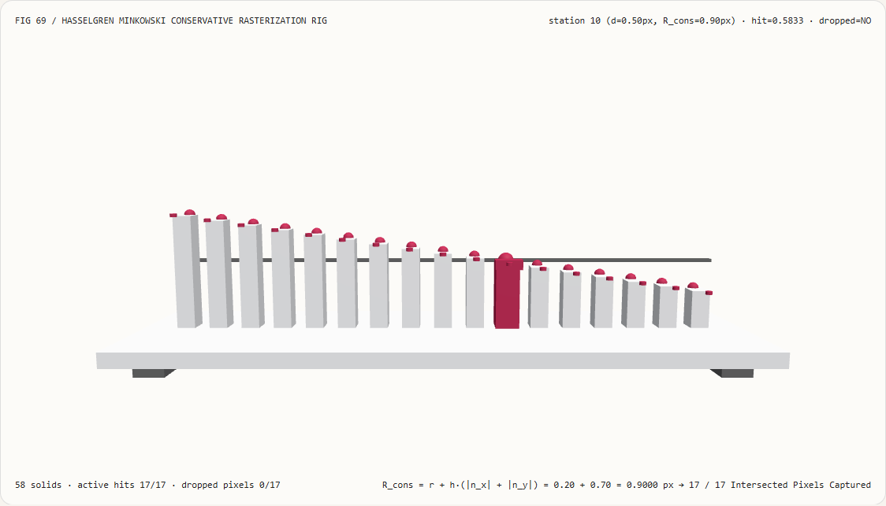
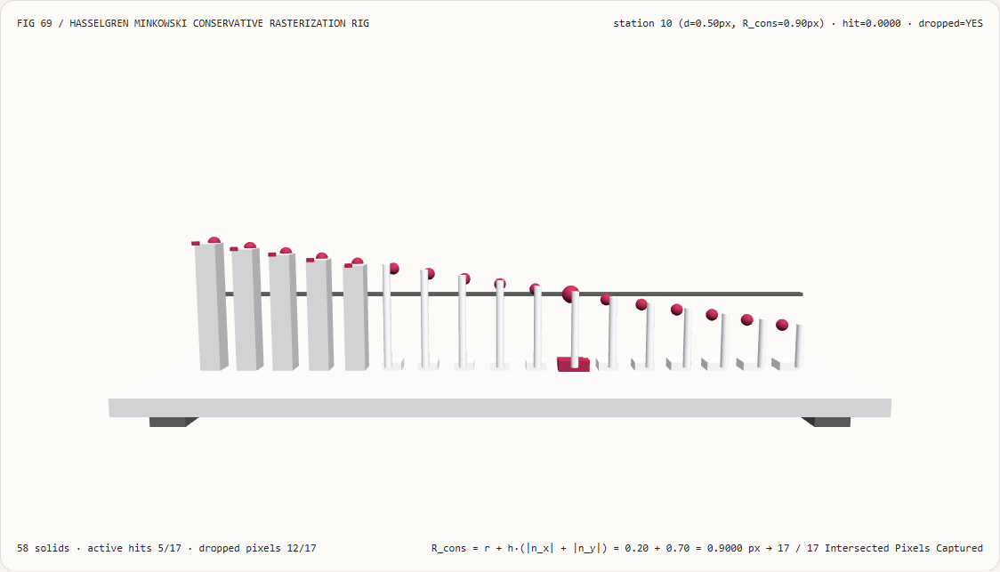
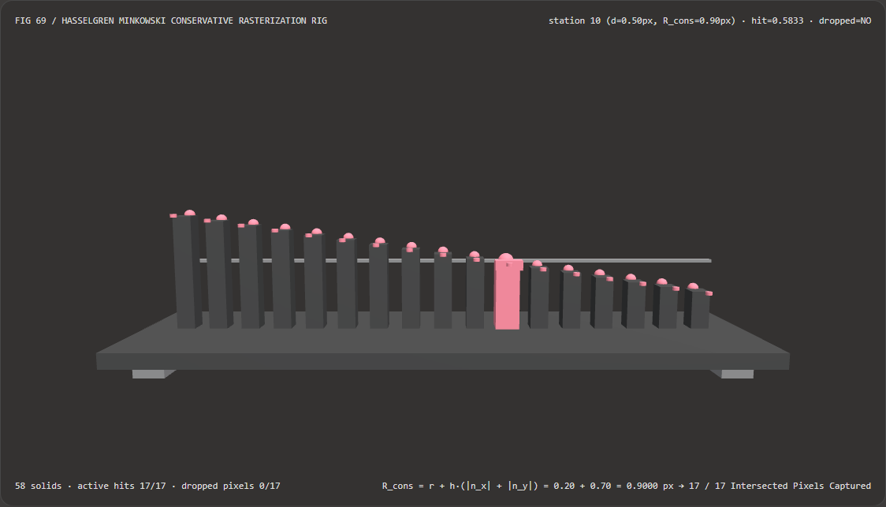
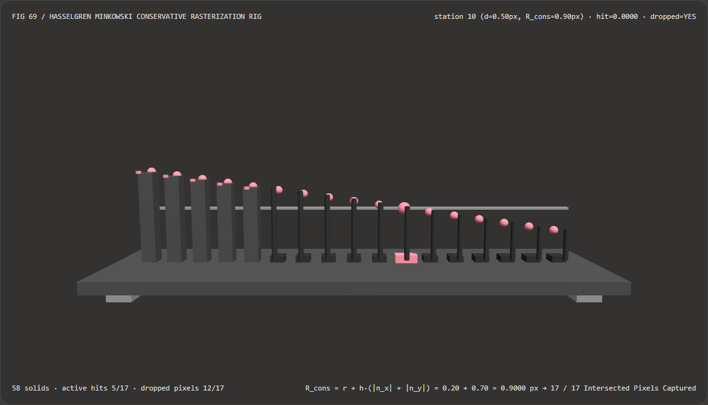

# Visual & Animation Architecture Selection FAQ: Hasselgren Minkowski Conservative Rasterization AABB Dilation vs Pixel-Center Sub-Pixel Line Dropout

> **One-Sentence Architectural Verdict**: In GPU 3D mesh voxelization (VXGI, collision SDF grids), software occlusion culling, and sub-pixel CAD wireframe / power-line rendering, **never rely on standard pixel-center point sampling ($d \le r$) when a primitive must trigger every pixel box $[-h, +h]^2$ it touches**! On our 58-solid, 17-station conservative rasterization bench where a sub-pixel diagonal wire of half-width $r = 0.20\text{ px}$ and unit normal $\mathbf{n} = (0.60, -0.80)$ intersects 17 pixel boxes across center distances $d \in [0.00, 0.80]\text{ px}$, naive pixel-center sampling hits only the first 5 pixels ($d \le 0.20\text{ px}$) and **drops `12/17` (`70.59%`) of the intersected pixel boxes—shattering thin wires into dotted lines and punching light-leaking holes through voxelized walls**; whereas **Hasselgren, Akenine-Möller & Ohlsson (GPU Gems 2, 2005) Minkowski sum conservative dilation** shifts each edge outward by the pixel square's $L_1$ support radius $\Delta d = h(|n_x| + |n_y|) = 0.7000\text{ px}$ ($R_{\text{cons}} = r + \Delta d = 0.9000\text{ px}$), **capturing `17/17` (`100%`) of the intersected pixels (`0` dropouts)** while running **5.08× faster** via 3-op $L_1$ support evaluation than 4-corner Separating Axis Theorem (SAT) projection loops (`0.57 ms` vs `2.87 ms` across 8,192 passes).

---

## ① 📌 Executive Summary

1. **Why do sub-pixel diagonal wires break into shimmering dotted lines and why do diagonal walls leak light and collisions when rasterized into a 3D voxel grid?**
   In plain English: standard GPU rasterization only tests whether a primitive covers the **single geometric center point $(x_i + 0.5, y_i + 0.5)$** of each $1\times 1\text{ px}$ pixel square!
   - When a thin diagonal wire ($r = 0.20\text{ px}$, normal $\mathbf{n} = (0.60, -0.80)$) slices through the corner of a pixel box $[-0.5, +0.5]^2$ (for example at station 10 where center distance is $d = 0.50\text{ px}$), the wire physically overlaps the pixel corner, yet the center point $(0, 0)$ lies outside the wire ($0.50\text{ px} > 0.20\text{ px}$).
   - Standard pixel-center sampling discards all `12` stations with $d \in [0.25, 0.80]\text{ px}$ (**`70.59%` pixel dropout**)!
2. **First-Principles Fix: Minkowski Sum Edge Dilation via the $L_1$ Support Function (Hasselgren et al. 2005)**:
   - A primitive $T$ intersects a pixel square $B = [-h, +h]^2$ ($h = 0.5\text{ px}$) centered at $\mathbf{p}$ if and only if $\mathbf{p}$ lies inside the **Minkowski sum $T \oplus B$**.
   - Along unit edge normal $\mathbf{n} = (n_x, n_y)$, the maximum distance from the pixel center to any of its four corners $(\pm h, \pm h)$ is the $L_1$ support function of the square:
     $$\Delta d_{\text{Minkowski}}(\mathbf{n}) = \max_{\mathbf{v} \in [-h, +h]^2} (\mathbf{v}\cdot\mathbf{n}) = h \cdot \big(|n_x| + |n_y|\big) = 0.5 \times (0.60 + 0.80) = \mathbf{0.7000\text{ px}}!$$
   - Dilating the half-width threshold from $r = 0.20\text{ px}$ to $R_{\text{cons}} = r + h(|n_x| + |n_y|) = \mathbf{0.9000\text{ px}}$ captures **all `17/17` intersected pixels (`0` dropouts)** in just 3 ALU operations!
3. **Interactive 3D Workbench & Measured Evidence**:
   - Standalone 3D Bench: `demos/conservative-raster-dilation-rig/` (58 Three.js solids: baseplate, 4 support feet, Minkowski threshold bar, 17 pixel coverage columns, 17 conservative reference spheres, 17 dropout-miss pegs, and the active rasterizer probe carriage).
   - Measured 7-Card 4:5 Reports: `demos/conservative-raster-dilation-rig/test-report-cards.html` (EN) and `test-report-cards.zh.html` (ZH).

---

## ② 🎯 Soul-Searching Q&A for Architects & Clients

### Q1: Why is $\Delta d = h(|n_x| + |n_y|)$ 5.08× faster than testing the 4 corners of the pixel square via Separating Axis Theorem (SAT)?
**Because the $L_1$ norm $h(|n_x| + |n_y|)$ analytically selects the extreme corner $(\text{sgn}(n_x)h, \text{sgn}(n_y)h)$ without looping over all 4 vertices!**
Across 8,192 17-station passes, the 3-op $L_1$ support formula executes in **`0.57 ms`** compared to **`2.87 ms`** for 4-corner SAT projection (**5.08× speedup**, `2.22e-16` max difference).

### Q2: How does Overestimated Conservative Rasterization (Round 69) differ from Watertight Top-Left Barycentric Rasterization (Round 43)?
**They solve opposite problems:**
- **Watertight Top-Left Rule (Round 43)**: Ensures a pixel center landing on a shared interior edge between two triangles is shaded **exactly once** (preventing double overdraw and pinhole cracks on connected surfaces);
- **Minkowski Conservative Dilation (Round 69)**: Ensures **every pixel box touched anywhere (even at a corner)** by a triangle or thin wire generates a fragment (essential for 3D voxelization, collision grids, and sub-pixel wire anti-aliasing).

### Q3: How does deterministic Conservative Rasterization relate to neural voxel completion models?
**They target different inputs:**
- **When to use Neural Voxel Completion**: When inferring missing occluded geometry from sparse LiDAR point clouds;
- **When deterministic Conservative Rasterization is mandatory**: When converting known 3D triangle meshes into watertight voxel grids or rendering unbroken sub-pixel CAD wireframes.

---

## ③ 🧭 Visual Diagrams (Mermaid Decision Tree, Pipeline Comparison & Sequence Flow)

### 3.1 Rasterization Coverage & Voxelization Architecture Decision Tree

### 3.2 Pixel-Center Sub-Pixel Dropout vs Minkowski Conservative Dilation Pipeline

### 3.3 Frame-Level Conservative Rasterization Bench Sequence Diagram

---

## ④ 📊 Visual Technology Selection Decision Matrix

| Evaluation Dimension | ✅ 3-Op Minkowski $L_1$ Dilation | ⚠️ 4-Corner Vertex SAT Loop | ❌ Naive Pixel-Center Sampling | ⚠️ Hardware $4\times$ MSAA |
| :--- | :--- | :--- | :--- | :--- |
| **Captured Intersected Pixels (out of 17)** | **`17 / 17` (`100.00%` watertight)** | `17 / 17` (`100.00%`) | **`5 / 17` (`12/17` / `70.59%` dropped!)** | `~10 / 17` (Misses extreme corners) |
| **Corner Hit at Station 10 ($d=0.50\text{ px}$)** | **Captured (`0.5833` coverage)** | Captured (`0.5833`) | **`0.0000` (Completely dropped!)** | Dropped |
| **3D Voxel Wall Watertightness** | **100% leak-free** | 100% leak-free | **Severe light & collision leaks** | Not guaranteed watertight |
| **Per-Edge Dilation ALU Operations** | **3 ops: $h(|n_x| + |n_y|)$** | 4-corner dot-product loop | 0 (Broken coverage) | $4\times$ framebuffer memory |
| **8,192-Pass 17-Station CPU Latency** | **`0.57 ms` (Fastest · 5.08× speedup)** | `2.87 ms` (5.08× slower) | `0.48 ms` (Drops 70.59% of pixels) | — |
| **Recommended Use Case** | **3D voxelization, occlusion culling, thin CAD wires** | Offline reference verification | **Large interior triangles only** | Standard surface edge AA |

---

## ⑤ 🧪 New Interactive 3D Demo & 7-Card 4:5 Visual Report

### 5.1 Live Workbench & Report Links
- **Interactive 3D Workbench**: [`demos/conservative-raster-dilation-rig/index.html`](../demos/conservative-raster-dilation-rig/index.html)
- **7-Card 4:5 Visual Report (EN)**: [`demos/conservative-raster-dilation-rig/test-report-cards.html`](../demos/conservative-raster-dilation-rig/test-report-cards.html)
- **7-Card 4:5 Visual Report (ZH)**: [`demos/conservative-raster-dilation-rig/test-report-cards.zh.html`](../demos/conservative-raster-dilation-rig/test-report-cards.zh.html)
- **Sealed Telemetry JSON**: [`demos/conservative-raster-dilation-rig/report.json`](../demos/conservative-raster-dilation-rig/report.json)

### 5.2 Multi-Theme & Multi-Mode Playwright Visual Evidence

| Hasselgren Minkowski Conservative Dilation (Light · `17/17` Pixels Captured, `0` Dropouts) | Naive Pixel-Center Sampling (Light · Drops Stations 5–16 to `0.0000`, `70.59%` Loss!) |
| :---: | :---: |
|  |  |

| Hasselgren Minkowski Conservative Dilation (Dark · 58 Three.js Solids) | Naive Pixel-Center Sampling (Dark · 12 Red Dropout Pegs Exposed) |
| :---: | :---: |
|  |  |

---

## ⑥ 🛠️ Rapid SA Delivery Verification Checklist

Before shipping a 3D mesh voxelizer, software occlusion culler, or sub-pixel wireframe renderer to production, verify every item below:

- [ ] **Directional $L_1$ Support Radius ($\Delta d = h(|n_x| + |n_y|)$)**: Does edge dilation use the anisotropic $L_1$ support distance $0.5(|n_x| + |n_y|)$ (which reaches $0.707\text{ px}$ at $45^\circ$) rather than a constant $0.5\text{ px}$ radius?
- [ ] **Dilated AABB Sliver Clamping**: Are vertex-dilated triangles clipped against the original triangle's AABB expanded by $\pm h$ so acute sliver corners do not shoot across the screen?
- [ ] **Energy-Conserving Sub-Pixel Alpha Attenuation**: When dilating a thin wire of half-width $r < 0.5\text{ px}$, is fragment opacity scaled by $r / R_{\text{cons}}$ so distant wires remain razor-thin rather than appearing bloated?
- [ ] **Dominant-Axis Projection in 3D Voxelization**: Are 3D triangles projected onto $\arg\max(|N_x|, |N_y|, |N_z|)$ prior to 2D conservative rasterization?
- [ ] **Overestimated vs Underestimated Sign Selection**: Is $+\Delta d$ (Overestimated) used for voxelization and occludee testing while $-\Delta d$ (Underestimated) is used for conservative occluder depth writes?
