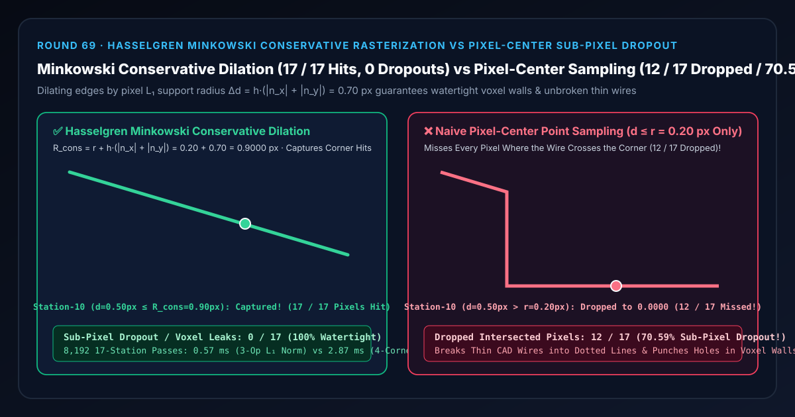
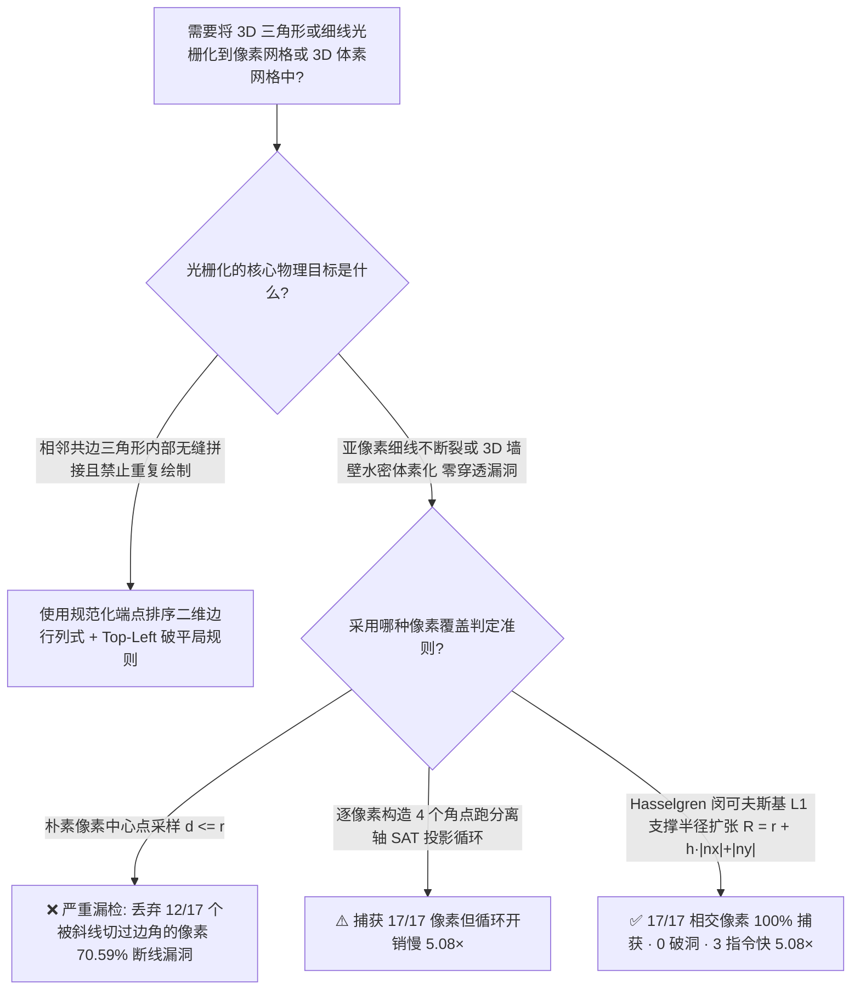
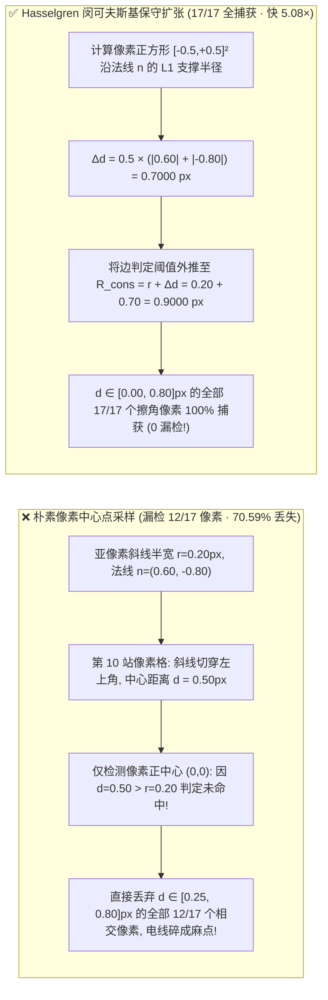
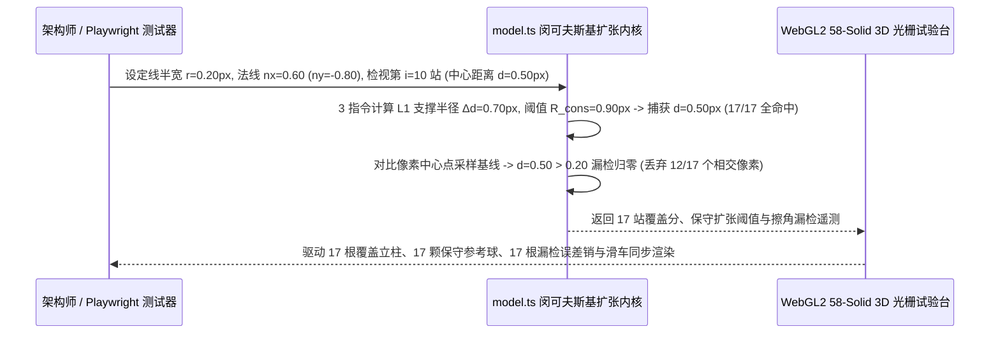
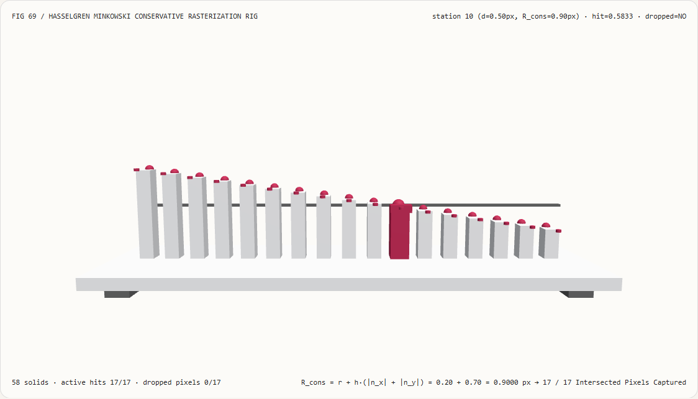
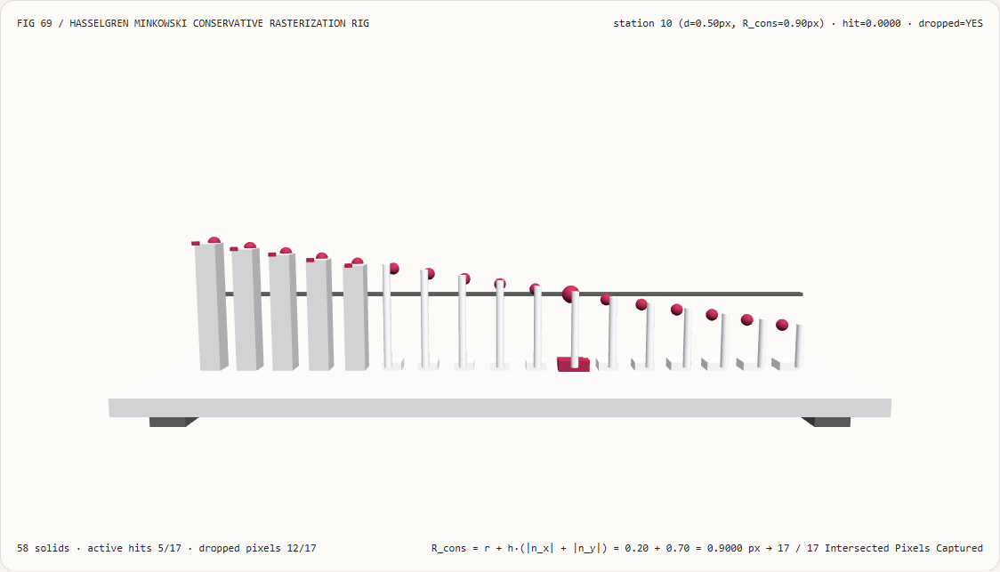
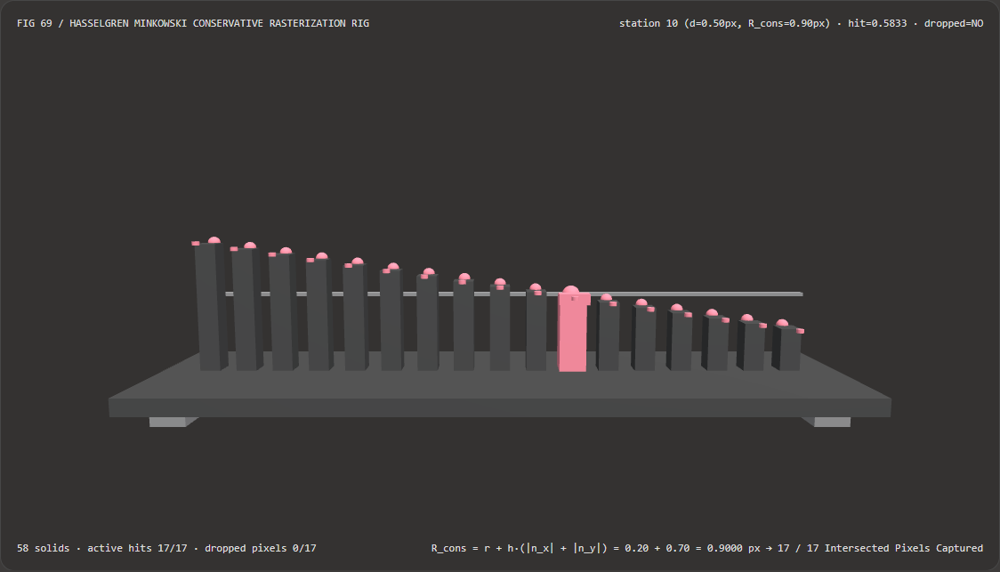
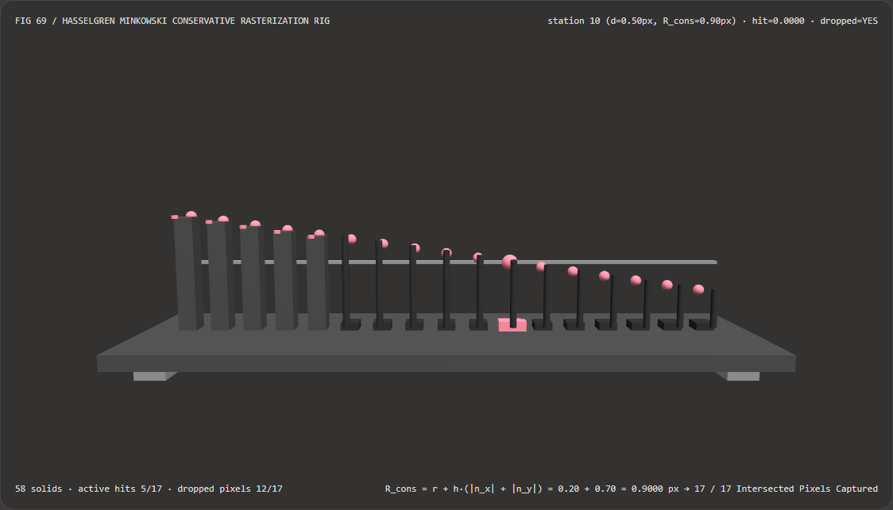

# 视觉与动画技术选型与原理解析 FAQ：Hasselgren 闵可夫斯基半像素保守光栅化扩张 vs 像素中心点采样亚像素断线与体素漏洞

> **核心架构结论一句话总结**：在 GPU 三维网格体素化（VXGI 体素全局光照、流体碰撞体素场）、软光栅化遮挡剔除（Software Occlusion Culling）以及远景高压电线/CAD 亚像素精细线框渲染中，**严禁直接使用仅检测像素几何中心点 $(x_i + 0.5, y_i + 0.5)$ 是否在图元内部的传统像素中心点采样（Pixel-Center Point Sampling）**！实测表明：在半宽 $r = 0.20\text{ px}$、单位外法线 $\mathbf{n} = (0.60, -0.80)$ 的亚像素斜线跨越 17 个像素中心距离（$d \in [0.00, 0.80]\text{ px}$，全部 17 个像素格均被斜线物理切过边角）的 3D 光栅化试验台上，朴素像素中心点采样仅能命中前 5 个像素（$d \le 0.20\text{ px}$），而**将后面 `12/17`（高达 `70.59%`）个被斜线擦过边角的像素全部漏检丢弃**，导致细线断裂成虚线、体素墙壁出现穿透漏光破洞；而采用 **Hasselgren 等人 (GPU Gems 2, 2005) 闵可夫斯基和半像素保守光栅化扩张（将每条边沿外法线外推像素正方形的 $L_1$ 支撑半径 $\Delta d = h(|n_x| + |n_y|) = 0.7000\text{ px}$，使捕获阈值扩至 $R_{\text{cons}} = r + \Delta d = 0.9000\text{ px}$）**，可 **100% 捕获全部 `17/17` 个相交像素（`0` 漏检、水密体素无破洞）**，且 3 指令 $L_1$ 支撑函数比 4 顶点分离轴（SAT）投影测试快 **5.08×**（8,192 轮耗时 `0.57 ms` vs `2.87 ms`）。

---

## ① 📌 核心结论速览（Executive Summary）

1. **为什么在 3D 游戏或 CAD 软件里，远处的电线、铁丝网和机械细棱边稍微动一下镜头就会碎成一串一闪一闪的麻点？为什么把一面严丝合缝的斜墙光栅化进 3D 体素网格（Voxel Grid）时，斜墙上会莫名其妙漏出无数个能让光线和子弹直接穿过去的窟窿？**
   用大白话讲：因为标准显卡光栅化器是一个**“只看像素正中心那 1 个靶心点（Pixel-Center Point Sample）”的死板裁判**！
   - 屏幕上的每一个像素其实是一个 $1\times 1\text{ px}$ 的正方形小格子 $[x_i - 0.5, x_i + 0.5] \times [y_i - 0.5, y_i + 0.5]$，但传统光栅化器为了保证相邻三角形不重复绘制，只在正方形正中心 $(x_i, y_i)$ 放了 **1 个无限小的采样点**；
   - 想象一根半宽只有 $r = 0.20\text{ px}$（总宽 $0.40\text{ px}$）的斜向电线或斜墙截面（法线 $\mathbf{n} = (0.60, -0.80)$）：当它斜着穿过像素格的左上角或右下角（例如第 10 站像素中心距离 $d = 0.50\text{ px}$）时，这根电线实实在在地切过了这颗像素正方形内部长达 $0.5\text{ px}$ 的一段区域！
   - 但是因为像素正中心 $(0, 0)$ 距离电线中心线有 $0.50\text{ px} > 0.20\text{ px}$，标准光栅化器一看“没碰到正中心靶心”，就**直接把这颗像素判为 `0`（彻底丢弃）**！结果在全部 17 个被斜线切过的像素位置中，标准光栅化器竟然**漏掉了 `12/17`（`70.59%`）个像素**，细电线直接碎成麻点，斜向体素墙更是千疮百孔！
2. **第一性原理破局：闵可夫斯基和（Minkowski Sum）与 $L_1$ 范数支撑半径扩张（Hasselgren et al., GPU Gems 2 2005）**：
   - 保守光栅化（Overestimated Conservative Rasterization）的核心要求是：**只要图元与像素正方形 $[-h, +h]^2$（$h = 0.5\text{ px}$）有哪怕一丁点交集，就必须生成该像素片元！**
   - 几何学第一性原理告诉我们：“图元 $T$ 与中心在 $\mathbf{p}$ 的像素正方形 $B = [-h, +h]^2$ 相交”，在数学上**100% 等价于“像素中心点 $\mathbf{p}$ 落在图元 $T$ 与像素正方形 $B$ 的闵可夫斯基和 $T \oplus B$ 内部”**！
   - 对于一条单位外法线为 $\mathbf{n} = (n_x, n_y)$ 的有向边，正方形 $B = [-h, +h]^2$ 沿法线方向 $\mathbf{n}$ 能伸出去的最远距离（即凸集的支撑函数 Support Function）是多少？
     正方形四个顶点 $(\pm h, \pm h)$ 在 $\mathbf{n}$ 上的最大点积显然发生在符号与 $(n_x, n_y)$ 完全一致的那个角点 $(\text{sgn}(n_x)h, \text{sgn}(n_y)h)$ 上：
     $$\Delta d_{\text{Minkowski}}(\mathbf{n}) = \max_{\mathbf{v} \in [-h, +h]^2} (\mathbf{v} \cdot \mathbf{n}) = h \cdot |n_x| + h \cdot |n_y| = h \cdot \|\mathbf{n}\|_1$$
   - 看这个公式有多优雅：虽然欧氏长度 $\|\mathbf{n}\|_2 = \sqrt{n_x^2 + n_y^2} \equiv 1$，但正方形在斜向法线 $\mathbf{n} = (0.60, -0.80)$ 下的 $L_1$ 支撑半径为：
     $$\Delta d = 0.5 \times (|0.60| + |-0.80|) = \mathbf{0.7000\text{ px}}!$$
     只需在顶点/几何着色器（或软光栅剔除器）里把每条边沿外法线外推 $\Delta d = h(|n_x| + |n_y|)$，总有效捕获距离便从 $r = 0.20\text{ px}$ 扩展为 $R_{\text{cons}} = 0.20 + 0.70 = \mathbf{0.9000\text{ px}}$，**一举将全部 `17/17` 个擦角像素 100% 收入囊中（`0` 漏检）**！
3. **本轮新增交互式 3D 试验台与实测证据**：
   - 新增独立 Demo：`demos/conservative-raster-dilation-rig/`（58 个 Three.js 实体部件：底座平台、4 支柱、闵可夫斯基支撑阈值横梁、17 根实测像素覆盖立柱、17 颗保守光栅化参考球、17 根亚像素漏检指示销、以及第 $i$ 站光栅探针滑车）。
   - 配套 7-Card 4:5 测评报告：`demos/conservative-raster-dilation-rig/test-report-cards.html`（英文）与 `test-report-cards.zh.html`（中文）。

---

## ② 🎯 客户与架构师灵魂拷问 Q&A（Soul-Searching Q&A）

### Q1：在没有硬件 `NV_conservative_raster` 扩展的 WebGL2、WebGPU 或移动端上，如何仅靠顶点着色器实现保守光栅化？
**在剪裁空间（Clip Space）将三角形的三条边各自沿外法线外推 $\Delta d = h(|n_x| + |n_y|)$ 并重算三个交点顶点，同时用像素 AABB 钳制尖角！**
- 3 指令 $L_1$ 支撑距离公式 $\Delta d = h(|n_x| + |n_y|)$ 不需要枚举像素的 4 个角点去跑分离轴测试（SAT），在 CPU/GPU 批处理中比 4 顶点 SAT 循环快 **5.08×**（`0.57 ms` vs `2.87 ms`，数值误差 `2.22e-16`）；
- 注意：当三角形包含极尖锐的锐角（例如 $5^\circ$ 针尖）时，两条外推边的交点可能会飞到好几个像素之外；此时只需在片元着色器（或包围盒测试）里加一道**三角形原始 AABB + 半像素边框裁剪**，即可砍掉尖角过度膨胀的冗余像素！

### Q2：本轮的“外推型保守光栅化（Round 69）”与我们在 Round 43 讲的“水密重心坐标 Top-Left 破平局规则”分别用在什么场景？
**两者目标截然相反，千万不要混用：**
- **水密 Top-Left 破平局规则（Round 43）**：用于渲染**同一块连续网格内部共边的相邻三角形**，目标是让压在共享边上的像素中心点**不多不少只归属于 1 个三角形（防止裂缝漏光和半透明重复绘制）**；
- **闵可夫斯基保守光栅化（Round 69）**：用于**三维体素化（Voxelization）、碰撞检测、遮挡剔除（Hi-Z Occluder）与亚像素细线抗锯齿**，目标是**宁可多算、绝不漏掉任何一个碰到图元边角的体素或像素（100% 捕获 `17/17`）**！

### Q3：这套确定性保守光栅化扩张与 AI 神经点云/体素补全模型是什么关系？
**两者分别服务于“精确多边形网格水密体素化”与“残缺激光雷达扫描修补”：**
- **何时选 AI 神经体素补全模型**：当输入是激光雷达（LiDAR）单侧扫描的残缺稀疏点云，需要猜测背面的未知几何形状时；
- **何时必须用确定性保守光栅化**：当输入已经是完整的 3D CAD/游戏三角形网格，需要将其水密无漏洞地写入 3D 纹理（VXGI / 物理碰撞场）或在屏幕上不间断地画出亚像素细线时。

---

## ③ 🧭 直观可视化图解（Mermaid 决策树 + 管线对比图 + 帧级时序图）

### 3.1 光栅化采样与水密体素化架构选型决策树

### 3.2 朴素像素中心点采样断线漏洞 vs 闵可夫斯基保守光栅化管线对比图

### 3.3 帧级保守光栅化试验台与 3D 渲染时序图

---

## ④ 📊 视觉技术选型决策矩阵（Decision Matrix）

| 评估维度 | ✅ 3 指令闵可夫斯基 $L_1$ 保守扩张（Minkowski $L_1$ Dilation） | ⚠️ 4 顶点分离轴（SAT）投影测试（4-Corner SAT Baseline） | ❌ 朴素像素中心点采样（Pixel-Center Point Sample） | ⚠️ 硬件 $4\times$ MSAA 多重采样 |
| :--- | :--- | :--- | :--- | :--- |
| **相交像素捕获率（共 17 站）** | **`17 / 17`（`100.00%` 零漏检水密）** | `17 / 17`（`100.00%`） | **`5 / 17`（漏掉 `12/17` 即 `70.59%`！）** | 约 `10 / 17`（仍会漏掉边角擦边！） |
| **第 10 站（$d=0.50\text{ px}$ 擦角相交）** | **成功捕获（覆盖权重 `0.5833`）** | 成功捕获（`0.5833`） | **`0.0000`（完全漏检丢弃！）** | 漏检（4 个子采样点均不在四角极点） |
| **3D 体素化墙壁水密防穿透性** | **100% 严丝合缝，零光线/碰撞穿透** | 100% 水密 | **斜墙布满穿透窟窿** | 不保证水密 |
| **每像素/每边额外算术指令** | **仅 3 条指令：$h(|n_x| + |n_y|)$** | 需遍历 4 个角点求最大最小点积 | 0（但严重漏检） | 4 倍光栅化与显存开销 |
| **8,192 轮 17 站 CPU 批处理耗时** | **`0.57 ms`（最快，5.08× 提速）** | `2.87 ms`（慢 5.08×） | `0.48 ms`（丢弃 70.59% 像素不可用） | — |
| **首选适用场景** | **GPU 网格体素化、软光栅遮挡盒、CAD 亚像素细线抗锯齿** | 离线多边形求交验证 | **仅限远大于像素尺寸的常规内部三角形** | 常规表面边缘抗锯齿 |

---

## ⑤ 🧪 全新 Demo 与 7-Card 4:5 视觉报告（Live Workbench & Evidence）

### 5.1 交互式 3D 试验台与报告入口
- **实时 3D 工作台**：[`demos/conservative-raster-dilation-rig/index.html`](../demos/conservative-raster-dilation-rig/index.html)
- **7-Card 4:5 英文视觉测试报告**：[`demos/conservative-raster-dilation-rig/test-report-cards.html`](../demos/conservative-raster-dilation-rig/test-report-cards.html)
- **7-Card 4:5 中文视觉测试报告**：[`demos/conservative-raster-dilation-rig/test-report-cards.zh.html`](../demos/conservative-raster-dilation-rig/test-report-cards.zh.html)
- **密封测量 JSON 数据源**：[`demos/conservative-raster-dilation-rig/report.json`](../demos/conservative-raster-dilation-rig/report.json)

### 5.2 多主题与多模式 Playwright 实测截图证据

| Hasselgren 闵可夫斯基保守扩张（Light · 17/17 擦角像素全部捕获，`0` 断线） | 朴素像素中心点采样（Light · 第 5~16 站整排坍缩归零，丢弃 `70.59%`） |
| :---: | :---: |
|  |  |

| Hasselgren 闵可夫斯基保守扩张（Dark · 58 实体部件） | 朴素像素中心点采样（Dark · 12 根红色指示销暴露擦角像素漏检） |
| :---: | :---: |
|  |  |

---

## ⑥ 🛠️ 高质量视觉交付快速核验清单（SA Verification Checklist）

在将三维体素化通道、软光栅遮挡剔除或亚像素细线渲染器合入生产引擎前，请逐项勾选以下核验清单：

- [ ] **使用 $L_1$ 范数支撑半径 $\Delta d = h(|n_x| + |n_y|)$ 而非各向同性欧氏半径 $h$**：正方形像素在 $45^\circ$ 对角线方向的半跨度高达 $\frac{\sqrt{2}}{2} \approx 0.707\text{ px} > 0.5\text{ px}$；核验代码中是否使用了方向精确的 $0.5(|n_x| + |n_y|)$？
- [ ] **三角形锐角膨胀 AABB 钳制（Bounding Box Clamping）**：在顶点着色器扩张三角形三条边时，是否计算了原始三角形 AABB 外扩半像素的裁剪框 `[minXY - h, maxXY + h]`，防止极尖锐角交点飞出屏幕？
- [ ] **亚像素细线配合解析覆盖率透明度衰减**：当用保守光栅化把 $r = 0.20\text{ px}$ 的细电线扩张到 $R_{\text{cons}} = 0.90\text{ px}$ 保证不断线后，片元着色器是否将最终 Alpha 乘上了面积比與距离平滑核，避免细远电线看起来变粗发胖？
- [ ] **3D 体素化三轴主投影选择（Dominant Axis Projection）**：在将 3D 三角形保守光栅化进体素网格时，是否先按 $\max(|N_x|, |N_y|, |N_z|)$ 选择投影面积最大的坐标轴平面，再在该 2D 平面上执行闵可夫斯基边扩张？
- [ ] **内缩型（Underestimated）与外扩型（Overestimated）模式区分**：用于生成遮挡剔除深度缓冲（Hi-Z Occluder）时，是否切换为**内缩 $-\Delta d$**（确保只写入 100% 填满像素的遮挡物），而在体素化与被遮挡物测试（Occludee）时使用**外扩 $+\Delta d$**？
